import CloudFeature from "/snippets/ru/cloud-feature.mdx"

<CloudFeature/>

## Обзор

Comfy Cloud позволяет импортировать модели напрямую из Civitai и Hugging Face. Эта функция доступна пользователям с подпиской **Creator** или выше.

## Требования

- **Подписка**: тариф Creator или выше
- **Поддерживаемые источники**: Civitai и Hugging Face

## Как импортировать модели

### 1. Откройте функцию импорта
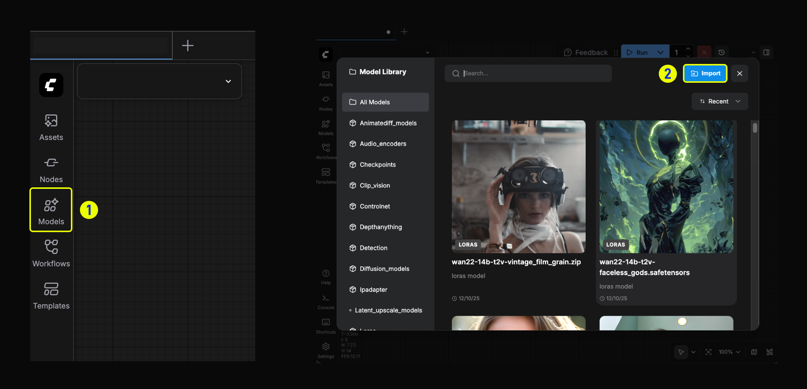
1. Нажмите кнопку **Models** в левой боковой панели, чтобы открыть Библиотеку моделей.
2. В окне Библиотеки моделей нажмите кнопку **Import**.

### 2. Вставьте ссылку
1. Вставьте ссылку на модель, полученную с Hugging Face или Civitai.
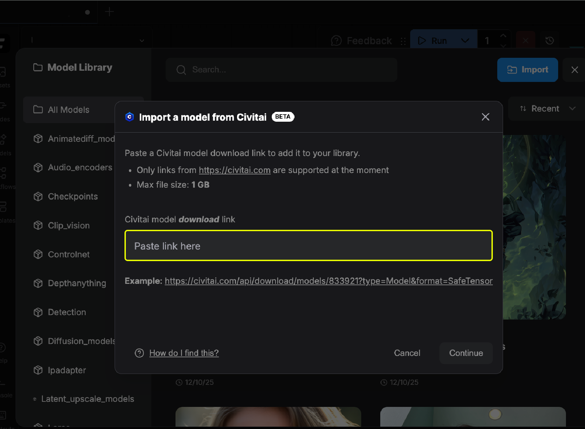

2. Если ссылка корректна, появится индикатор подтверждения, и вы сможете нажать кнопку `Continue`, чтобы продолжить.
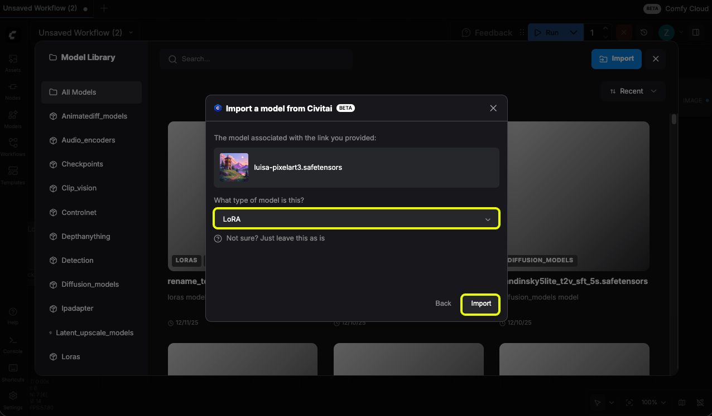

3. Выберите тип модели и целевую папку.
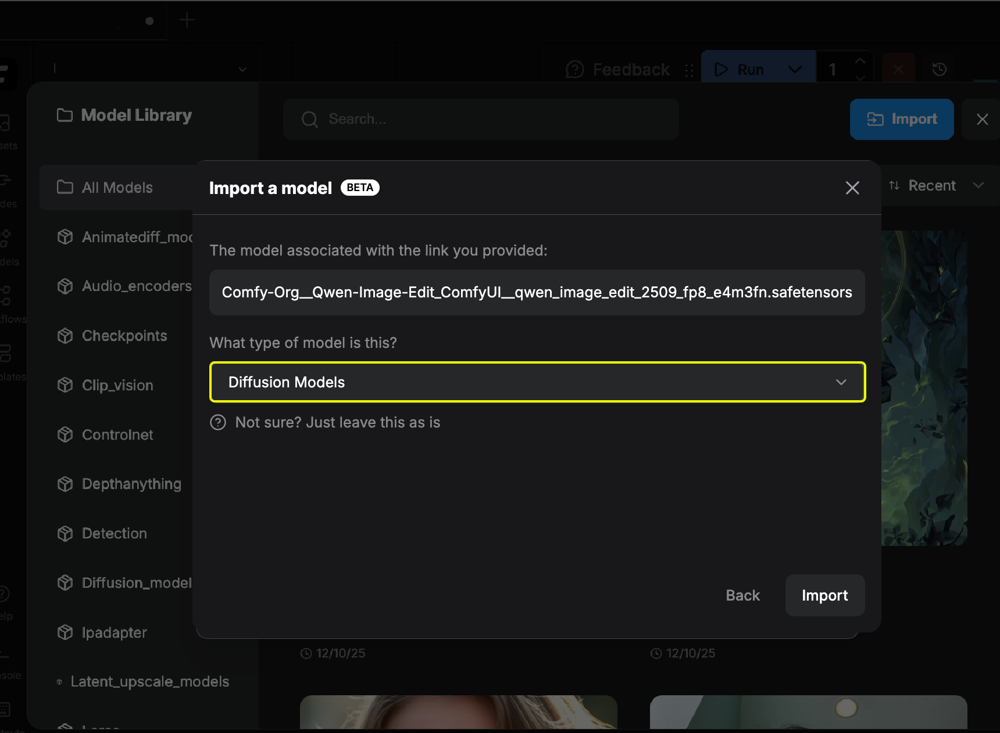

4. Дождитесь завершения загрузки модели.
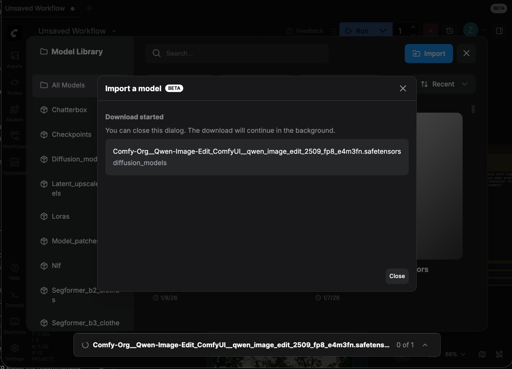

5. После загрузки модель появится в вашей Библиотеке моделей.

## Как просмотреть импортированные модели

В Библиотеке моделей выберите «Мои модели» в раскрывающемся списке фильтра, чтобы отфильтровать импортированные модели.

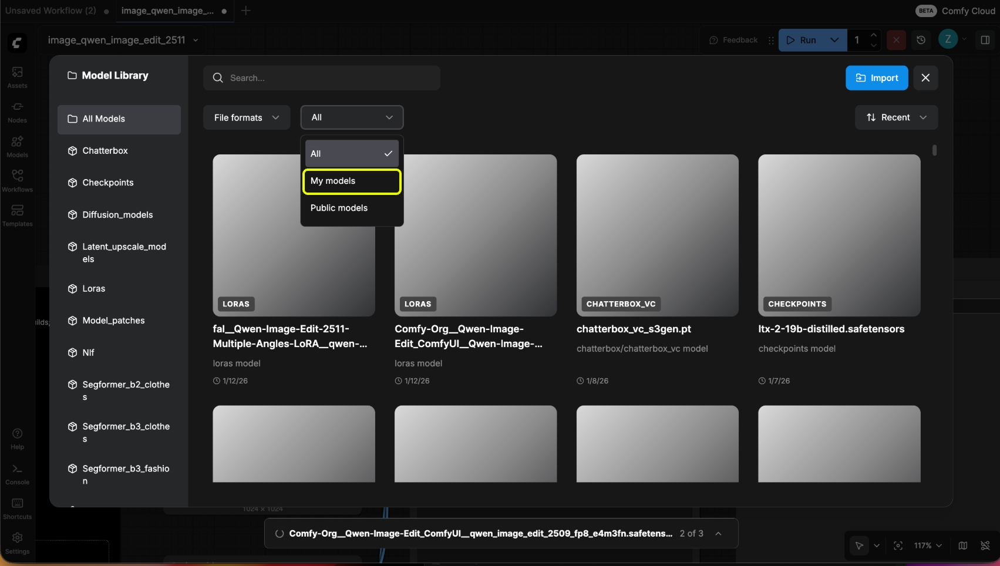

## Как получить ссылки для импорта модели

### 1. Получить ссылку с Civitai

1. Перейдите на [Civitai](https://civitai.com/) и найдите модель, которую хотите импортировать.
2. Нажмите правой кнопкой мыши на кнопку скачивания и выберите «Копировать адрес ссылки», чтобы получить ссылку на скачивание модели.

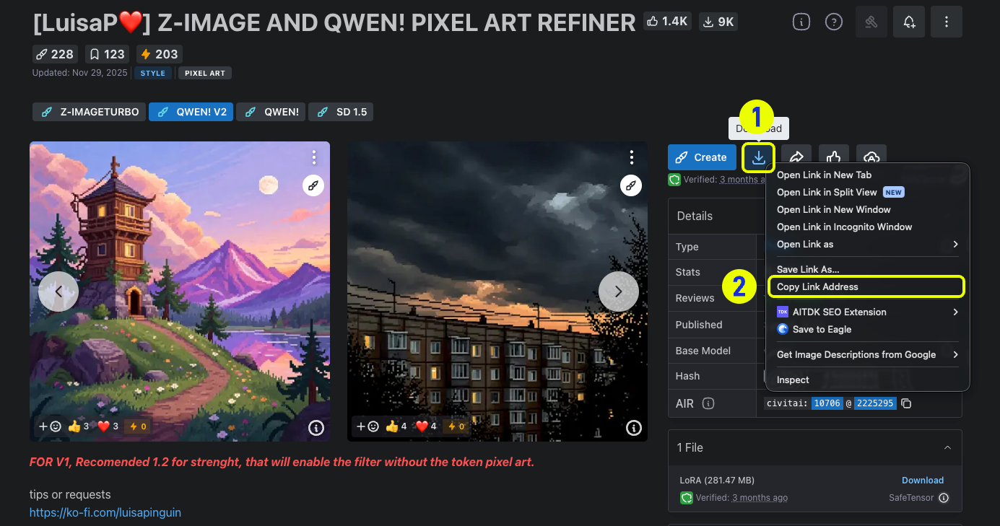

### 2. Получить ссылку с Hugging Face

1. Перейдите на [Hugging Face](https://huggingface.co/) и найдите репозиторий модели, который хотите импортировать.
2. Перейдите на страницу файлов модели. Поддерживаемый формат: `.safetensors`. Нажмите на название нужной модели, чтобы открыть страницу с подробностями.

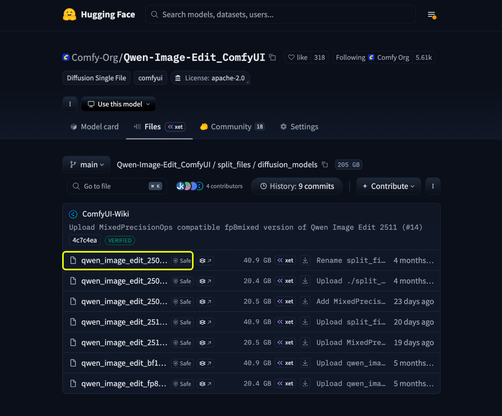

3. На странице с подробностями нажмите кнопку `Copy Download Link`, чтобы получить ссылку на скачивание модели.

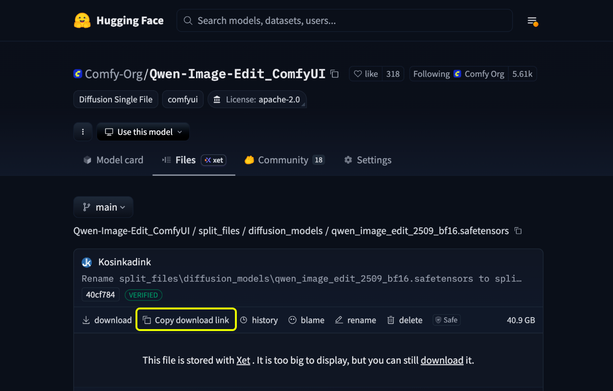

## Импортировать приватные модели

Если вы хотите импортировать приватные модели из Hugging Face или Civitai, сначала нужно настроить API-ключи.

### 1. Сгенерировать API-ключи

Сначала нужно сгенерировать API-ключи на соответствующих платформах:

<Tabs>
  <Tab title="Civitai">
    1. Войдите в Civitai и перейдите по адресу [https://civitai.com/user/account](https://civitai.com/user/account).
    2. Сгенерируйте API-ключ в настройках аккаунта.

    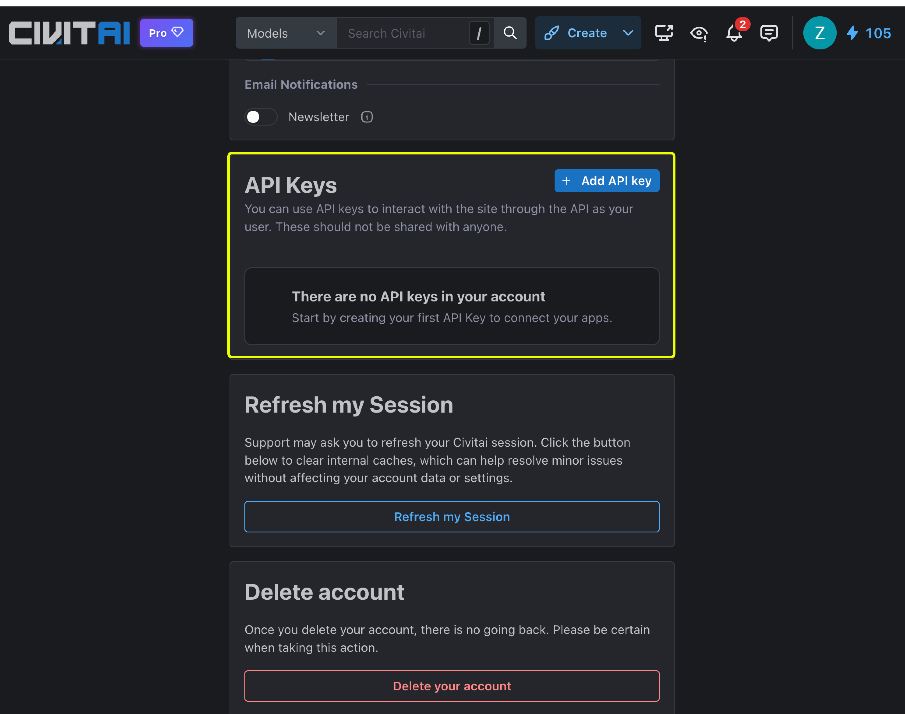
  </Tab>
  <Tab title="Hugging Face">
    1. Перейдите на [https://huggingface.co/settings/tokens](https://huggingface.co/settings/tokens).
    2. Сгенерируйте свой API-токен.

    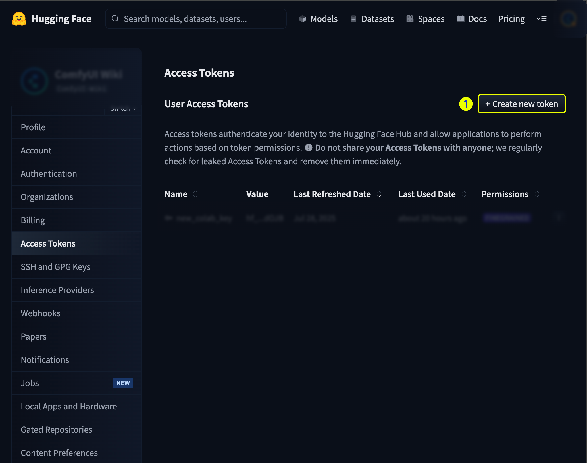

    3. Убедитесь, что у вашего токена есть доступ на чтение к репозиториям с приватными моделями, которые вы хотите импортировать.

    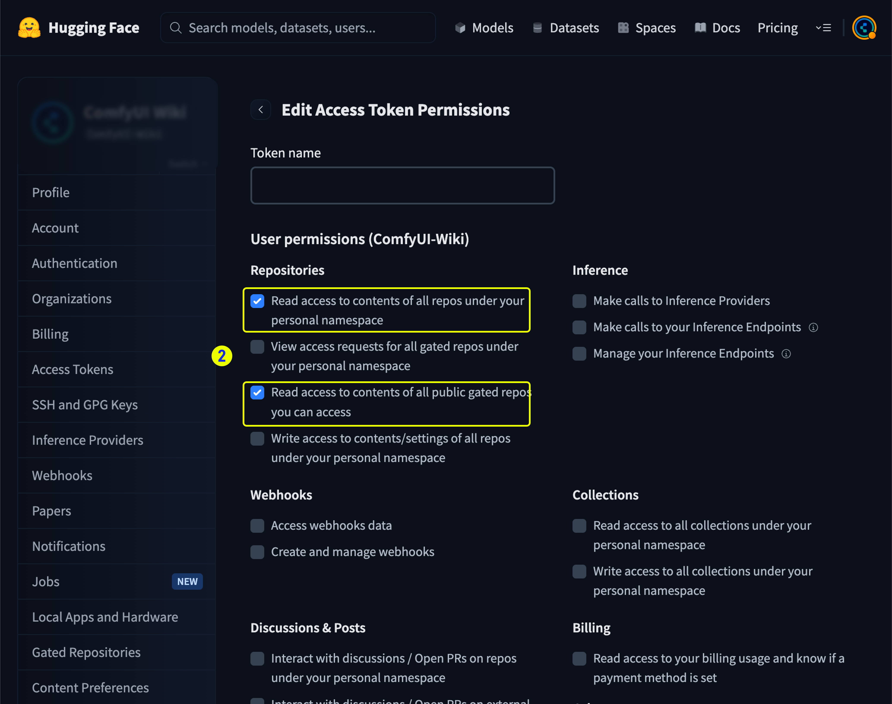
  </Tab>
</Tabs>

### 2. Сохранить API-ключи

1. Перейдите в [Настройки Comfy Cloud](https://cloud.comfy.org) и откройте раздел **Секреты**.

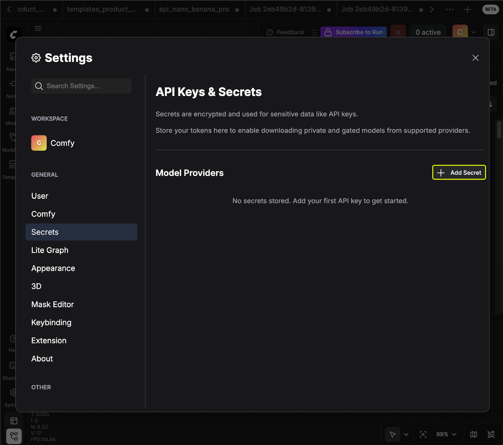

2. Нажмите, чтобы добавить API-ключи (назвать ключ можно как угодно):

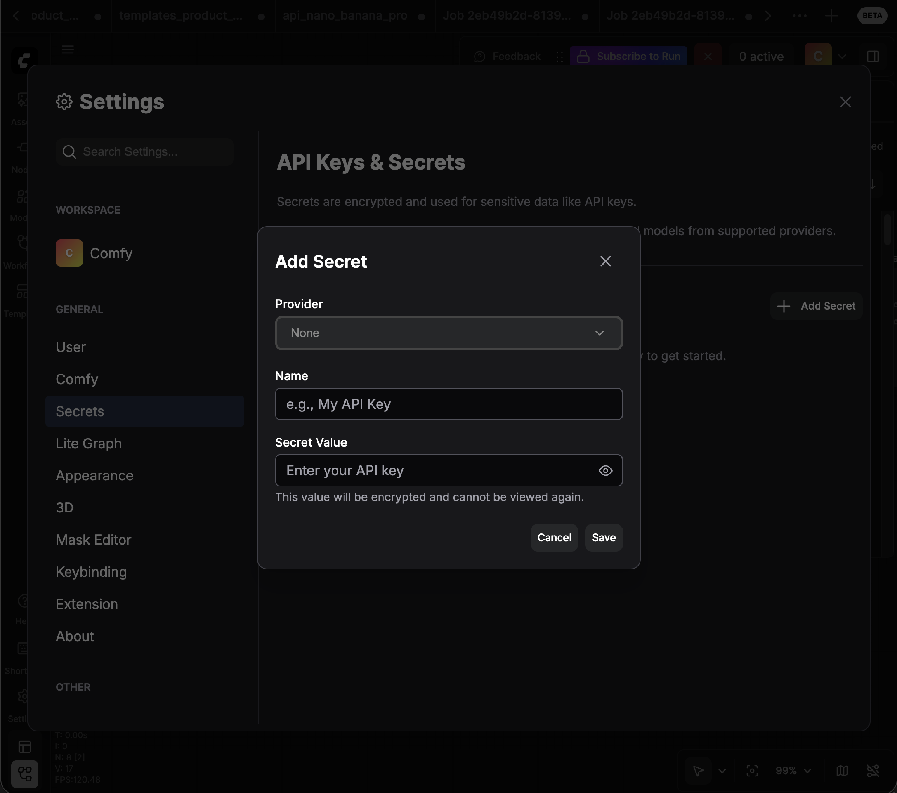

3. Убедитесь, что у ваших API-ключей есть разрешения на доступ к приватным моделям, которые вы хотите импортировать.

### 3. Импортировать приватную модель

Когда API-ключи настроены, вы можете импортировать приватные модели так же, как публичные:

1. Получите ссылку на модель из Hugging Face или Civitai.
2. Вставьте ссылку в модальном окне импорта.
3. Система автоматически использует ваши сохранённые API-ключи для доступа к приватной модели.

<Note>
Убедитесь, что у вашего API-ключа есть необходимые разрешения на доступ к конкретной приватной модели, которую вы хотите импортировать.
</Note>

## Часто задаваемые вопросы

<AccordionGroup>
  <Accordion title="Есть ли ограничения на модели, которые можно загрузить?">
    Да. Поддерживаются только файлы **safetensors**. Фактически ограничения на размер файла нет (до 100GB).
  </Accordion>

  <Accordion title="Загруженные модели приватны или доступны всем?">
    Импортированные модели **приватны для вас**. Только вы видите модели в своей библиотеке.
  </Accordion>

  <Accordion title="Можно ли загрузить собственные пользовательские модели с локального жёсткого диска?">
    Сейчас нужно сначала загрузить модель в **публичный репозиторий Hugging Face или Civitai**, а затем импортировать её с этих платформ.
  </Accordion>

  <Accordion title="Можно ли загружать файлы моделей, разбитые на части?">
    Нет. Перед импортом нужно объединить разбитые на части файлы модели в один файл.
  </Accordion>

  <Accordion title="Включена ли эта функция в мою текущую облачную подписку?">
    Эта функция доступна только в планах **Creator** и **Pro**.
  </Accordion>

  <Accordion title="Доступна ли эта функция в Desktop-версии или портативной версии Comfy?">
    Нет. Эта функция доступна **только в Comfy Cloud**.
  </Accordion>

  <Accordion title="Можно ли удалить загруженную модель?">
    Да. Вы можете удалять импортированные модели. Обратите внимание: модели, загруженные внутренней командой Comfy, удалить нельзя.
  </Accordion>

  <Accordion title="Какие типы моделей можно импортировать (BYOM)?">
    Не только примеры ниже. BYOM поддерживает любую папку моделей, которую Comfy Cloud показывает в **import type selector** при импорте. Этот список формируется из поддерживаемых Comfy Cloud папок моделей ComfyUI и является источником истины.

    На практике, если ComfyUI считает файл весами модели (чекпойнт, LoRA, VAE, ControlNet, embedding, upscaler, IP-Adapter, SAM, аудиокодер и подобное), вы можете импортировать его при условии, что эта папка есть в указанном селекторе.

    Типичные примеры:

    - **Чекпойнты и UNet**: `checkpoints`, `diffusion_models`
    - **LoRA и адаптеры**: `loras`, `animatediff_motion_lora`, `cogvideox_loras` и аналогичные папки адаптеров
    - **VAE**: `vae`, `vae_approx`
    - **ControlNet**: `controlnet`
    - **CLIP и текстовые энкодеры**: `clip_vision`, `text_encoders`
    - **embedding / textual inversion**: `embeddings` (ссылка в промптах `CLIPTextEncode` через `embedding:my-embedding-name`)
    - **Апскейлеры**: `upscale_models`, `latent_upscale_models`
    - **Vision / сегментация / удаление фона**: `ipadapter`, `gligen`, `sams`, `sam3`, `rmbg`, `ultralytics_bbox`, `ultralytics_segm`
    - **Другие папки в селекторе**: `audio_encoders`, `model_patches`, `style_models`, `photomaker`, `LLM`, `CogVideo` и другие

    На самом деле импорт ограничивает не категория модели, а следующие правила:

    - **Формат файла**: только `.safetensors` (даже если локальный ComfyUI поддерживает `.ckpt`, `.pth` или `.onnx` для этой папки)
    - **Источник**: только ссылки на скачивание с Civitai или Hugging Face (без прямой локальной загрузки)
    - **Заблокированная папка**: модели `nlf` импортировать нельзя
  </Accordion>
</AccordionGroup>
