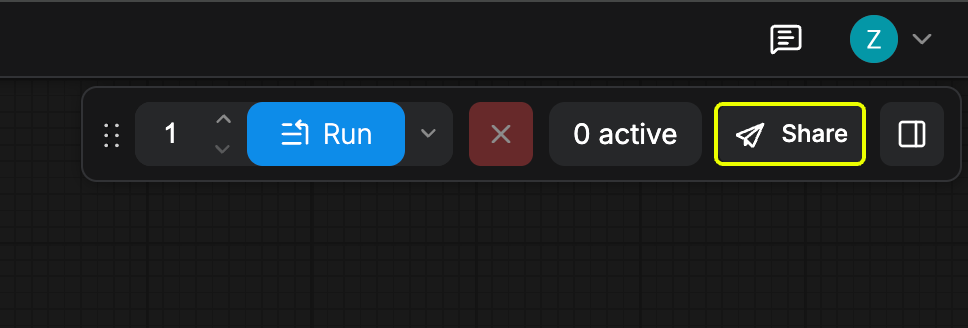
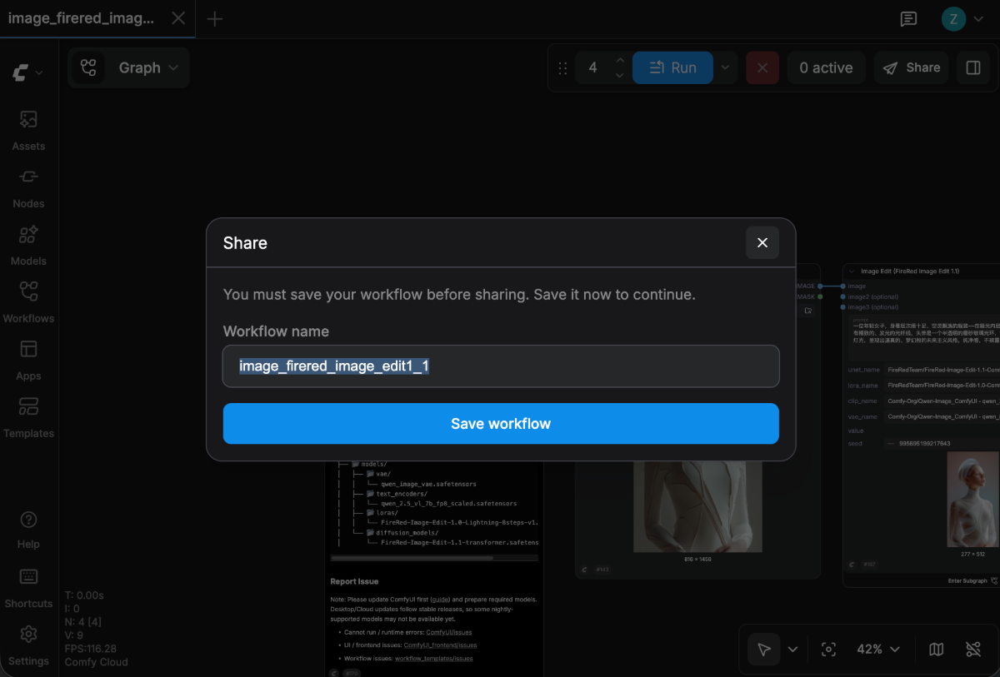
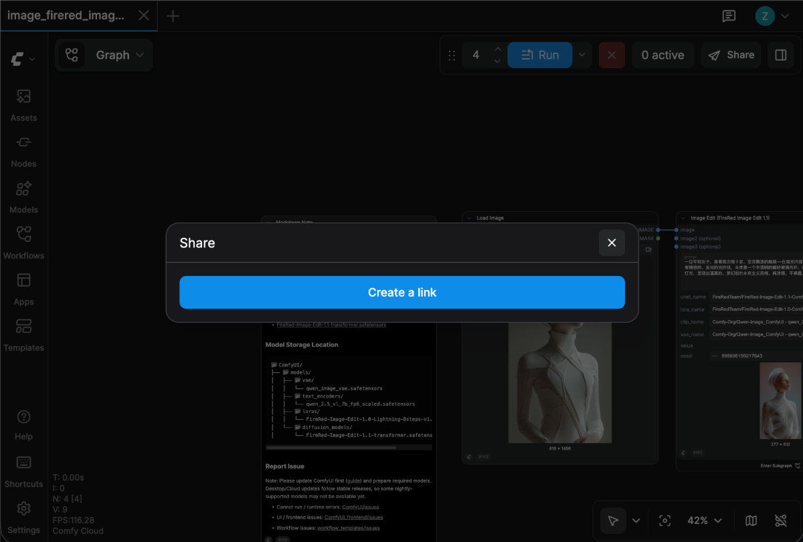
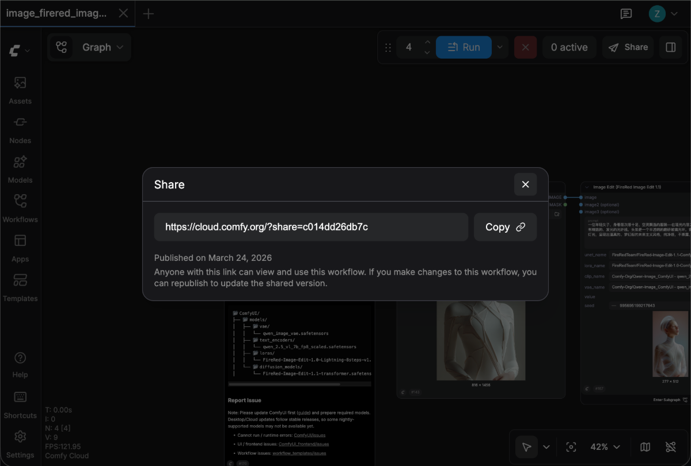
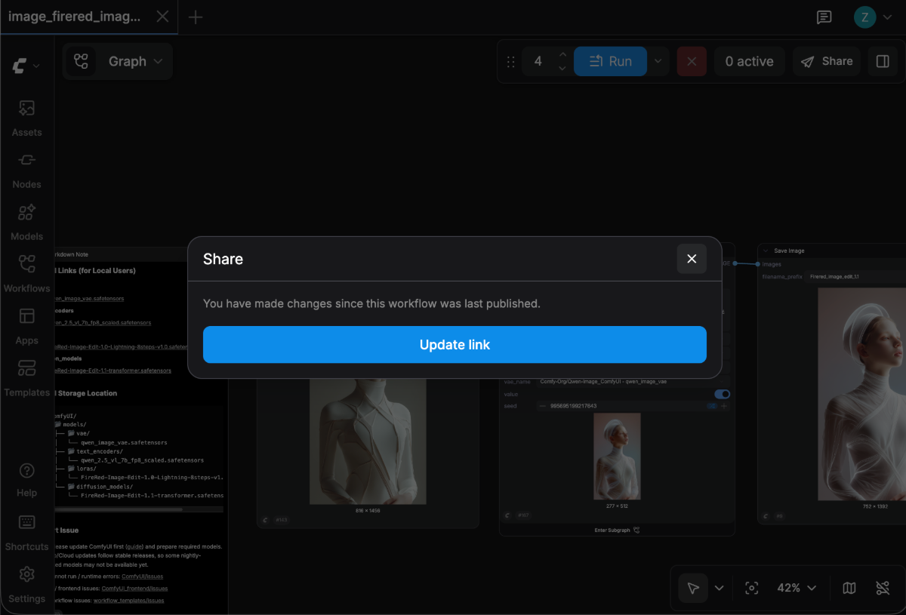

import CloudFeature from "/snippets/ru/cloud-feature.mdx"

<CloudFeature/>

## Обзор

Comfy Cloud позволяет делиться рабочими процессами с другими, создавая ссылку для общего доступа. Получатели могут просмотреть рабочий процесс вместе со всеми его входами, выходами и любыми ассетами, на которые он ссылается.

<Warning>
  **Ссылки для общего доступа включают ассеты вашего рабочего процесса.** Любой, у кого есть ссылка, увидит не только структуру рабочего процесса, но и используемые в нём медиафайлы: загруженные изображения, маски и другие файлы, связанные с узлами. Не делитесь ссылками на рабочие процессы, содержащие приватное или конфиденциальное содержимое.
</Warning>

## Как поделиться рабочим процессом

<Steps>
  <Step title="Создайте рабочий процесс">
    Создайте и доработайте рабочий процесс, которым хотите поделиться, в Comfy Cloud.
  </Step>
  <Step title="Нажмите кнопку «Поделиться»">
    В правом верхнем углу страницы рабочего процесса нажмите кнопку **Поделиться**.

    
  </Step>
  <Step title="Сохраните рабочий процесс">
    Если рабочий процесс ещё не сохранён, вам будет предложено ввести имя файла и сохранить его перед тем, как поделиться.

    
  </Step>
  <Step title="Создайте ссылку для общего доступа">
    После сохранения нажмите **Создать ссылку**, чтобы сгенерировать ссылку для общего доступа. Ссылка включает рабочий процесс, его входы и выходы, а также ассеты, используемые в графе.

    
  </Step>
  <Step title="Скопируйте ссылку и поделитесь ею">
    Когда ссылка создана, скопируйте её и отправьте всем, с кем хотите поделиться рабочим процессом.

    
  </Step>
</Steps>

## Обновить опубликованный рабочий процесс

Если вы изменили рабочий процесс, которым уже поделились:

1. Сохраните обновлённый рабочий процесс.
2. Снова нажмите кнопку **Поделиться**.
3. Выберите **Обновить**, чтобы обновить существующую ссылку последними изменениями.

Оригинальная ссылка автоматически отразит обновлённое содержимое рабочего процесса. Получатели по той же ссылке увидят последнюю версию.