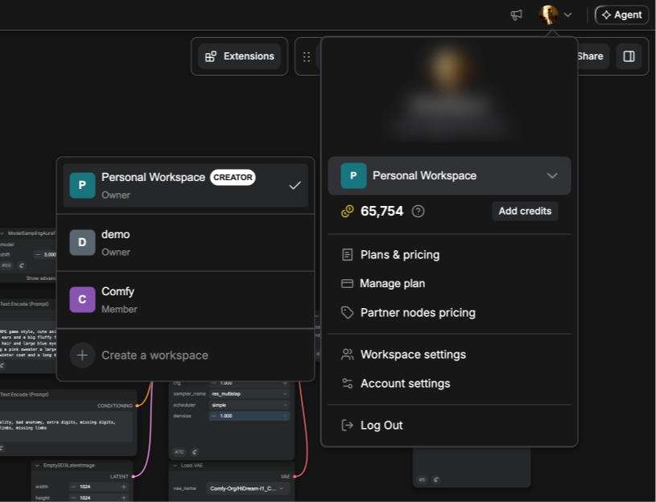
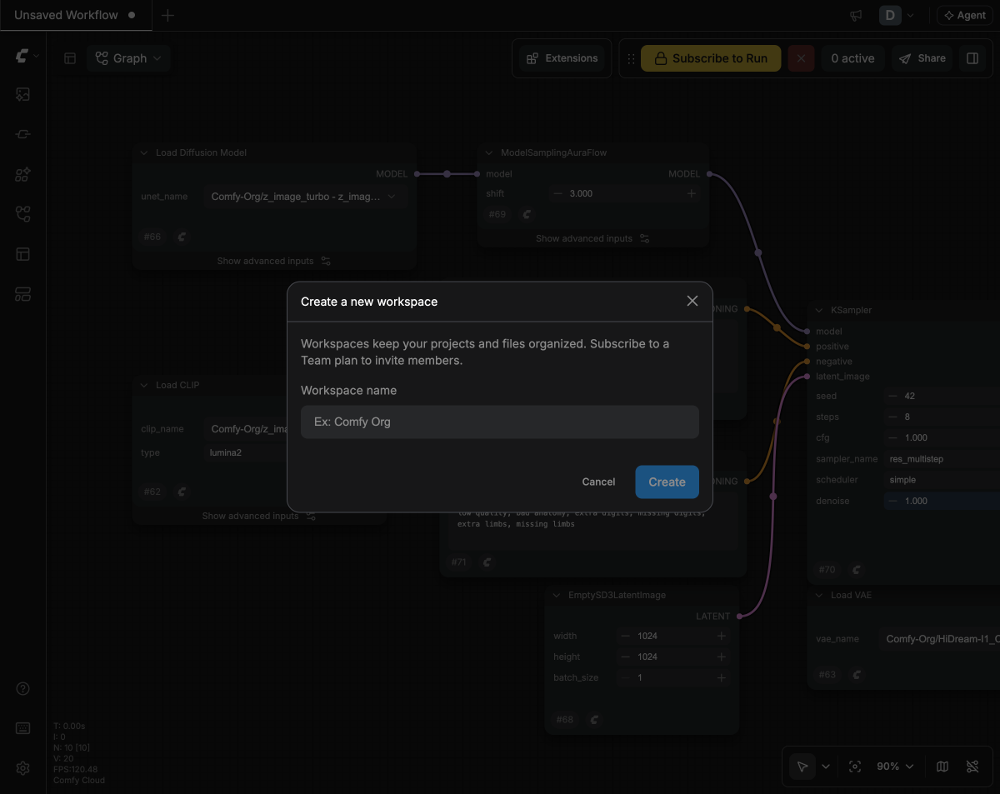
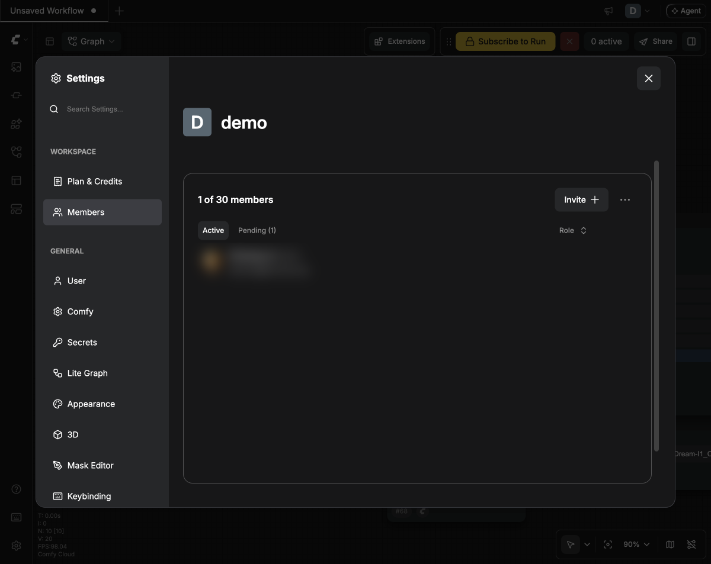
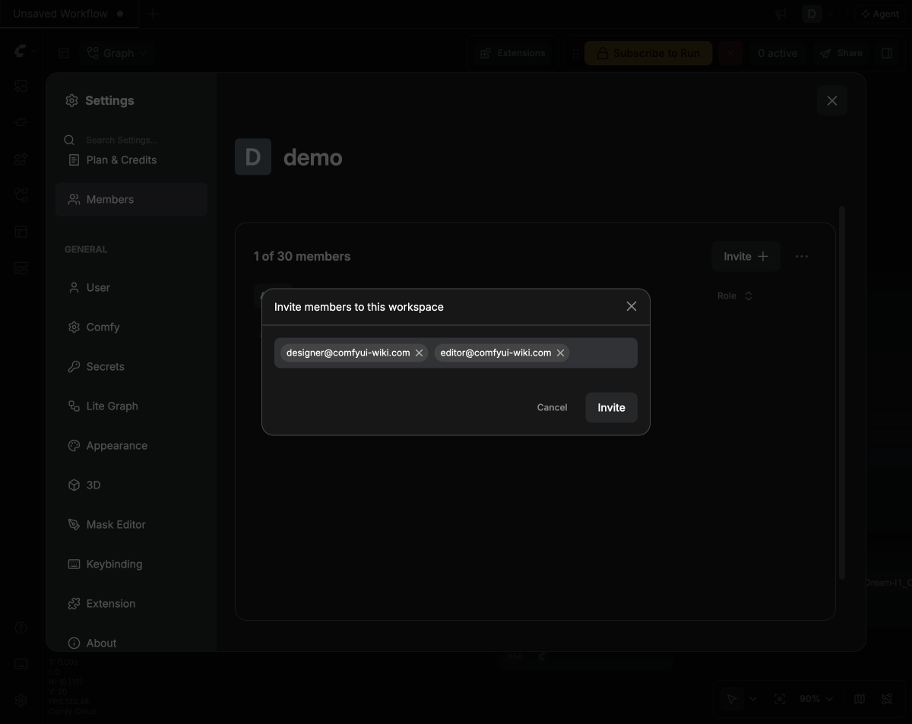
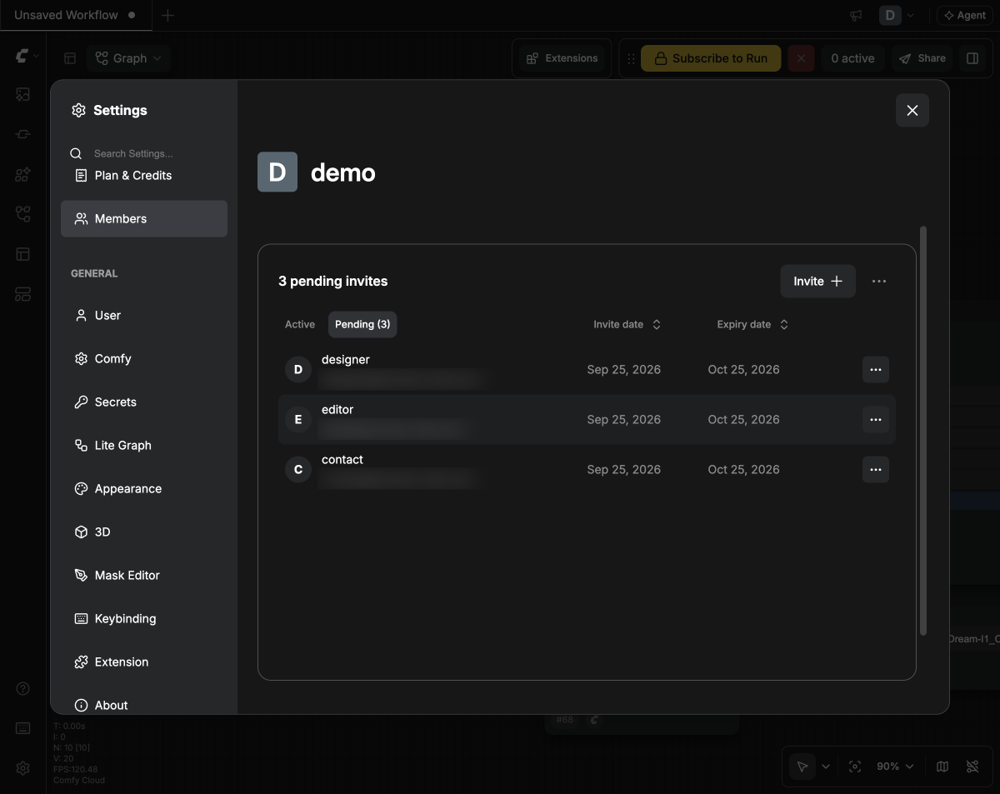
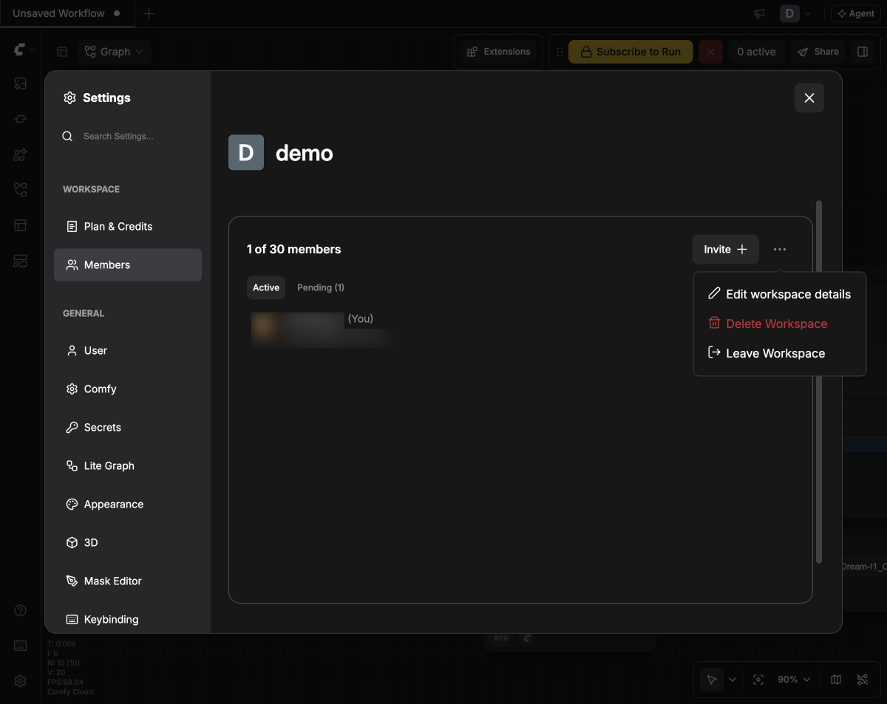
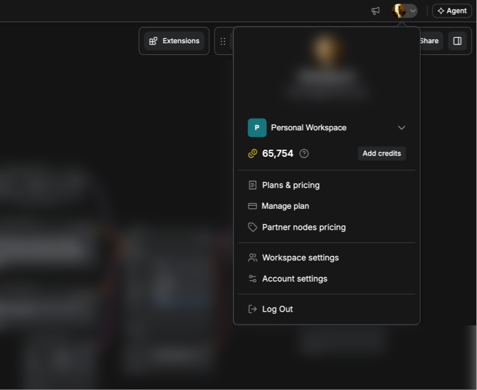

import CloudFeature from "/snippets/ru/cloud-feature.mdx"

<CloudFeature/>

## Обзор

Рабочее пространство задаёт границы учётной записи для вашей работы в Comfy Cloud. Рабочие процессы, загруженные файлы, выходы и кредиты принадлежат рабочему пространству, а не отдельному пользователю, поэтому при переключении рабочих пространств меняется то, какие файлы вы видите, и то, какие кредиты расходуют ваши запуски.

Каждый пользователь получает **Личное** рабочее пространство. Чтобы работать с другими людьми, создайте **Командное** рабочее пространство и пригласите их.

Если вас пригласили в командное рабочее пространство, ничего создавать не нужно: откройте письмо с приглашением, войдите с адресом, на который оно было отправлено, и переключитесь на это рабочее пространство. См. [Переключение рабочих пространств](#переключить-рабочие-пространства).

## Личные и командные рабочие пространства

| Тип | Что это |
|------|-------------|
| **Личное** | Создаётся автоматически для каждого пользователя и включает одно место. Доступ к нему есть только у вас. Его нельзя удалить, и вы не можете его покинуть. |
| **Команда** | Общее рабочее пространство, которое вы создаёте или в которое вас приглашают. Участники видят файлы рабочего пространства и совместно используют его кредиты. |

Создание командного рабочего пространства бесплатно. Чтобы приглашать людей, рабочему пространству нужны места: рабочее пространство без Командного тарифа имеет одно место, которое принадлежит его владельцу. Командные тарифы включают по одному месту для каждого участника.

## Что хранится отдельно в каждом рабочем пространстве

Каждое рабочее пространство хранит собственные:

- **Файлы и выходы**: загрузки, сгенерированные изображения, задания и история
- **Рабочие процессы**: библиотека рабочих процессов, которую вы видите в этом рабочем пространстве
- **Тариф и кредиты**: собственная подписка и баланс кредитов
- **Участники**: участники, роли и приглашения в ожидании
- **Доступ**: ключи API рабочего пространства, а в корпоративных рабочих пространствах также модели партнёров, которые участники могут запускать

Переключение рабочего пространства переключает всё это сразу, и между рабочими пространствами ничего не копируется автоматически.

## Создать командное рабочее пространство

<Steps>
  <Step title="Откройте меню профиля">
    Нажмите на изображение профиля в правом верхнем углу.
  </Step>
  <Step title="Откройте список рабочих пространств">
    Нажмите на название рабочего пространства в меню. В списке показаны все рабочие пространства, в которых вы состоите, и ваша роль в каждом из них.

    
  </Step>
  <Step title="Создайте рабочее пространство">
    Нажмите **Create a workspace** внизу списка.
  </Step>
  <Step title="Задайте название">
    Введите название и нажмите **Create**. Длина названия составляет от 1 до 50 символов, оно должно начинаться с буквы или цифры и может содержать буквы, цифры, пробелы и символы `- _ ' . , ( ) & +`.

    
  </Step>
</Steps>

Comfy Cloud переключает вас на новое рабочее пространство и перезагружает страницу.

<Note>
  Вы можете владеть максимум **10 рабочими пространствами** в общей сложности, включая ваше личное рабочее пространство. Нет ограничений на то, к скольким рабочим пространствам вы можете присоединиться как участник.
</Note>

Чтобы открыть список рабочих пространств напрямую, добавьте `?create_workspace=1` к URL Comfy Cloud, например `https://cloud.comfy.org/?create_workspace=1`. Откроется диалоговое окно командных рабочих пространств, в котором перечислены ваши рабочие пространства, есть поле **New workspace** и кнопка **Create workspace**.

## Приглашение участников

Приглашать участников могут только владельцы рабочего пространства. В командных тарифах каждому участнику предусмотрено место, а на вкладке **Участники** показано, сколько мест занято, например `3 of 20 members`. Ожидающие приглашения учитываются в этом лимите. Сегодня рабочее пространство может вмещать до 50 участников; если вам нужно больше, [свяжитесь с поддержкой](https://support.comfy.org/).

Чтобы пригласить участников:

<Steps>
  <Step title="Открыть настройки рабочего пространства">
    В меню профиля нажмите **Настройки рабочего пространства**.
  </Step>
  <Step title="Открыть раздел «Участники»">
    Выберите **Участники**.
  </Step>
  <Step title="Отправить приглашения">
    Нажмите **Пригласить**, введите один или несколько адресов электронной почты через запятую, затем нажмите **Пригласить** в диалоговом окне.
  </Step>
</Steps>

<Note>
  Если при нажатии на **Пригласить** диалоговое окно не открывается, значит, в рабочем пространстве нет свободного места. В рабочем пространстве не на командном тарифе есть одно место, а при заполненной команде отображается подсказка о максимальном числе участников. Откройте **План и кредиты** и обновите тариф до командного или свяжитесь с нами насчёт корпоративного тарифа, если вам нужно больше участников.
</Note>

Comfy Cloud отправляет каждому человеку ссылку для присоединения по электронной почте. Приглашение привязано к адресу, на который оно было отправлено, поэтому получатель должен войти или создать аккаунт с этим же адресом. Если при открытии ссылки вход не выполнен, получателю сначала предлагается войти, а приглашение применяется после этого.

Приглашения, которые ещё не приняты, отображаются на вкладке **В ожидании** раздела «Участники» с датой истечения. Эту вкладку видят владельцы; участникам доступен только список тех, кто уже присоединился. Оттуда владелец может:

- **Скопировать ссылку-приглашение**: поделиться ссылкой напрямую, не дожидаясь письма
- **Повторно отправить приглашение**: отправить письмо ещё раз с новой ссылкой
- **Отменить приглашение**: отозвать приглашение

Приглашения истекают через 30 дней после отправки.

## Роли и разрешения

| Роль | Что можно делать |
|------|--------|
| **Владелец** | Приглашать и удалять участников, менять роли, переименовывать или удалять рабочее пространство, а также управлять тарифом и кредитами рабочего пространства. |
| **Участник** | Запускать рабочие процессы в рабочем пространстве и просматривать список участников. Не может приглашать участников, видеть ожидающие приглашения, менять настройки рабочего пространства и управлять оплатой. |

Владельцы могут изменить роль участника в разделе «Участники»: так участника повышают до владельца или понижают владельца обратно до участника. В рабочем пространстве всегда остаётся хотя бы один владелец, поэтому последнего оставшегося владельца нельзя понизить или удалить. В некоторых сообщениях Comfy Cloud владелец называется администратором рабочего пространства; это одна и та же роль.

Участники могут открыть **Настройки рабочего пространства** и увидеть тариф рабочего пространства и список участников, но не могут ничего там изменить. Когда владелец удаляет участника, этот человек теряет доступ к файлам и рабочим процессам рабочего пространства, место освобождается, а все созданные этим человеком API-ключи рабочего пространства перестают работать. Участники не могут удалить себя сами; вместо этого они покидают рабочее пространство. Покинуть рабочее пространство недоступно создателю рабочего пространства, единственному владельцу и участникам, членством которых управляет организация.

## Управление рабочим пространством

Откройте **Настройки рабочего пространства** в меню профиля. Группа **Рабочее пространство** в диалоге настроек содержит следующие разделы:

- **План и кредиты**: тариф рабочего пространства, баланс кредитов и пополнения. Изменять их может только владелец.
- **Участники**: список участников, роли и приглашения в ожидании. Приглашения в ожидании видны владельцам.
- **Список разрешённых**: отображается владельцам рабочего пространства. Ограничение того, какие модели провайдеров могут запускать участники, доступно в тарифе Enterprise. Отключите **Разрешить все партнерские модели**, чтобы выбрать, каких провайдеров и модели могут запускать участники; модели, добавленные позже, остаются отключёнными, пока вы их не включите. Применение изменений во всём рабочем пространстве может занять до 10 минут.

Меню в разделе **Участники** позволяет владельцам:

- **Редактировать детали рабочего пространства**: переименовать рабочее пространство
- **Удалить рабочее пространство**: доступно, когда у рабочего пространства нет активной подписки. См. [Удалить командное рабочее пространство](#удалить-командное-рабочее-пространство).
- **Покинуть рабочее пространство**: покинуть командное рабочее пространство. Пункт недоступен, если вы создали рабочее пространство, если вы его единственный владелец (сначала назначьте владельцем другого участника) или если ваша организация управляет вашим членством.

Участники тоже видят это меню, но только пункт **Покинуть рабочее пространство**.

### Удалить командное рабочее пространство

Удалить командное рабочее пространство может только его владелец, и у рабочего пространства не должно быть активной подписки. Удаление рабочего пространства необратимо: неиспользованные кредиты и несохранённые ассеты теряются, восстановить рабочее пространство невозможно. Личное рабочее пространство удалить нельзя, а корпоративные рабочие пространства управляются нашей командой продаж.

<Steps>
  <Step title="Отменить тариф">
    В **Настройках рабочего пространства** → **План и кредиты** откройте меню с тремя точками и выберите **Отменить тариф**. Если у рабочего пространства нет подписки, пропустите этот шаг.
  </Step>
  <Step title="Удалить рабочее пространство">
    В **Настройках рабочего пространства** → **Участники** откройте меню с тремя точками и выберите **Удалить рабочее пространство**, затем подтвердите действие в диалоге.
  </Step>
</Steps>

## Переключить рабочие пространства

1. Откройте меню профиля.
2. Нажмите на название рабочего пространства, чтобы открыть список рабочих пространств.
3. Выберите рабочее пространство, в котором хотите работать.

Comfy Cloud перезагружает страницу на выбранном рабочем пространстве и запоминает его при следующем входе.

| Параметр URL | Действие |
|------|--------|
| `?create_workspace=1` | Открывает список рабочих пространств с полем **Новое рабочее пространство** и кнопкой **Создать рабочее пространство** |
| `?invite=TOKEN` | Принимает приглашение в рабочее пространство |

## Как оплачиваются рабочие пространства

Тарифы и кредиты принадлежат рабочему пространству, а не отдельным аккаунтам.

**Личные рабочие пространства** используют ваш собственный тариф, и только вы расходуете его кредиты.

**Командные рабочие пространства** используют подписку на кредиты, которую настраивает владелец:

- Владелец выбирает ежемесячное количество кредитов рабочего пространства в **Choose a Plan** (**For Teams**) с помощью ползунка кредитов. Цена зависит от выбранного количества, и большее обязательство снижает эффективную ставку. Каждый расчётный период пополняет пул на это количество.
- Ежегодные обязательства стоят меньше ежемесячных, и рабочее пространство получает кредиты за весь год сразу.
- Участникам не выставляются счета по отдельности, и добавление или удаление участников не меняет цену. Тариф включает места рабочего пространства. Если вам нужно больше участников, чем включает тариф, свяжитесь с нами, чтобы обсудить Корпоративный тариф.
- Все участники расходуют кредиты из одного общего пула.
- Кредиты из подписки расходуются раньше пополненных кредитов, а пополненные кредиты действительны 12 месяцев.
- Переключение рабочего пространства на личный тариф немедленно удаляет всех остальных участников, поэтому перенесите общие материалы до переключения.

Актуальные тарифы и скидки приведены на странице [цены Comfy Cloud](https://www.comfy.org/cloud/pricing). Чтобы настроить командный тариф, [подпишитесь на Comfy Cloud](/ru/support/subscription/subscribing), а об изменении тарифа читайте в разделе [Измените тариф Comfy Cloud](/ru/support/subscription/changing-plan).

## Частые вопросы

<AccordionGroup>
  <Accordion title="Можно ли состоять более чем в одном командном рабочем пространстве?">
    Да. Вы можете владеть в общей сложности до 10 рабочими пространствами, включая Личное рабочее пространство, и быть участником любого количества рабочих пространств, в которые вас пригласили.
  </Accordion>

  <Accordion title="Нужна ли собственная подписка, чтобы присоединиться к командному рабочему пространству?">
    Нет. Участникам счёт отдельно не выставляется: запуски в рабочем пространстве расходуют кредиты рабочего пространства, которыми управляет его владелец.
  </Accordion>

  <Accordion title="Что сохраняется при обновлении рабочего пространства до Командного тарифа?">
    Всё. Обновление применяется к самому рабочему пространству, поэтому его рабочие процессы, модели, история запусков и пополненные кредиты остаются на месте. Исключение: неиспользованные кредиты месячного плана, которые сгорают в конце текущего расчётного периода, так как рабочее пространство переходит на новый лимит кредитов. Пополненные кредиты переносятся.
  </Accordion>

  <Accordion title="Как участники передают работу друг другу?">
    Командный тариф объединяет один пул кредитов, один счёт и один набор владельцев. Общий доступ к рабочим процессам и ассетам внутри рабочего пространства всё ещё в разработке. Пока эта возможность не выпущена, передавайте работу, делясь ссылкой на рабочий процесс, экспортируя JSON рабочего процесса или перетаскивая сгенерированный в Comfy ассет на холст другого участника.
  </Accordion>

  <Accordion title="Письмо с приглашением так и не пришло. Что делать?">
    Попросите владельца рабочего пространства использовать **Resend invite** или отправить вам **Copy invite link** на вкладке **Pending** раздела Members. Приглашения действуют 30 дней с момента отправки, поэтому старое приглашение, возможно, придётся отправить повторно.
  </Accordion>

  <Accordion title="Можно ли удалить Личное рабочее пространство?">
    Нет. Ваше Личное рабочее пространство является постоянным и служит рабочим пространством по умолчанию.
  </Accordion>

  <Accordion title="Можно ли пригласить кого-то в Личное рабочее пространство?">
    Нет. В личном рабочем пространстве одно место и нет управления участниками.
  </Accordion>

  <Accordion title="Что происходит, когда я покидаю командное рабочее пространство?">
    Рабочее пространство исчезает из вашего списка рабочих пространств, и вы теряете доступ к его файлам и рабочим процессам. Все созданные вами API-ключи этого рабочего пространства перестают работать. Ваше Личное рабочее пространство и его содержимое не затрагиваются.
  </Accordion>

  <Accordion title="Что происходит, если в рабочем пространстве закончились кредиты?">
    Участники не могут запускать рабочие процессы, пока владелец не добавит кредиты. То же самое происходит, когда подписка рабочего пространства неактивна или платёж не проходит: попросите владельца рабочего пространства исправить тариф или способ оплаты.
  </Accordion>

  <Accordion title="Почему **Delete Workspace** недоступно?">
    У рабочего пространства всё ещё есть активная подписка. Сначала отмените её с помощью **Cancel plan** в **Plan & Credits**, затем удалите рабочее пространство. **Delete Workspace** становится доступным сразу после отмены тарифа, поэтому ждать окончания расчётного периода не нужно. Личные рабочие пространства удалить нельзя вообще, а корпоративные рабочие пространства закрываются через нашу команду продаж.
  </Accordion>

  <Accordion title="Можно ли восстановить удалённое рабочее пространство?">
    Нет. Удаление рабочего пространства необратимо.
  </Accordion>
</AccordionGroup>
