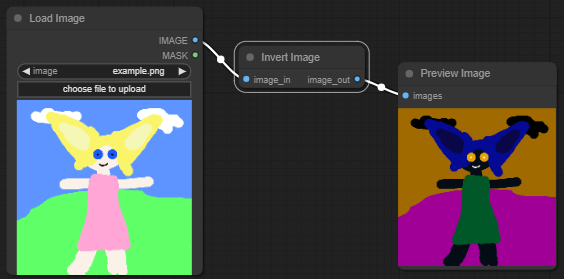

Пользовательские узлы позволяют реализовывать новые возможности и делиться ими с сообществом.

Пользовательский узел устроен так же, как любой узел ComfyUI: он получает вход, что-то с ним делает и выдаёт результат.
Некоторые пользовательские узлы выполняют крайне сложные задачи, но многие делают всего одну вещь. Вот пример
простого узла, который получает изображение и инвертирует его.

Примеры пользовательских узлов:
- [cookiecutter-comfy-extension](https://github.com/Comfy-Org/cookiecutter-comfy-extension)
- [ComfyUI-React-Extension-Template](https://github.com/Comfy-Org/ComfyUI-React-Extension-Template)
- [ComfyUI_frontend_vue_basic](https://github.com/jtydhr88/ComfyUI_frontend_vue_basic)

Если вы используете Claude Code для разработки, [ComfyUI Custom Node Skills](https://github.com/jtydhr88/comfyui-custom-node-skills) даёт Claude исчерпывающие знания о системе узлов ComfyUI, охватывая как V3, так и V1 API. Установите его из маркетплейса Claude Code или добавьте URL репозитория, чтобы получить 9 навыков: основы работы с узлами, входы, выходы, типы данных, расширенные паттерны, расширения фронтенда и упаковку.

## Модель клиент-сервер

Comfy работает по модели клиент-сервер. Сервер, написанный на Python, выполняет всю основную работу: обработку данных, работу с моделями, diffusion изображений и т. д. Клиент, написанный на JavaScript, отвечает за пользовательский интерфейс.

Comfy также можно использовать в режиме API: в этом случае рабочий процесс отправляется на сервер клиентом, не являющимся Comfy (например, другим интерфейсом или скриптом командной строки).

Пользовательские узлы можно отнести к одной из четырёх категорий:

### Только на стороне сервера

Большинство пользовательских узлов работают исключительно на стороне сервера: они определяют класс Python, который задаёт типы входов и выходов, и предоставляют функцию, которую можно вызвать для обработки входов и получения результата.

### Только на стороне клиента

Некоторые пользовательские узлы изменяют пользовательский интерфейс клиента, но не добавляют основной функциональности. Несмотря на название, они могут даже не добавлять в систему новые узлы.

### Независимые клиент и сервер

Пользовательские узлы могут добавлять дополнительные возможности на стороне сервера и связанные с ними функции интерфейса (например, новый виджет для нового типа данных). В большинстве случаев взаимодействие между клиентом и сервером обеспечивается механизмом управления потоком данных Comfy.

### Связанные клиент и сервер

В редких случаях функции интерфейса и сервер должны напрямую взаимодействовать друг с другом.

<Warning>Любой узел, которому требуется обмен данными между клиентом и сервером, не будет совместим с использованием через API.</Warning>

## Дальнейшие шаги

<CardGroup cols={2}>
  <Card title="Начало работы" icon="play" href="/ru/custom-nodes/walkthrough">
    Создайте и зарегистрируйте работающий пользовательский узел, шаг за шагом.
  </Card>
  <Card title="Python (бэкенд)" icon="python" href="/ru/custom-nodes/backend/server_overview">
    Контракт класса узла: свойства, входы, типы возвращаемых значений.
  </Card>
  <Card title="JavaScript (UI)" icon="js" href="/ru/custom-nodes/js/javascript_overview">
    Расширьте фронтенд ComfyUI из вашего пакета узлов.
  </Card>
  <Card title="Упаковка и публикация" icon="box" href="/ru/registry/publishing">
    Опубликуйте узел в Comfy Registry.
  </Card>
</CardGroup>
