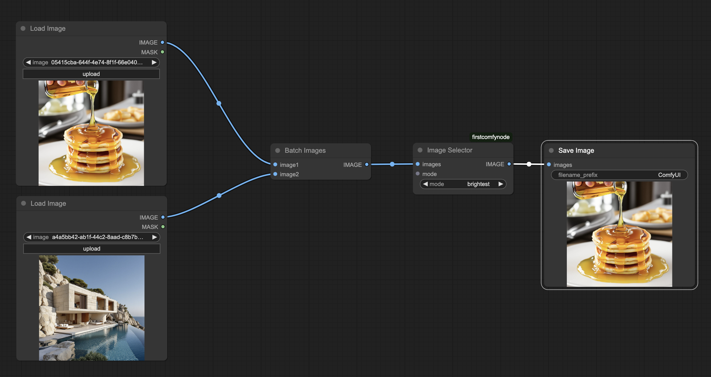

Эта страница шаг за шагом проведёт вас через процесс создания пользовательского узла.

В нашем примере мы возьмём пакет изображений и вернём одно из изображений. Изначально узел
будет возвращать изображение, которое в среднем является самым светлым по цвету; затем мы расширим
его, добавив набор критериев выбора, и наконец добавим немного клиентского кода.

Для понимания этой страницы достаточно минимальных знаний Python или Javascript.

После этого пошагового руководства перейдите к подробностям [кода бэкенда](./backend/server_overview) и
[кода фронтенда](./js/javascript_overview).

## Написать базовый узел

### Предварительные требования

- Работающая [установка](/ru/installation/manual_install) ComfyUI. Для разработки мы рекомендуем устанавливать ComfyUI вручную.
- Работающая [установка](/ru/comfy-cli/getting-started) comfy-cli.

### Настройка

```bash
cd ComfyUI/custom_nodes
comfy node scaffold
```

После ответа на несколько вопросов у вас будет создан новый каталог.

```bash
 ~  % comfy node scaffold
You've downloaded .cookiecutters/cookiecutter-comfy-extension before. Is it okay to delete and re-download it? [y/n] (y): y
  [1/9] full_name (): Comfy
  [2/9] email (you@gmail.com): me@comfy.org
  [3/9] github_username (your_github_username): comfy
  [4/9] project_name (My Custom Nodepack): FirstComfyNode
  [5/9] project_slug (firstcomfynode): 
  [6/9] project_short_description (A collection of custom nodes for ComfyUI): 
  [7/9] version (0.0.1): 
  [8/9] Select open_source_license
    1 - GNU General Public License v3
    2 - MIT license
    3 - BSD license
    4 - ISC license
    5 - Apache Software License 2.0
    6 - Not open source
    Choose from [1/2/3/4/5/6] (1): 1
  [9/9] include_web_directory_for_custom_javascript [y/n] (n): y
Initialized empty Git repository in firstcomfynode/.git/
✓ Custom node project created successfully!
```

### Определить узел

Добавьте следующий код в конец `src/nodes.py`:

```Python src/nodes.py
class ImageSelector:
    CATEGORY = "example"
    @classmethod    
    def INPUT_TYPES(s):
        return { "required":  { "images": ("IMAGE",), } }
    RETURN_TYPES = ("IMAGE",)
    FUNCTION = "choose_image"
```

<Info>Базовая структура пользовательского узла подробно описана [здесь](/ru/custom-nodes/backend/server_overview). </Info>

Пользовательский узел определяется с помощью класса Python, который должен включать следующие четыре элемента: `CATEGORY` задаёт, где в меню добавления нового узла будет расположен пользовательский узел; `INPUT_TYPES` представляет собой метод класса, определяющий, какие входы принимает узел (подробнее о возвращаемом словаре см. [позже](/ru/custom-nodes/backend/server_overview#input_types)); `RETURN_TYPES` определяет, какие выходы создаст узел; `FUNCTION` задаёт имя функции, которая будет вызвана при выполнении узла.

<Tip>Обратите внимание, что типом данных для входа и выхода является `IMAGE` (единственное число), хотя мы ожидаем получить пакет изображений, а возвращаем только одно. В Comfy `IMAGE` означает пакет изображений, а одно изображение рассматривается как пакет размером 1.</Tip>

### Основная функция

Основная функция `choose_image` получает именованные аргументы, определённые в `INPUT_TYPES`, и возвращает `tuple`, определённый в `RETURN_TYPES`. Поскольку мы имеем дело с изображениями, которые внутри хранятся как `torch.Tensor`,

```Python
import torch
```

Затем добавьте функцию в свой класс. Тип данных изображения: `torch.Tensor` с формой `[B,H,W,C]`, где `B` это размер пакета, а `C` это количество каналов (3 для RGB). Если мы выполним итерацию по такому тензору, то получим набор из `B` тензоров формы `[H,W,C]`. Метод `.flatten()` превращает его в одномерный тензор длиной `H*W*C`, `torch.mean()` вычисляет среднее, а `.item()` превращает тензор из одного значения в число Python с плавающей точкой.

```Python
def choose_image(self, images):
    brightness = list(torch.mean(image.flatten()).item() for image in images)
    brightest = brightness.index(max(brightness))
    result = images[brightest].unsqueeze(0)
    return (result,)
```

Замечания по последним двум строкам:

- `images[brightest]` вернёт тензор формы `[H,W,C]`. `unsqueeze` используется, чтобы вставить измерение (длиной 1), в данном случае в нулевое измерение, что даёт нам `[B,H,W,C]` с `B=1`: одно изображение.
- в `return (result,)` завершающая запятая обязательна, чтобы гарантировать возврат кортежа.

### Зарегистрировать узел

Чтобы Comfy распознал новый узел, он должен быть доступен на уровне пакета. Измените переменную `NODE_CLASS_MAPPINGS` в конце `src/nodes.py`. Чтобы увидеть изменения, необходимо перезапустить ComfyUI.

```Python src/nodes.py

NODE_CLASS_MAPPINGS = {
    "Example" : Example,
    "Image Selector" : ImageSelector,
}

# При необходимости можно переименовать узел в словаре `NODE_DISPLAY_NAME_MAPPINGS`.
NODE_DISPLAY_NAME_MAPPINGS = {
    "Example": "Example Node",
    "Image Selector": "Image Selector",
}
```

<Info>Подробное объяснение того, как ComfyUI обнаруживает и загружает пользовательские узлы, см. в [документации по жизненному циклу узла](/ru/custom-nodes/backend/lifecycle).</Info>

## Добавить параметры

Этот узел, возможно, слишком скучный, поэтому добавим несколько параметров: виджет, который позволяет
выбирать самое яркое изображение, а также самое красное, самое синее или самое зелёное. Отредактируйте `INPUT_TYPES` так:

```Python
@classmethod    
def INPUT_TYPES(s):
    return { "required":  { "images": ("IMAGE",), 
                            "mode": (["brightest", "reddest", "greenest", "bluest"],)} }
```

Затем обновите основную функцию. Мы воспользуемся довольно наивным определением «самого красного»: среднее
значение `R` по пикселям, делённое на среднее по всем трём каналам. Итак:

```Python
def choose_image(self, images, mode):
    batch_size = images.shape[0]
    brightness = list(torch.mean(image.flatten()).item() for image in images)
    if (mode=="brightest"):
        scores = brightness
    else:
        channel = 0 if mode=="reddest" else (1 if mode=="greenest" else 2)
        absolute = list(torch.mean(image[:,:,channel].flatten()).item() for image in images)
        scores = list( absolute[i]/(brightness[i]+1e-8) for i in range(batch_size) )
    best = scores.index(max(scores))
    result = images[best].unsqueeze(0)
    return (result,)
```

## Настроить интерфейс

Возможно, нам хотелось бы получить немного визуальной обратной связи, поэтому давайте отправим небольшое текстовое сообщение, которое будет отображаться.

### Отправить сообщение с сервера

Для этого нужно добавить две строки в код Python:

```Python
from server import PromptServer
```

а в конце метода `choose_image` добавьте строку для отправки сообщения на клиентскую часть (`send_sync` принимает тип сообщения, который должен быть уникальным, и словарь)

```Python
PromptServer.instance.send_sync("example.imageselector.textmessage", {"message":f"Picked image {best+1}"})
return (result,)
```

### Написать клиентское расширение

Чтобы добавить немного JavaScript на клиент, создайте подкаталог `web/js` в каталоге вашего пользовательского узла и измените конец `__init__.py`, чтобы сообщить Comfy о нём, экспортировав `WEB_DIRECTORY`:

```Python
WEB_DIRECTORY = "./web/js"
__all__ = ['NODE_CLASS_MAPPINGS', 'WEB_DIRECTORY']
```

Клиентское расширение сохраняется как файл `.js` в подкаталоге `web/js`, поэтому создайте `image_selector/web/js/imageSelector.js` с приведённым ниже кодом. (Подробнее см. в разделе [клиентский код](./js/javascript_overview).)

```Javascript
import { app } from "../../scripts/app.js";
app.registerExtension({
	name: "example.imageselector",
    async setup() {
        function messageHandler(event) { alert(event.detail.message); }
        app.api.addEventListener("example.imageselector.textmessage", messageHandler);
    },
})
```

Всё, что мы сделали, это зарегистрировали расширение и добавили обработчик для типа сообщения, которое отправляем в методе `setup()`. Он читает словарь, который мы отправили (он хранится в `event.detail`).

Остановите сервер Comfy, запустите его снова, перезагрузите веб-страницу и запустите рабочий процесс.

### Полный пример

Полный пример доступен [здесь](https://gist.github.com/robinjhuang/fbf54b7715091c7b478724fc4dffbd03). Вы можете скачать пример рабочего процесса в виде [JSON-файла](https://github.com/Comfy-Org/docs/blob/main/public/workflow.json) или просмотреть его ниже:

<div align="center">
  
</div>
