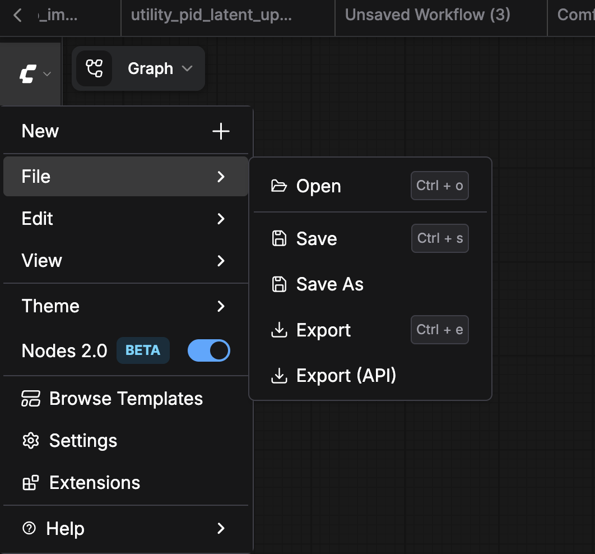

Рабочие процессы ComfyUI представляют собой JSON-объекты, которые описывают граф узлов. При программном вызове ComfyUI, будь то через Cloud API или при запуске собственного сервера, рабочий процесс необходимо отправить в **формате API**, который представляет собой специализированную структуру JSON и отличается от обычного формата сохранения, используемого в браузере.

На этой странице объясняются различия и описывается, как правильно экспортировать ваши рабочие процессы.

---

## Формат сохранения и формат API

ComfyUI фронтенд (интерфейс) может сохранять рабочие процессы в двух форматах:

| | Формат сохранения | Формат API |
|---|---|---|
| **Меню File** | `File → Save` или `Ctrl+S` | `File → Export Workflow (API)` |
| **Расширение файла** | `.json` | `.json` |
| **Ключи узлов** | Названия или метки узлов | Числовые ID узлов |
| **Значения виджетов** | Включено | Включено |
| **Данные положения и компоновки** | Включено (x, y, width) | **Не включено** |
| **Цвета и группы** | Включено | **Не включено** |
| **Использование** | Повторное открытие во фронтенде | Отправка через API |
| **Можно загрузить в интерфейсе** | Да | Да, но без компоновки |

Ключевая разница: **формат API не содержит метаданные интерфейса** (положение, цвета, группы, размеры узлов), которые нужны только для визуального редактирования во фронтенде. Благодаря этому JSON остаётся меньше и чище для программного использования.

---

## Как экспортировать

Откройте рабочий процесс в интерфейсе ComfyUI, затем перейдите в `File → Export Workflow (API)`:

<Frame caption="Экспорт рабочего процесса в формате API из интерфейса ComfyUI">
  
</Frame>

Будет скачан файл `.json`, содержащий только данные, относящиеся к API:

```json
{
  "3": {
    "inputs": {
      "seed": 156680208700286,
      "steps": 20,
      "cfg": 8,
      "sampler_name": "euler",
      "scheduler": "normal",
      "denoise": 1,
      "model": [
        "4",
        0
      ],
      "positive": [
        "6",
        0
      ],
      "negative": [
        "7",
        0
      ],
      "latent_image": [
        "5",
        0
      ]
    },
    "class_type": "KSampler",
    "_meta": {
      "title": "KSampler"
    }
  },
  "4": {
    "inputs": {
      "ckpt_name": "v1-5-pruned-emaonly-fp16.safetensors"
    },
    "class_type": "CheckpointLoaderSimple",
    "_meta": {
      "title": "Load Checkpoint"
    }
  },
  "5": {
    "inputs": {
      "width": 512,
      "height": 512,
      "batch_size": 1
    },
    "class_type": "EmptyLatentImage",
    "_meta": {
      "title": "Empty Latent Image"
    }
  },
  "6": {
    "inputs": {
      "text": "beautiful scenery nature glass bottle landscape, , purple galaxy bottle,",
      "clip": [
        "4",
        1
      ]
    },
    "class_type": "CLIPTextEncode",
    "_meta": {
      "title": "CLIP Text Encode (Prompt)"
    }
  },
  "7": {
    "inputs": {
      "text": "text, watermark",
      "clip": [
        "4",
        1
      ]
    },
    "class_type": "CLIPTextEncode",
    "_meta": {
      "title": "CLIP Text Encode (Prompt)"
    }
  },
  "8": {
    "inputs": {
      "samples": [
        "3",
        0
      ],
      "vae": [
        "4",
        2
      ]
    },
    "class_type": "VAEDecode",
    "_meta": {
      "title": "VAE Decode"
    }
  },
  "9": {
    "inputs": {
      "filename_prefix": "ComfyUI",
      "images": [
        "8",
        0
      ]
    },
    "class_type": "SaveImage",
    "_meta": {
      "title": "Save Image"
    }
  }
}
```

---

## Преобразование форматов

Если у вас есть рабочий процесс в формате сохранения и его нужно перевести в формат API, проще всего сделать так:

1. Откройте файл `.json` через `File → Load` во фронтенде.
2. Экспортируйте его через `File → Export Workflow (API)`.

---

## Связанные страницы

- [Запуск рабочих процессов](/ru/development/run-workflows/overview): сравните варианты API и развёртывания
- [Обзор Cloud API](/ru/development/cloud/overview): отправка рабочих процессов в формате API в Comfy Cloud
- [Примеры API](/ru/development/comfyui-server/api-examples): посмотрите рабочие процессы в формате API в действии
- [Получение API-ключа](/ru/development/api-development/getting-an-api-key): обязательно для Cloud API и партнёрских узлов
