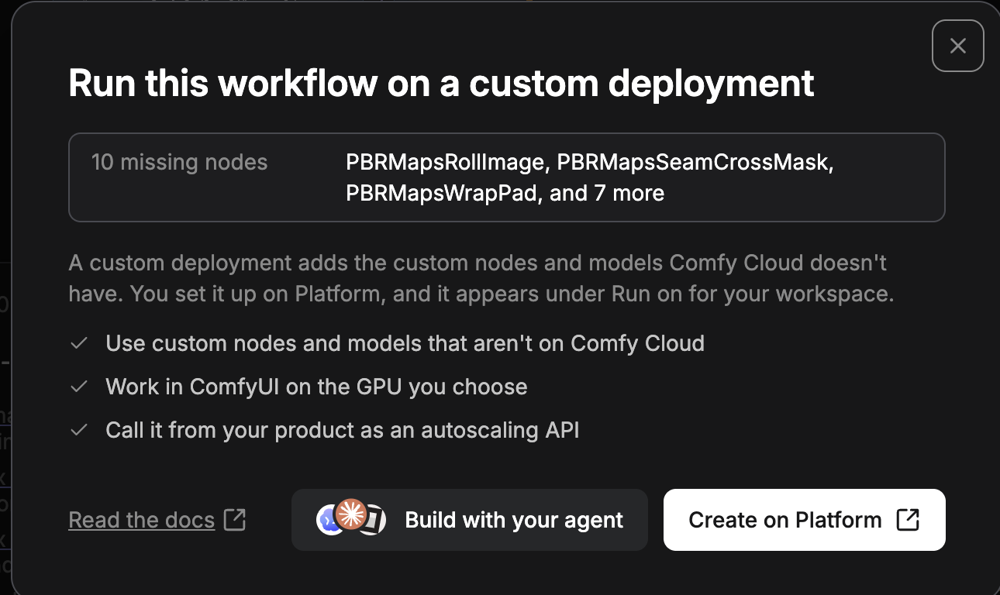
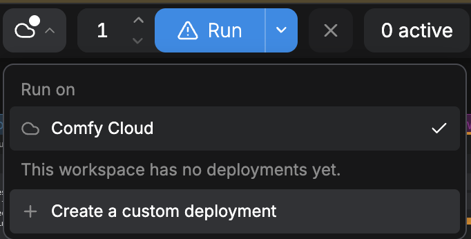
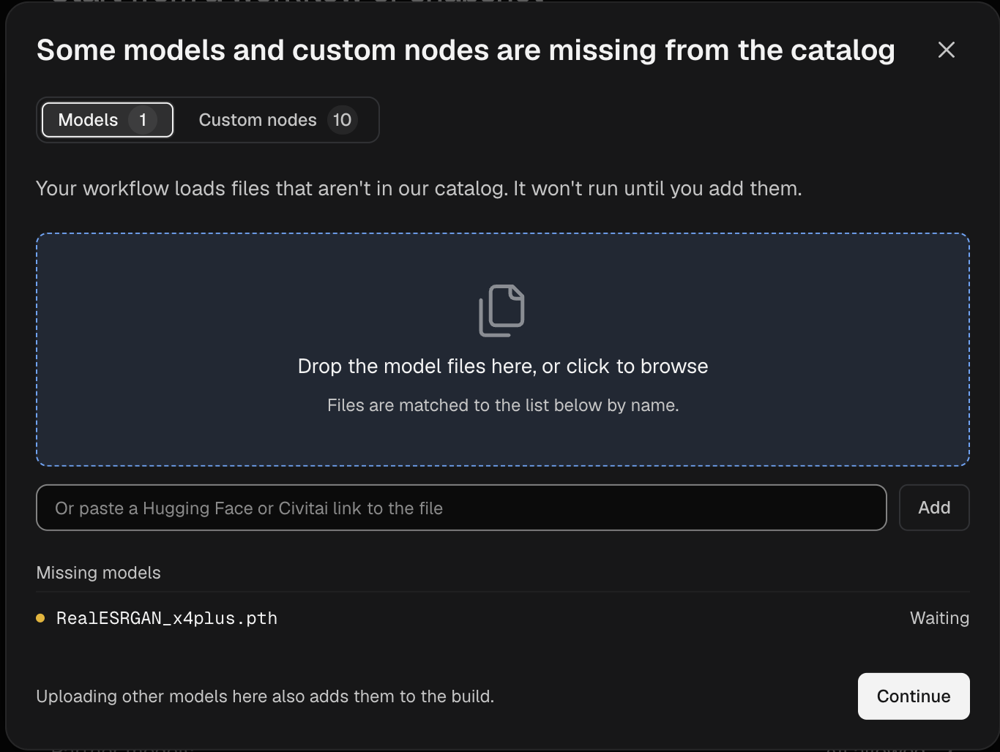
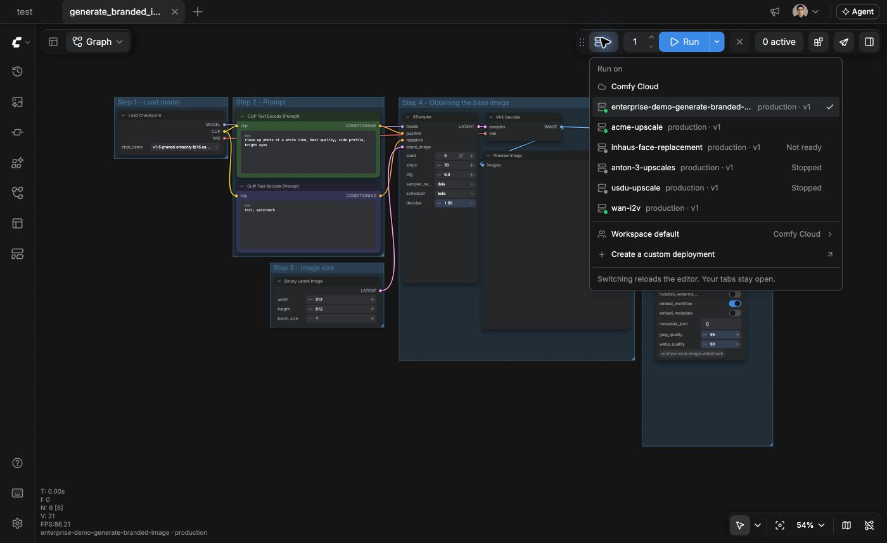
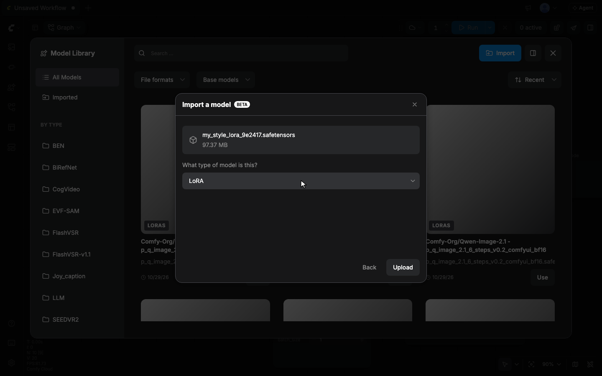
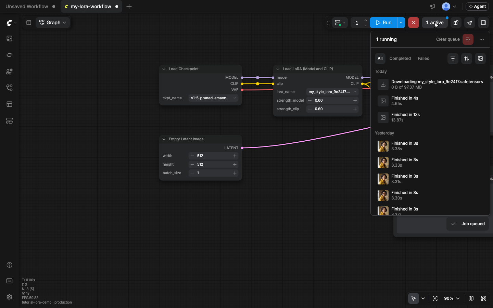
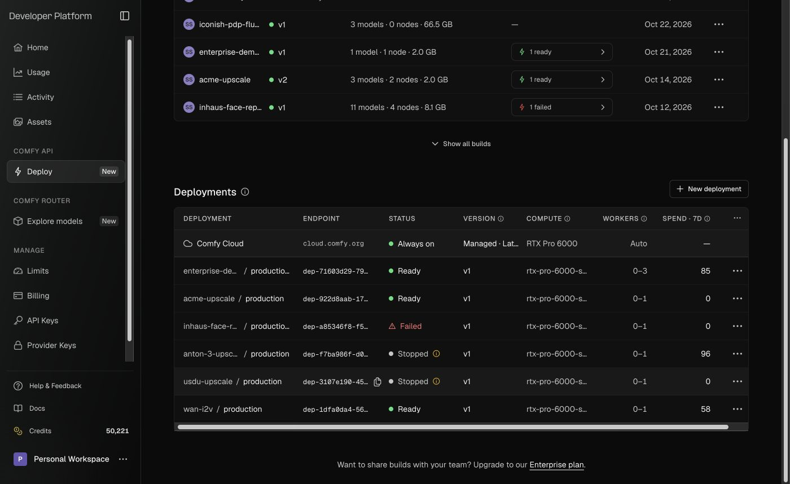

Build упаковывает ваши пользовательские узлы, приватные пользовательские узлы, LoRA и другие модели, а также зависимости Python, чтобы ваши рабочие процессы могли запускаться в Comfy Cloud. Вы запускаете Build из редактора Comfy Cloud, создаёте и развёртываете его на Developer Platform, а затем запускаете на нём свой рабочий процесс в редакторе.

Развёртывание Build также даёт вам GPU-воркеры, которые обслуживают только ваши рабочие процессы, даже если Comfy Cloud уже поддерживает все узлы в них.

<Note>
  Чтобы использовать собственную LoRA или другую модель с узлами, которые Comfy Cloud уже поддерживает, Build не нужен. Вместо этого загрузите модель в свою **Библиотеку моделей**. См. [Добавить собственную LoRA или модель](#добавить-свою-lora-или-модель).
</Note>

### Предварительные требования

Перед созданием Build убедитесь, что у вас есть следующее:

- **Сохранённый рабочий процесс в Comfy Cloud**
- **Активная подписка или баланс кредитов Comfy выше нуля**

<Warning>
  Создание Build и его хранение ничего не стоят. Развёртывание расходует GPU-время, пока для него включён GPU. Оно также оплачивается за хранилище всё время, пока развёртывание существует, даже если оно остановлено или GPU не включён. Диалоговое окно развёртывания показывает оценку стоимости до подтверждения. Чтобы прекратить оплату, удалите развёртывание. См. [Остановить или удалить развёртывание](#остановить-или-удалить-развёртывание).
</Warning>

## Создать сборку из рабочего процесса

Если в вашем рабочем процессе используются пользовательские узлы, которые не поддерживаются в Comfy Cloud, при его открытии Comfy Cloud показывает диалоговое окно. В диалоговом окне перечислены отсутствующие пакеты пользовательских узлов (группы пользовательских узлов) и модели, например LoRA. Чтобы запустить рабочий процесс, создайте сборку с ними. Когда вы выбираете сохранённый рабочий процесс, платформа разработчика находит его пользовательские узлы и модели и выбирает их за вас.

<Steps>
  <Step title="Открыть платформу разработчика">
    В диалоговом окне нажмите **Создать на платформе**. Платформа разработчика откроется в новой вкладке на странице **Deploy**.

    

    <Tip>
      Чтобы создать сборку без диалогового окна, нажмите меню облака слева от **Run**. По умолчанию в нём выбран пункт **Comfy Cloud**.

      - Если в вашем рабочем пространстве ещё нет развёртываний, выберите **Создать пользовательское развёртывание**, а затем нажмите **Создать на платформе**.
      - Если развёртывания уже есть, выберите **Управление развёртываниями**.

      
    </Tip>
  </Step>
  <Step title="Начать новую сборку">
    На странице **Deploy** нажмите **New build**. Если сборок ещё нет, нажмите **Start from scratch**.
  </Step>
  <Step title="Выбрать рабочий процесс">
    1. Нажмите **Pick from Comfy Cloud**.
    2. Выберите свой рабочий процесс, а затем нажмите **Add 1 workflow**.

    Вы также можете перетащить файл `.json` рабочего процесса или изображение `.png`, созданное с его помощью, в область перетаскивания.

    

    Шаг выполнен, когда под областью перетаскивания появляется название вашего рабочего процесса с галочкой, а в списке **Suggested defaults** отображаются **Custom nodes** сборки.
  </Step>
  <Step title="Собрать с предложенными настройками по умолчанию">
    Нажмите **Build with defaults…**. Откроется диалоговое окно **Choose build targets**.

    Если **Build with defaults…** недоступна, строка под кнопкой объясняет причину. Если в ней написано _Add the missing models and custom nodes on their steps first._, добавьте недостающее:

    1. Нажмите **Customise build**.
    2. Нажимайте **Next**, пока на каком-либо шаге не появится список отсутствующих пользовательских узлов или моделей.
    3. Для каждого из них нажмите **Use suggestion** или **Upload**.
  </Step>
</Steps>

Чтобы изменить состав сборки, нажмите **Customise build** и пройдите шаги. Состав сборки определяют два шага:

- **Which custom nodes does the build need?**
  - Выберите пользовательские узлы.
- **Which models ship inside the build?**
  - Выберите, какие модели включает сборка. Модель, не включённая в сборку, загружается при первом использовании в задании.

### Опубликовать сборку

Публикация превращает сборку в пронумерованную версию, например `v1`, которую можно развернуть сейчас и позже. Публикация бесплатна.

1. В диалоговом окне **Choose build targets** оставьте выбранным **Serverless build**. Это цель, которая выполняется в Comfy Cloud.
2. Нажмите **Publish**.

Страница вашей сборки откроется с новой версией. В строке **Serverless build** отображается ход сборки. Обычно сборка занимает от 10 до 15 минут, и вы можете покинуть страницу и вернуться позже. Когда сборка завершится, в строке **Serverless build** появится кнопка **Deploy**.

Чтобы вернуться к этой версии позже:

1. В **боковой панели платформы разработчика** нажмите **Deploy**.
2. В разделе **Builds** нажмите на свою сборку.
3. В разделе **Versions** нажмите на последнюю версию.

<AccordionGroup>
  <Accordion title="Что делать, если сборка завершилась ошибкой?">
    Некоторые пользовательские узлы не удаётся собрать. В этом случае в строке **Serverless build** на странице вашей сборки отображается **Build failed**.

    1. Откройте **Logs** в этой строке, чтобы прочитать, что завершилось ошибкой.
    2. Нажмите **Edit build** и измените сборку, например удалив пользовательский узел, который не удалось собрать.
    3. Опубликуйте сборку снова.

    Кнопка **Debug with your agent** в этой строке открывает промпт с описанием ошибки. Скопируйте его в агент для написания кода, чтобы исправить сборку.
  </Accordion>
</AccordionGroup>

### Разверните и запустите рабочий процесс

Развертывание представляет собой ваш Build, работающий на GPU Comfy Cloud. Разверните Build, а затем переключите редактор Comfy Cloud на развертывание, чтобы запустить рабочий процесс.

1. В строке **Serverless build** нажмите **Deploy**. Откроется диалоговое окно **Deploy v1 of** _название вашего Build_.
2. Выберите GPU. Для каждого GPU показаны объём видеопамяти (VRAM) и цена за час.
3. Если в диалоговом окне выбран пункт **Ready for the Cloud editor**, оставьте его. Он включён по умолчанию.
4. Оставьте остальные настройки по умолчанию. Если для **Always-warm workers** указано `0`, развертывание отключает свои GPU, когда задания не поступают. По умолчанию **Keep worker up after a job** удерживает GPU включённым в течение 3 минут после последнего задания, и это время простоя оплачивается по тарифу GPU.
5. Проверьте панель **Estimated cost**. В ней показаны время работы GPU за час и объём хранилища модели за месяц.
6. Нажмите **Create deployment**. Откроется страница развертывания. Дождитесь, пока статус под названием развертывания не сменится на **Готов**.
7. В редакторе Comfy Cloud нажмите меню облака слева от **Run**. В разделе **Run on** выберите своё развертывание. Редактор перезагрузится, а вкладки останутся открытыми.

    

8. Откройте рабочий процесс и нажмите **Run**. Первое задание может подождать, пока развертывание запустит GPU.

Этот браузер продолжает запускать ваши рабочие процессы на развертывании, пока вы не выберете другое. Чтобы вернуться, выберите **Comfy Cloud** в том же меню. Если в рабочем процессе есть несохранённые изменения, откроется диалоговое окно **Сохранить рабочие процессы перед переключением?**. Нажмите **Сохранить и переключиться** или **Переключиться без сохранения**.

## Добавить свою LoRA или модель

В **Библиотеке моделей** хранятся модели, которые загружает ваше рабочее пространство. Загруженная модель работает в Comfy Cloud и в ваших развёртываниях.

Перед загрузкой модели убедитесь, что выполнены следующие требования:

- **Активный план Pro, Creator, Team или Enterprise**: он нужен вашему рабочему пространству для загрузки модели.
- **Файл `.safetensors` размером не более 2 ГБ**: более крупные базовые модели, например SDXL или Flux, добавляйте в сборку.

<Warning>
  Некоторые развёртывания, созданные до появления моделей библиотеки, не могут их загружать. Чтобы использовать модели библиотеки, создайте новое развёртывание. На старом развёртывании задача может завершиться ошибкой `Library model "<file name>" is unavailable on this deployment. Retry the job. If it still fails, contact support with the job ID.`
</Warning>

### Загрузить модель

Загрузить модель можно в редакторе Comfy Cloud или на Developer Platform. Выберите вкладку для того места, где вы работаете.

<Tabs>
  <Tab title="Облачный редактор">
    1. В облачном меню слева от **Run** убедитесь, что в разделе **Run on** выбрано **Comfy Cloud**. В развёртывании у **Библиотеки моделей** нет кнопки **Импорт**.
    2. В **левой боковой панели** нажмите **Библиотека моделей**, а затем нажмите **Импорт**.
    3. Нажмите **Выберите файл** или перетащите файл `.safetensors` в диалоговое окно.
    4. В разделе **Какого типа эта модель?** оставьте **LoRA** для LoRA или выберите тип, соответствующий файлу.
    5. Нажмите **Загрузить**. Когда в диалоговом окне появится _Модель успешно импортирована._, нажмите **Готово**.

    

    Чтобы вместо этого импортировать модель по ссылке с Civitai или Hugging Face:

    1. В диалоговом окне **Импорт** вставьте ссылку на модель в поле **Вставьте ссылку сюда**.
    2. Нажмите **Продолжить**.
    3. В разделе **Какого типа эта модель?** выберите тип модели.
    4. Нажмите **Импорт**.

    Импорт по ссылке в другом формате, например `.ckpt`, попадает в **Библиотеку моделей**, но не работает в развёртывании.
  </Tab>
  <Tab title="Developer Platform">
    1. На шаге **Какие модели входят в сборку?** сборки нажмите **Загрузить модели**.
    2. Выберите **Библиотека рабочего пространства**.
    3. Перетащите файл `.safetensors` в область перетаскивания или нажмите на неё, чтобы просмотреть файлы.
    4. В разделе **Тип модели** оставьте **LoRA** для LoRA или выберите тип, соответствующий файлу.
    5. Нажмите **Загрузить**.

    
  </Tab>
</Tabs>

### Использовать модель в рабочем процессе

После загрузки модели её можно использовать в Comfy Cloud или в вашем развёртывании.

1. В облачном меню слева от **Run** выберите, где запускать: **Comfy Cloud** или ваше развёртывание.
2. Добавьте узел `Load LoRA (Model and CLIP)` или откройте рабочий процесс, в котором он есть.
3. В списке `lora_name` узла выберите свой файл.
4. Нажмите **Run**.

<Tip>
  В развёртывании первый запуск скачивает модель, и в строке задачи в очереди отображается `Downloading <file name>`. Последующие задачи на том же работающем GPU пропускают загрузку. GPU, который развёртывание запустит позже, скачает модель заново. Чтобы пропустить загрузку, добавьте модель в сборку.
</Tip>

Соблюдайте следующие правила, чтобы задача нашла вашу модель:

- **Выбирайте подходящий тип.** Узел-загрузчик показывает только модели своего типа. Узел `Load LoRA (Model and CLIP)` показывает модели, загруженные как LoRA.
- **Используйте новое имя файла.** Если в вашей сборке уже есть модель с таким же именем, задача в развёртывании использует файл из сборки, а не ваш загруженный.
- **Согласуйте с базовой моделью.** LoRA должна соответствовать базовой модели, которую загружает ваш рабочий процесс.
- **Используйте узел-загрузчик, который есть в Comfy Cloud.** Если узел-загрузчик относится к пользовательскому узлу, которого нет в Comfy Cloud, добавьте модель в сборку.

### Изменить или удалить модель библиотеки

Когда в разделе **Run on** выбрано развёртывание, **Библиотека моделей** показывает только модели сборки. Чтобы изменить или удалить загруженную вами модель, [переключитесь обратно на Comfy Cloud](#разверните-и-запустите-рабочий-процесс), а затем в **левой боковой панели** нажмите **Библиотека моделей**.

Чтобы изменить тип модели:

1. Наведите указатель на карточку модели и нажмите **Информация о модели**.
2. Выберите новый **Тип модели**.

<Warning>
  Удаление модели безвозвратно убирает её из **Библиотеки моделей**. Задача, которая всё ещё использует этот файл, завершится ошибкой `Value not in list` на узле-загрузчике.
</Warning>

Чтобы удалить модель:

1. Наведите указатель на карточку модели, нажмите **Ещё**, а затем нажмите **Удалить**.
2. В окне **Удалить эту модель?** нажмите **Удалить**.

## Остановить или удалить развёртывание

Развёртывание занимает место в хранилище, пока вы его не удалите, даже когда оно остановлено. Остановите развёртывание, чтобы сохранить его на будущее без запуска заданий. Удалите его, чтобы перестать за него платить.

Чтобы открыть страницу развёртывания:

1. В **боковой панели Developer Platform** нажмите **Развернуть**.
2. В разделе **Развёртывания** нажмите на название развёртывания.

Чтобы остановить развёртывание:

1. Нажмите **Остановить**.
2. В диалоговом окне **Остановка развёртывания** нажмите **Остановить**.

Статус сменится на **Остановка**, а затем на **Остановлено**.

Чтобы снова запустить развёртывание:

- Нажмите **Запустить**.

<Warning>
  Удаление безвозвратно удаляет развёртывание и его историю. Ваш Build и его версии сохраняются, поэтому позже вы сможете развернуть его снова.
</Warning>

Чтобы удалить развёртывание:

1. Для остановленного развёртывания нажмите **Удалить**. Для работающего развёртывания откройте меню **Дополнительные действия** и выберите **Удалить**.
2. В диалоговом окне **Удаление развёртывания** нажмите **Удалить**.

При следующем открытии редактора в этом браузере редактор будет запускать ваши рабочие процессы в Comfy Cloud.

## Следующие шаги

<CardGroup cols={2}>
  <Card title="Модели из библиотеки в API-запросах" icon="code" href="/ru/development/serverless/overview#использование-моделей-из-библиотеки-рабочего-пространства-в-запросах-к-api">
    Загрузите модель из терминала и выбирайте её для каждого запроса с помощью `lora_name`.
  </Card>
  <Card title="Вызвать развёртывание из кода" icon="cloud-arrow-up" href="/ru/development/deploy/cloud#запустить-рабочий-процесс-на-пользовательской-сборке">
    Вызывайте своё развёртывание из собственного кода как автомасштабируемый эндпоинт.
  </Card>
  <Card title="Использование и лимиты" icon="gauge" href="/ru/development/deploy/cloud-usage">
    Узнайте, как работают кредиты Comfy Cloud и лимиты одновременных задач.
  </Card>
  <Card title="Формат API рабочего процесса" icon="file-code" href="/ru/development/api-development/workflow-api-format">
    Экспортируйте рабочий процесс в формате, который отправляют API-запросы.
  </Card>
</CardGroup>
