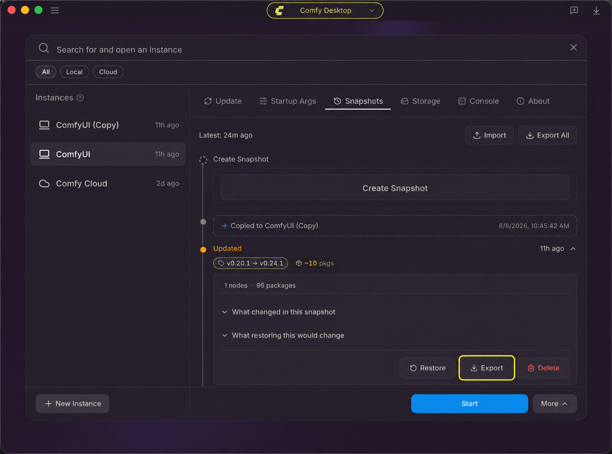

После развёртывания сборки на Comfy Cloud вы можете выпускать новые версии сборки, менять GPU и число воркеров развёртывания, а также вызывать развёртывание из своего приложения по его собственному URL. Развёртывание расходует время GPU, пока работают его воркеры, и место в хранилище, пока вы его не удалите. Вы продолжаете управлять им после создания. На этой странице рассказывается, как запускать сборку из других источников, выпускать версии, выбирать GPU и воркеры, вызывать развёртывание, наблюдать за ним, а также останавливать или удалять его.

Чтобы создать первую сборку и развёртывание, см. [Пользовательские сборки](/ru/development/deploy/cloud-custom-builds).

<Note>
  Если Comfy Cloud уже поддерживает все узлы вашего рабочего процесса, вы можете запустить рабочий процесс на Comfy Cloud без сборки и развёртывания. См. [Развёртывание на Comfy Cloud](/ru/development/deploy/cloud).
</Note>

## Перед началом

Каждая задача на этой странице выполняется в двух местах: на платформе для разработчиков по адресу [platform.comfy.org](https://platform.comfy.org) в браузере и с comfy-cli в терминале. Убедитесь, что у вас есть следующее:

- **Рабочее пространство с кредитами Comfy или активным тарифом**: чтобы создать деплой или запустить его, нужно одно из этого.
- **Для вкладок comfy-cli: вход выполнен в comfy-cli под вашей учётной записью Comfy**: выполните `comfy cloud login`.

<Tip>
  Чтобы создать Build и деплой с помощью comfy-cli вместо браузера, выполните эти команды в папке установки `ComfyUI`:

  ```bash
  comfy build init
  comfy build push --release --target linux/nvidia
  comfy deploy up
  ```

  `comfy build init` записывает файл Build, `comfy-build.yaml`, в эту папку. Последующие команды `comfy build` читают его, поэтому выполняйте их в той же папке.
</Tip>

## Начать сборку из Comfy Desktop, файла рабочего процесса или ComfyUI

Если у вас ещё нет сборки, её можно начать с того, что у вас уже есть. В разделе [Custom Builds](/ru/development/deploy/cloud-custom-builds) показан основной поток в браузере, начиная с рабочего процесса, сохранённого в Comfy Cloud. Выберите вкладку, соответствующую тому, с чего вы начинаете.

<Tabs>
  <Tab title="Снимок Comfy Desktop">
    Снимок Comfy Desktop переносит в сборку версию ComfyUI экземпляра, пользовательские узлы и пакеты Python. Модели он не переносит, поэтому добавьте их на последующих шагах сборки.

    1. В Comfy Desktop нажмите **Manage** на своём экземпляре, а затем откройте вкладку **Snapshots**.
    2. Если текущее состояние экземпляра отсутствует в списке, нажмите **Create Snapshot**.
    3. У нужного снимка нажмите **Export**.

       

    4. В Developer Platform в **боковой панели Developer Platform** нажмите **Deploy**, а затем нажмите **New build**. Если у вас ещё нет сборок, вместо этого нажмите **Start from scratch**.
    5. На шаге **Start with a workflow or snapshot?** перетащите экспортированный файл `.json` в область перетаскивания или нажмите на эту область, чтобы выбрать файл.

    Другой перетащенный снимок заменит текущий. Продолжите с раздела [Собрать с предложенными параметрами по умолчанию](/ru/development/deploy/cloud-custom-builds#создать-сборку-из-рабочего-процесса) в Custom Builds.
  </Tab>
  <Tab title="Файл рабочего процесса">
    1. В Developer Platform в **боковой панели Developer Platform** нажмите **Deploy**, а затем нажмите **New build**. Если у вас ещё нет сборок, вместо этого нажмите **Start from scratch**.
    2. На шаге **Start with a workflow or snapshot?** перетащите файл `.json` рабочего процесса или изображение `.png`, созданное с его помощью, в область перетаскивания. Также можно нажать на эту область, чтобы выбрать файл.

    

    Developer Platform считывает модели и пользовательские узлы, которые использует рабочий процесс. Каждый перетащенный рабочий процесс добавляется к предыдущим. Продолжите с раздела [Собрать с предложенными параметрами по умолчанию](/ru/development/deploy/cloud-custom-builds#создать-сборку-из-рабочего-процесса) в Custom Builds.
  </Tab>
  <Tab title="ComfyUI">
    В ComfyUI пункт **Deploy to Comfy API** подсчитывает, что нужно открытому рабочему процессу, и затем открывает Developer Platform.

    1. В **верхней панели** щёлкните правой кнопкой мыши по вкладке рабочего процесса. Также можно нажать кнопку **Workflow actions**.

       

    2. Выберите **Deploy to Comfy API**. Откроется карточка **Deploy to Comfy API**, которая подсчитает пакеты узлов, модели и классы узлов, используемые рабочим процессом.

       

    3. Нажмите **Deploy on Platform**. Developer Platform откроется в новой вкладке.

    Чтобы начать сборку с этого рабочего процесса, выберите **Export** в том же меню, чтобы сохранить рабочий процесс как файл `.json`, а затем воспользуйтесь вкладкой **Файл рабочего процесса**.
  </Tab>
</Tabs>

## Найти развёртывание

Далее предполагается, что у вас есть сборка хотя бы с одним развёртыванием. Каждая последующая задача начинается с развёртывания, поэтому сначала найдите его. Просмотр развёртывания ничего не стоит. Выберите вкладку, соответствующую тому, где вы работаете.

<Tabs>
  <Tab title="Developer Platform">
    1. На **боковой панели Developer Platform** нажмите **Deploy**.
    2. В разделе **Deployments** нажмите на название развёртывания.

    Откроется страница развёртывания. Под названием отображаются статус, например **Готово** или **Остановлено**, и запущенная версия, например `v2`. Вкладка **Overview** показывает **Runtime configuration**.
  </Tab>
  <Tab title="comfy-cli">
    Выведите список всех развёртываний в вашем рабочем пространстве:

    ```bash
    comfy deploy ls --workspace
    ```

    В каждой строке показаны имя развёртывания, его ID, статус и запущенная версия. Последующие команды выбирают развёртывание с помощью `--deployment`, после которого указывается ID. Простое имя, например `production`, работает, только если вы запускаете команду в папке сборки. В остальных случаях используйте ID или `<build>/<name>`.
  </Tab>
</Tabs>

## Выпустить версию сборки

Опубликованная версия сборки никогда не меняется. Чтобы добавить пользовательский узел или модель, вы публикуете версию, а затем переводите развёртывание на неё. Developer Platform называет версии `v1`, `v2` и так далее. comfy-cli называет её релизом.

<Warning>
  Перевод развёртывания на другую версию или откат расходует GPU-время, пока работают и старая, и новая версия. В Developer Platform диалог **Change version** показывает количество.
</Warning>

<Tabs>
  <Tab title="Developer Platform">
    Чтобы опубликовать версию:

    1. В **боковой панели Developer Platform** нажмите **Deploy**.
    2. В разделе **Builds** нажмите на свою сборку.
    3. Нажмите **New version** и внесите изменения на шагах.
    4. На последнем шаге нажмите **Save changes**. На странице сборки появится **Changed since v**_N_, где _N_ обозначает последнюю версию.
    5. Нажмите **Publish**. В диалоге **Choose build targets** оставьте выбранным **Serverless build** и нажмите **Publish**.

    Сборка обычно занимает от 10 до 15 минут. Если сборка завершилась ошибкой, см. [Fix a failing build or deployment](#исправить-ошибку-сборки-или-развёртывания).

    Чтобы перевести развёртывание на эту версию:

    1. Откройте страницу развёртывания. Когда новая версия готова, под именем развёртывания отображается **v**_N_ **доступна**.
    2. Нажмите **Change version**.
    3. Выберите версию и нажмите **Update to v**_N_.

    Развёртывание продолжает обслуживать текущую версию, пока новая не будет готова, и его URL остаётся прежним. Когда обновление завершится, под именем развёртывания будет указана **v**_N_.

    Чтобы вернуться к более ранней версии:

    1. На странице развёртывания нажмите вкладку **History**.
    2. В строке версии нажмите **Roll back to this version**.
  </Tab>
  <Tab title="comfy-cli">
    Выполните эти команды в папке сборки.

    1. После изменения установки ComfyUI пересканируйте её в файл сборки:

       ```bash
       comfy build update --yes
       ```

    2. Сравните файл сборки с установкой и со сборкой в Comfy Cloud:

       ```bash
       comfy build status
       ```

    3. Отправьте файл сборки и создайте релиз для цели `linux/nvidia`, той цели, на которой работает развёртывание:

       ```bash
       comfy build push --release --target linux/nvidia
       ```

    4. Отслеживайте лог сборки релиза, пока сборка не завершится:

       ```bash
       comfy build release logs --target linux/nvidia --follow
       ```

    5. Переведите развёртывание на новейший релиз:

       ```bash
       comfy deploy up --deployment <deployment>
       ```

    `comfy deploy up` отслеживает развёртывание, пока переход не завершится. До этого развёртывание продолжает обслуживать текущий релиз.

    Чтобы вернуться к более раннему релизу:

    - Чтобы вернуться к релизу, предшествующему текущему, выполните:

      ```bash
      comfy deploy rollback --deployment <deployment>
      ```

    - Чтобы вернуться к конкретному релизу, добавьте `--to`, например `--to v5`.
  </Tab>
</Tabs>

Каждая версия каждой сборки учитывается в лимите версий сборок вашего рабочего пространства. Когда вы достигнете лимита, удалите версию, которая больше не нужна. См. [Clean up](#очистить).

## Изменить GPU или регион

GPU определяет, сколько VRAM получит рабочий процесс и сколько стоит каждый воркер в час. Регион определяет, где запускается развертывание, и от него зависит, какие GPU можно выбрать.

<Warning>
  В запущенном развертывании смена GPU или региона запускает копию развертывания на новом GPU. Старая копия продолжает обслуживать запросы и расходовать время GPU, пока Comfy Cloud не перенесет развертывание на новую копию. В остановленном развертывании изменение вступает в силу при следующем запуске.
</Warning>

<Tabs>
  <Tab title="Developer Platform">
    Вы выбираете **Location** при создании развертывания: **Anywhere** или **United States**. Developer Platform не может изменить местоположение существующего развертывания. Чтобы запустить в другом местоположении, разверните Build заново с его страницы.

    Чтобы изменить GPU:

    1. На странице развертывания нажмите **Edit settings**.
    2. В **Edit deployment** выберите GPU. Для каждого GPU отображаются его VRAM и цена за час.
    3. Нажмите **Save changes**.
  </Tab>
  <Tab title="comfy-cli">
    1. Выведите список регионов и GPU, которые предлагает каждый из них:

       ```bash
       comfy deploy refs compute
       ```

       Таблица показывает каждый регион, каждый класс GPU, его VRAM и доступность. Чтобы вывести список одного региона, добавьте `--region <region>`.

    2. Задайте класс GPU, регион или и то и другое:

       ```bash
       comfy deploy scale --deployment <deployment> --gpu <gpu-class> --region <region>
       ```

    Если команда отказывается выполняться, потому что развертывание запущено, сначала выполните `comfy deploy stop --deployment <deployment>`, затем снова выполните `scale`, а после этого выполните `comfy deploy start --deployment <deployment>`. Новый GPU или регион вступает в силу при запуске развертывания.
  </Tab>
</Tabs>

## Масштабировать воркеры

Каждый воркер — это один GPU, который выполняет ваши задания. Вы задаёте два числа:

- **Always-warm workers**: воркеры, которые остаются запущенными, чтобы задания не ждали запуска GPU. При `0` развёртывание отключает свои GPU, когда задания не поступают.
- **Max workers**: максимальное число воркеров, которое развёртывание запускает одновременно при поступлении заданий. Запросы сверх этого ждут в очереди развёртывания, пока не освободится воркер.

<Warning>
  **Always-warm workers** тарифицируют GPU-время всё время, пока они запущены, даже при отсутствии заданий.
</Warning>

<Tabs>
  <Tab title="Developer Platform">
    1. На странице развёртывания нажмите **Edit settings**.
    2. Задайте **Always-warm workers** и **Max workers**.
    3. Нажмите **Save changes**.

    В разделе **Runtime configuration** отображаются сохранённые значения.
  </Tab>
  <Tab title="comfy-cli">
    Задайте обе границы вместе. `--min` принимает значения от `0` до `20`, а `--max` — от `1` до `20`:

    ```bash
    comfy deploy scale --deployment <deployment> --min 0 --max 3
    ```

    Команда выводит `Scaled deployment <id> to min=0, max=3`.
  </Tab>
</Tabs>

Ваш тариф определяет максимальное число воркеров, которое может запускать одно развёртывание. Чтобы узнать его, откройте [**Limits**](https://platform.comfy.org/settings/limits) на Developer Platform и проверьте **Max workers per deployment**.

## Остановить и запустить развёртывание

Остановите развёртывание, чтобы сохранить его вместе с URL и моделями, но не запускать задания. Запустите его снова, когда оно понадобится.

<Warning>
  Остановленное развёртывание по-прежнему оплачивается как хранилище. Оплата хранилища прекращается, когда вы удаляете последнее развёртывание Build в этом регионе. См. [Очистка](#очистить).
</Warning>

<Tabs>
  <Tab title="Developer Platform">
    Чтобы остановить и запустить развёртывание в браузере, см. [Остановка и удаление развёртывания](/ru/development/deploy/cloud-custom-builds#остановить-или-удалить-развёртывание).

    Чтобы запустить остановленное развёртывание на другой версии:

    1. Нажмите стрелку рядом с **Start** и выберите **Start on v**_N_.
    2. В диалоговом окне нажмите **Start on v**_N_.
  </Tab>
  <Tab title="comfy-cli">
    Чтобы остановить развёртывание:

    ```bash
    comfy deploy stop --deployment <deployment>
    ```

    Чтобы запустить его снова:

    ```bash
    comfy deploy start --deployment <deployment>
    ```

    Каждая команда выводит сообщение о том, что служба её приняла. Чтобы отслеживать развёртывание до завершения, см. [Мониторинг развёртывания](#отслеживать-развёртывание).
  </Tab>
</Tabs>

## Вызвать развёртывание из приложения

Приложение отправляет рабочие процессы в формате API на URL развёртывания с помощью [Comfy API v2](/api-reference/v2/overview), используя API-ключ рабочего пространства. Перед отправкой задачи проверьте, что в статусе развёртывания указано **Ready**. Задача на развёртывании с `0` постоянно прогретыми воркерами может подождать несколько минут, пока запускается GPU.

<Tabs>
  <Tab title="Developer Platform">
    1. На странице развёртывания найдите **Run via API** на вкладке **Overview**.
    2. Скопируйте **Deployment URL**.
    3. Нажмите **Create API key** и скопируйте ключ.
    4. Скопируйте фрагмент кода для Python, JavaScript или cURL.
    5. Запустите фрагмент, указав ключ в переменной окружения `COMFY_API_KEY`.

    Чтобы проверить развёртывание со страницы, используйте **Quick test**. Он запускает небольшой рабочий процесс без моделей на развёртывании.

    <Warning>
      **Quick test** расходует время GPU на развёртывании.
    </Warning>

    1. Откройте **Test this deployment**.
    2. Выберите **Quick test**.
    3. Нажмите **Run**.

    Когда тест завершится, отобразится **Finished in** и затраченное время.
  </Tab>
  <Tab title="comfy-cli">
    Отправьте рабочий процесс в формате API и дождитесь его выходов:

    ```bash
    comfy deploy run --deployment <deployment> --workflow workflow_api.json
    ```

    Команда ожидает завершения задачи и загружает её выходы в папку `outputs`. Чтобы сохранить их в другое место, добавьте `--output-dir <folder>`.
  </Tab>
</Tabs>

В собственном коде используйте [Comfy SDKs](/ru/development/api-development/sdks). Установите для `COMFY_BASE_URL` значение **Deployment URL**. См. [Выбор базового URL](/ru/development/api-development/sdks#выбор-базового-url).

## Использование моделей из библиотеки рабочего пространства в запросах к API

Развёртывание использует модели `.safetensors` из библиотеки рабочего пространства, даже если они не входят в его релиз. Чтобы выбирать LoRA для каждого запроса, один раз загрузите её в библиотеку, а затем указывайте её имя в каждом отправляемом рабочем процессе.

<Steps>
  <Step title="Загрузите LoRA в библиотеку рабочего пространства">
    Чтобы загрузить модель в редакторе Comfy Cloud или на платформе Developer Platform, см. [Добавить свою LoRA или модель](/ru/development/deploy/cloud-custom-builds#добавить-свою-lora-или-модель). На этой странице также указаны тариф и размер файла, необходимые для загрузки.

    Чтобы загрузить из терминала, задайте тип модели с помощью `--type`:

    ```bash
    comfy assets library upload my_style.safetensors --type loras
    ```

    Когда загрузка завершится, команда выведет `Added my_style.safetensors to loras`.
  </Step>
  <Step title="Задайте lora_name в рабочем процессе">
    В [рабочем процессе в формате API](/ru/development/api-development/workflow-api-format) задайте для входа `lora_name` загрузчика имя файла из библиотеки, включая `.safetensors`:

    ```json
    "10": {
      "class_type": "LoraLoader",
      "inputs": {
        "lora_name": "my_style.safetensors",
        "strength_model": 1.0,
        "strength_clip": 1.0,
        "model": ["4", 0],
        "clip": ["4", 1]
      }
    }
    ```
  </Step>
  <Step title="Отправьте запрос">
    Отправьте рабочий процесс так, как показано в разделе [Вызов развёртывания из приложения](#вызвать-развёртывание-из-приложения).
  </Step>
</Steps>

Чтобы использовать другую LoRA, в следующем запросе измените `lora_name` на другое имя файла из библиотеки. Новая сборка, релиз или повторное развёртывание не требуются.

- Рабочий процесс может указывать до 100 моделей из библиотеки. Загрузчик, который указывает 101-ю модель из библиотеки, завершается ошибкой, как если бы файла не было в библиотеке.
- Имена файлов должны быть уникальными во всех папках, которые читает один загрузчик. Если в библиотеке одинаковое имя файла встречается в двух из этих папок, задача, отправленная через API, не загрузит ни один из этих файлов.

## Отслеживать развёртывание

Проверяйте состояние развёртывания при запуске, после изменений и при сбое заданий.

<Tabs>
  <Tab title="Developer Platform">
    На странице развёртывания:

    - Статус под названием развёртывания показывает **В очереди**, **Подготовка** или **Запуск**, пока развёртывание поднимается, и **Готов**, когда оно обслуживает задания.
    - Пока развёртывание поднимается, **Deployment progress** показывает каждый шаг, например **Copying models**. Развёртывание продолжает запускаться на стороне Comfy, поэтому страницу можно закрыть и вернуться позже.
    - Вкладка **Boot log** показывает, что ComfyUI выводил при запуске развёртывания.
    - Вкладка **History** перечисляет версии, которые запускало развёртывание, и что стало причиной изменений.

    На странице **Deploy** раздел **Deployments** показывает, сколько GPU-кредитов израсходовало каждое развёртывание за последние семь дней, в столбце **Spend · 7d**. Хранение моделей не учитывается.
  </Tab>
  <Tab title="comfy-cli">
    В папке сборки отслеживайте развёртывание, пока оно не стабилизируется:

    ```bash
    comfy deploy status --deployment <deployment> --watch
    ```

    Команда сообщает статус, например `Deployment <name>: ready`, ждёт ли более новый релиз и сколько заданий стоит в очереди. Чтобы узнать больше:

    ```bash
    comfy deploy logs --deployment <deployment>      # что ComfyUI выводил при запуске
    comfy deploy events --deployment <deployment>    # изменения статуса по порядку
    comfy deploy history --deployment <deployment>   # релизы, которые он запускал
    ```
  </Tab>
</Tabs>

## Очистить

Удаление последнего развёртывания Build в регионе останавливает начисление платы за его хранение, а удаление версии освобождает место в вашем лимите версий Build. Удалить Build или версию, пока их использует развёртывание, нельзя, поэтому сначала удалите развёртывание.

<Warning>
  Удаление развёртывания, версии или Build необратимо. При удалении развёртывания удаляется его URL, поэтому приложения, которые к нему обращаются, перестают работать. Build и его версии сохраняются, поэтому вы можете развернуть его снова. Развёртывание, созданное позже, получит новый URL, поскольку URL формируется из идентификатора развёртывания. Чтобы сохранить URL, [остановите развёртывание](#остановить-и-запустить-развёртывание).
</Warning>

<Tabs>
  <Tab title="Developer Platform">
    Чтобы удалить развёртывание, см. раздел [Остановить или удалить развёртывание](/ru/development/deploy/cloud-custom-builds#остановить-или-удалить-развёртывание).

    Чтобы удалить версию:

    1. Откройте страницу Build.
    2. В строке версии откройте **Version actions**, а затем выберите **Delete version**.
    3. Нажмите **Delete**.

    Чтобы удалить Build:

    1. На странице Build нажмите **Delete**.
    2. В диалоговом окне **Delete build** нажмите **Delete**.
  </Tab>
  <Tab title="comfy-cli">
    Чтобы удалить развёртывание:

    ```bash
    comfy deploy delete --deployment <deployment>
    ```

    Чтобы удалить версию:

    ```bash
    comfy build release delete <release-id>
    ```

    Чтобы удалить Build:

    ```bash
    comfy build delete --id <build-id>
    ```

    Каждая команда запрашивает подтверждение. Чтобы вывести список релизов Build и их идентификаторов, выполните `comfy build release ls --id <build-id>`. Чтобы вывести список ваших Build, выполните `comfy build ls`.
  </Tab>
</Tabs>

## Исправить ошибку сборки или развёртывания

Если сборка или развёртывание завершаются ошибкой, в логах указана причина. Устраните причину, а затем опубликуйте или запустите снова.

<AccordionGroup>
  <Accordion title="Сборка завершилась ошибкой">
    На платформе разработчика следуйте разделу [Что делать, если сборка завершилась ошибкой?](/ru/development/deploy/cloud-custom-builds#опубликовать-сборку) в Custom Builds.

    С comfy-cli прочитайте состояние релиза и лог сборки в папке сборки:

    ```bash
    comfy build release show
    comfy build release logs --target linux/nvidia
    ```

    Измените установку ComfyUI, например удалив пользовательский узел, из-за которого произошла ошибка, а затем [выпустите релиз снова](#выпустить-версию-сборки).
  </Accordion>

  <Accordion title="Статус развёртывания отображается как Failed">
    На странице развёртывания показана ошибка с текстом **This deployment didn't start. Fix what the error names, then start it again.** Нажмите **Copy**, чтобы скопировать ошибку. Вкладка **Boot log** показывает вывод ComfyUI.

    При использовании comfy-cli команда `comfy deploy status` выводит причину. Лог и изменения статуса описаны в разделе [Отслеживание развёртывания](#отслеживать-развёртывание).

    Устраните причину, указанную в ошибке, и снова запустите развёртывание.
  </Accordion>

  <Accordion title="Развёртывание долго запускается">
    Следуйте шагам в разделе **Deployment progress** на странице развёртывания или выполните `comfy deploy status --deployment <deployment> --watch`. Шаг **Copying models** длится тем дольше, чем больше моделей в версии. Когда вы создаёте развёртывание на платформе разработчика, **Estimated time** в диалоге развёртывания показывает, сколько времени занимает запуск.

    Если у выбранной GPU нет доступной ёмкости, [смените GPU или регион](#изменить-gpu-или-регион). С comfy-cli команда `comfy deploy refs compute` показывает доступность каждой GPU.
  </Accordion>

  <Accordion title="Статус отображается как Stopped: кредиты закончились">
    Развёртывание останавливается, когда в рабочем пространстве заканчиваются кредиты. Добавьте кредиты и снова запустите развёртывание.
  </Accordion>

  <Accordion title="Статус отображается как Stop failed">
    Запрос на остановку завершился ошибкой, поэтому с развёртывания может по-прежнему взиматься плата. Нажмите **Stop** ещё раз или повторно выполните `comfy deploy stop --deployment <deployment>`.
  </Accordion>

  <Accordion title="Ошибка при обновлении версии">
    На странице развёртывания отображается **Update to v**_N_ **failed.**, и развёртывание продолжает обслуживать версию, которая работала до этого. Нажмите **Retry** или исправьте версию и выпустите релиз снова.
  </Accordion>
</AccordionGroup>

## FAQ

Сведения о том, как оплачиваются развёртывания, см. в разделе [Выставление счетов за развёртывание](/ru/development/deploy/cloud-usage#выставление-счетов-за-развёртывание) страницы «Использование и ограничения».

<AccordionGroup>
  <Accordion title="Может ли один Build использовать несколько рабочих процессов?">
    Да. При создании Build на Developer Platform можно загрузить один или несколько рабочих процессов, чтобы предварительно выбрать их модели и пользовательские узлы. Укажите зависимости всех рабочих процессов, которые планируете запускать, а затем отправьте каждый рабочий процесс в формате API в развёртывание.

    Каждое развёртывание использует один класс GPU. Чтобы запускать рабочие процессы на разных классах GPU, создайте отдельные развёртывания одного и того же Build.
  </Accordion>
</AccordionGroup>

## Дальнейшие шаги

Когда развёртывание запущено, используйте эти страницы, чтобы отправлять в него рабочие процессы из собственного кода.

<CardGroup cols={2}>
  <Card title="Comfy SDKs" icon="code" href="/ru/development/api-development/sdks">
    Отправляйте рабочие процессы из приложения на Python или TypeScript и обрабатывайте входы, прогресс и выходы.
  </Card>
  <Card title="Comfy API v2" icon="cloud" href="/api-reference/v2/overview">
    Вызывайте HTTP API из любого языка и проверяйте форматы запросов и ответов.
  </Card>
  <Card title="Формат Workflow API" icon="file-code" href="/ru/development/api-development/workflow-api-format">
    Подготовьте JSON рабочего процесса для запроса к API или устраните неполадки с его входами и выходами.
  </Card>
  <Card title="Начать работу с comfy-cli" icon="terminal" href="/comfy-cli/getting-started">
    Установите comfy-cli и войдите в Comfy Cloud с помощью `comfy cloud login`.
  </Card>
</CardGroup>
