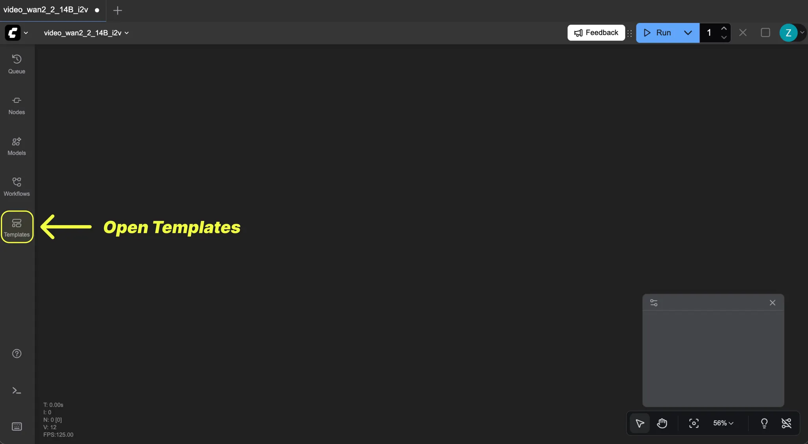
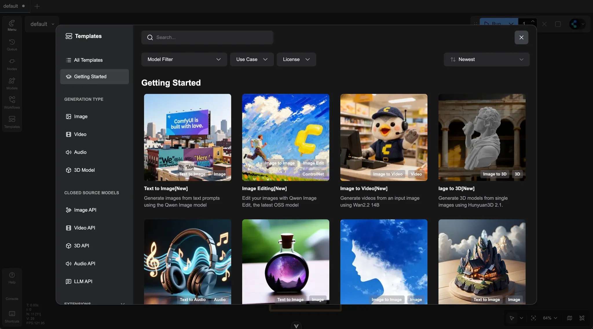
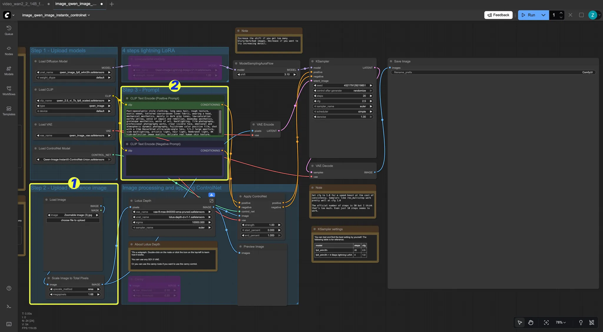
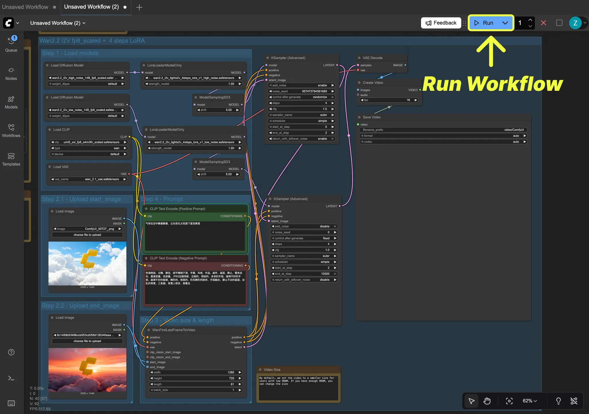
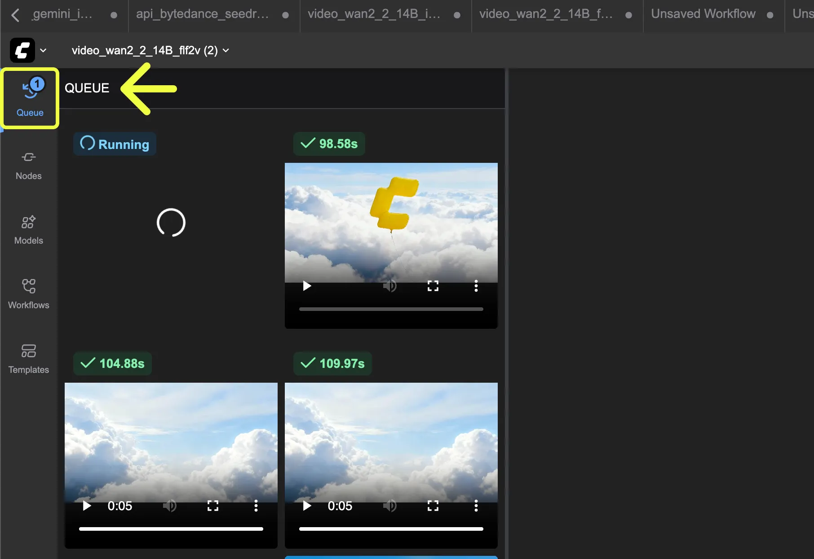
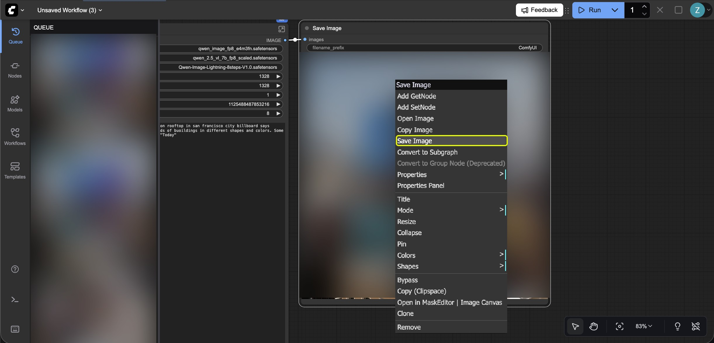
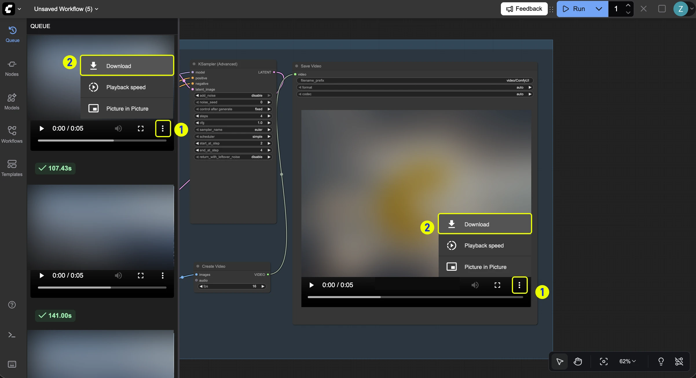
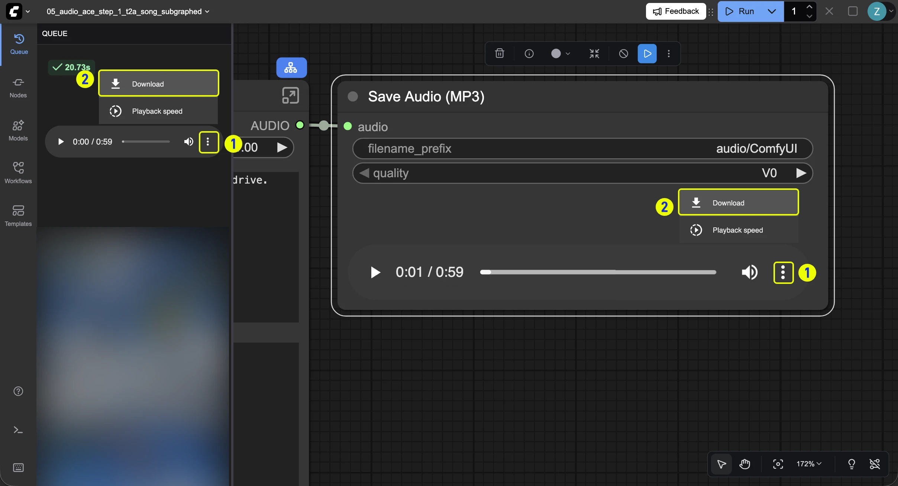
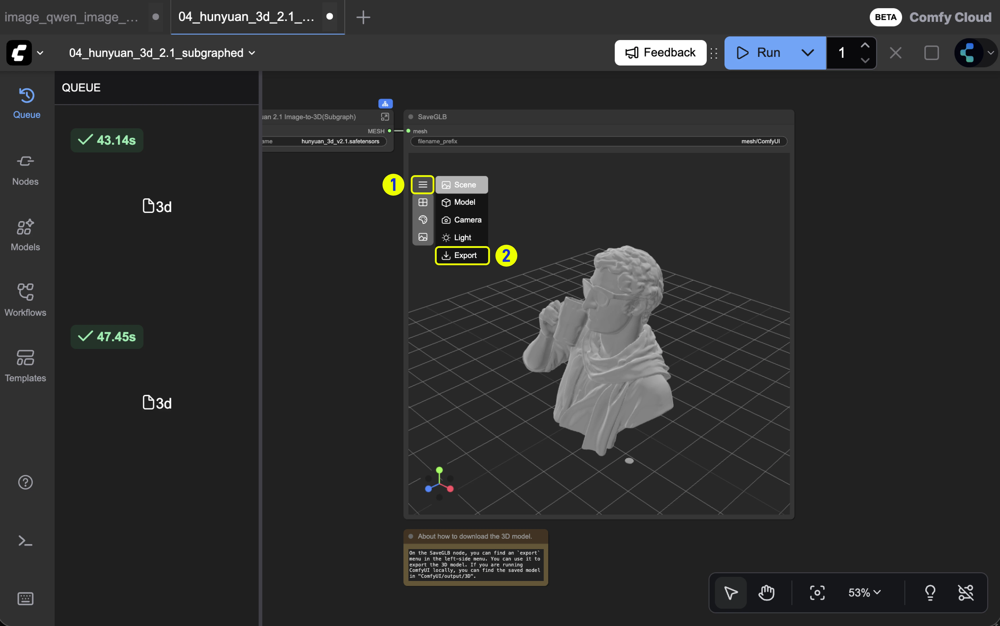
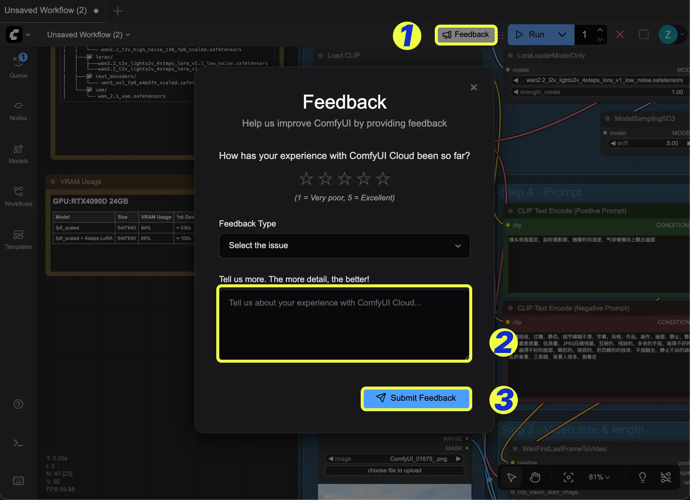

<Card title="Доступ к Comfy Cloud" icon="cloud" href="https://comfy.org/cloud">
  Нажмите здесь, чтобы перейти напрямую в ComfyUI Cloud
</Card>

## Что такое Comfy Cloud?

ComfyUI Cloud — это облачная версия ComfyUI с теми же функциями, что и локальная версия. Всё предварительно установлено и готово к использованию.

### Ключевые возможности

<CardGroup cols={2}>
  <Card title="Без настройки" icon="bolt">
    Установка не требуется. Все модели и пользовательские узлы предварительно установлены и готовы к использованию
  </Card>
  
  <Card title="Мощные GPU" icon="microchip">
    Запускайте рабочие процессы быстро на наших мощных серверных GPU без необходимости в собственном оборудовании
  </Card>
  
  <Card title="Всегда актуально" icon="arrows-rotate">
    Автоматически обновляется до последних версий и возможностей ComfyUI
  </Card>
  
  <Card title="Доступ откуда угодно" icon="globe">
    Используйте ComfyUI с любого устройства с подключением к интернету. Локальная установка не нужна
  </Card>
  
  <Card title="Совместная работа команды" icon="users" href="/cloud/workspace">
    Создавайте командные рабочие пространства, чтобы работать вместе с участниками команды. Делитесь подписками, кредитами и рабочими процессами.
  </Card>
</CardGroup>

## Облако или локально

ComfyUI предлагает как официальную облачную версию, [Comfy Cloud](https://comfy.org/cloud), так и версию с открытым исходным кодом для самостоятельного хостинга. Если у вас мощная GPU, локальный запуск ComfyUI будет отличным вариантом. Облачная версия, в свою очередь, это онлайн-сервис, готовый к использованию сразу: открываете URL, установка и настройка не требуются.

| Категория | Comfy Cloud | Самостоятельный хостинг (локальный ComfyUI) |
|----------|-------------|------------------------------|
| **Стоимость** | Бесплатный тариф и платные подписки | Бесплатно |
| **GPU** | Мощные Blackwell RTX 6000 Pro | Своя GPU |
| **Технические знания** | Технические знания не требуются. | Десктопная и портативная версии упрощают начало работы, но вам придётся самостоятельно устранять проблемы с установкой пользовательских узлов и локальной установки. |
| **Пользовательские узлы** | Используйте предустановленные пользовательские узлы и не беспокойтесь о проблемах совместимости. | Устанавливайте любые пользовательские узлы, но управлять ими придётся самостоятельно. |
| **Модели** | Используйте предустановленные модели. Импортируйте модели с Civitai и Hugging Face. | Используйте любые модели, но сначала их нужно скачать. |
| **Ключевые отличия** | Легко подключить команду с помощью [рабочих пространств](/cloud/workspace) | Работает офлайн, безгранично настраивается |
| **Начать** | [Запустить ComfyUI Cloud](https://comfy.org/cloud) | [Установить ComfyUI локально](/ru/installation/system_requirements) |

### Пользовательские узлы в Comfy Cloud

В Comfy Cloud работает фиксированный набор пользовательских узлов, которые поддерживает Comfy. Установить там свои пакеты узлов нельзя, поэтому рабочий процесс, зависящий от пакета, которого нет в Cloud, не запустится в текущем виде.

Comfy Cloud отмечает узлы, которые не может запустить, в двух местах: они помечаются на холсте, а на вкладке Errors [правой боковой панели](/interface/right-side-panel) перечислены в разделе **Unsupported Node Packs**. Эти узлы передаются автоматически, чтобы пакеты могли получить приоритет в поддержке Cloud.

Чтобы запустить рабочий процесс, замените эти узлы на поддерживаемые или откройте его в локальной установке ComfyUI.

## Цены и подписка

<Card title="Проверить цены" icon="tag" href="https://www.comfy.org/cloud/pricing">
  Посмотреть цены и варианты подписки для Comfy Cloud
</Card>

### Ограничения параллельных запусков

Интерфейс Comfy Cloud не поддерживает одновременный запуск более одного рабочего процесса. Каждый пользователь может запускать в редакторе только один рабочий процесс за раз; остальные рабочие процессы ждут в очереди и выполняются один за другим.

Параллельный запуск нескольких задач поддерживается только при отправке рабочих процессов через API, для чего требуется платная подписка. Подробнее см. [Ограничения параллельных запусков](/ru/development/deploy/cloud-usage#ограничения-параллельных-запусков) в документации для разработчиков.

На тарифах Team и Enterprise параллельные запуски считаются отдельно для каждого участника: у всех в рабочем пространстве свои лимиты, поэтому выполняющиеся рабочие процессы одного участника никогда не блокируют другого.

### Ограничения на время выполнения и очередь

У каждого рабочего процесса в Cloud есть максимальное время выполнения, и задача, превысившая его, отменяется автоматически:

| Тариф | Максимальное время выполнения |
| :--- | :--- |
| Standard | 30 минут |
| Creator | 30 минут |
| Pro | 1 час |

В очереди одновременно может ожидать до 100 рабочих процессов. О том, как ведёт себя очередь при заполнении, см. в разделе [Ограничения на время выполнения и очередь](/ru/development/deploy/cloud-usage#ограничения-времени-выполнения-и-очереди).

## Список разрешённых адресов в брандмауэре Comfy Cloud

Разрешите исходящий трафик HTTPS и WebSocket по TCP-порту 443 к следующим адресам:

- **Приложение:** `cloud.comfy.org`, `api.comfy.org`, `cdn.comfy.org`
- **Загрузки и выходы:** `comfy-hub-assets.comfy.org`, `storage.googleapis.com`
- **Вход:** `dreamboothy.firebaseapp.com`, `identitytoolkit.googleapis.com`, `securetoken.googleapis.com`, `apis.google.com`, `challenges.cloudflare.com`
- **Другие функции:** `registry.comfy.org`, `*.algolia.net`, `media.comfy.org`

## Как использовать ComfyUI Cloud

Работа с ComfyUI Cloud практически не отличается от работы с локальным ComfyUI. Если вы используете ComfyUI впервые, вот несколько коротких советов для начала:

<Steps>
  <Step title="Выберите шаблон">
    Нажмите на значок шаблонов в левой боковой панели, чтобы просмотреть доступные рабочие процессы.
    
  </Step>
  
  <Step title="Выберите рабочий процесс, который хотите запустить">
    Нажмите на нужный шаблон.
    
  </Step>
  
  <Step title="Обновите входы шаблона">
    1. В загруженном рабочем процессе все модели уже предустановлены в версии облака, поэтому все шаблоны готовы к запуску сразу после загрузки.
    2. Если нужно что-то изменить, достаточно указать входные изображения или текстовые промпты. Проверьте узел `Load Image` или узел `CLIP Text Encode`.
    
  </Step>
  
  <Step title="Запустите рабочий процесс">
    Если всё верно, нажмите на значок "Run" или используйте сочетание клавиш "Ctrl + Enter", чтобы запустить рабочий процесс.
    
  </Step>

  <Step title="Посмотрите выход">
    После нажатия Run наш сервис начнёт выделять машину для вашего рабочего процесса. Статус выполнения соответствующего рабочего процесса можно проверить на панели очереди.
    
  </Step>

  <Step title="Сохраните содержимое локально">
    После завершения выполнения рабочего процесса вы можете сохранить сгенерированное содержимое локально. Способ сохранения зависит от типа ассета:
    
    <Tabs>
      <Tab title="Сохранить изображения">
        На панели очереди или на узле сохранения изображения щёлкните правой кнопкой мыши по сгенерированному изображению и выберите "Save image", чтобы сохранить изображение локально.
        
        
      </Tab>
      
      <Tab title="Сохранить видео">
        На панели очереди или на узле сохранения видео:
        1. Нажмите на три точки на компоненте проигрывателя в браузере, чтобы открыть меню
        2. Выберите "Download", чтобы сохранить видео локально.
        
        
      </Tab>
      
      <Tab title="Сохранить аудио">
        На панели очереди или на узле сохранения аудио:
        1. Нажмите на три точки на компоненте проигрывателя в браузере, чтобы открыть меню
        2. Выберите "Download", чтобы сохранить аудиофайл локально.
        
        
      </Tab>
      
      <Tab title="Сохранить 3D-ассеты">
        В меню узла просмотра 3D выберите пункт "Export", укажите нужный формат, и 3D-файл будет сохранён локально.
        
        
      </Tab>
    </Tabs>
  </Step>
</Steps>

## Обратная связь

Если у вас есть идеи, предложения или вы столкнулись с какими-либо проблемами, просто нажмите на иконку «Feedback». Ваш отзыв будет отправлен нам напрямую.

### Как остановить Comfy Cloud и выйти из него

Оплачивается только то время сеанса Cloud, когда GPU активно работает. Если закрыть вкладку браузера, сеанс остановится автоматически. Вы можете закрыть его в любой момент, как обычную вкладку браузера.

## Часто задаваемые вопросы

<Card title="Открыть часто задаваемые вопросы" icon="circle-question" href="https://comfy.org/cloud">
  Ознакомьтесь с часто задаваемыми вопросами и ответами о Comfy Cloud: цены, возможности, ограничения и многое другое
</Card>

## Дальнейшие шаги

<CardGroup cols={2}>
  <Card title="Cloud API" icon="code" href="/ru/development/cloud/overview">
    Программно запускайте рабочие процессы через Cloud API
  </Card>
  
  <Card title="Учебники" icon="book" href="/ru/tutorials/basic/text-to-image">
    Изучайте учебники, чтобы освоить рабочие процессы ComfyUI
  </Card>
  
  <Card title="Поддержка" icon="life-ring" href="https://discord.com/invite/comfyorg">
    Присоединяйтесь к нашему сообществу Discord, чтобы получить помощь
  </Card>
</CardGroup>
