В этом руководстве вы создаёте рабочий процесс «текст в изображение» на пустом **холсте** и запускаете его. Вы вводите описание картинки, и ComfyUI генерирует по нему изображение 512 × 512 с помощью модели Stable Diffusion 1.5. Вы сами добавляете и соединяете каждый узел. В каждом шаге сказано, что делает узел и как проверить, что шаг выполнен.

В этом руководстве используется ComfyUI на вашем компьютере: Comfy Desktop, ComfyUI Portable или установка вручную. Установите ComfyUI и откройте его перед началом работы.

<Tip>
  Чтобы использовать ComfyUI в браузере без установки, [откройте шаблон «текст в изображение» Z-Image-Turbo в Comfy Cloud](https://cloud.comfy.org/?template=image_z_image_turbo&utm_source=docs&utm_medium=referral&utm_campaign=first_generation).
</Tip>

## Изучить составные части рабочего процесса

Рабочий процесс представляет собой набор узлов, соединённых связями. Каждый узел выполняет одну задачу:

- **Входы**: точки на левой стороне узла. Они получают данные от других узлов.
- **Выходы**: точки на правой стороне узла. Они отправляют данные другим узлам.
- **Виджеты**: настройки внутри узла, например текстовое поле, число или список.
- **Связи**: линии, которые передают данные от выхода ко входу того же типа, например от выхода `CLIP` ко входу `clip`.

В рабочем процессе из этого руководства семь узлов шести типов. В последнем столбце указано, где каждый узел находится в меню **Add Node**. Это объясняется в разделе [Добавить узел](#добавить-узел).

| Узел | Что делает | Путь в меню **Add Node** |
| --- | --- | --- |
| `Load Checkpoint` | Загружает файл модели. Его выходы: модель (`MODEL`), текстовый энкодер (`CLIP`) и декодер изображения (`VAE`). | **model** > **loaders** |
| `CLIP Text Encode (Prompt)` | Преобразует ваш текстовый промпт в данные, которые направляют модель. Вы добавляете два: один для того, что вы хотите, а другой для того, чего вы не хотите. | **model** > **conditioning** |
| `Empty Latent Image` | Создаёт пустое латентное изображение для старта и задаёт его ширину и высоту. | **model** > **latent** |
| `KSampler` | Использует модель и оба промпта, чтобы шаг за шагом превратить пустое стартовое изображение в ваше изображение. | **model** > **sampling** |
| `VAE Decode` | Преобразует результат из `KSampler` в обычное изображение. | **model** > **latent** |
| `Save Image` | Показывает изображение и сохраняет его в папку output. | **image** |

## Скачать модель {#download-the-model}

Узлу `Load Checkpoint` нужен файл модели. В этом руководстве используется `v1-5-pruned-emaonly-fp16.safetensors`.

- Скачайте [`v1-5-pruned-emaonly-fp16.safetensors`](https://huggingface.co/Comfy-Org/stable-diffusion-v1-5-archive/blob/main/v1-5-pruned-emaonly-fp16.safetensors) с Hugging Face.

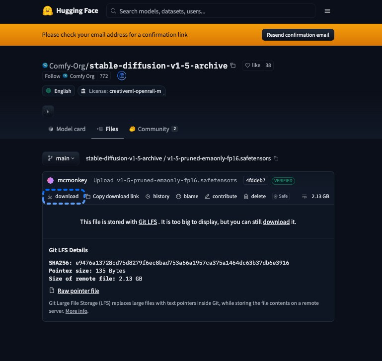

## Поместить модель в папку `checkpoints`

ComfyUI показывает чекпойнт в списке, только если файл лежит в папке `checkpoints`, которую читает ComfyUI. Переместите скачанный файл в папку, соответствующую вашей установке.

<Tabs>
  <Tab title="Comfy Desktop">
    По умолчанию каждый экземпляр Comfy Desktop читает общие папки моделей. Comfy Desktop сохраняет скачанные модели в общую папку моделей с пометкой **Загрузки**.

    1. В **строке заголовка** Comfy Desktop нажмите **Меню**, а затем выберите **Настройки рабочего стола**.
    2. Перейдите на вкладку **Хранилище**.
    3. В разделе **Общие модели** нажмите на путь к папке с пометкой **Загрузки**. Папка откроется в вашем файловом менеджере.
    4. Переместите `v1-5-pruned-emaonly-fp16.safetensors` в папку `checkpoints` внутри неё. Если папки `checkpoints` нет, создайте её.
  </Tab>
  <Tab title="ComfyUI Portable">
    - Переместите `v1-5-pruned-emaonly-fp16.safetensors` в `ComfyUI_windows_portable\ComfyUI\models\checkpoints`.

    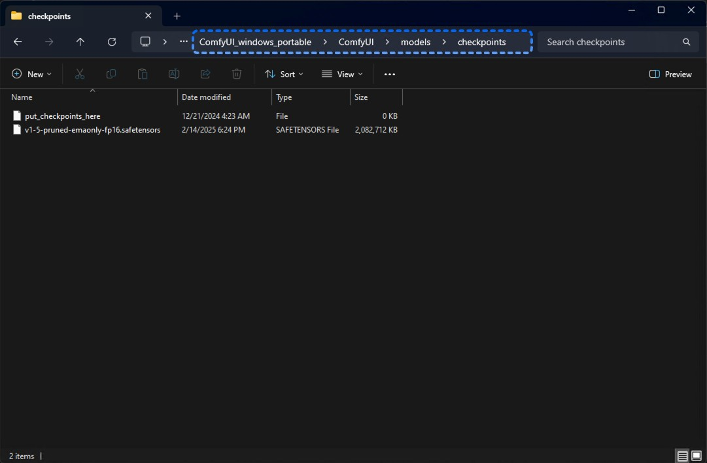
  </Tab>
  <Tab title="Ручная установка">
    1. Откройте папку, в которую вы установили ComfyUI, ту, что содержит `main.py`.
    2. Переместите `v1-5-pruned-emaonly-fp16.safetensors` в её папку `models/checkpoints`.
  </Tab>
</Tabs>

Если ComfyUI уже открыт, нажмите `R`, чтобы он заново прочитал папки моделей.

## Открыть пустой рабочий процесс

**Холст** представляет собой большую область, в которой вы размещаете узлы. Если на нём уже отображается рабочий процесс, откройте пустой рабочий процесс:

1. В верхней части **левой боковой панели** нажмите на логотип ComfyUI (**Меню**).
2. Выберите **New**.

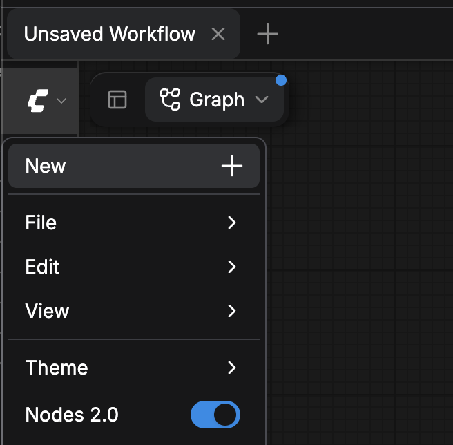

Теперь **Холст** пуст.

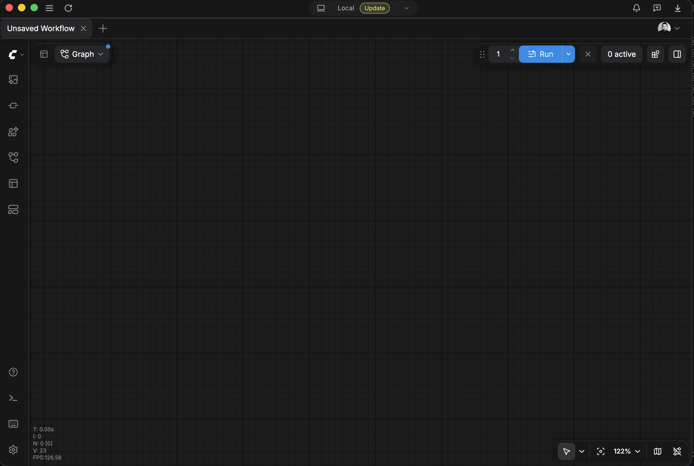

<Tip>
  В **верхней панели** кнопка плюса (**+**) рядом с вкладками открытых рабочих процессов также открывает новый пустой рабочий процесс.

  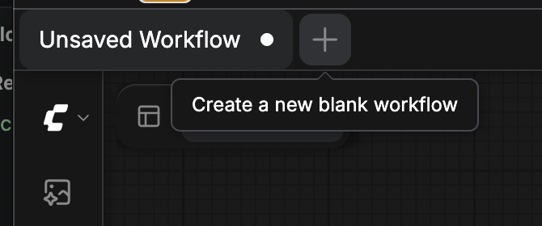
</Tip>

## Добавить узел

Добавить узел можно тремя способами. В последующих шагах указано, какой способ использовать.

### Использовать меню «Добавить узел»

1. Щёлкните правой кнопкой мыши по пустому месту на **холсте**. Откроется меню.
2. Выберите **Добавить узел**, затем последовательно выберите каждую категорию в пути к узлу в меню **Добавить узел**. В [таблице узлов](#изучить-составные-части-рабочего-процесса) перечислены пути для каждого узла в этом руководстве.
3. Выберите узел. Он появится в том месте, где вы щёлкнули правой кнопкой.

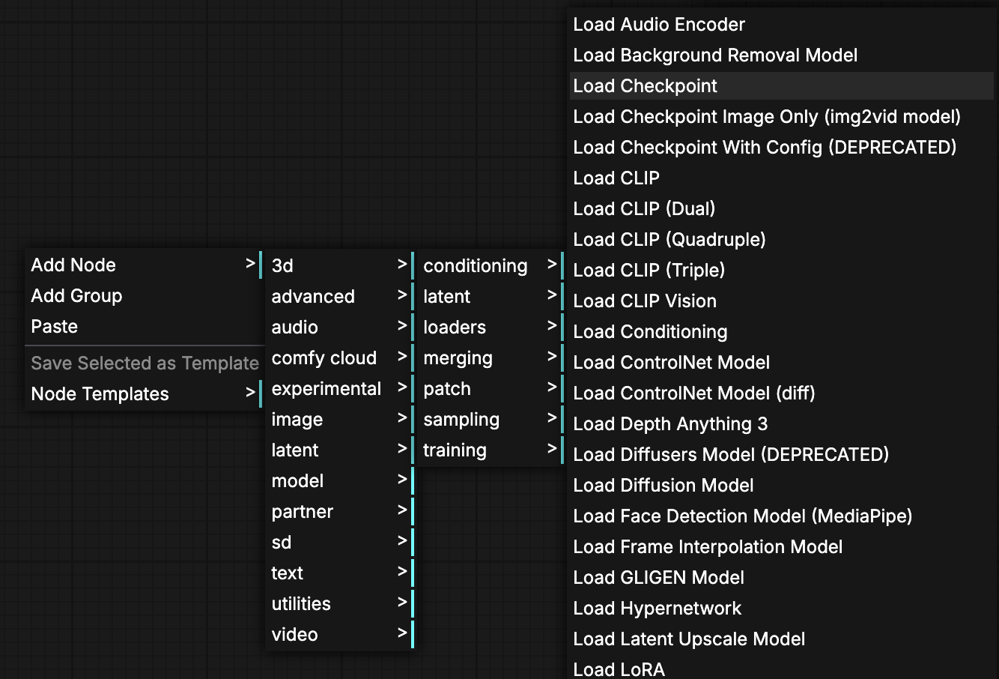

### Найти узел в библиотеке нод

1. Нажмите `N` или щёлкните **Узлы** на **левой боковой панели**. Откроется **Библиотека нод**.
2. Если в **Библиотеке нод** отображается несколько вкладок, выберите **Все узлы**.
3. Введите название узла в поисковую строку **Поиск нод...**.
4. Нажмите на узел в результатах, а затем нажмите на **холст** в нужном месте. Узел появится там.

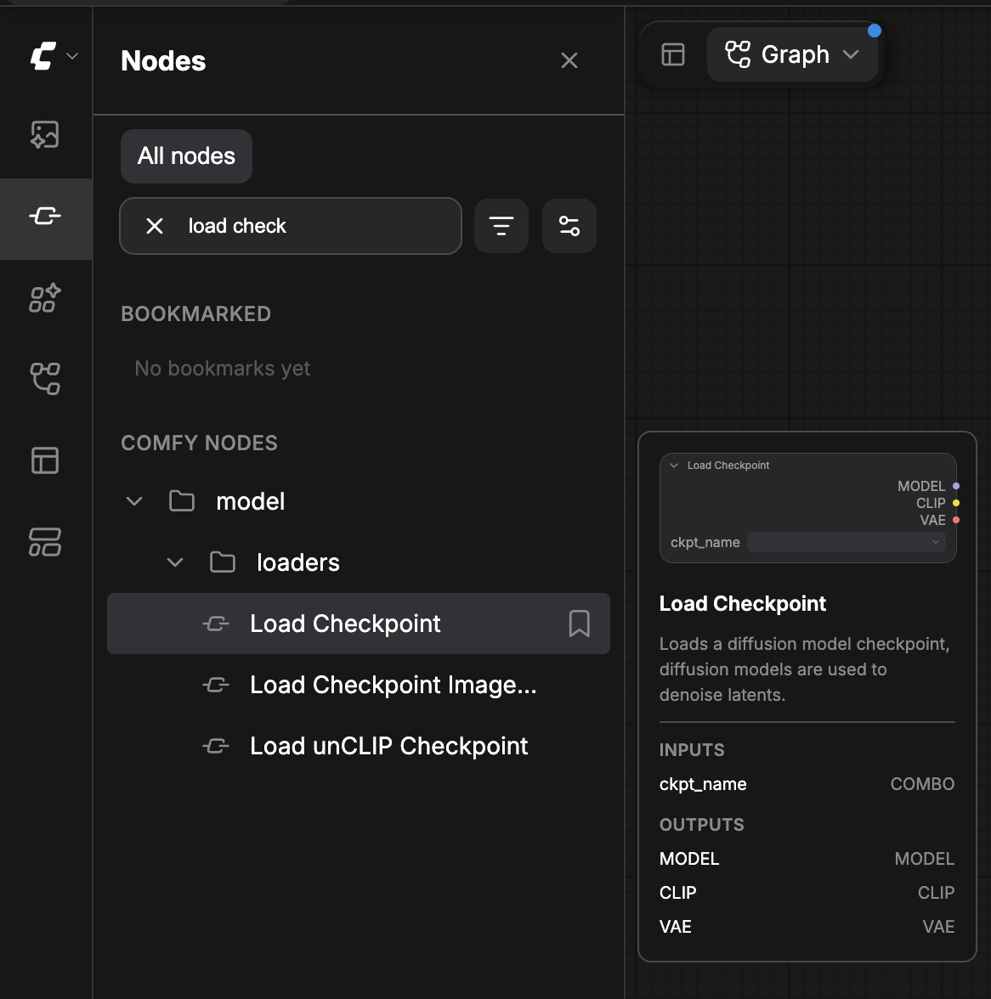

### Перетащить связь на пустой холст

Перетаскивание связи на пустой холст добавляет узел и соединяет его за одно действие.

1. Перетащите от точки выхода на уже размещённом узле.
2. Отпустите над пустым местом на **холсте**. По умолчанию там откроется поисковая строка нод.
3. Введите название узла, затем выберите узел. ComfyUI добавит узел и соединит его с выходом, от которого вы перетаскивали.

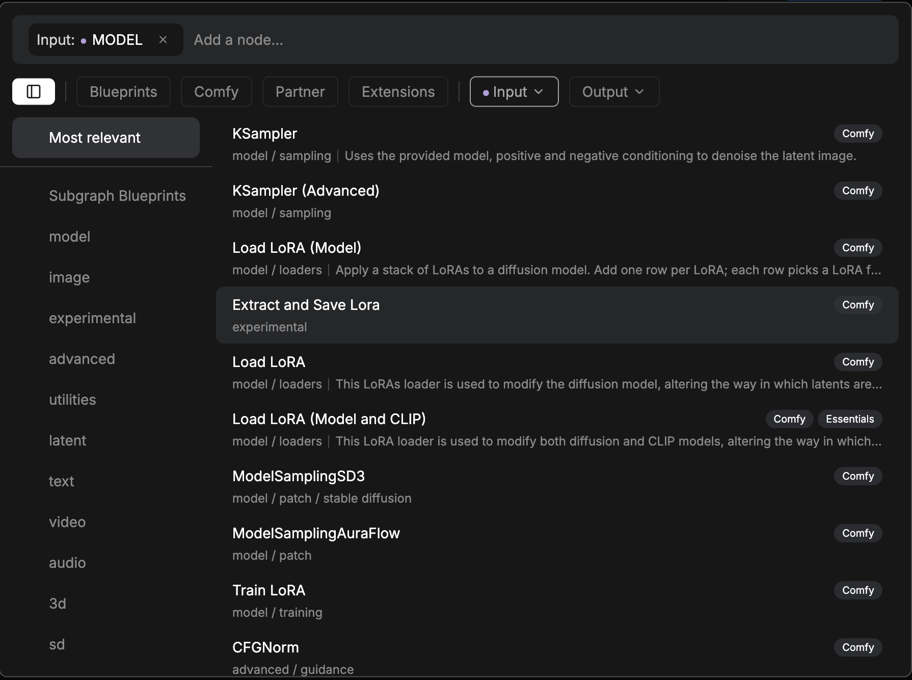

Чтобы открыть меню вместо поисковой строки, удерживайте `Shift` при отпускании.

## Соединить два узла

Соединение передает данные от выхода одного узла к входу другого узла.

1. Потяните от точки выхода на одном узле.
2. Отпустите над точкой входа на другом узле. Между двумя точками появится соединение.

Эти правила применяются к каждому соединению:

- Один выход может быть подключен к нескольким входам.
- К входу можно подключить только одно соединение. Новое соединение к входу заменяет старое.
- Соединение связывает выход и вход одного типа. ComfyUI не создает соединение между разными типами.

## Добавить узел `Load Checkpoint`

Узел `Load Checkpoint` загружает файл модели.

1. Добавьте узел `Load Checkpoint` через меню [**Add Node**](#использовать-меню-добавить-узел): **model** > **loaders** > `Load Checkpoint`.
2. В узле нажмите на виджет `ckpt_name`, а затем выберите `v1-5-pruned-emaonly-fp16.safetensors`.

Справа узел показывает три выхода: `MODEL`, `CLIP` и `VAE`.

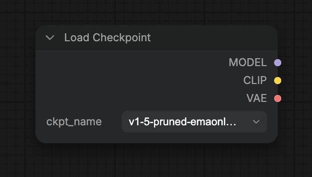

Если в списке `ckpt_name` нет файла, см. раздел [Модели нет в списке чекпойнтов](#модели-нет-в-списке-чекпойнтов).

## Добавить узел `KSampler`

Узел `KSampler` выполняет генерацию. Ему требуются четыре соединения: модель, оба промпта и пустое начальное изображение.

1. Добавьте узел `KSampler`. Откройте [**Библиотека нод**](#найти-узел-в-библиотеке-нод) и найдите `KSampler`.
2. [Подключите](#соединить-два-узла) выход `MODEL` узла `Load Checkpoint` к входу `model` узла `KSampler`.

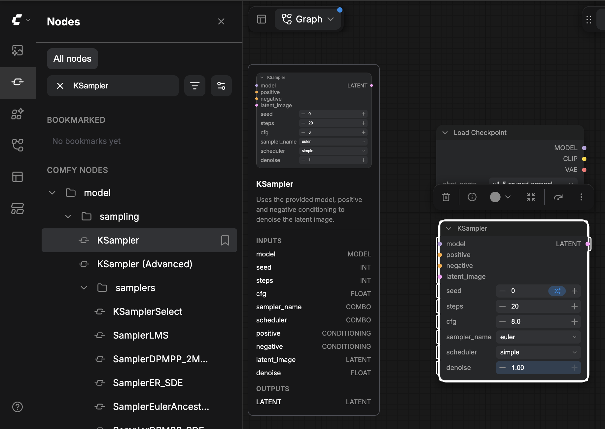

Остальные три соединения вы создадите в следующих двух разделах.

Оставьте виджеты `KSampler` со значениями по умолчанию. Например, `steps` равен `20`, а `cfg` равен `8.0`.

## Добавить узлы промптов

Промпты описывают изображение. Положительный промпт говорит о том, что вы хотите увидеть. Отрицательный промпт говорит о том, чего вы не хотите.

1. Добавьте узел `CLIP Text Encode (Prompt)` через меню [**Добавить узел**](#использовать-меню-добавить-узел) (**model** > **conditioning**) или [**Библиотеку нод**](#найти-узел-в-библиотеке-нод).
2. Нажмите на его текстовое поле и введите положительный промпт, например `beautiful scenery nature glass bottle landscape, purple galaxy bottle`.
3. Щёлкните по узлу правой кнопкой мыши и выберите **Duplicate**. Появится второй узел `CLIP Text Encode (Prompt)`.
4. Нажмите на текстовое поле второго узла и введите отрицательный промпт, например `text, watermark`.

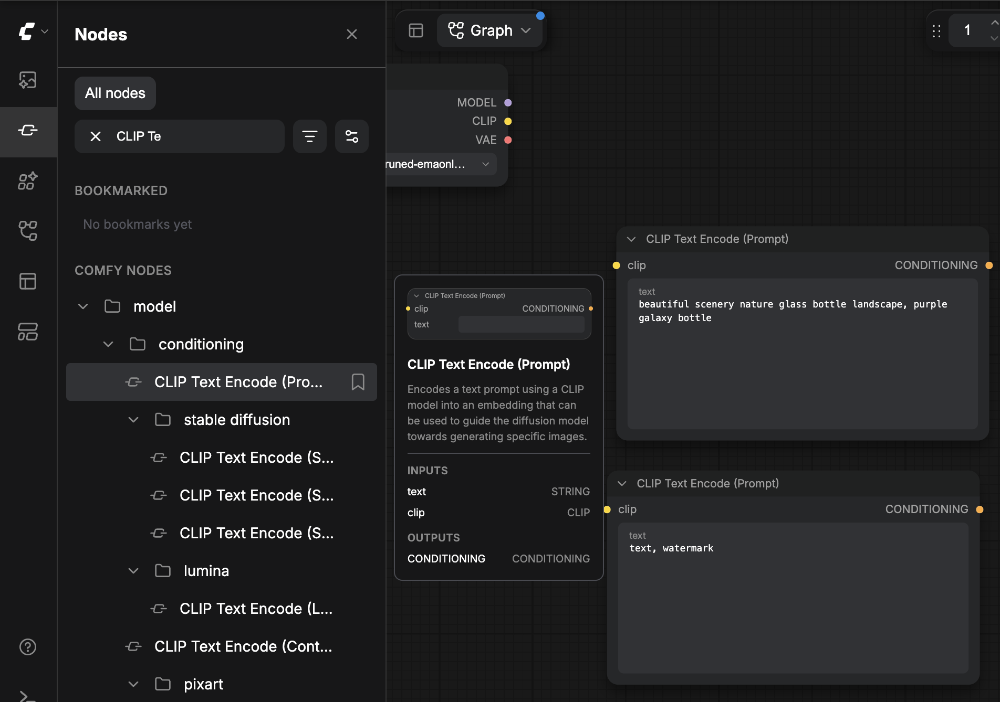

[Соедините](#соединить-два-узла) промпты:

1. Соедините выход `CLIP` на `Load Checkpoint` со входом `clip` на каждом узле `CLIP Text Encode (Prompt)`. Оба узла промптов используют один выход `CLIP`.
2. Соедините выход `CONDITIONING` на узле положительного промпта со входом `positive` на `KSampler`.
3. Соедините выход `CONDITIONING` на узле отрицательного промпта со входом `negative` на `KSampler`.

## Задать размер изображения

Узел `Empty Latent Image` задаёт размер изображения. Его `width` и `height` по умолчанию равны `1024`. В этом рабочем процессе используется `512`, как в примере рабочего процесса из раздела [Загрузить рабочий процесс из изображения](#загрузить-рабочий-процесс-из-изображения).

1. Добавьте узел `Empty Latent Image` через [меню **Add Node**](#использовать-меню-добавить-узел): **model** > **latent** > `Empty Latent Image`.
2. Задайте для `width` значение `512`.
3. Задайте для `height` значение `512`.
4. Оставьте `batch_size` равным `1`.
5. [Подключите](#соединить-два-узла) его выход `LATENT` ко входу `latent_image` узла `KSampler`.

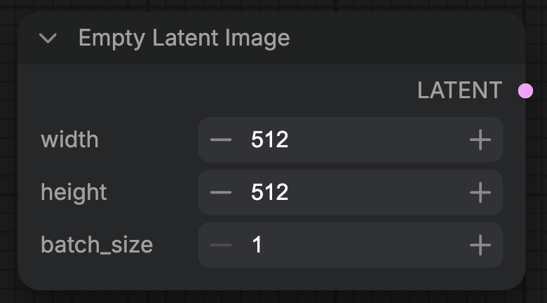

Теперь все четыре входа `KSampler` подключены.

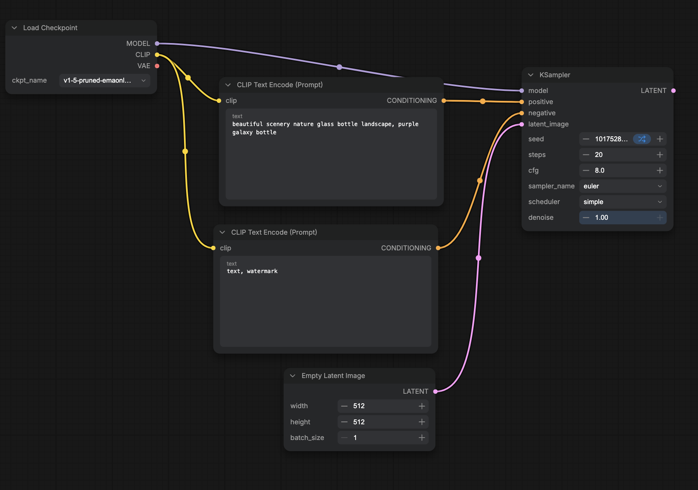

## Декодировать и сохранить изображение

`KSampler` выводит латент, а не изображение. `VAE Decode` преобразует его в изображение, а `Save Image` сохраняет результат.

1. Добавьте узел `VAE Decode` с помощью [**Библиотеки нод**](#найти-узел-в-библиотеке-нод): найдите `VAE Decode`.
2. [Соедините](#соединить-два-узла) выход `LATENT` на `KSampler` с входом `samples` на `VAE Decode`.
3. Соедините выход `VAE` на `Load Checkpoint` с входом `vae` на `VAE Decode`.
4. Добавьте узел `Save Image`, [перетащив ссылку на пустой холст](#перетащить-связь-на-пустой-холст): потяните от выхода `IMAGE` на `VAE Decode`, отпустите над пустым **холстом** и выберите `Save Image`. Его вход `images` будет связан с `IMAGE`.

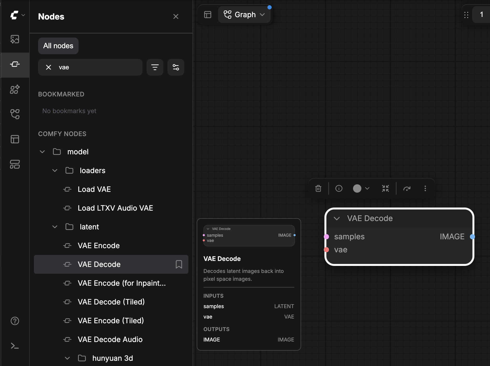

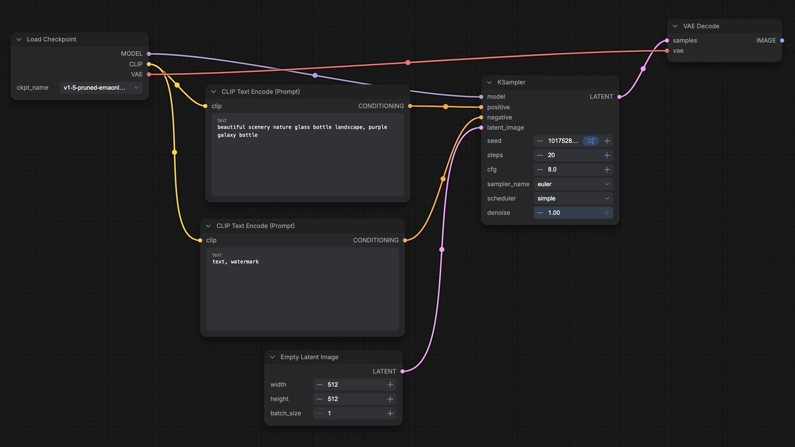

В вашем рабочем процессе семь узлов и девять связей.

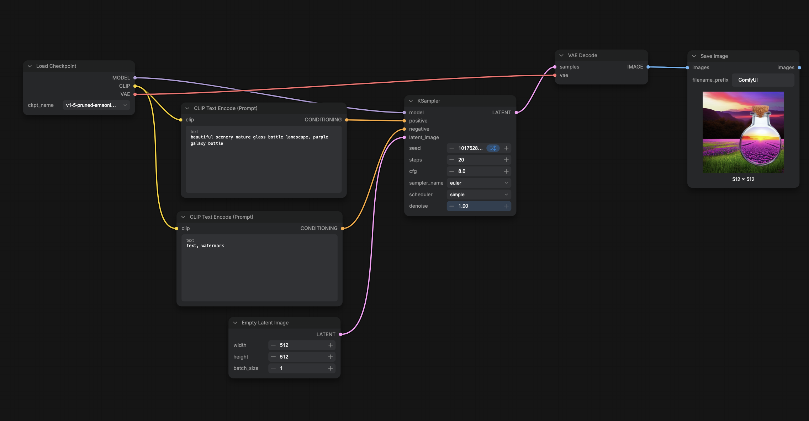

<Tip>
  Если ни один узел не выбран, нажмите `.`, чтобы вписать весь рабочий процесс в экран.
</Tip>

## Запустить рабочий процесс

При запуске рабочий процесс ставится в очередь, и ComfyUI генерирует изображение.

- Нажмите **Run** или используйте `Ctrl+Enter` (`Cmd+Enter` в macOS).

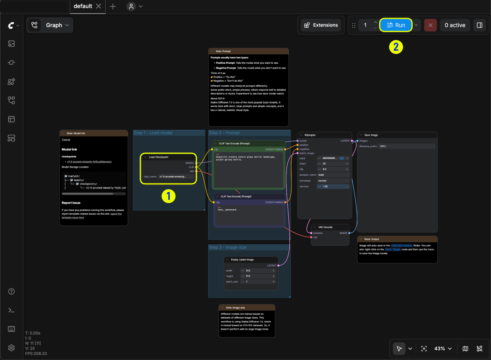

Если ComfyUI показывает **Отсутствует обязательный вход**, см. раздел [Отсутствует обязательный вход](#отсутствует-обязательный-вход).

## Найти сгенерированное изображение

Когда запуск завершится, изображение появится в узле `Save Image`. Чтобы открыть его из **левой боковой панели**:

- Нажмите **Ассеты**, а затем выберите вкладку **Сгенерированные**.

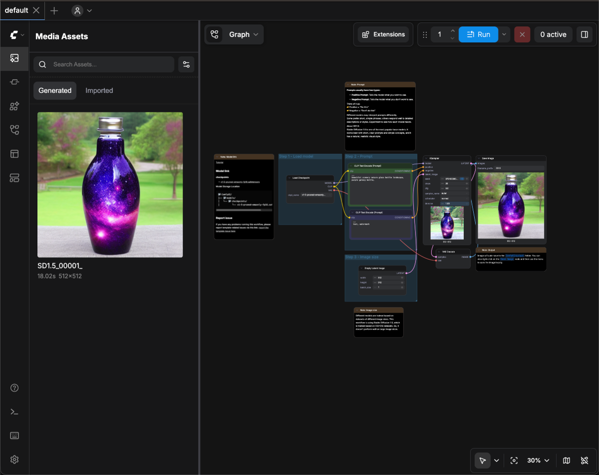

`Save Image` также записывает изображение в папку output как PNG-файл с именем `ComfyUI_00001_.png`. Номер увеличивается для каждого нового изображения. В ComfyUI Portable и при ручной установке папка output: `ComfyUI/output`.

## Загрузить рабочий процесс из изображения

По умолчанию каждый PNG-файл, который записывает `Save Image`, содержит рабочий процесс, создавший его. Загрузите пример изображения ниже, чтобы сравнить его рабочий процесс с тем, который вы построили.

1. Сохраните это изображение на компьютер:

   

2. Перетащите PNG-файл на **холст**. Также можно нажать на логотип ComfyUI (**Меню**) в **левой боковой панели**, выбрать **Файл** > **Открыть** и выбрать файл.

Рабочий процесс из изображения откроется. Если вместо него появится узел `Load Image`, значит, в перетащенном файле не сохранён рабочий процесс.

## Исправить отсутствующую модель

Когда вы загружаете рабочий процесс, файл модели которого отсутствует в ваших папках моделей, ComfyUI показывает уведомление с именем отсутствующей модели, например `v1-5-pruned-emaonly-fp16.safetensors is missing`.

1. Нажмите **Просмотреть детали**. Откроется боковая панель справа на вкладке **Проблемы**, где файл будет указан в разделе **Отсутствующие модели**. Папка, в которую должен попасть файл, например `checkpoints`, отображается под именем файла.
2. Если в строке есть кнопка **Скачать**, нажмите её.
   - **Comfy Desktop**: Comfy Desktop скачивает файл в папку `checkpoints` вашей папки моделей **Загрузки**.
   - **ComfyUI Portable и ручная установка**: файл скачивает ваш браузер. Переместите его в папку `checkpoints`, как описано в разделе [Поместить модель в папку checkpoints](#поместить-модель-в-папку-checkpoints).
3. Если в строке нет кнопки **Скачать**, получите файл самостоятельно:
   1. Нажмите иконку ссылки рядом с именем файла. Иконка ссылки копирует ссылку на скачивание (**Скопировать URL**) или имя файла, если у рабочего процесса нет ссылки (**Скопировать имя модели**).
   2. Скачайте файл. Для модели из этого руководства выполните действия из раздела [Скачать модель](#скачать-модель).
   3. Переместите файл в папку, указанную под именем файла, например `checkpoints`.
4. Нажмите **Обновить** (круговая стрелка) в заголовке **Отсутствующие модели** или нажмите `R`, чтобы ComfyUI снова проверил папки моделей.

Строка отсутствующей модели не содержит кнопку **Скачать**, если верно любое из условий:

- У рабочего процесса нет ссылки на скачивание модели. Пример изображения из раздела [Загрузить рабочий процесс из изображения](#загрузить-рабочий-процесс-из-изображения) относится к таким рабочим процессам.
- Ссылка на скачивание не является ссылкой Hugging Face или Civitai.
- Имя файла не заканчивается на `.safetensors`, `.sft`, `.ckpt`, `.pth` или `.pt`.
- В рабочем процессе не указано, в какую папку моделей должен попасть файл.

<Note>
  Comfy Cloud никогда не показывает **Скачать** для отсутствующей модели. Вместо этого он показывает **Импорт**, чтобы вы могли импортировать модель в Comfy Cloud. Модели, используемые узлами, которые не поддерживают импортированные модели, перечислены в разделе **Импорт не поддерживается**.
</Note>

## Устранение неполадок

Используйте эти разделы, если запуск завершается ошибкой или файл модели не загружается.

### Отсутствует обязательный вход

У входа нет соединения. В сообщении указаны узел и вход, например: `KSampler is missing a required input: latent_image`. Подключите вход, указанный в сообщении, и снова запустите рабочий процесс.

### Модели нет в списке чекпойнтов

Файл не находится в папке `checkpoints`, которую читает ComfyUI. Переместите его туда, как описано в разделе [Поместить модель в папку чекпойнтов](#поместить-модель-в-папку-checkpoints), затем нажмите `R`.
