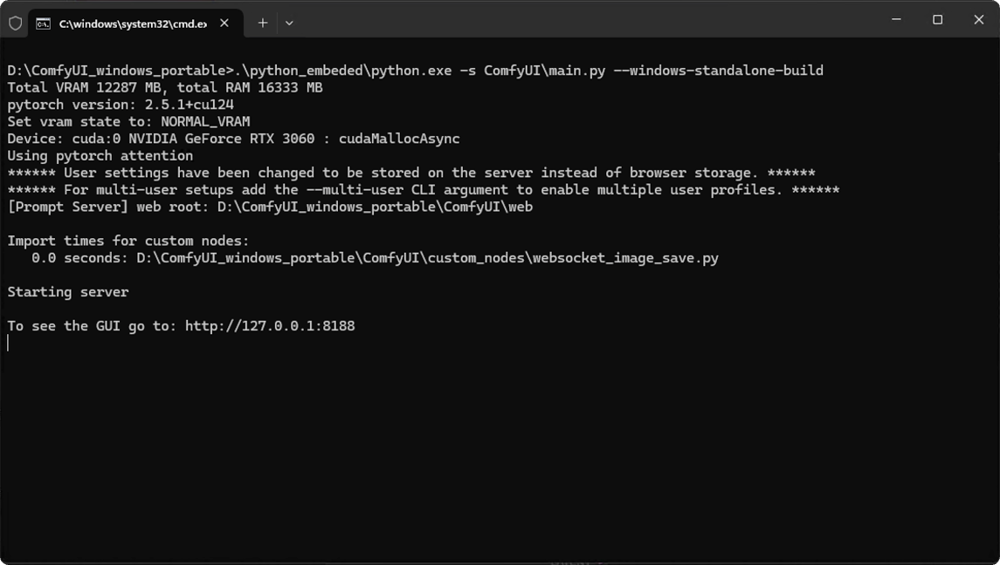

import FirstGeneration from "/snippets/ru/install/first-generation.mdx"
import AddExternalModels from "/snippets/ru/install/add-external-models.mdx"

**ComfyUI Portable** представляет собой автономную упакованную полную версию ComfyUI для Windows, в которую включён отдельный **Python (python_embeded)**, необходимый для работы ComfyUI. Чтобы начать работу, достаточно распаковать архив.

В этом разделе руководства описано, как установить ComfyUI Portable.

## Скачать ComfyUI Portable

<Note>Выберите пакет для скачивания, соответствующий типу вашей GPU. ComfyUI Portable предоставляет отдельные пакеты для разного оборудования GPU.</Note>

<Tabs>
  <Tab title="Nvidia GPU">
    ### Стандартная портативная сборка для GPU Nvidia

    <CardGroup cols={3}>
      <Card title="Nvidia GPU (CUDA 13.0, Python 3.13)" icon="download" href="https://github.com/Comfy-Org/ComfyUI/releases/latest/download/ComfyUI_windows_portable_nvidia.7z">
       Для современных GPU Nvidia (серия RTX)
      </Card>
      <Card title="Nvidia GPU (CUDA 12.6, Python 3.12)" icon="download" href="https://github.com/Comfy-Org/ComfyUI/releases/latest/download/ComfyUI_windows_portable_nvidia_cu126.7z">
       Для GPU Nvidia серии 10 и старше
      </Card>
      <Card title="Nvidia GPU on Windows ARM64 (Python 3.14)" icon="download" href="https://github.com/Comfy-Org/ComfyUI/releases/latest/download/ComfyUI_windows_portable_nvidia_arm64.7z">
       Для устройств Windows on ARM с GPU Nvidia
      </Card>
    </CardGroup>

    Скачайте файл и распакуйте его с помощью [7-ZIP](https://7-zip.org/). Структура распакованной папки:

    ```
    ComfyUI_windows_portable
    ├── 📂ComfyUI                   // Основная программа ComfyUI
    ├── 📂python_embeded            // Независимое окружение Python
    ├── 📂update                    // Пакетные скрипты для обновления портативной версии
    ├── 📂advanced                  // Дополнительные средства запуска: run_cpu.bat (только CPU), run_nvidia_gpu_fast_fp16_accumulation.bat, run_nvidia_gpu_disable_api_nodes.bat
    ├── README_VERY_IMPORTANT.txt   // Инструкции по использованию ComfyUI Portable на английском
    └── run_nvidia_gpu.bat          // Дважды щёлкните, чтобы запустить ComfyUI (Nvidia GPU)
    ```

    Дважды щёлкните `run_nvidia_gpu.bat`, чтобы запустить ComfyUI.
  </Tab>

  <Tab title="AMD GPU">
    ### Портативная сборка для GPU AMD

    <Card title="AMD GPU" icon="download" href="https://github.com/Comfy-Org/ComfyUI/releases/latest/download/ComfyUI_windows_portable_amd.7z">
      Скачать для GPU AMD (ROCm)
    </Card>

    Скачайте файл и распакуйте его с помощью [7-ZIP](https://7-zip.org/). Структура распакованной папки:

    ```
    ComfyUI_windows_portable_amd
    ├── 📂ComfyUI                   // Основная программа ComfyUI
    ├── 📂python_embeded            // Независимое окружение Python
    ├── 📂update                    // Пакетные скрипты для обновления портативной версии
    ├── README_VERY_IMPORTANT.txt   // Инструкции по использованию ComfyUI Portable на английском
    ├── run_amd_gpu_enable_dynamic_vram.bat // Запуск с включённой динамической VRAM
    └── run_amd_gpu.bat             // Дважды щёлкните, чтобы запустить ComfyUI (AMD GPU)
    ```

    Дважды щёлкните `run_amd_gpu.bat`, чтобы запустить ComfyUI.
  </Tab>

  <Tab title="Intel GPU">
    ### Портативная сборка для GPU Intel

    <Card title="Intel GPU" icon="download" href="https://github.com/Comfy-Org/ComfyUI/releases/latest/download/ComfyUI_windows_portable_intel.7z">
      Скачать для GPU Intel
    </Card>

    Скачайте файл и распакуйте его с помощью [7-ZIP](https://7-zip.org/). Структура распакованной папки:

    ```
    ComfyUI_windows_portable_intel
    ├── 📂ComfyUI                   // Основная программа ComfyUI
    ├── 📂python_embeded            // Независимое окружение Python
    ├── 📂update                    // Пакетные скрипты для обновления портативной версии
    └── run_intel_gpu.bat           // Дважды щёлкните, чтобы запустить ComfyUI (Intel GPU)
    ```

    Дважды щёлкните `run_intel_gpu.bat`, чтобы запустить ComfyUI.
  </Tab>
</Tabs>

После загрузки и распаковки вы увидите, как выполняется команда, как показано на изображении ниже



Когда вы увидите примерно то же, что на изображении
```
To see the GUI go to: http://127.0.0.1:8188
```
это означает, что служба ComfyUI уже запущена. Обычно ComfyUI автоматически открывает ваш браузер по умолчанию и переходит на `http://127.0.0.1:8188`. Если браузер не открылся автоматически, откройте его вручную и перейдите по этому адресу.

<Warning>Во время работы не закрывайте соответствующее окно командной строки, иначе ComfyUI остановит выполнение</Warning>

<AddExternalModels/>

<FirstGeneration/>

## Дополнительные инструкции по ComfyUI Portable

### 1. Обновить ComfyUI Portable

Вы можете использовать пакетные команды в папке update, чтобы обновить версию ComfyUI Portable.

```
ComfyUI_windows_portable
└─ 📂update
   ├── update.py
   ├── update_comfyui.bat                          // Обновить ComfyUI до последнего коммита
   ├── update_comfyui_and_python_dependencies.bat  // Использовать только при проблемах со средой выполнения
   └── update_comfyui_stable.bat                   // Обновить ComfyUI до последней стабильной версии
```

### 2. Настроить доступ по локальной сети для ComfyUI Portable

Если ComfyUI работает в локальной сети и вы хотите, чтобы другие устройства могли получить доступ к ComfyUI, можно изменить соответствующий файл `.bat` (например, `run_nvidia_gpu.bat`, `run_amd_gpu.bat` или `run_cpu.bat`, который находится в `advanced\` в новых пакетах NVIDIA и в корне пакета в старых) с помощью Блокнота, чтобы завершить настройку. В основном это делается добавлением `--listen`, чтобы указать адрес прослушивания.
Ниже приведён пример команды в файле `run_nvidia_gpu.bat` с добавленным параметром `--listen`.

```bat
.\python_embeded\python.exe -s ComfyUI\main.py --listen --windows-standalone-build
pause
```

После запуска ComfyUI вы заметите, что итоговый адрес запуска станет таким:
```
Starting server

To see the GUI go to: http://0.0.0.0:8188
To see the GUI go to: http://[::]:8188
```

Вы можете нажать `WIN + R`, ввести `cmd`, чтобы открыть командную строку, затем ввести `ipconfig`, чтобы просмотреть локальный IP-адрес. После этого другие устройства смогут получить доступ к ComfyUI, введя `http://your-local-IP:8188` в браузере.

### 3. Установить дополнительные пакеты Python

Портативная версия поставляется со встроенной средой Python (`python_embeded`). Чтобы установить дополнительные пакеты Python (например, оптимизации внимания, зависимости пользовательских узлов или другие инструменты), используйте pip встроенного Python из командной строки:

```bash
# Сначала перейдите в папку портативной версии ComfyUI
cd ComfyUI_windows_portable

# Установите пакет с помощью встроенного Python
.\python_embeded\python.exe -m pip install <package-name>
```

После установки пакета, который требует флага запуска, добавьте соответствующий флаг в ваш файл `.bat` (например, `run_nvidia_gpu.bat`):

```bat
.\python_embeded\python.exe -s ComfyUI\main.py --<startup-flag> --windows-standalone-build
```

Подробные указания по установке зависимостей пользовательских узлов см. в [руководстве по зависимостям пользовательских узлов](/basic-concepts/custom-nodes).
