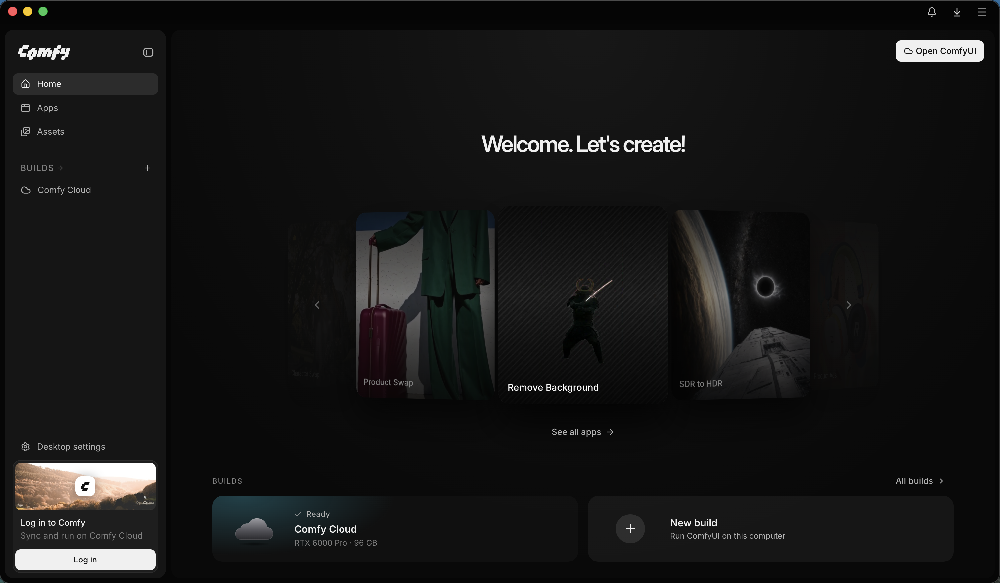
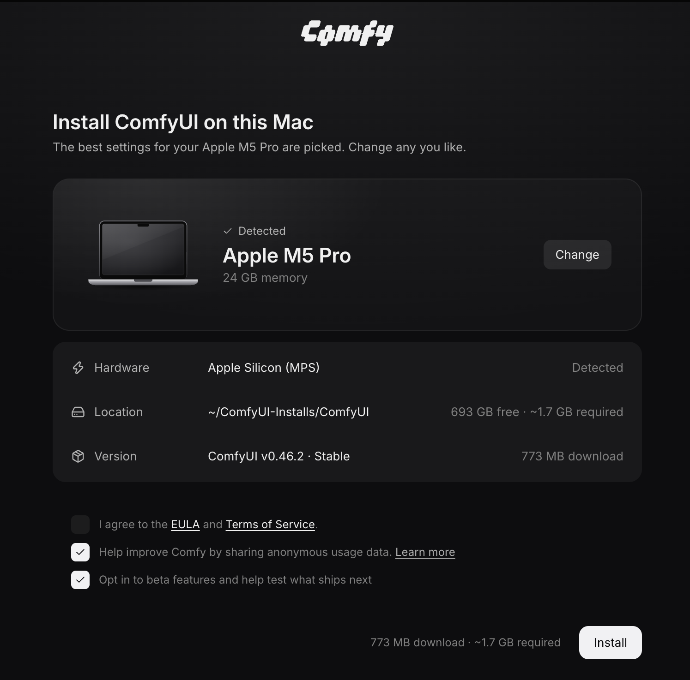

Десктопный Comfy представляет собой приложение, с помощью которого вы запускаете ComfyUI: либо как копию, установленную на этом компьютере (локальная сборка), либо в Comfy Cloud, который работает на облачных GPU и доступен на любом компьютере. Он скачивает и настраивает всё необходимое для ComfyUI, поэтому Десктопный Comfy остаётся единственным приложением, которое вы устанавливаете. На этой странице вы скачиваете Десктопный Comfy, подтверждаете экран настройки, который открывается при первом запуске, и открываете ComfyUI.

<Note>
  В Десктопном Comfy каждая копия ComfyUI называется сборкой. Если вы использовали более раннюю версию Десктопного Comfy, ваши экземпляры отображаются как сборки с теми же моделями и настройками.
</Note>

## Выбрать, где работает ComfyUI

Десктопный Comfy запускает ComfyUI в двух местах: на этом компьютере как локальную сборку или в [Comfy Cloud](https://comfy.org/cloud). Выберите нужный вариант до начала работы, поскольку экран настройки при первом запуске устанавливает локальную сборку.

| | Локальная сборка | Comfy Cloud |
| --- | --- | --- |
| Где работает | На этом компьютере | На GPU в облаке, поэтому подходит для любого компьютера |
| Установка | Экран настройки устанавливает её при первом запуске | Не требуется. На вкладке **Home** отображается карточка **Comfy Cloud** |
| Стоимость | Бесплатно | Кредиты Comfy, которые списываются только во время работы GPU |
| Требуется | Свободное место на диске для установки (экран настройки показывает количество) | Аккаунт Comfy |

Чтобы использовать только Comfy Cloud, пропустите установку, когда откроется экран настройки. Как это сделать, описано в разделе [Открыть Comfy Cloud в десктопном Comfy](#открыть-comfy-cloud-в-comfy-desktop).

## Скачать десктопный Comfy

На странице загрузки предлагаются установщики для Windows, macOS и Linux.

1. Перейдите на [comfy.org/download](https://comfy.org/download).
2. Нажмите **DOWNLOAD DESKTOP**. Кнопка скачивает установщик для операционной системы, которую определяет страница. Имя установщика отображается под текстом кнопки.
3. Чтобы выбрать другой установщик, нажмите стрелку (**All installers**) рядом с кнопкой, а затем выберите установщик. В списке доступны **Windows x64**, **Windows ARM64 (NVIDIA only)**, **macOS (Apple Silicon)** и **Linux x64 (AppImage)**.

   

4. Откройте скачанный файл, чтобы установить десктопный Comfy.
5. Откройте десктопный Comfy.

<Tip>
  Китайская страница загрузки [comfy.org/zh-CN/download](https://comfy.org/zh-CN/download) предлагает те же установщики. На её кнопке написано **下载桌面版**. Чтобы скачать файлы ComfyUI с зеркал в Китае, см. раздел [Подтвердить экран настройки](#подтвердить-экран-настройки).
</Tip>

## Подтвердить экран настройки

При первом запуске Десктопный Comfy открывает экран настройки. Его заголовок: **Install ComfyUI on this Mac** в macOS, **Install ComfyUI on this PC** в Windows и **Install ComfyUI on this computer** в Linux. Ничего не загружается, пока вы не нажмете **Install**.

Десктопный Comfy подбирает настройки для вашего компьютера. Проверьте их перед установкой:

- **Detected**: панель вверху показывает GPU или процессор, которые нашёл Десктопный Comfy, и их память.
- **Hardware**: аппаратное обеспечение, для которого собрана сборка. **No GPU acceleration** означает, что ComfyUI работает на вашем процессоре.
- **Version**: версия ComfyUI и её канал выпуска, например **Stable**.
- **Location**: папка, в которую устанавливается сборка, и свободное место на этом диске.

Рядом с **Install** экран настройки показывает размер загрузки. Наведите указатель на иконку информации рядом с ним, чтобы узнать, сколько места на диске потребуется для установки.

Чтобы выбрать другие настройки, нажмите **Change**, измените их на экране **Change setup** и нажмите **Save changes**.

<Tip>
  Для первой установки оставьте настройки, которые выбрал Десктопный Comfy. В разделе [Сборки](/ru/installation/desktop/usage/instance-management) описана каждая настройка, которую можно изменить.
</Tip>

Чтобы установить:

1. Установите флажок **I agree to the EULA and Terms of Service.** Нажмите **EULA** или **Terms of Service**, чтобы прочитать любой из них.
2. Нажмите **Install**.

Если вы нажмете **Install**, не установив флажок условий, рядом с ним появится **Agree to install.**

<Note>
  Если Десктопный Comfy работает на китайском языке, после нажатия **Install** он спросит **Enable Chinese mirrors?**. **Enable mirrors** загружает с `gitcode.com`, `mirrors.aliyun.com` и `mirrors.cloud.tencent.com`. **Not now** оставляет `github.com` и `pypi.org`.
</Note>

### Оставить существующие сборки или мигрировать

- **Use my builds**: появляется рядом с **Install**, если на этом компьютере уже есть сборки. Установите флажок условий и нажмите эту кнопку, чтобы пропустить установку. Открывается **Home** с вашими сборками.
- **Migrate**: заменяет **Install**, если Десктопный Comfy обнаружил установку Классического десктопа. В разделе [Мигрировать из Классического десктопа](/ru/installation/desktop/usage/migrate) перечислено, что переносится.

## Наблюдать за установкой на Home

Экран настройки закрывается, и открывается **Home**. Карточка вашей сборки в строке Builds показывает прогресс, например **Установка ComfyUI · 60%**, затем **Запуск ComfyUI**.

Пока идёт установка, карточка может показывать более старую версию ComfyUI. На последнем шаге установки сборка обновляется до версии, которая была указана на экране настройки.

По умолчанию ComfyUI открывается в собственном окне, когда готов, и на карточке отображается **Работает**.

Если установка или запуск завершатся ошибкой, см. раздел [Устранение неполадок](#устранение-неполадок).

## Открыть Comfy Cloud в Comfy Desktop

На странице **Home** в строке **Builds** отображается карточка **Comfy Cloud**, рядом с любой локальной сборкой.

### Пропустить локальную установку и перейти на Home

На экране настройки нет кнопки пропуска, если у вас ещё нет сборок. Чтобы попасть на **Home** и использовать только Comfy Cloud:

1. На экране настройки отметьте флажок условий.
2. На панели **Detected** нажмите **Change**.
3. В **заголовке окна** нажмите **Menu**, а затем выберите **Skip onboarding**.

Откроется **Home** с карточкой **Comfy Cloud** в строке **Builds**.

### Войти и открыть Comfy Cloud

Пока вы не вошли в аккаунт, карточка **Comfy Cloud** показывает **Log in to use**.

<Warning>
  Comfy Cloud расходует кредиты Comfy, пока работает её GPU. Проверьте баланс **Credits**, прежде чем открывать её.
</Warning>

1. В **боковой панели** на карточке **Log in to Comfy** нажмите **Log in**. Карточка покажет **Continue in your browser**.

   

2. Завершите вход в браузере. В **боковой панели** отобразится ваш баланс **Credits**, что подтвердит, что аккаунт работает.
3. На **Home** нажмите карточку **Comfy Cloud**.

Comfy Cloud откроется в отдельном окне.

<Tip>
  Чтобы использовать Comfy Cloud в браузере, откройте [cloud.comfy.org](https://cloud.comfy.org/).
</Tip>

## Снова открыть ComfyUI из Home

После того как вы закроете ComfyUI, снова открыть его можно на экране **Home**. Воспользуйтесь одним из способов:

- Нажмите **Open ComfyUI** в правом верхнем углу. Откроется ваша последняя сборка. Чтобы открыть другую сборку, нажмите стрелку справа от кнопки (**Choose the build to open**) и выберите сборку.
- Или нажмите на карточку сборки в ряду **Builds**, чтобы запустить или открыть эту сборку.

Чтобы узнать об остальных возможностях экрана **Home** и **боковой панели**, см. [Навигация в Comfy Desktop](/ru/installation/desktop/usage/overview). Чтобы сгенерировать первое изображение в установленной вами сборке, перейдите к разделу [Ваше первое изображение в ComfyUI](/ru/get_started/first_generation).

## Устранение неполадок

Используйте эти пункты, если экран настройки или установка работают не так, как ожидалось.

<AccordionGroup>
  <Accordion title="Исправить кнопку Install, которая ничего не делает">
    - **Not supported** в строке **Hardware**: используйте Comfy Cloud. [Пропустите локальную установку и перейдите на Home](#пропустить-локальную-установку-и-перейти-на-home), а затем [войдите и откройте Comfy Cloud](#войти-и-открыть-comfy-cloud).
    - **Couldn't reach the ComfyUI download server**: проверьте подключение к интернету, а затем нажмите **Try again**.
    - **Agree to install.** рядом с блоком условий: см. [Подтвердить экран настройки](#подтвердить-экран-настройки).
  </Accordion>
  <Accordion title="Освободить место на диске">
    В строке **Location** отображается **Only … free, about … needed to install**, если диск переполнен. [Измените расположение](#подтвердить-экран-настройки) на диск с большим объёмом свободного места или освободите место на этом диске.
  </Accordion>
  <Accordion title="Исправить сборку, которая не установилась">
    Если установка не завершилась, карточка сборки на **Home** показывает **Install failed**.

    <Warning>
      При удалении сборка и все её файлы удаляются безвозвратно. Другие сборки не затрагиваются. Сначала скопируйте из папки сборки всё, что хотите сохранить.
    </Warning>

    1. Нажмите на карточку сборки. Откроется страница этой сборки.
    2. Нажмите **More**, затем выберите **Uninstall**. Подтвердите действие кнопкой **Uninstall**.
    3. На **Home** нажмите **New build**, чтобы установить новую сборку.
  </Accordion>
  <Accordion title="Восстановить работу после закрытия настройки">
    Если вы закроете Comfy Desktop во время настройки, появится запрос **Quit setup?**. Нажмите **Quit setup**, и Comfy Desktop не сохранит ваш выбор. Экран настройки снова откроется при следующем запуске Comfy Desktop.
  </Accordion>
  <Accordion title="Исправить сборку, которая не запустилась">
    Если ComfyUI не запускается, карточка сборки на **Home** показывает **Didn't start**.

    1. Нажмите на карточку сборки. Откроется диалоговое окно с заголовком **ComfyUI didn't start**.
    2. Нажмите **View logs**, чтобы прочитать, что пошло не так.
    3. Нажмите **Try again**.
  </Accordion>
</AccordionGroup>

## Посмотреть исходный код

Исходный код Comfy Desktop доступен на [GitHub](https://github.com/Comfy-Org/Comfy-Desktop). Проект распространяется по двойной лицензии: AGPL-3.0-or-later или коммерческая лицензия от Comfy Org.
