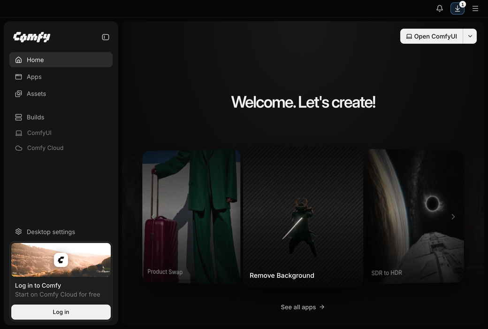
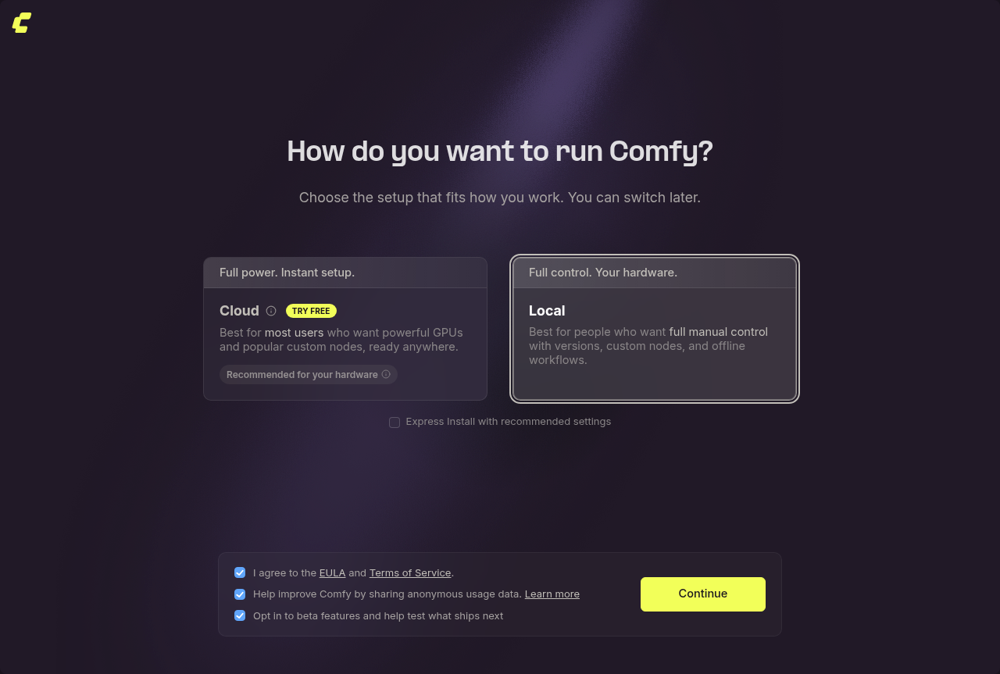

**Comfy Desktop** представляет собой настольное приложение, которое позволяет устанавливать, управлять и запускать несколько экземпляров ComfyUI из одного лаунчера.

Проще говоря, **Comfy Desktop** представляет собой приложение, которое управляет и запускает **ComfyUI**, движок генеративного ИИ на основе узлов. ComfyUI не нужно устанавливать отдельно. Comfy Desktop берёт на себя установку, среду Python и зависимости. Каждый экземпляр ComfyUI работает независимо, со своей версией, пользовательскими узлами и настройками.

Comfy Desktop работает на **Windows 10+**, **macOS 13+ (Apple Silicon)** и **Linux** (официальные пакеты `.deb` и AppImage). Каждая отдельная установка требует не менее **4.85 GB** дискового пространства и **8 GB RAM (рекомендуется 16 GB)**. Полные подробности смотрите на страницах для соответствующих платформ.

## Начать

Выберите свою платформу, чтобы начать:

<CardGroup cols={3}>
  <Card title="Windows" icon="windows" href="/ru/installation/desktop/windows">
    Пошаговое руководство по установке для Windows 10 и новее.
  </Card>

  <Card title="macOS" icon="app-store" href="/ru/installation/desktop/macos">
    Пошаговое руководство по установке для macOS 13+ (Apple Silicon).
  </Card>

  <Card title="Linux" icon="linux" href="/ru/installation/desktop/linux">
    Установите официальный `.deb` или AppImage либо соберите из исходного кода.
  </Card>
</CardGroup>

## Первый запуск

При первом открытии Comfy Desktop полноэкранная настройка спрашивает: **How do you want to run Comfy?** и собирает нужные параметры до того, как что-либо будет установлено. Окно остаётся в этом режиме настройки, пока вы её не завершите: если закрыть приложение на полпути, при следующем запуске откроется тот же экран.

### Облако или локально

Две карточки описывают два способа запуска ComfyUI:

- **Cloud** запускает ComfyUI на облачных GPU Comfy Cloud. На вашу машину ничего не устанавливается и ничего не скачивается. Пока доступны бесплатные запуски в облаке, на карточке отображается метка **TRY FREE**.
- **Local** устанавливает ComfyUI на эту машину. Вы контролируете версию ComfyUI, пользовательские узлы и аргументы запуска, и всё работает офлайн.

Если Comfy Desktop обнаружит, что GPU этой машины недостаточно мощный для большинства рабочих процессов, на карточке Cloud появится метка **Recommended for your hardware**, и ни одна из карточек не будет выбрана заранее, чтобы выбор был осознанным, а не по умолчанию. Кнопка **Continue** остаётся недоступной, пока не выбрана карточка.

### Условия и обмен данными

Под карточками расположены три флажка:

- **I agree to the EULA and Terms of Service**: обязательно. Две ссылки в нём открывают EULA и Terms of Service; политика конфиденциальности открывается из **Learn more** в строке обмена данными ниже. **Continue** не сработает, пока этот флажок не установлен, при каждом запуске настройки.
- **Help improve Comfy by sharing anonymous usage data**: необязательно и отмечено по умолчанию. Comfy Desktop отправляет анонимные данные об использовании и никогда не собирает содержание рабочего процесса, промпты, сгенерированные медиафайлы или личную информацию. Это можно изменить позже в разделе [Настройки рабочего стола](/ru/installation/desktop/usage/settings).
- **Opt in to beta features and help test what ships next**: необязательно и отмечено по умолчанию, доступно только пока включён обмен данными. Отключение обмена данными также снимает этот флажок.

### Экспресс-установка

Когда выбран **Local**, появляется флажок **Express Install with recommended settings**. По умолчанию он снят, поэтому мастер установки показывает версию ComfyUI, место установки и параметры запуска до того, как что-либо будет записано на диск. Установите его, чтобы пропустить этот шаг и установить автономный экземпляр с рекомендуемыми настройками. После этого Comfy Desktop указывает под флажком обнаруженное оборудование, чтобы вы могли снять флажок, если обнаруженный GPU не тот, который вы хотите использовать.

### Перенос существующей установки

Если Comfy Desktop обнаружит на машине установку Legacy Desktop, рядом с Express Install появится флажок **Migrate existing instance**, отмеченный по умолчанию. Оставьте его отмеченным, чтобы перенести свои рабочие процессы, модели и настройки при продолжении; что именно переносится, описано в разделе [Перенос из Legacy Desktop](/ru/installation/desktop/usage/migrate). Снимите его, чтобы вместо этого установить новый экземпляр. Если сняты оба флажка, Comfy Desktop спросит ещё раз перед началом установки: выберите **Migrate**, чтобы перенести установку Legacy Desktop, или **Start Fresh**, чтобы установить чистый экземпляр и оставить существующие проекты на месте.

### Китайские зеркала

Когда приложение работает на китайском языке, настройка добавляет один вопрос после **Continue**: **Enable Chinese Mirrors?** Выберите **Enable Mirrors**, чтобы клонировать Git-репозитории с `gitcode.com` и загружать пакеты PyPI с зеркал Aliyun и Tencent вместо `github.com` и `pypi.org`, что быстрее в материковом Китае. Выберите **Not now**, чтобы оставить значения по умолчанию. Любой ответ сохраняется в настройке **Use Chinese Mirrors (Git & PyPI)**, поэтому его можно изменить позже.

### После настройки

**Continue** сохраняет ваш выбор и показывает короткий шаг **Preparing your install…**.

- **Cloud**: Comfy Desktop закрывает настройку и запускает Comfy Cloud.
- **Local**: запускается мастер установки, если не включена экспресс-установка, установка показывает свой прогресс, а завершённый экземпляр появляется на панели управления.

Если у Comfy Desktop уже есть автономная, отслеживаемая или удалённая установка, он пропускает выбор Cloud или Local и сразу переводит вас на панель управления после принятия условий. Согласие требуется при каждом запуске настройки.

Настройка захватывает весь экран: заголовок окна заблокирован, пока она открыта, а после того как вы покидаете шаг согласия, меню приложения (☰) сокращается до одного пункта **Skip Onboarding**, который закрывает настройку и переносит вас на панель управления без установки чего-либо.

## Руководство по использованию

После установки узнайте, как работать с Comfy Desktop:

<CardGroup cols={1}>
  <Card title="Руководство по использованию Comfy Desktop" icon="book-open" href="/ru/installation/desktop/usage/overview">
    Обзор панели управления, управление экземплярами, настройки, снимки и другое.
  </Card>
</CardGroup>

## Мигрировать с классической версии Desktop

Если вы всё ещё используете старую классическую версию Desktop (настольное приложение с единой установкой), вы можете мигрировать свои пользовательские узлы, рабочие процессы и модели в новый Comfy Desktop. Ваши существующие данные сохраняются. Ручная миграция не требуется.

<CardGroup cols={1}>
  <Card title="Руководство по миграции" icon="arrow-right" href="/ru/installation/desktop/usage/migrate">
    Пошаговое руководство по миграции с классической версии Desktop на Comfy Desktop.
  </Card>
</CardGroup>

## Открытый исходный код

Исходный код Comfy Desktop опубликован на [GitHub](https://github.com/Comfy-Org/Comfy-Desktop). Он распространяется по двойной лицензии: AGPL-3.0-or-later или коммерческая лицензия от Comfy Org.
