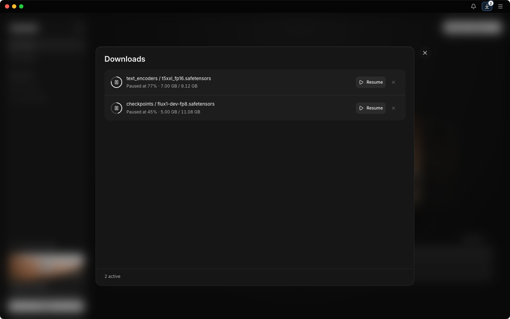

Comfy Desktop скачивает модели для ваших экземпляров и отслеживает каждую передачу в одном месте: будь то модель, которую приложение скачивает для вас, или сгенерированный файл, который вы скачиваете сами. Когда экземпляру ComfyUI нужна модель, которой ещё нет на диске, Comfy Desktop выполняет загрузку и сохраняет файл в каталог моделей экземпляра, поэтому вам не нужно размещать его вручную.

Откройте панель **Downloads** в строке заголовка, чтобы следить за активными загрузками, повторить неудачную или перейти в папку, куда был сохранён завершённый файл.

## Что отображается в списке загрузок

- **Отсутствующие модели**: когда ComfyUI сообщает об отсутствующих моделях в диалоге отсутствующих моделей или на вкладке **Errors** правой боковой панели, действие скачивания выполняется через Comfy Desktop. Каждый файл сохраняется в соответствующую папку моделей, например `checkpoints`, `diffusion_models`, `text_encoders`, `loras` или `vae`. Поддерживаемые типы файлов моделей: `.safetensors`, `.sft`, `.ckpt`, `.pth` и `.pt`.
- **Модели шаблонов**: при создании экземпляра из стартового шаблона модели, необходимые этому шаблону, скачиваются в фоне и отображаются в трее как любая другая загрузка. На экране прогресса шаг загрузки моделей остаётся видимым, пока они не завершатся. Если вы хотите начать сразу, **Skip & open ComfyUI** на этом экране откроет ComfyUI немедленно, а загрузки продолжат идти в трее.
- **Выходы удалённых экземпляров**: при запуске рабочего процесса на удалённом экземпляре или экземпляре Cloud завершённые выходы автоматически скачиваются в ваш локальный выходной каталог.
- **Сгенерированные ресурсы, которые вы скачиваете сами**: изображения, видео или аудио, которые вы сохраняете из панели **Assets**. См. [Загрузка сгенерированных ресурсов](#скачивание-сгенерированных-ресурсов).

## Скачивание сгенерированных ресурсов

Выходы остаются внутри экземпляра, поэтому сохранение одного из них в выбранную вами папку выполняется отдельно от автоматических загрузок, описанных выше.

1. Откройте **Assets** в левой боковой панели и выберите нужный элемент. Чтобы сохранить сразу несколько, сначала выделите их с помощью множественного выбора.
2. Используйте **Download** или **Download all**, если выбрано больше одного элемента. Предпросмотр ассета и меню правой кнопки мыши предлагают то же действие.
3. Comfy Desktop открывает диалог сохранения файла, начиная с папки, в которую вы сохраняли в последний раз (при первом сохранении это системная папка Downloads). Подтвердите папку, и начнётся передача.
4. Следите за ней или отмените её в области **Downloads**. Чтобы приостановить загрузку, откройте **View All Downloads** и нажмите кнопку паузы в строке этой загрузки.

Если файл с таким именем уже существует в папке, диалог сохранения запросит подтверждение перед заменой. При скачивании нескольких ассетов из облачного экземпляра они приходят в виде одного zip-файла.

## Панель загрузок

Нажмите кнопку **Downloads** в правой части заголовка окна, чтобы открыть панель. Загрузки перечислены в порядке «Сначала новые», с указанием папки модели и имени файла, а в активных строках отображаются переданный объём, процент, скорость и оставшееся примерное время.

На кнопке отображается значок с количеством активных загрузок. Если сейчас ничего не загружается, значок вместо этого отмечает загрузки, которые завершились ошибкой и ещё не просмотрены вами, или которые завершились, но ещё не открыты.

В каждой строке доступны следующие действия:

- **Нажмите на завершённую строку**, чтобы открыть папку с файлом (Show in Finder, Show in Explorer или Show in Folder в зависимости от вашей системы).
- **Повторить** неудачную или отменённую загрузку.
- **✕**, чтобы отменить активную загрузку или удалить завершённую из списка.

**View All Downloads** в нижней части панели открывает полный список загрузок.

## Полное окно загрузок

Полное окно сохраняет историю загрузок приложения и добавляет элементы управления, которые не помещаются в трей:

- Фильтруйте список по статусу. Панель предлагает **All** и по одному чипу для каждого статуса, у которого есть строки (**Active**, **Completed**, **Failed**); если строки есть только у одного статуса, панель скрыта.
- **Pause** приостанавливает активную загрузку, а **Resume** возобновляет приостановленную.
- **Retry** повторяет неудавшуюся или отменённую загрузку.
- Откройте папку файла или удалите отдельную строку.
- **Clear finished** позволяет удалить все завершённые строки сразу.

В нижней панели отображается количество активных и завершённых загрузок в списке при любом выбранном фильтре. Неудавшиеся и отменённые загрузки не учитываются.

## Выход при незавершённых загрузках

Загрузки моделей можно возобновить. Если вы выйдете из Comfy Desktop во время передачи модели, уже полученные байты сохранятся, а при следующем запуске передача появится в панели загрузок как приостановленная строка. Откройте **View All Downloads** и нажмите **Resume**, чтобы продолжить с места остановки, или отмените загрузку, чтобы удалить частичный файл.

Загрузки выходных файлов с удалённых инстансов передаются по отдельному пути и не возобновляются после выхода.

Если модели шаблона ещё загружаются, Comfy Desktop просит подтвердить выход, так как настройка шаблона ожидает эти файлы:

- **Quit Anyway**: приостанавливает загрузки и закрывает приложение. При следующем запуске строки останутся на месте.
- **Keep Downloading**: отменяет выход, и Comfy Desktop продолжает работу. Это вариант по умолчанию.

Выход, который инициирует сам Comfy Desktop, например при установке обновления или перезапуске, пропускает этот запрос. Так же поступает **Quit Desktop** в меню заголовка окна, которое закрывает все окна сразу. Если открыто окно локального инстанса, приложение сначала спрашивает подтверждение в диалоге **Quit Desktop**, где перечислены открытые инстансы и активные загрузки; из панели управления, когда окно инстанса не открыто, выход происходит без запроса. В любом случае передачи приостанавливаются и возвращаются при следующем запуске.

## Где сохраняются загрузки

Файлы моделей записываются в каталог загрузок моделей экземпляра: в общий каталог моделей, помеченный **DOWNLOADS** (задаётся с помощью **Use for Model Downloads**), если экземпляр включает общие каталоги моделей, иначе в собственную папку `models` экземпляра. Общие каталоги настраиваются в [Настройках рабочего стола](/ru/installation/desktop/usage/settings#хранилище), а каждый экземпляр может отказаться от них на панели **Manage** на [вкладке **Storage**](/ru/installation/desktop/usage/manage#storage-tab).

Выходы, скачанные с удалённого экземпляра, попадают в общую папку выходов, если экземпляр её использует, иначе в папку выходов, заданную для этого экземпляра. Если это поле пустое, они попадают в общую папку выходов. Удалённое подключение может отключить автоматическое скачивание выходов с помощью **Auto-Download Outputs** в разделе **Launch Settings** на вкладке **Startup Args**.

Сгенерированные ресурсы, которые вы скачиваете самостоятельно, являются исключением: они сохраняются туда, куда вы укажете в диалоге сохранения, поэтому могут находиться полностью вне экземпляра.
