

Comfy Desktop позволяет управлять несколькими экземплярами ComfyUI из представления Chooser.

### Типы экземпляров

Comfy Desktop поддерживает четыре типа экземпляров. Каждый тип отображается на своей карточке и в заголовке окна; у экземпляров **Tracked** та же иконка, что и у **Standalone**.

| Тип | Иконка | Описание |
|------|------|-------------|
| **Standalone** | 💻 | Автономный экземпляр ComfyUI, созданный Comfy Desktop. Включает встроенный Python, автоматические обновления и полную поддержку снимков. Используется по умолчанию при нажатии **New Instance**. |
| **Cloud** | ☁️ | Экземпляр Comfy Cloud. Требуется учётная запись Comfy Cloud. Экземпляры Cloud работают на серверах Comfy, оплата за них взимается отдельно. |
| **Remote** | 🌐 | Подключается к экземпляру ComfyUI, работающему на другом компьютере в вашей сети. При настройке укажите удалённый хост и порт. |
| **Tracked** | 💻 | Отслеживает существующую установку ComfyUI (Git-клон или портативную версию). Использует ту же иконку, что и **Standalone**. Обновлениями вы управляете вручную. См. [Отслеживание существующей установки](#отслеживание-существующей-установки). |

На изображении ниже отмечены основные действия, доступные для каждой карточки экземпляра:

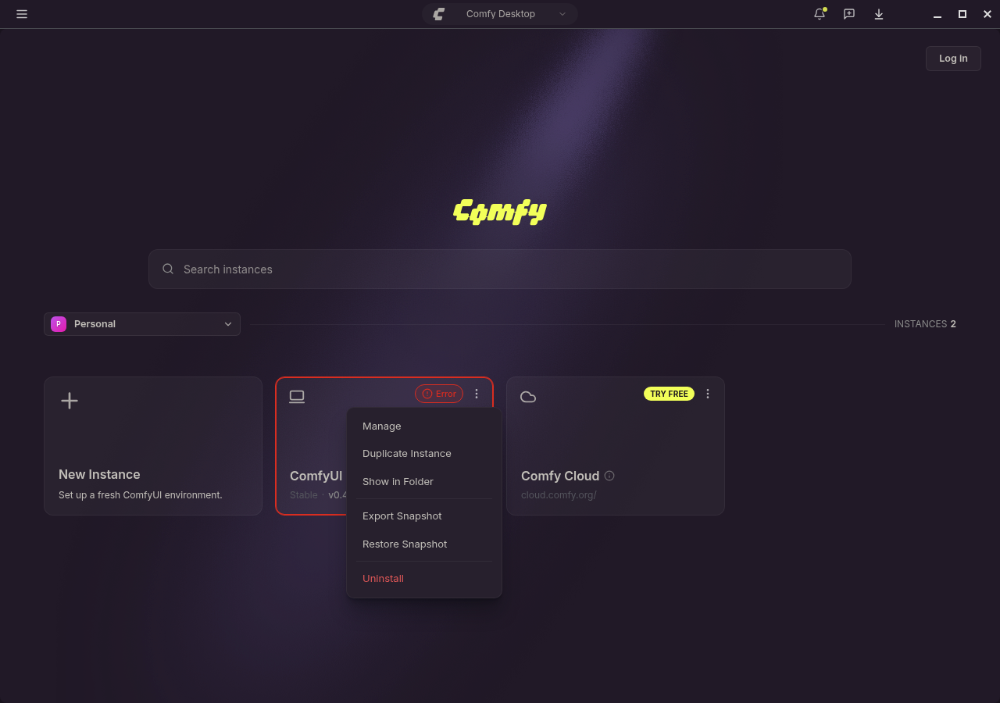

1. **New Instance**: Создайте новый экземпляр ComfyUI. См. [Создание нового экземпляра](#создать-новый-экземпляр). Также можно [создать экземпляр из файла снимка](/ru/installation/desktop/usage/snapshots#создать-экземпляр-из-файла-снимка).
2. **⋮ Menu**: Нажмите на иконку с тремя точками, чтобы открыть меню действий для экземпляра. Правый клик по карточке открывает то же меню.
3. **Manage**: Открывает панель Manage для настройки экземпляра (путь, аргументы запуска, каталоги моделей, переменные окружения). См. страницу [Manage](/ru/installation/desktop/usage/manage).
4. **Duplicate Instance**: Копирует standalone-установку вместе с её собственным окружением Python и пользовательскими узлами. См. [Дублирование экземпляра](#дублировать-экземпляр).
5. **Show in Finder**, **Show in Explorer** или **Show in Folder**: Открывает папку установки в файловом менеджере. Название зависит от вашей операционной системы.
6. **Export Snapshot**: Экспортирует новейший снимок экземпляра в файл, которым можно поделиться. См. [Поделиться снимком](/ru/installation/desktop/usage/snapshots#поделиться-снимком).
7. **Restore Snapshot**: Возвращает экземпляр к предыдущему снимку. См. страницу [Снимки](/ru/installation/desktop/usage/snapshots).
8. **Uninstall**: Окончательно удаляет экземпляр и все его файлы с диска. См. [Удаление экземпляра](#удалить-экземпляр).

В меню также перечислены действия, которые появляются только в определённых состояниях: **Stop**, пока экземпляр запущен, **Update**, когда доступна новая версия ComfyUI, **Migrate to Standalone** для установки, которую можно мигрировать, и **Create Build** для локального экземпляра, который можно опубликовать в рабочее пространство. **Forget** не входит в это меню: он находится в панели Manage, см. [Удаление экземпляра](#удалить-экземпляр).

## Создать новый экземпляр

Нажмите карточку **+** (слева вверху) в представлении Chooser, чтобы добавить новый экземпляр ComfyUI.

<Steps>
  <Step title="Создать новый экземпляр">

<Tabs><Tab title="Windows">
    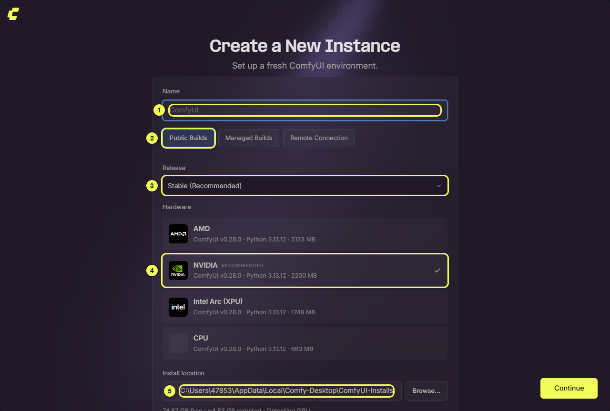
  </Tab><Tab title="macOS">
    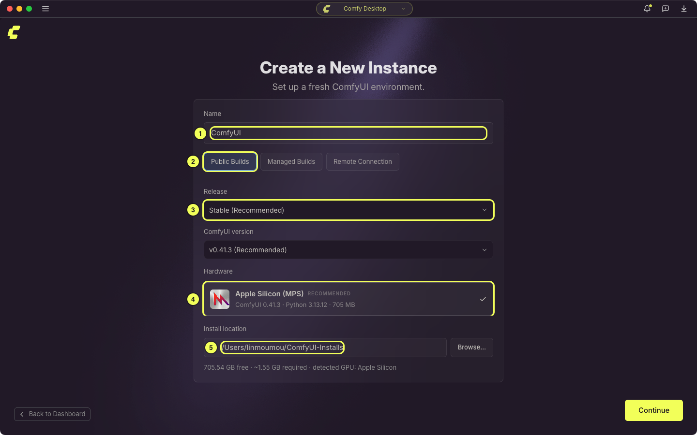
  </Tab><Tab title="Linux">
    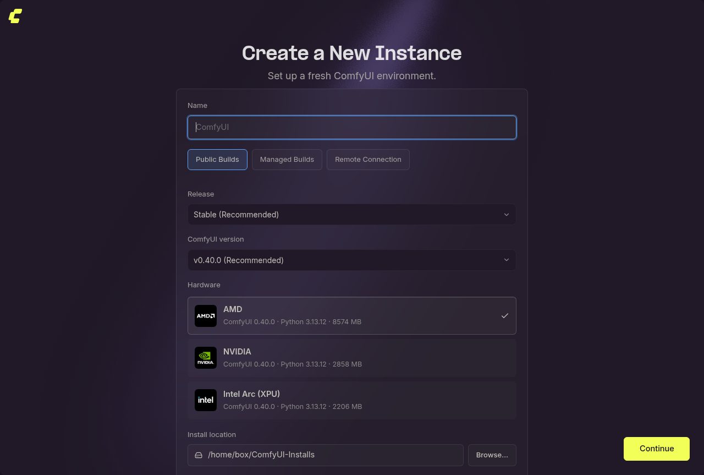
  </Tab>
</Tabs>

1. **Имя**: имя вашего экземпляра. По умолчанию: «ComfyUI».
2. **Public Builds**: рекомендуемый вариант. Стандартная установка ComfyUI, собранная под обнаруженное оборудование. Выберите **Managed Builds**, чтобы вместо этого установить сборку из одного из ваших рабочих пространств (см. [Рабочие пространства и сборки](/ru/installation/desktop/usage/workspaces-and-builds#установить-сборку)), или **Remote Connection**, чтобы подключиться к экземпляру ComfyUI, работающему на другой машине.
3. **Релиз**: канал релиза для установки. По умолчанию выбран **Stable (Рекомендуется)**.
4. **Оборудование**: Comfy Desktop определяет вашу видеокарту и предварительно выбирает подходящую сборку (NVIDIA, AMD, Intel Arc (XPU) или CPU). Для каждого варианта показаны версия ComfyUI, версия Python и размер загрузки.
5. **Место установки**: куда устанавливается ComfyUI. В Windows настоятельно рекомендуется использовать **SSD** и избегать корня диска C:. Поле показывает свободное место на диске и оценку размера установки, когда Comfy Desktop знает её.

Если свободного места мало, мастер показывает диалог **Недостаточно места на диске**. Выберите **Всё равно продолжить** или отмените и укажите другой путь.

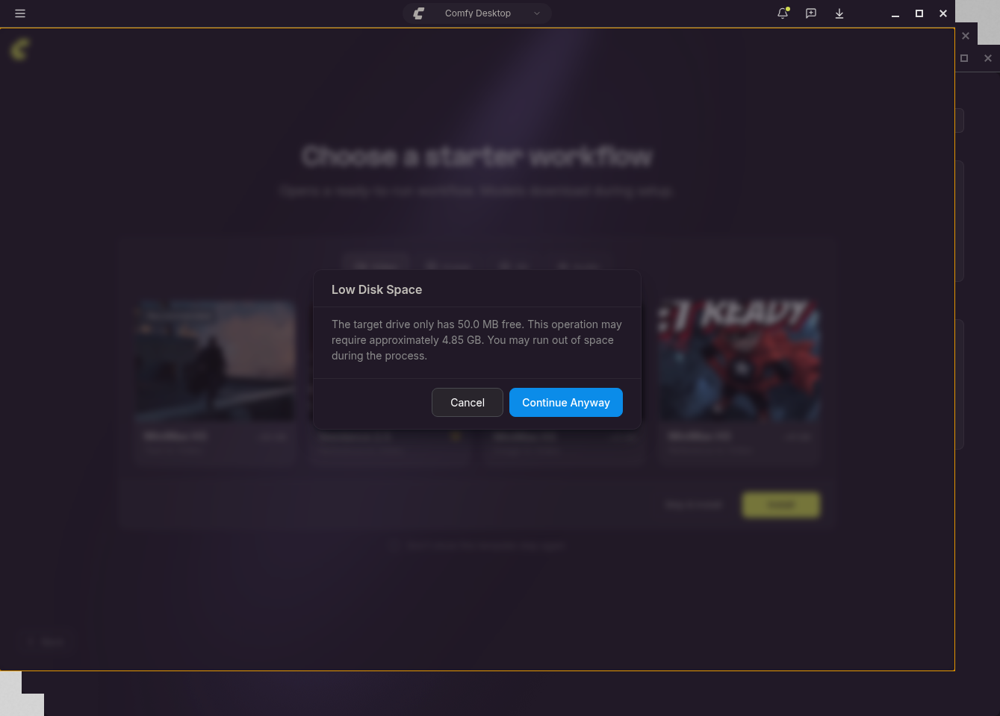

Comfy Desktop также отклоняет папки, в которые не может установиться. Он проверяет папку сразу после выбора через **Просмотреть…**, объясняет проблему под **Местом установки** и держит **Продолжить** недоступной, пока папка не станет пригодной для использования:

- **Внутри собственных файлов Comfy Desktop**: папка приложения, её встроенные ресурсы, папка с данными, а в Windows также кэши обновления. Эти файлы заменяются при обновлении приложения, поэтому установка там будет удалена. В macOS это касается всего, что находится внутри пакета приложения Comfy Desktop.
- **Внутри OneDrive** (Windows): облачная синхронизация замедляет работу большого окружения Python и может повредить файлы во время их выгрузки.
- **Внутри общей папки models, input или output**: установка там может повредить файлы, которые используют все экземпляры. См. [Хранилище](/ru/installation/desktop/usage/settings#хранилище).
- **Внутри папки другого экземпляра**: две установки будут конфликтовать и могут повредить данные.

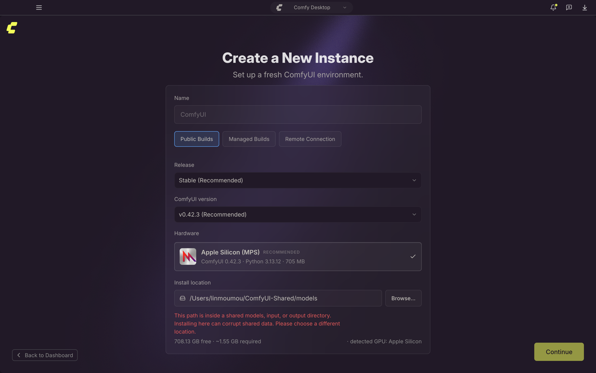

На машине с GPU NVIDIA сборка NVIDIA также проверяет версию драйвера. Если обнаруженный драйвер старше 580, Comfy Desktop показывает диалог **Обновить драйвер NVIDIA** с обнаруженной версией и рекомендуемым минимумом. **Всё равно продолжить** устанавливает с текущим драйвером.

  </Step>
  <Step title="Установка">

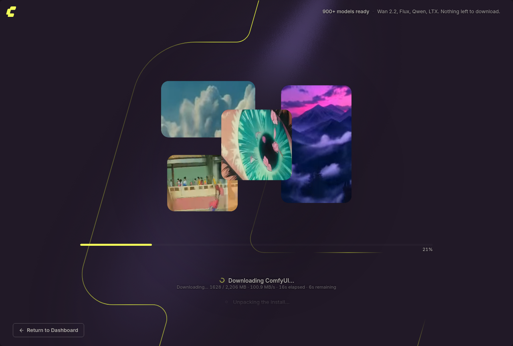

Остальное Comfy Desktop берёт на себя. На экране прогресса работает пошаговый индикатор: завершённые этапы получают галочку, активный этап показывает спиннер с обновляемой строкой подробностей (процент, скорость передачи или имя файла), а следующий этап ждёт под ним. Когда установка завершается, тот же индикатор продолжается при первом запуске, поэтому строки продолжаются этапами **Запуск ComfyUI** и этапами запуска.

| Этап | Что он делает |
|-------|--------------|
| **Загрузка ComfyUI** | Скачивает пакет ComfyUI для выбранного вами оборудования. |
| **Распаковка установки** | Распаковывает пакет в папку установки. |
| **Настройка окружения** | Создаёт собственное окружение Python экземпляра и копирует в него предварительно собранные пакеты, что записывает несколько гигабайт. |
| **Очистка окружения** | Удаляет пакеты, которые не нужны экземпляру, записывает конфигурацию окружения, получает теги версий и сохраняет первый снимок экземпляра. |
| **Обновление до последней стабильной** | Переводит ComfyUI на выбранный вами канал релиза и устанавливает его требования Python, что на новой машине может занять час и более. |

Установка, созданная из снимка, не обновляется автоматически, поэтому её индикатор пропускает последний этап и вместо него показывает два этапа восстановления.

Если вы выбрали стартовый шаблон, его модели скачиваются в фоне во время этапов выше, поэтому установка их не ждёт. Затем индикатор завершается этапом **Загрузка моделей шаблона**, как только ComfyUI запустится, и эта строка остаётся, пока файлы не скачаются. Выберите **Пропустить и открыть ComfyUI** на этом экране, чтобы сразу открыть экземпляр; передача продолжится в [лотке загрузок](/ru/installation/desktop/usage/downloads).

  </Step>
  <Step title="Выбрать шаблон">

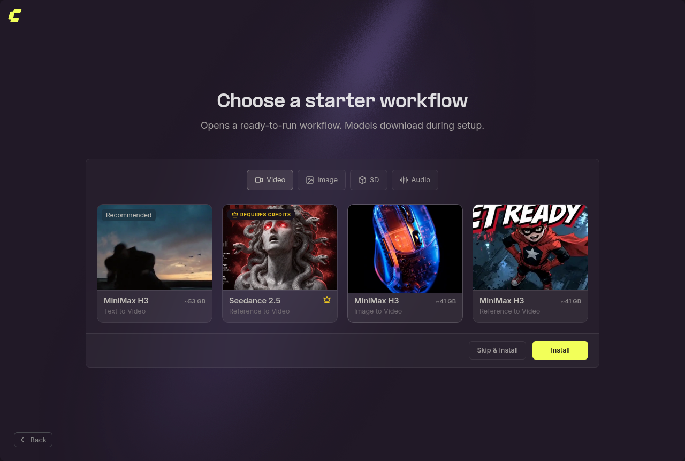

Когда установка завершена, Comfy Desktop открывает библиотеку шаблонов, где можно выбрать шаблон рабочего процесса, чтобы начать.

Шаблонам, которые скачивают модели, нужно достаточно свободного места для этих файлов. Если на диске не помещаются модели шаблона, мастер блокирует этот выбор. Выберите более лёгкий шаблон или освободите место. На очень маленьких дисках шаг выбора шаблона может быть полностью пропущен.

  </Step>
</Steps>

## Отслеживание существующей установки

Если у вас уже есть установка ComfyUI (настроенная вручную из репозитория Git или скачанная как портативная версия), вы можете добавить её в Comfy Desktop, не создавая новую.

Откройте меню ☰ в строке заголовка и выберите **Add Existing Instance**.

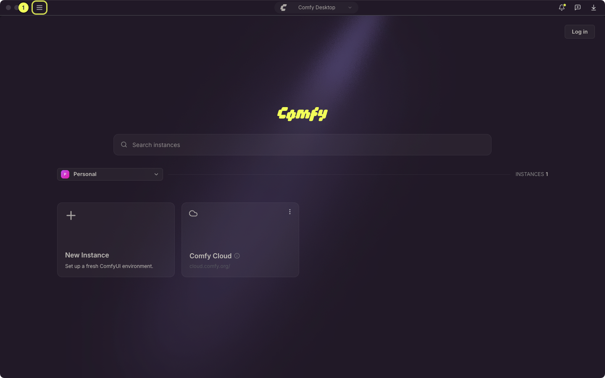

1. Кнопка меню **☰** в левом верхнем углу строки заголовка.
2. **Add Existing Instance**: открывает диалоговое окно для отслеживания существующей установки ComfyUI.

### Определение вашей установки

В диалоговом окне нажмите **Browse…** и выберите папку установки. Comfy Desktop проверяет папку и заполняет остальные поля диалогового окна. В раскрывающемся списке **Detected type** перечислено то, что удалось найти:

- **Standalone**: установка Comfy Desktop. Проверка ищет каталог `standalone-env` и `ComfyUI/main.py`.
- **Portable**: портативная сборка для Windows. Проверка ищет `python_embeded` в выбранной папке или в папке, расположенной непосредственно внутри неё.
- **Git Clone**: клон репозитория ComfyUI. Проверка ищет каталог `.git`.
- **Legacy Desktop**: установка более старого приложения ComfyUI Desktop, которая распознаётся по каталогам `models/`, `user/` и `.venv`. См. [Мигрировать из классического Desktop](/ru/installation/desktop/usage/migrate).

Если проверка ничего не находит, в списке отображается **No known install detected**. Выберите папку, в которой находится сама установка, а не родительскую или постороннюю папку.

### Подтверждение обнаруженной установки

После завершения проверки в диалоговом окне отображается то, что удалось найти. Проверьте пути, прежде чем отслеживать установку.

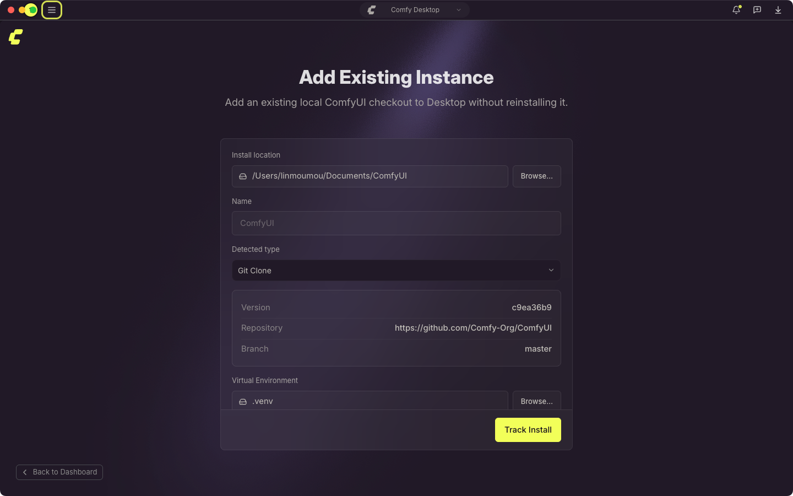

- **Install location**: папка, которую вы выбрали. Нажмите на путь, чтобы открыть его, или **Browse…**, чтобы выбрать другую папку. Для портативной сборки укажите папку, содержащую `python_embeded`.
- **Name**: как экземпляр отображается в Chooser. Диалоговое окно предлагает имя.
- **Detected type**: тип установки, которая находится в папке.
- **Version**, **Repository** и **Branch**: отображаются для клона Git.
- **Virtual Environment**: отображается для клона Git, если Comfy Desktop находит его в `.venv`, `venv`, `.env` или `env` с файлом `pyvenv.cfg` внутри. **Browse…** указывает экземпляру на другое окружение.

Нажмите **Track Install**, чтобы добавить экземпляр. Файлы не перемещаются и не копируются.

### Отслеживаемая установка и Standalone

Ключевая разница между **отслеживаемой** установкой (Add Existing Instance) и установкой **Standalone** заключается в том, как управляются обновления:

| Аспект | Отслеживаемая (существующая) | Standalone |
|--------|-------------------|------------|
| **Обновления** | Без автоматических обновлений: в клоне Git вы сами выполняете pull и переустановку, а портативная сборка заменяется более новой версией | Встроенные автоматические обновления |
| **Python** | Использует существующее окружение Python (`.venv`, `python_embeded` и т. д.) | Встроенный Python, автоматическое управление зависимостями |
| **Изоляция** | Использует существующий путь и окружение | Полностью самодостаточная, изолированная установка |
| **Снимки** | Не поддерживаются | Поддержка снимков доступна |
| **Сценарий использования** | ComfyUI уже настроен и кастомизирован | Чистая установка с нуля |

> **Примечание:** Comfy Desktop запускает отслеживаемую установку с её существующим окружением Python и не переустанавливает ComfyUI и не управляет его пакетами. Захват снимков выполняется только для экземпляров Standalone.

## Запуск, остановка и перезапуск экземпляра

[↩ Вернуться к обзору](#overview)

### Запуск экземпляра

Нажмите на карточку экземпляра в окне выбора, чтобы запустить его. Пока ComfyUI запускается, в окне отображается ход запуска, а после готовности сервера открывается интерфейс ComfyUI.

### Запуск при работающем другом экземпляре

Если вы запускаете локальный экземпляр, когда другой локальный экземпляр уже работает или запускается, Comfy Desktop показывает диалог **An instance is already running** со списком экземпляров, которые будут остановлены:

- **Close & Launch**: останавливает перечисленные экземпляры, затем запускает выбранный.
- **Run All**: запускает новый экземпляр параллельно с работающими.

Чтобы отменить запуск, закройте диалог. При перезапуске экземпляра этот диалог не показывается. Чтобы он больше не появлялся, отключите **Warn before running multiple instances** в разделе [Настройки рабочего стола → Настройки](/ru/installation/desktop/usage/settings#предпочтения).

### Когда порт уже занят

ComfyUI прослушивает порт 8188, если экземпляр не передаёт `--port`. Перед запуском ComfyUI Comfy Desktop проверяет этот порт, и настройка экземпляра **If Port is Busy** на [вкладке Startup Args](/ru/installation/desktop/usage/manage#startup-args-tab) определяет, что произойдёт, если порт уже занят другой программой:

- **Use next available port (asks if `--port` is set)** (значение по умолчанию): Comfy Desktop запускает ComfyUI на следующем свободном порту и сообщает об этом в ходе запуска. Занятый порт останавливает запуск, только если его удерживает ComfyUI этой установки, см. ниже.
- **Ask what to do**: запуск останавливается с сообщением **Port already in use**, в котором указано, что занимает порт, и вы выбираете следующий шаг.

Если в **Startup Arguments** задан `--port`, Comfy Desktop тоже спрашивает, даже при значении по умолчанию, потому что этот порт был указан намеренно.

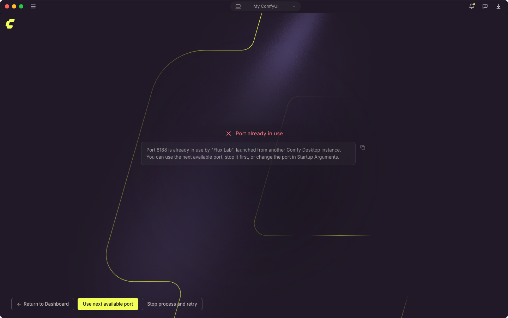

В сообщении указано, что занимает порт:

- **Another Comfy Desktop instance**: в сообщении назван этот экземпляр.
- **A ComfyUI**: в сообщении говорится, что это похоже на экземпляр ComfyUI, в том числе запущенный вне Comfy Desktop.
- **Any other program**: в сообщении назван процесс, и Comfy Desktop не предлагает его остановить.

Действия на этом экране:

- **Use next available port**: запускает этот экземпляр на следующем свободном порту.
- **Stop process and retry**: принудительно останавливает процесс, занимающий порт, затем запускает снова. Появляется, только если занимающий порт процесс похож на ComfyUI, а подтверждение предупреждает, что несохранённая работа в этом ComfyUI будет потеряна.
- **Return to Dashboard**: отменяет запуск.

Если Comfy Desktop может определить, что порт занимает ComfyUI той же установки, например запущенный вручную в терминале, он останавливается вместо предложения другого порта, поскольку вторая копия использовала бы ту же базу данных. Остановите эту копию, закройте запустившее её приложение или выберите **Stop process and retry**, затем запустите снова. Comfy Desktop выполняет эту проверку, когда запуск включает систему ассетов: он добавляет `--enable-assets` для ComfyUI 0.38.0 и новее, если аргументы запуска экземпляра не передают `--disable-assets`.

#### ComfyUI, оставшийся от предыдущего сеанса

Перед проверкой порта Comfy Desktop ищет ComfyUI той же установки, который остался работать после предыдущего сеанса Comfy Desktop. Этот процесс всё ещё удерживает базу данных установки, поэтому новый ComfyUI не смог бы запуститься.

- **Still working on a prompt**: запуск останавливается и сообщает об этом. **Stop it and launch** останавливает этот ComfyUI и отменяет промпты, которые он выполняет. Если оставить его работать, этот запуск будет отменён.
- **Processes that no longer answer on the port**: в сообщении указаны их PID и предлагается **Stop them and launch**.
- **A process that will not exit**: в сообщении предлагается завершить его вручную, затем запустить снова.

### Остановка экземпляра

Выберите **Stop** в меню ⋮ на карточке экземпляра. Сервер ComfyUI останавливается, а окно остаётся открытым с карточкой **ComfyUI is stopped**. Выберите **Relaunch ComfyUI**, чтобы снова запустить сервер, или **Return to Dashboard**, чтобы вернуться к окну выбора.

### Перезапуск после сбоя

Если ComfyUI не удаётся запустить или он неожиданно завершается, окно остаётся открытым с карточкой, описывающей произошедшее:

- **ComfyUI could not start**: экземпляр не запустился.
- **ComfyUI exited unexpectedly**: процесс остановился. Если Comfy Desktop может его прочитать, карточка также показывает код выхода или сигнал, завершивший процесс.

В Windows сбой может сообщать о нарушении доступа к памяти и отмечать, что некоторые файлы Microsoft Visual C++ Redistributable, похоже, отсутствуют. Разверните логи карточки для подробностей, затем выберите **Restart ComfyUI**, чтобы запустить снова, или **Back**, чтобы вернуться на панель управления.

Если ComfyUI останавливается из-за того, что не может открыть базу данных ассетов, хранящуюся внутри установки, ошибка объясняет причину, а не только сообщает код выхода:

- **Another ComfyUI is using this installation's database**: закройте этот ComfyUI (или приложение, которое его запустило) либо задайте одному из них собственное расположение базы данных с помощью аргумента запуска `--database-url`.
- **Any other database failure**, от базы данных, заблокированной другой программой, до базы, записанной более новой версией ComfyUI, или которую невозможно создать в этой папке: в сообщении указаны файл и способ исправления, а в конце предлагается запустить экземпляр без системы ассетов, добавив `--disable-assets` в его аргументы запуска.

## Удалить экземпляр

[↩ Назад к обзору](#overview)

Когда нужно удалить экземпляр, два действия определяют, останутся ли его файлы на диске.

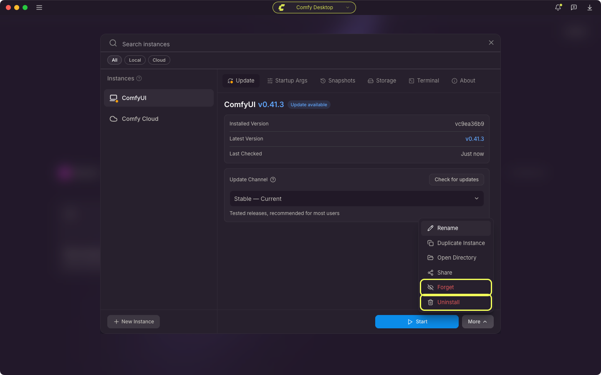

1. **Forget**: удаляет экземпляр из приложения, ничего не удаляя. Папка установки и все её данные остаются на диске. Используйте этот вариант, если нужно только очистить список, но экземпляр может понадобиться позже.
2. **Uninstall**: навсегда удаляет установку и все её файлы с диска. Файлы моделей в общих каталогах не затрагиваются.

**Uninstall** также доступен в меню ⋮ на карточке экземпляра. **Forget** в этом меню нет: он находится на панели Manage, в меню **More** внизу панели. У установки, которую принял Comfy Desktop, например перенесённой из классического Desktop, нет действия **Forget**.

## Дублировать экземпляр

[↩ Вернуться к обзору](#overview)

Можно дублировать существующую отдельную установку. Откройте меню ⋮ на карточке и выберите **Duplicate Instance** или воспользуйтесь пунктом **Duplicate Instance** в меню **More** панели Manage. В копии будет:

- новая среда Python;
- та же версия ComfyUI;
- собственный набор пользовательских узлов.

При появлении запроса введите имя для дубликата. Копия создаётся рядом с оригиналом. Облачные, удалённые и отслеживаемые установки дублировать нельзя.

## Редактировать экземпляр

[↩ Вернуться к обзору](#overview)

В панели **Manage** экземпляра можно:

- Изменить путь установки
- Настроить аргументы запуска
- Изменить каталоги моделей
- Обновить переменные среды
- Переименовать экземпляр с помощью имени в верхней части вкладки **About** или пункта **Rename** в меню **More**
- Изменить адрес подключения Remote Connection на вкладке **About**

Откройте панель **Manage**, щёлкнув правой кнопкой мыши по карточке экземпляра (или выбрав **Manage** в меню ⋮).

## Состояние ошибки

Если при установке возникает проблема, на её карточке появляется значок **Ошибка**. Выберите этот значок, чтобы прочитать подробности: сообщение, код выхода или сигнал, если Comfy Desktop его предоставляет, и последние строки вывода ошибки. Запуск или перезапуск экземпляра снимает значок. Если проблема повторяется, проверьте логи в разделе [Расположение данных](/ru/installation/desktop/usage/settings#расположение-данных).
