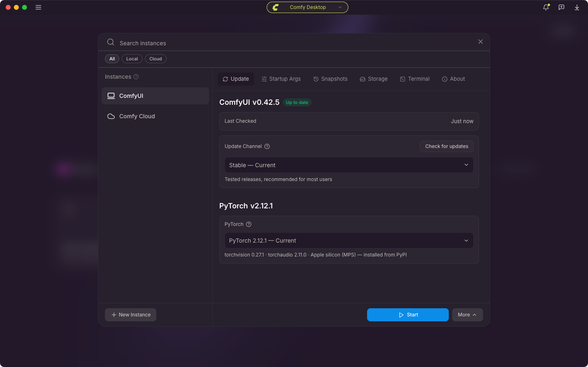
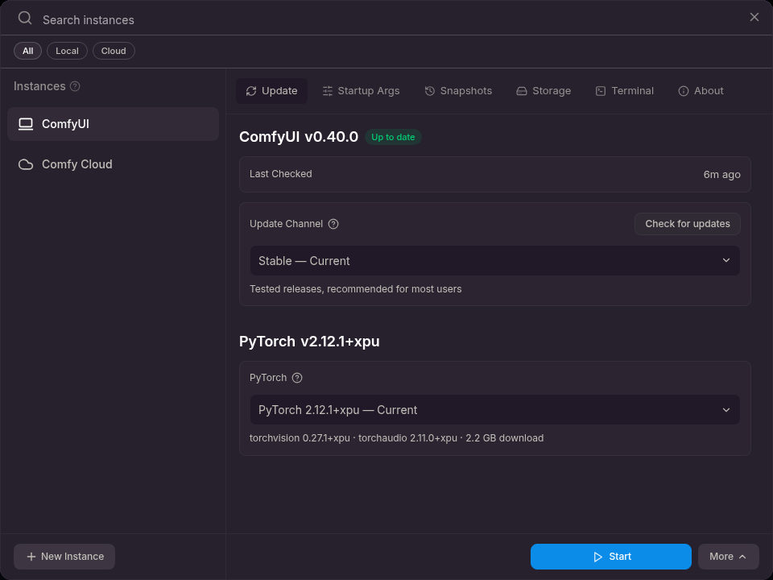
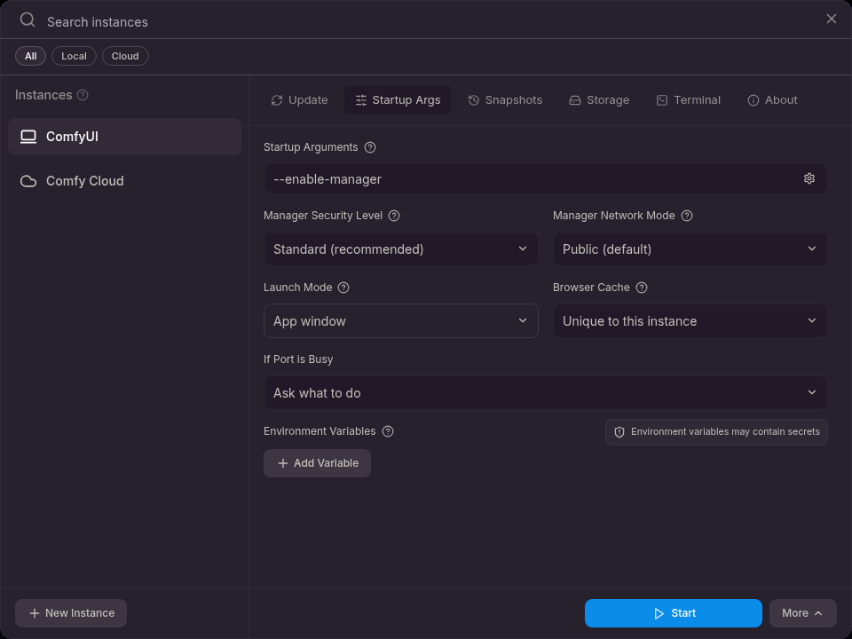
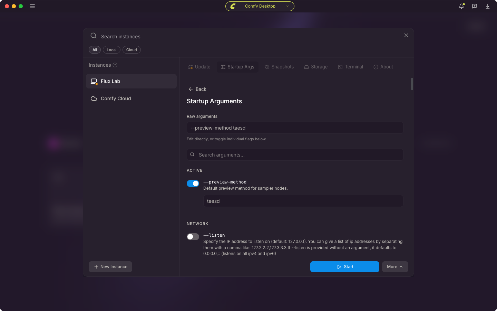
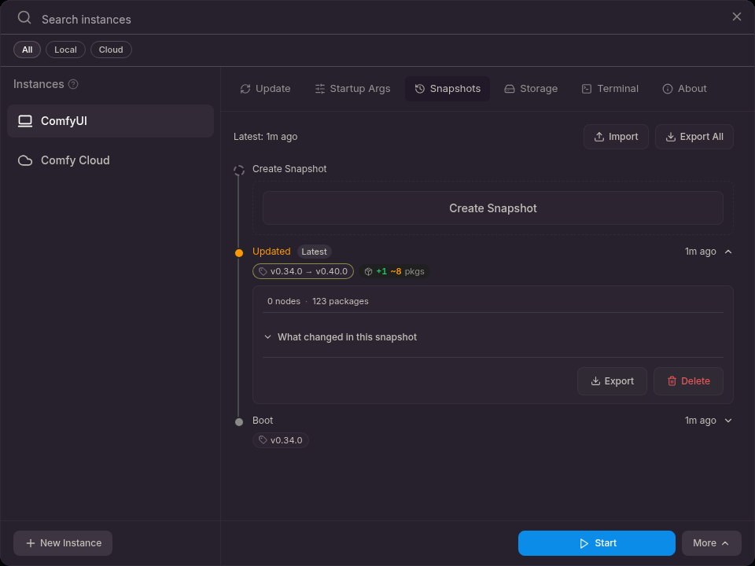
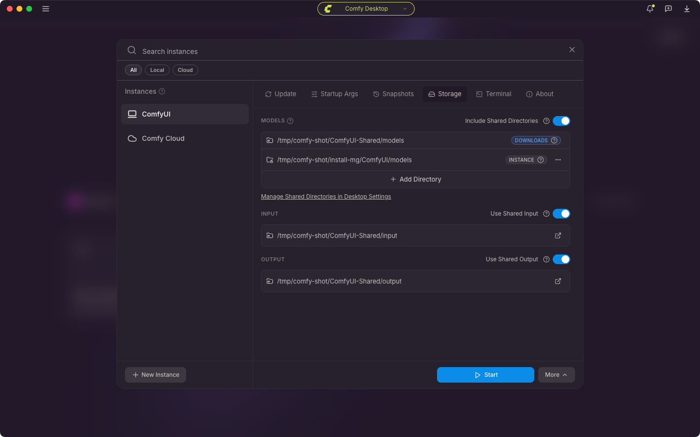
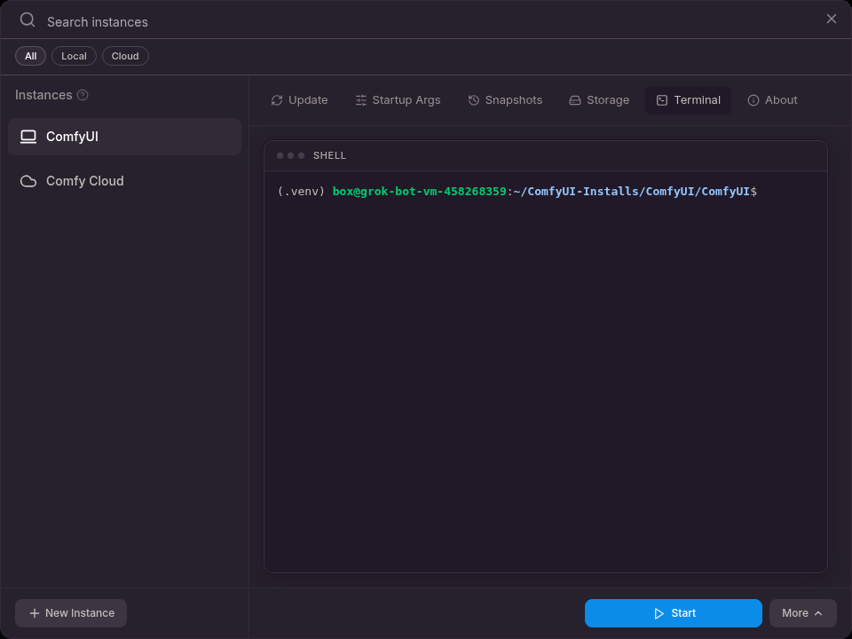
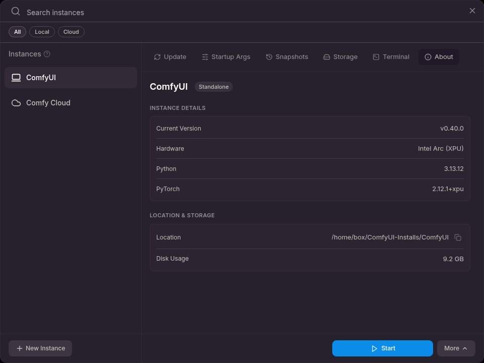
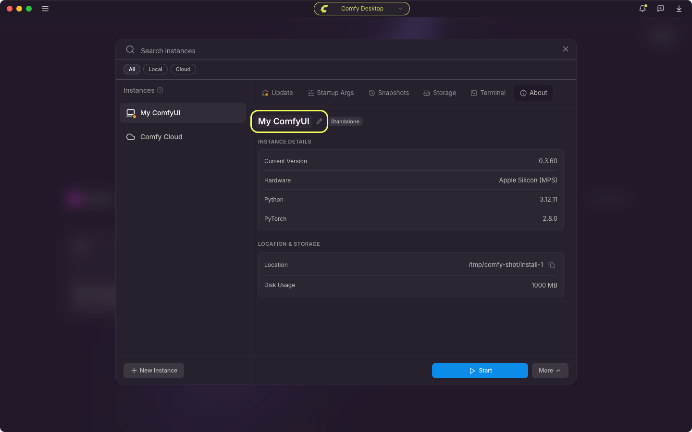
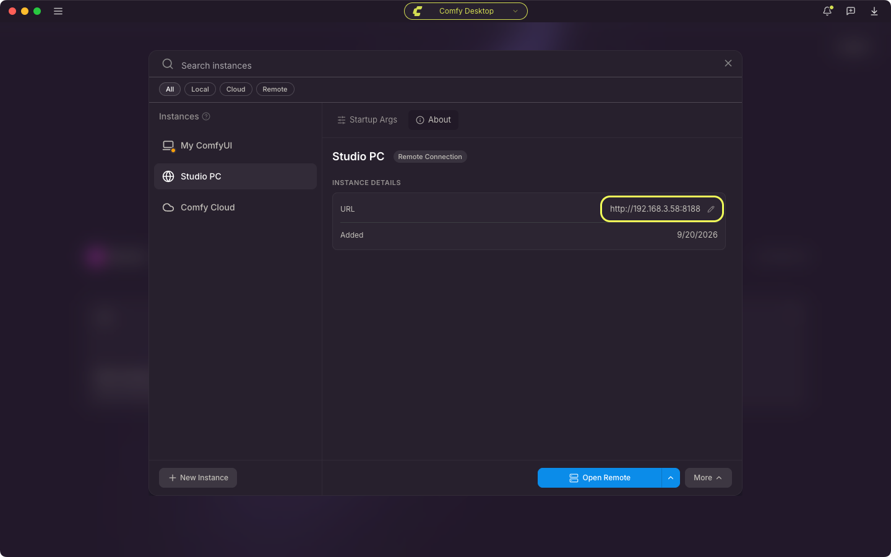

## Панель Manage

Содержимое панели Manage зависит от типа экземпляра. Скриншоты на этой странице относятся к **локальной автономной установке**. У облачных и удалённых экземпляров вкладок и настроек меньше.

Чтобы открыть её, перейдите в представление **Chooser** (главный экран со списком ваших экземпляров), нажмите значок ⋮ на карточке экземпляра и выберите **Manage**.

В панели шесть вкладок: **Update**, **Startup Args**, **Snapshots**, **Storage**, **Terminal** и **About**.

### Вкладка Update

На вкладке есть карточка для ComfyUI и карточка для PyTorch. Работают они одинаково: в заголовке показано, что установлено сейчас, раскрывающиеся списки выбирают канал или стек torch, а кнопки под карточкой применяют этот выбор.

#### ComfyUI

В заголовке указана версия ComfyUI, а пока в выбранном канале нет ничего новее, отображается значок **Up to date**. Когда появляется более новый релиз, в заголовке показывается он со значком **Update available**, а в карточке добавляются строки **Installed Version** и **Latest Version**. **Last checked** показывает, как давно Comfy Desktop выполнял проверку; наведите на него курсор, чтобы увидеть точное время.

- **Update Channel**: **Stable** (проверенные релизы, значение по умолчанию) или **Latest on GitHub** (новейшие коммиты из ветви master). В раскрывающемся списке канал, на котором находится экземпляр, помечен как **Current**.
- **Check for updates**: отображается, пока в выбранном канале нет ничего новее, и сразу запускает повторную проверку. Comfy Desktop выполняет эту проверку и самостоятельно, см. [раздел вопросов и ответов](/ru/installation/desktop/faq#общие-вопросы).
- **Update Now**: отображается, когда в выбранном канале есть что-то новее. В окне подтверждения показаны версии, между которыми выполняется переход, или канал, на который выполняется переключение, приведены примечания к релизу, если канал их публикует, и указание на вкладку Snapshots, потому что перед обновлением Comfy Desktop сохраняет снимок. Если новая версия ломает пользовательский узел, восстановите предыдущее состояние оттуда.
- **Copy & Update**: копирует экземпляр и обновляет копию, а оригинал оставляет без изменений. Используйте, чтобы опробовать новую версию на уже имеющемся наборе узлов.
- **Switch Channel**: отображается, когда вы выбираете канал, в котором нет ничего новее для установки, и переводит экземпляр на этот канал без обновления.

Выбор **Stable** для экземпляра, который опережает стабильный релиз, означает откат: в окне подтверждения так и сказано, а более новые коммиты удаляются.

#### PyTorch

В карточке показана установленная сборка torch и перечислены официальные стеки, которые Comfy Desktop может установить для этого экземпляра. Если каталог охватывает несколько бэкендов, второй раскрывающийся список сначала выбирает бэкенд (**CUDA 13.0**, **CUDA 12.8** и так далее, а также **ROCm**, **Intel XPU** и **CPU**). Каждый вариант содержит версии torchvision и torchaudio и, если стек поставляется единым пакетом, размер загрузки. Также выводится предупреждение, если в стеке нет torchaudio: при переключении он удаляется, и пользовательские узлы, которым он нужен, перестают работать.

- **Change PyTorch**: переключает этот экземпляр на выбранный стек. В окне подтверждения показан объём загрузки; во время изменения Comfy Desktop создаёт резервную копию текущего окружения и восстанавливает её, если что-то пойдёт не так.
- **Copy & Change PyTorch**: выполняет такое же переключение в новой копии экземпляра, а оригинал оставляет нетронутым.

Ночные сборки помечены как нестабильные. Средство выбора предлагает их примерно 45 дней после даты выпуска wheel, что меньше примерно 60 дней, по истечении которых PyTorch удаляет датированную ночную сборку из своего индекса.

### Вкладка Startup Args

Настройте аргументы CLI запуска, политику менеджера, режим запуска, совместное использование кэша браузера, поведение при конфликте портов и переменные среды.

- **Startup Arguments**: Пользовательские аргументы CLI для ComfyUI (например, `--listen`). Нажмите на иконку шестерёнки, чтобы открыть флаги по категориям. Когда включены бета-функции, рядом с полем отображается плашка **+N beta**, в которой перечислены бета-аргументы, добавленные Comfy Desktop для текущего сеанса, или те, на которые будет иметь право следующий запуск.
- **Manager Security Level**: Определяет, какие пакеты узлов ComfyUI-Manager может устанавливать для этого экземпляра. Применяется при следующем запуске.
  - **Strict**: Блокирует любую установку, обновление и удаление пакетов узлов. Manager работает только в режиме чтения.
  - **Standard** (рекомендуется): Разрешает зарегистрированные пакеты узлов. Блокирует установку из незарегистрированных источников (например, произвольных git-URL).
  - **Relaxed**: Как Standard, но дополнительно разрешает установку из незарегистрированных источников, пока ComfyUI доступен только с этой машины. `--listen` снова их блокирует.
  - **Permissive**: Разрешает любой уровень риска. Если ComfyUI открыт через `--listen`, для установки всё равно требуется сетевой режим **Personal cloud**.
- **Manager Network Mode**: Как Manager взаимодействует с реестром узлов.
  - **Public** (по умолчанию): Использует публичный реестр. `--listen` блокирует установку пакетов узлов на любом уровне безопасности.
  - **Private**: Использует частную базу данных узлов, которую вы настраиваете сами.
  - **Offline**: Без внешней сети. Загрузки недоступны.
  - **Personal cloud**: Рассматривает эту машину как доверенный удалённый сервер и снимает блокировку установки, вызванную `--listen`. Выбранный уровень безопасности при этом по-прежнему действует. Используйте это только на машине, которую контролируете.
- **Launch Mode**: **App window** (встроенное окно) или **Console only** (без окна приложения; ComfyUI работает как консольный процесс).
- **Browser Cache**: **Unique to this instance** или **Shared**.
- **If Port is Busy**: **Ask what to do** или **Use next available port (asks if --port is set)**.
- **Environment Variables**: Добавляйте пользовательские переменные среды кнопкой **+ Add Variable**. Значения ключей, похожих на учётные данные (например, `HF_TOKEN`), скрыты, пока вы их не откроете, а повторяющиеся ключи отмечаются. Comfy Desktop хранит эти значения в незашифрованном виде, поэтому не держите настоящие секреты в этом списке.

#### Собрать аргументы запуска с помощью средства выбора

Нажмите на иконку шестерёнки рядом с **Startup Arguments**, чтобы открыть средство выбора флагов. Переключайте флаги по категориям или редактируйте **Raw arguments**; и то, и другое обновляет одну и ту же строку CLI для этого экземпляра.

Нераспознанные флаги остаются в поле; лаунчер отбрасывает те, что неизвестны схеме установки, всё равно передаёт скрытые поддерживаемые флаги (например, `--feature-flag`), а при неудачном обнаружении схемы передаёт аргументы без фильтрации. Изменения применяются при следующем запуске (пока экземпляр работает, отображается **Restart to apply**).

<CardGroup cols={1}>
  <Card title="Справочник по флагам запуска" icon="book-open" href="/development/comfyui-server/startup-flags">
    Полный список флагов запуска ComfyUI, доступных для Startup Arguments.
  </Card>
</CardGroup>

### Вкладка «Снимки»

Просматривайте, импортируйте, экспортируйте и создавайте снимки. В каждой записи отображаются изменения версий и статистика пакетов.

- **Timeline**: Показывает все снимки в хронологическом порядке с изменениями версий и статистикой.
- **Latest**: Показывает, когда был сделан последний снимок.
- **Import**: Импортируйте снимок из файла.
- **Export All**: Экспортируйте все снимки как резервную копию.
- **Create Snapshot**: Создайте новый снимок вручную в любой момент.
- В каждой записи снимка отображаются:
  - Изменение версии (например, `v0.20.1 → v0.24.1`)
  - Изменения пакетов
  - Количество узлов и пакетов
  - Кнопки **Export** и **Delete**

<CardGroup cols={1}>
  <Card title="Полное управление снимками" icon="camera" href="/ru/installation/desktop/usage/snapshots">
    Узнайте об автоматических снимках, сравнении и полном управлении снимками.
  </Card>
</CardGroup>

### Вкладка «Хранилище»

Настройте, использует ли этот экземпляр глобальные общие папки, и добавьте дополнительные каталоги моделей, которые применяются только к этому экземпляру.

- **Include Shared Directories**: Включает или отключает сканирование этим экземпляром глобальных общих каталогов моделей из раздела [Настройки рабочего стола → Хранилище](/ru/installation/desktop/usage/settings#хранилище).
- **Use Shared Input Folder**: Если включено, этот экземпляр читает входные файлы из глобальной общей папки входных данных. Отключите, чтобы использовать собственную папку входных данных этого экземпляра.
- **Use Shared Output Folder**: Если включено, этот экземпляр записывает сгенерированные выходы в глобальную общую папку выходных данных. Отключите, чтобы использовать собственную папку выходных данных этого экземпляра.
- **Model Directories**: Дополнительные каталоги моделей только для этого экземпляра, которые просматриваются в дополнение к общим каталогам моделей.
- **Input Directory** / **Output Directory**: Собственные папки этого экземпляра, когда общие переключатели выше выключены.

### Вкладка терминала

Интерактивная оболочка в папке этого экземпляра. Она работает независимо от того, запущен ComfyUI или остановлен.

- Используйте её для просмотра логов запуска, ошибок и вывода Python.
- Копирование, вставка и выделение всего выполняются с помощью сочетаний клавиш ОС. Чтобы выполнить те же действия, щёлкните правой кнопкой мыши по терминалу.

### Вкладка «О программе»

Вкладка «О программе» собирает всё, что Comfy Desktop знает об экземпляре. Путь открывается в вашем файловом менеджере при нажатии, а кнопка копирования рядом с ним копирует этот путь.

Сведения сгруппированы, и группа появляется только тогда, когда ей есть что показать:

- **Instance details**: версия ComfyUI, аппаратное обеспечение, а также версии Python и PyTorch. Для Remote Connection эта группа содержит URL подключения и дату добавления подключения.
- **Running details**: порт, который слушает ComfyUI. Появляется, пока экземпляр запущен.
- **Location & storage**: полный путь установки на диске и объём места, который занимает установка. Только локальная установка хранит файлы на этой машине, поэтому у Cloud и Remote Connections такой группы нет.
- **Lineage**: экземпляр, с которого был скопирован этот, и когда это произошло. Появляется у экземпляра, полученного через **Duplicate Instance**, из копии с изменённой версией или PyTorch, при миграции из Legacy Desktop или при принятии существующей установки.

#### Переименовать экземпляр

Нажмите на имя экземпляра в верхней части вкладки «О программе», введите новое имя, затем нажмите Enter или щёлкните в любом другом месте. При наведении на имя появляется карандаш, который ставит курсор в то же поле. Esc отменяет правку и сохраняет старое имя, а пустое имя или имя, которое у экземпляра уже есть, ничего не меняют.

В меню **More** панели Manage есть то же действие, что и **Rename**: оно открывает диалог **Rename Instance** с полем **Name**.

Comfy Desktop отклоняет имя, которое уже использует другой экземпляр, и в сообщении предлагается выбрать другое. Запись Comfy Cloud сохраняет своё имя и не имеет карандаша; локальные, удалённые и отслеживаемые экземпляры можно переименовывать.

#### Изменить URL Remote Connection

Адрес Remote Connection это строка **URL** на вкладке «О программе». Нажмите на URL или на карандаш рядом с ним, введите новый адрес и нажмите Enter или щёлкните в любом другом месте. Адрес без схемы читается как `http://`, а завершающая косая черта отбрасывается при сохранении адреса.

Пока экземпляр подключён, изменённый URL вступает в силу при следующем запуске: строка показывает **Restart to apply**, пока вы не перезапустите экземпляр, а текущий сеанс сохраняет старый адрес. Адрес, который Comfy Desktop не может прочитать, не сохраняется, и строка возвращается к предыдущему значению.

## Действия с установкой

Щёлкните правой кнопкой мыши по карточке установки (или нажмите на иконку ⋮), чтобы открыть действия. Полный список действий приведён на странице [Управление экземплярами](/ru/installation/desktop/usage/instance-management).
