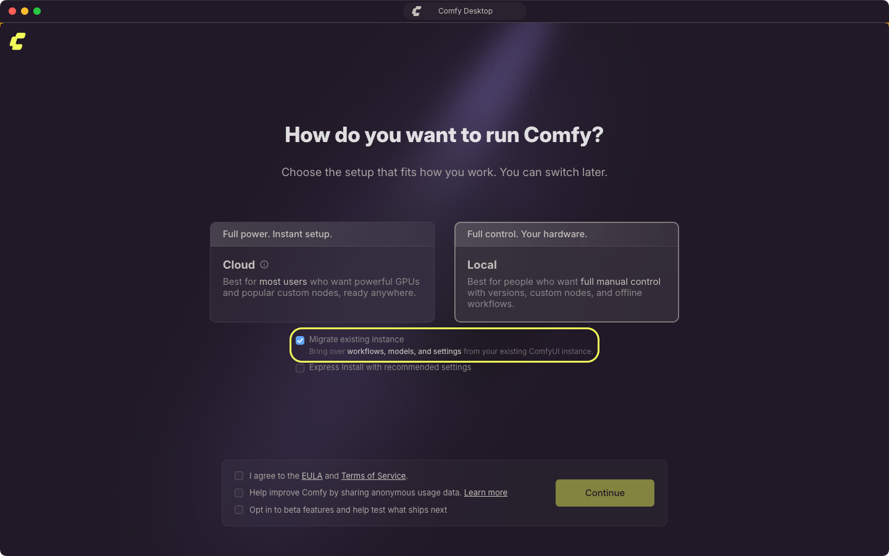
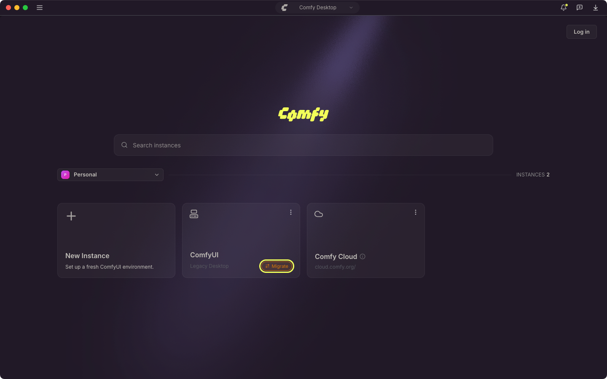
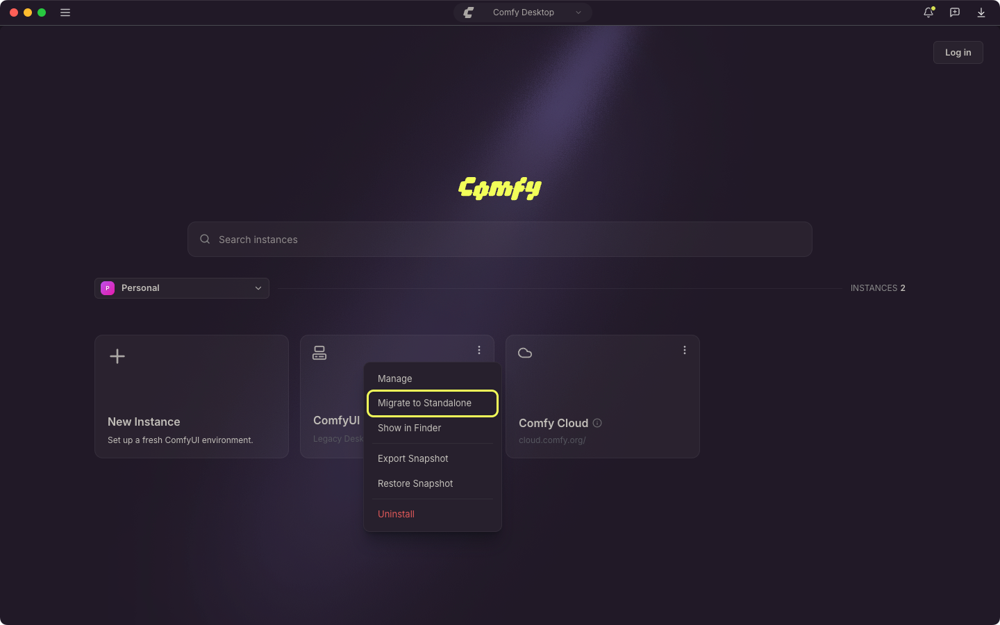
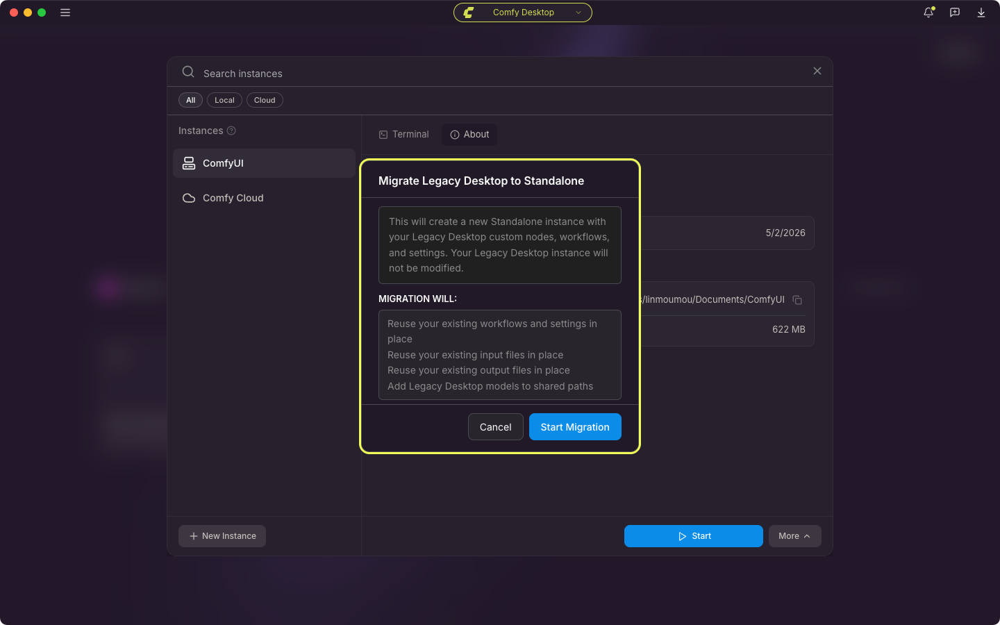

<Info>
Эта страница описывает миграцию с **Legacy Desktop** (предыдущего приложения для десктопа с единственной установкой). Если вы пользуетесь Comfy Desktop впервые, этот раздел можно пропустить.
</Info>

<CardGroup cols={1}>
  <Card title="Ищете другую установку?" icon="compass" href="/ru/installation/desktop/usage/instance-management#tracking-an-existing-installation">
    Если у вас уже есть установка ComfyUI (portable, ручное клонирование через git и т.д.) и вы хотите добавить её в Comfy Desktop, см. раздел **Отслеживание существующей установки** в статье «Управление экземплярами».
  </Card>
</CardGroup>

Если у вас уже установлен Legacy Desktop, Comfy Desktop может обнаружить его и выполнить миграцию, создав новую установку Standalone в представлении Chooser.

## Что переносится при миграции

Legacy Desktop был приложением с единственной установкой. Comfy Desktop представляет собой менеджер нескольких установок. При миграции:

- **Рабочие процессы и настройки**: используются на месте, поэтому новый экземпляр сохраняет те же пользовательские данные.
- **Пользовательские узлы**: остаются в вашей существующей папке `custom_nodes`. Мигрированный экземпляр использует вашу папку данных Legacy Desktop в качестве базового каталога, поэтому загружает те же узлы, а их пакеты остаются в переиспользуемом окружении Python.
- **Модели**: ваша существующая папка моделей добавляется к общим каталогам моделей, поэтому каждый экземпляр может читать эти файлы там, где они уже находятся.
- **Входные файлы и выходы**: используются на месте из существующих папок.
- **Окружение Python**: ваше существующее окружение проверяется, а затем используется повторно. Comfy Desktop проверяет, что в нём можно импортировать torch, и затем устанавливает требования ComfyUI, не заменяя ваши пакеты PyTorch.
- **Версия ComfyUI**: исходный код ComfyUI помещается в новый управляемый каталог, поэтому с этого момента обновлениями управляет Comfy Desktop.

Миграция использует вашу папку данных Legacy Desktop и окружение Python на месте, а не копирует их, поэтому в итоге вы получаете одну рабочую конфигурацию, а не вторую копию. Если вам нужна нетронутая копия вашей конфигурации Legacy Desktop, сделайте резервную копию самостоятельно до миграции.

## Что попадает в резервную копию при миграции

Перед тем как что-либо изменить, Comfy Desktop копирует файлы настроек Legacy Desktop в папку с датой в имени внутри папки конфигурации классической версии:

- macOS: `~/Library/Application Support/ComfyUI/legacy-backup/<timestamp>/`
- Windows: `%APPDATA%\ComfyUI\legacy-backup\<timestamp>\`

Каждый файл копируется, только если он существует:

- `config.json`: настройки приложения Legacy Desktop, включая папку данных, которую оно использовало.
- `comfy.settings.json`: настройки фронтенда ComfyUI, сохранённые в вашей папке пользователя классической версии.
- `extra_models_config.yaml`: все дополнительные пути к моделям, которые вы настроили в Legacy Desktop.
- `window.json`: сохранённые размер и положение окна.

Резервная копия содержит только настройки. Модели, рабочие процессы, пользовательские узлы, входные файлы и выходы в неё не копируются, поскольку перенесённый экземпляр продолжает использовать их там, где они находятся. Миграция также записывает снимок классической среды с её пользовательскими узлами и установленными пакетами в `.snapshots/` внутри вашей папки данных классической версии.

Если файл не удаётся скопировать, миграция отмечает это в журнале и продолжает работу, поэтому ошибка резервного копирования не останавливает миграцию.

## Что происходит во время миграции

Миграция показывает собственный экран хода выполнения и проходит следующие шаги:

1. **Создать резервную копию классического состояния**
2. **Проверить доступ к папкам** (только macOS)
3. **Проверить окружение Python**
4. **Захватить снимок состояния**
5. **Выделить папку установки**
6. **Разместить исходный код ComfyUI**
7. **Установить требования**
8. **Перенести настройки**
9. **Зарегистрировать установку**

Шаг может остановиться и ждать ответа:

- **Требуется доступ к папке** (macOS): macOS заблокировала доступ к папке Legacy Desktop. Предоставьте приложению Comfy Desktop «Полный доступ к диску» в разделе «Системные настройки» → «Конфиденциальность и безопасность», затем запустите миграцию снова.
- **Окружение Python выглядит повреждённым**: классическое окружение не смогло импортировать torch. Выберите **Adopt anyway**, чтобы сохранить это окружение, или **Cancel**, чтобы остановиться.
- **Исходный код ComfyUI недоступен**: не удалось получить исходный код ComfyUI для нового экземпляра. Выберите **Retry** или **Cancel** и создайте новый экземпляр через панель управления.

Экран сохраняет вывод каждого шага в панели **View logs**, которая открывается сама, когда шаг завершается ошибкой. Скопируйте текст кнопкой копирования в этой панели или найдите тот же вывод в журнале приложения Desktop. Ошибка установки требований выводится как предупреждение и не останавливает миграцию.

## Что меняется после миграции

Когда миграция завершена, новая установка Standalone работает так же, как любая другая установка Comfy Desktop:

- **Запуск**: нажмите кнопку воспроизведения на карточке новой установки в представлении Chooser, чтобы запустить ComfyUI.
- **Порт**: порт и большинство других пользовательских аргументов запуска из классической конфигурации переносятся.
- **Manage**: используйте панель Manage, чтобы обновлять установку, создавать снимки и настраивать её.
- **Обновления**: установки Standalone можно обновлять независимо через панель Manage. В отличие от Legacy Desktop, больше не нужно скачивать новую сборку для каждого обновления.
- **Несколько экземпляров**: можно держать несколько установок Standalone рядом, у каждой будет своя версия ComfyUI и своя конфигурация.
- **Общее хранилище**: по умолчанию модели общие для всех установок Standalone. Каталоги входов и выходов закреплены за принятым классическим рабочим пространством, поэтому ваши существующие файлы остаются на месте.
- **Legacy Desktop**: оставьте его установленным как запасной вариант, но не запускайте его одновременно с перенесённым экземпляром. Они используют общую папку данных, порт и базу данных ComfyUI, поэтому одновременно может работать только один из них.

Если вы задали пользовательский `--database-url` в Legacy Desktop, миграция его не переносит: перенесённый экземпляр открывает базу данных внутри вашей классической папки данных. Добавьте исходный аргумент на вкладке Startup Args панели Manage и перезапустите экземпляр, если вам нужна другая база данных.

Перенесённый экземпляр не обновляет ComfyUI самостоятельно. Используйте [вкладку Update](/ru/installation/desktop/usage/manage#update-tab) панели Manage, когда вам нужна более новая версия ComfyUI.

## Работает ли моя старая ссылка?

Классическое приложение Desktop по умолчанию работало на порту `8000`. Новая установка **переносит порт** из вашей классической конфигурации, поэтому `http://localhost:8000` должен по-прежнему работать. Если у вас были настроены пользовательские аргументы CLI (например, `--port 8188`), большинство из них также переносятся.

Если вы используете сервис сокращения URL, закладку или внешнюю интеграцию, которые ссылаются на классическое приложение Desktop по другому адресу, возможно, вам потребуется проверить вкладку Startup Args новой установки и соответствующим образом обновить их.

## Пошаговая миграция

<Steps>
<Step title="Установить Comfy Desktop">
Скачайте и установите Comfy Desktop с [официальной страницы загрузки](https://comfy.org/download).
</Step>

<Step title="Запустить Comfy Desktop">
При первом открытии Comfy Desktop первичная настройка обнаруживает установку Legacy Desktop в вашей системе, если она есть. Выберите **Local**, и мастер настройки покажет **Migrate existing instance** уже отмеченным, поэтому при продолжении ваша существующая конфигурация будет перенесена.

</Step>

<Step title="Подтвердить миграцию">
Выберите **Continue**, затем подтвердите **Migrate to Standalone** кнопкой **Start Migration**. Comfy Desktop:

1. Переиспользует ваши рабочие процессы, настройки, пользовательские узлы, входы и выходы на месте
2. Переиспользует ваше окружение Python и разворачивает исходный код ComfyUI в новый управляемый каталог, чтобы обновления работали как обычно
3. Добавляет вашу папку моделей как общую папку и устанавливает требования ComfyUI в переиспользуемое окружение

После завершения в представлении Chooser появится карточка новой установки Standalone.
</Step>

<Step title="Проверить">
Запустите новую установку и убедитесь, что:
- Ваши рабочие процессы доступны
- Пользовательские узлы установлены
- Модели доступны
- Ваш сервер работает по перенесённому URL (по умолчанию `http://localhost:8000`)
</Step>
</Steps>

## Мигрировать из Chooser

Если вы уже завершили первоначальную настройку или установка Legacy Desktop уже отображается в Chooser, начните миграцию с карточки экземпляра:

1. Найдите карточку экземпляра Legacy Desktop. На ней отображается плашка **Migrate**.

   

2. Нажмите на плашку или откройте меню **⋮** на карточке и выберите **Migrate to Standalone**.

   

3. Проверьте подтверждение и выберите **Start Migration**.

   

Установка Legacy Desktop подхватывается на месте, поэтому появившийся экземпляр представляет собой вашу существующую установку под управлением Comfy Desktop. Миграция отслеживаемой Git- или портативной установки, напротив, создаёт новый экземпляр Standalone, а отслеживаемая установка остаётся на месте.

На таких карточках приоритет имеет ожидающее обновление: вместо **Migrate** на них отображается плашка обновления.

## Устранение неполадок

### Классический Desktop не обнаружен автоматически

Источник Классический Desktop предназначен только для миграции и не отображается в списке выбора нового экземпляра, поэтому его нельзя добавить вручную. Если Comfy Desktop не обнаружил вашу установку Классического Desktop:

1. Добавьте установку как отслеживаемый экземпляр. См. [**Отслеживание существующей установки**](/ru/installation/desktop/usage/instance-management#отслеживание-существующей-установки).
2. Когда она появится в **Chooser**, мигрируйте её с помощью плашки **Migrate** или пункта **Migrate to Standalone** в меню **⋮**.

### Миграция завершается ошибкой

- **Прочитайте лог**: выберите **View logs** в окне миграции или откройте лог приложения Desktop (`app.log`) в `~/Library/Logs/Comfy Desktop` на macOS или `%APPDATA%\Comfy Desktop\logs` на Windows.
- **Проверьте установку Классического Desktop**: миграция читает модели, рабочие процессы и пользовательские узлы из существующей папки, поэтому перемещённая или удалённая папка остановит её.
- **Попробовать снова**: проблема с сетью может остановить этап подготовки источника, и вторая попытка может оказаться успешной.

### Миграция остановилась до завершения

Выбор **Cancel** в одном из промптов останавливает выполнение, как и шаг, который завершился с ошибкой. Предупреждение о требованиях миграцию не останавливает. Остановленный запуск не добавляет экземпляр в **Chooser**, поэтому запустите миграцию снова с помощью плашки **Migrate** на карточке. Ваша папка Классического Desktop не удаляется.

### Модели отсутствуют после миграции

Модели добавляются в общие каталоги моделей, а не копируются. Если модели не отображаются:

1. Откройте [Настройки рабочего стола → Storage](/ru/installation/desktop/usage/settings#хранилище)
2. Убедитесь, что ваша папка классических моделей и все дополнительные пути к моделям, указанные в `extra_models_config.yaml` Классического Desktop, входят в общие каталоги. Если какого-то из них нет, выберите **+ Add Shared Directory** и укажите его.
3. В панели **Manage** мигрированного экземпляра откройте вкладку **Storage** и убедитесь, что **Include Shared Directories** включено.
