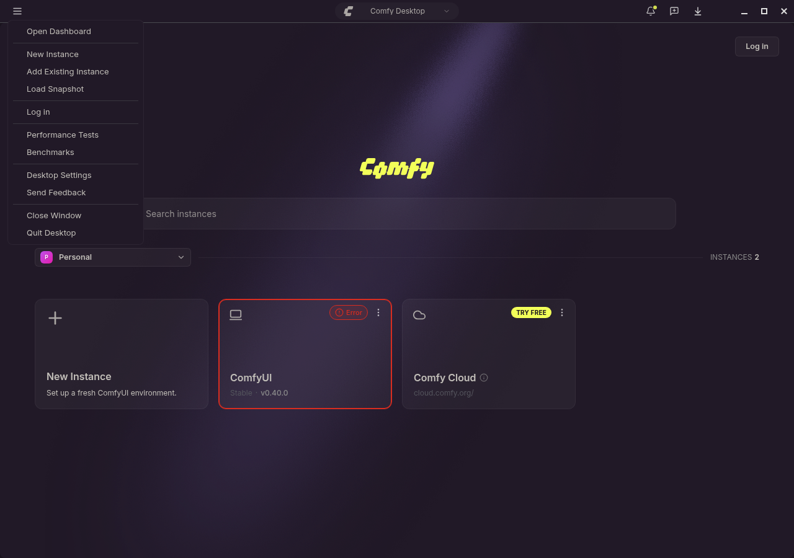

Comfy Desktop — это официальное десктопное приложение для **ComfyUI**. Оно берёт на себя всё: установку ComfyUI, поддержание его в актуальном состоянии и возможность запускать несколько независимых экземпляров параллельно.

Чтобы понять связь: **Comfy Desktop** — это приложение, которое управляет экземплярами **ComfyUI** и запускает их. Вам не нужно устанавливать ComfyUI отдельно: Comfy Desktop автоматически выполняет установку, настраивает окружение Python и зависимости для каждого экземпляра.

### Ключевые возможности

- **[Управление несколькими экземплярами](/ru/installation/desktop/usage/instance-management)**: запускайте несколько экземпляров ComfyUI параллельно, каждый со своей версией, пользовательскими узлами и конфигурацией
- **[Snapshots](/ru/installation/desktop/usage/manage#snapshots-tab)**: сохраняйте и восстанавливайте полное состояние экземпляра (версия ComfyUI, пользовательские узлы, пакеты Python), что позволяет легко откатиться или воспроизвести окружение
- **[Общее хранилище](/ru/installation/desktop/usage/settings#хранилище)**: по умолчанию модели общие для всех экземпляров, что экономит место на диске. Вы также можете добавлять внешние папки с моделями
- **Автоматические обновления**: элемент **Desktop Update** в строке заголовка обновляет Comfy Desktop. Чтобы обновить каждый экземпляр ComfyUI, используйте вкладку [Update](/ru/installation/desktop/usage/manage#update-tab) панели Manage.
- **Интеграция с облаком**: запускайте экземпляры Comfy Cloud или подключайтесь к ним прямо из представления Chooser
- **[Отслеживание существующих установок](/ru/installation/desktop/usage/instance-management#отслеживание-существующей-установки)**: добавляйте существующие portable-установки или ComfyUI, клонированные из git, в Comfy Desktop для единого управления

В этом руководстве описано, как пользоваться этими возможностями.

## Обзор панели управления

Окно Comfy Desktop разделено на несколько ключевых областей. На изображении ниже отмечены основные части панели управления:

### Меню приложения

Меню-гамбургер (☰) в левом верхнем углу открывает меню приложения, в котором собраны все действия уровня приложения:

- **Open Dashboard**: открывает панель управления в новом окне. Запущенные экземпляры продолжают работать.
- **New Instance** и **Add Existing Instance**: создайте новый экземпляр или отслеживайте уже имеющуюся установку ComfyUI.
- **Load Snapshot**: создайте экземпляр из файла снимка, которым с вами поделились.
- **Log in**: войдите в свою учётную запись Comfy. Этот пункт отображается только пока вы не вошли.
- **Performance Tests**: запускайте рабочие процессы с замером времени на экземпляре. См. [Тесты производительности и бенчмарки](/ru/installation/desktop/usage/performance-tests).
- **Benchmarks**: сравнение сохранённых результатов тестов производительности на разном оборудовании, рабочих процессах и экземплярах.
- **Desktop Settings**: глобальные настройки автообновлений, прокси/зеркала, общего хранилища и расположения данных.
- **Send Feedback**: открывает панель обратной связи.
- **Close Window** и **Quit Desktop**: закрыть текущее окно или выйти из приложения. Закрытие окна экземпляра останавливает запущенный в нём экземпляр ComfyUI, а закрытие последнего окна завершает работу Comfy Desktop.

Два пункта появляются только по ситуации: **Reset Zoom (N%)** после того, как вид ComfyUI масштабирован, и **Skip Onboarding** во время первоначальной настройки. Пока на экране отображается первоначальная настройка, **Skip Onboarding** является единственным пунктом меню.

В macOS приложение также сохраняет системную строку меню со стандартными меню приложения, Edit и Window. В сборках для Windows и Linux системной строки меню нет.

<CardGroup cols={2}>
  <Card title="Настройки" icon="cog" href="/ru/installation/desktop/usage/settings">
    Глобальные настройки: автообновления, прокси/зеркало, общее хранилище и расположение данных.
  </Card>
  <Card title="Тесты производительности" icon="gauge" href="/ru/installation/desktop/usage/performance-tests">
    Измеряйте скорость рабочих процессов на экземпляре, а затем сравнивайте запуски на разном оборудовании.
  </Card>
</CardGroup>

### Переключатель экземпляров

Центральная плашка показывает имя активного экземпляра ComfyUI. Нажмите на неё, чтобы открыть **Instance Picker**: всплывающую панель, в которой перечислены все установленные экземпляры, показан их статус работы и можно переключаться между ними или запустить новый. Когда для этого экземпляра доступна новая версия ComfyUI, на плашке также отображается чип **Update**; нажмите на чип, чтобы обновить экземпляр, не открывая панель выбора.

<CardGroup cols={1}>
  <Card title="Управление установками" icon="sliders" href="/ru/installation/desktop/usage/manage">
    Запускайте, обновляйте, создавайте снимки и настраивайте установки через панель Manage.
  </Card>
</CardGroup>

### Кнопки справа

Элементы управления, сгруппированные справа в строке заголовка, обеспечивают быстрый доступ к:

- **Desktop Update**: когда доступна новая версия Comfy Desktop, здесь появляется плашка. Нажмите, чтобы скачать и применить обновление.
- **Reset Zoom**: пока вид ComfyUI масштабирован не на 100%, отображается плашка с текущим процентом масштабирования. Нажмите её, чтобы вернуться к 100%.
- **What's new**: открывает панель объявлений. Объявления рассказывают о новых функциях ComfyUI и запусках продуктов Comfy: короткое видео, главное и ссылки с подробностями. Колокольчик показывает точку, пока есть неоткрытое объявление, и точка исчезает, как только вы откроете панель.
- **Feedback**: отправить обратную связь команде Comfy Desktop.
- **Downloads**: открывает панель загрузок. Бейдж показывает, сколько загрузок выполняется, и отмечает загрузки с ошибкой и неоткрытые. В панели можно повторить загрузку с ошибкой или отменить выполняющуюся; выберите **View All Downloads**, чтобы открыть полный список, где загрузки также можно приостановить и возобновить.

### Поиск

Поисковая строка позволяет фильтровать установленные экземпляры по имени, что упрощает поиск нужной конфигурации, когда их много.

### Chooser (список экземпляров)

Основная область панели управления, называемая **Chooser**, отображает все ваши экземпляры ComfyUI в виде карточек. **Нажмите на любую карточку экземпляра, чтобы запустить или переключиться на этот экземпляр.**

Отсюда вы можете:

- **＋ New Instance**: создать новый отдельный экземпляр ComfyUI.
- **Comfy Cloud**: подключиться к облачному экземпляру или запустить его. На карточке может отображаться плашка **TRY FREE**, когда доступны бесплатные запуски Cloud.
- **Чип учётной записи** (справа вверху): войдите в свою учётную запись Comfy. После входа чип показывает ваш аватар и электронную почту, а над сеткой появляется переключатель рабочего пространства.
- **Workspace Builds**: после входа сборки ComfyUI, опубликованные в выбранном рабочем пространстве, можно установить через поток New Instance. См. [Рабочие пространства и сборки ComfyUI](/ru/installation/desktop/usage/workspaces-and-builds).
- **Карточки существующих экземпляров**: каждая карточка показывает имя, статус и тип экземпляра. Щёлкните правой кнопкой (или нажмите значок ⋮), чтобы управлять экземпляром, обновить его, создать снимок или удалить.

<CardGroup cols={1}>
  <Card title="Управление экземплярами" icon="layer-group" href="/ru/installation/desktop/usage/instance-management">
    Создавайте, переименовывайте, редактируйте и удаляйте экземпляры ComfyUI.
  </Card>
</CardGroup>

## Обратная связь и проблемы

Нашли ошибку или есть предложение? Comfy Desktop распространяется с открытым исходным кодом. Вы можете сообщать о проблемах и просматривать запланированные функции здесь:

- **Проблемы Comfy Desktop**: [github.com/Comfy-Org/Comfy-Desktop/issues](https://github.com/Comfy-Org/Comfy-Desktop/issues)
- **Проблемы с документацией**: [github.com/Comfy-Org/docs/issues](https://github.com/Comfy-Org/docs/issues)

По общим вопросам о ComfyUI посетите [ComfyUI GitHub Discussions](https://github.com/Comfy-Org/ComfyUI/discussions) или присоединяйтесь к [ComfyUI Discord](https://www.comfy.org/discord).
