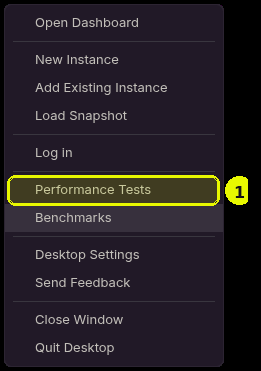
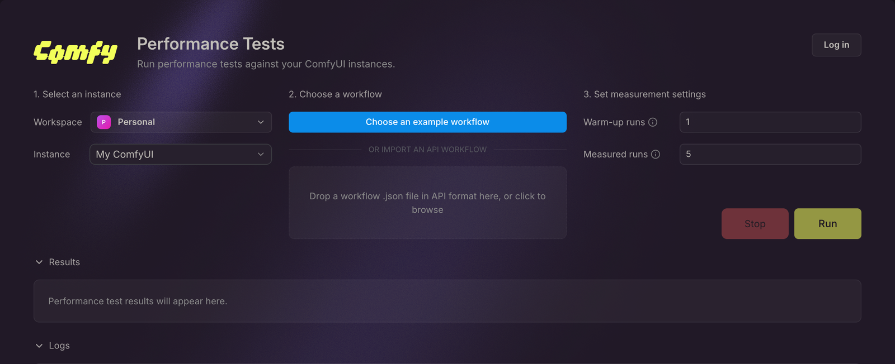
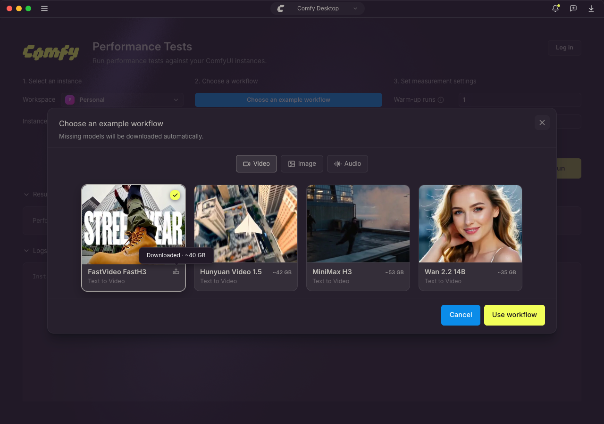
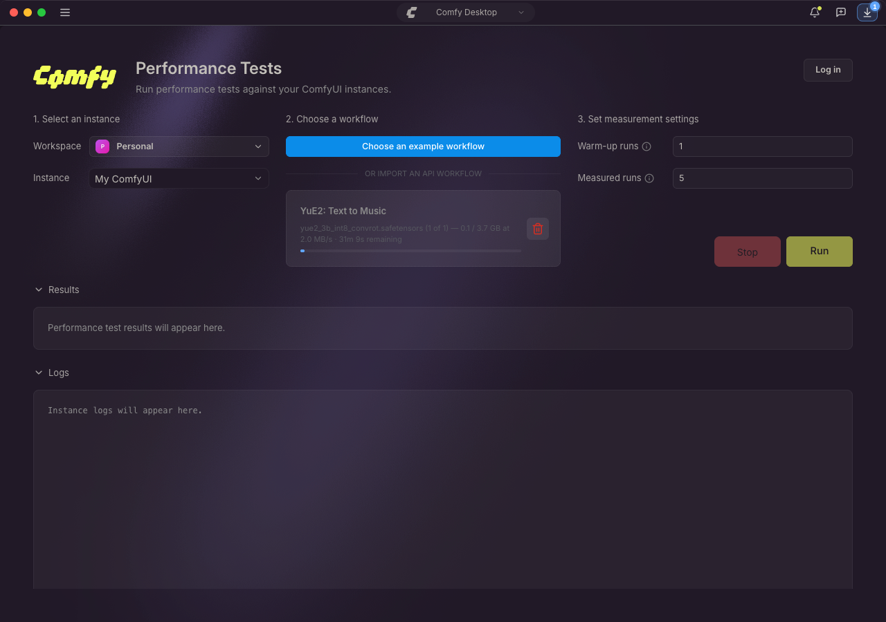
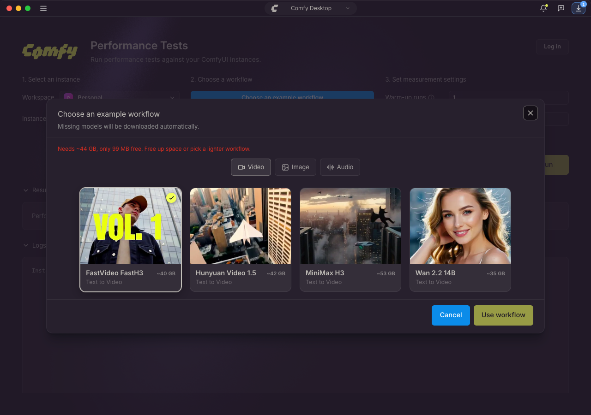
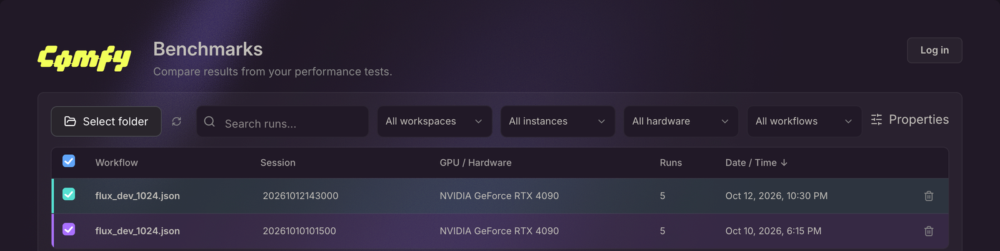
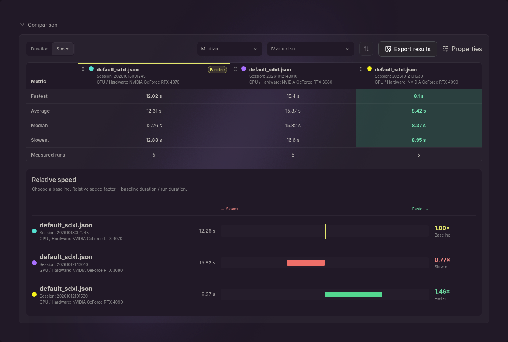

**Performance Tests** измеряет, сколько времени рабочий процесс ComfyUI выполняется на одном из ваших инстансов. Вы выбираете инстанс, загружаете рабочий процесс, и Comfy Desktop запускает его заданное число раз, замеряя время каждого измеряемого запуска и показывая самую быструю, самую медленную, среднюю и медианную длительность вместе с аппаратным и программным обеспечением, на котором получены эти цифры.

**Benchmarks** сравнивает эти записанные результаты. Панель перечисляет все сохранённые запуски, фильтрует их по рабочему пространству, инстансу, оборудованию или рабочему процессу и выстраивает выбранные запуски рядом с относительным коэффициентом скорости, чтобы вы видели, насколько один GPU, рабочий процесс или инстанс быстрее другого.

Обе панели открываются из меню-гамбургера (☰) в левом верхнем углу заголовка Панели управления, а не из левой боковой панели. Нажмите кнопку ☰ (1), затем выберите **Performance Tests** (2) или **Benchmarks** чуть ниже:



<Info>
Performance Tests запускает реальный рабочий процесс на реальном инстансе, поэтому тест занимает примерно столько же времени, сколько сам рабочий процесс, умноженный на количество запусков. Импортируемые рабочие процессы должны быть предварительно экспортированы в [формате API](/ru/development/api-development/workflow-api-format). Примеры рабочих процессов, поставляемые с Comfy Desktop, уже в этом формате.
</Info>

## Запустить тест производительности

Панель разделена на три пронумерованных шага, расположенных рядом друг с другом. В узких окнах они выстраиваются вертикально.



### 1. Выберите экземпляр

Выберите **Workspace** и **Instance** для тестирования. Список экземпляров ограничен рабочим пространством, поэтому, чтобы получить доступ к экземпляру, принадлежащему команде, переключите рабочее пространство. Экземпляр и его аппаратное обеспечение записываются вместе с результатами, и именно это делает возможными последующие сравнения: запуски на разных GPU остаются различимыми.

При запуске теста Comfy Desktop останавливает предыдущий сеанс теста производительности этого экземпляра, если он ещё выполняется, а затем запускает экземпляр в сеансе консоли. Comfy Desktop не запускает тест, пока какой-либо другой локальный ComfyUI работает, ещё запускается или останавливается, и указывает, какие экземпляры этому мешают. Остановите их или дождитесь завершения запуска или остановки, а затем снова запустите тест. Comfy Cloud и удалённые экземпляры работают в другом месте и никогда не блокируют тест. Другая работа, занимающая GPU, например игра или экспорт видео, всё равно влияет на цифры, поэтому остановите её перед запуском теста.

### 2. Выберите рабочий процесс

Можно выбрать пример рабочего процесса, поставляемый с Comfy Desktop, или использовать свой собственный.

Нажмите **Choose an example workflow**, чтобы открыть окно выбора. Примеры сгруппированы по вкладкам **Video**, **Image** и **Audio**, и каждая карточка показывает название, задачу и размер, который занимают загружаемые модели. Если модели карточки уже находятся на диске, вместо размера отображается значок жёсткого диска, а подсказка показывает **Downloaded** и размер (например, **Downloaded · ~17 GB**). Эти модели не загружаются повторно и не учитываются в объёме свободного пространства.



Выберите карточку и нажмите **Use workflow**. Comfy Desktop получает промпт в формате API и загружает отсутствующие модели в фоне: зона перетаскивания показывает прогресс, кнопка **Run** остаётся недоступной до завершения загрузки, а подсказка кнопки с корзиной меняется на **Cancel download**. Неудачная загрузка удаляет рабочий процесс.



Для окна выбора требуются установленный экземпляр и рабочее подключение, и если чего-то из этого нет, оно сообщает об этом под зоной перетаскивания. Если моделям не хватит свободного места на диске, над карточками появляется предупреждение, а кнопка **Use workflow** остаётся недоступной:



Примеры привязаны к экземпляру: при переключении экземпляров подготовленный пример сбрасывается, если только тест уже не использовал его. Набор встроенных примеров меняется от версии к версии.

**Your own workflow** необходимо экспортировать в [формате API](/ru/development/api-development/workflow-api-format). Перетащите файл `.json` в зону перетаскивания или нажмите на неё, чтобы выбрать файл.

В любом случае Comfy Desktop копирует рабочий процесс в папку сеанса теста, поэтому тест выполнится, даже если вы переместите или измените оригинальный файл.

### 3. Настройте параметры измерений

| Параметр | Диапазон | По умолчанию | Что делает |
|---------|-------|---------|--------------|
| **Warm-up runs** | от 0 до 5 | 1 | Запуски, выполняемые первыми для загрузки моделей и прогрева кэшей. Они не включаются в результаты. Укажите 0, чтобы пропустить прогрев. |
| **Measured runs** | от 1 до 100 | 5 | Запуски, время которых измеряется после прогревочных запусков. Их длительность используется для расчёта результатов. |

Каждый запуск увеличивает числовые входы seed рабочего процесса на единицу, поэтому измеряемые запуски не повторяют одинаковый кэшированный результат.

Когда все три шага настроены, нажмите **Run**, чтобы начать тест. Кнопка **Stop** рядом с ней отменяет выполняющийся тест.

### Читать результаты

Во время теста панель показывает, сколько запусков завершено, и журналы экземпляра. Когда завершаются все запуски, экземпляр останавливается и появляются результаты:

- **Fastest run**, **Slowest run**, **Average run** и **Median run** в секундах
- **Measured runs** и **Failed runs**: сколько запусков дали длительность, а сколько нет
- **Run duration aggregates**: столбчатая диаграмма, сравнивающая четыре агрегата (самый быстрый, самый медленный, средний и медианный)
- **System information**: вычислительное устройство, VRAM, RAM, версия PyTorch, версия xFormers, CPU, ядра CPU, операционная система и архитектура

Длительность запуска: это время, которое ComfyUI потратил на выполнение задачи на сервере, а не время вашего ожидания. Неудачные запуски подсчитываются отдельно и не учитываются в статистике.

Рядом с результатами расположены две кнопки: **Open folder** открывает папку сеанса, а **Export results** сохраняет сводку и диаграммы в виде изображения PNG.

## Сравнение запусков с Benchmarks

Benchmarks читает результаты, сохранённые Performance Tests, поэтому ему нечего показывать, пока не завершится хотя бы один тест.

### Библиотека запусков

**Runs library** показывает все сохранённые запуски в папке результатов, сначала новые. На её панели инструментов есть:

- **Select folder**: укажите для панели другую папку результатов, например папку на сетевом диске. По умолчанию используется папка, в которую записывает Performance Tests, см. [Где хранятся результаты](#где-хранятся-результаты).
- **Refresh sessions**: перезагрузите папку после завершения теста в другом месте.
- **Search runs**: отфильтруйте список по тексту.
- Раскрывающиеся фильтры по рабочему пространству, экземпляру, оборудованию и рабочему процессу.
- **Properties**: выберите, какие столбцы показывает библиотека (сеанс, дата и время, рабочий процесс, экземпляр, рабочее пространство, количество запусков, GPU и оборудование).



### Сравнить запуски

Выберите два или более запуска с помощью флажков или используйте **Select all visible runs**. При загрузке библиотеки автоматически выбираются три самых новых запуска. После выбора ниже библиотеки открывается раздел **Comparison**.

В **Comparison** для каждого выбранного запуска предусмотрен столбец, а метрики расположены в строках: самая быстрая, средняя, медианная и самая медленная длительность, а также измеренное количество запусков. Один запуск является **базовым**. По умолчанию это первый отображаемый столбец. В представлении **Speed** нажмите на заголовок столбца, чтобы сделать базовым именно этот запуск.

### Относительная скорость

Сравнение имеет два представления, **Duration** и **Speed**, между которыми можно переключаться на панели инструментов сравнения. **Relative speed** относится к представлению **Speed**, и базовый запуск также выбирается там.

**Relative speed** вычисляется как длительность базового запуска, делённая на длительность запуска:

- **1.00×** означает, что запуск имеет ту же скорость, что и базовый.
- Коэффициент выше 1.00× означает, что запуск **быстрее** базового.
- Коэффициент ниже 1.00× означает, что запуск **медленнее** базового.

В представлении **Speed** каждый запуск отображается на логарифмической оси: **Slower** слева, **Faster** справа, поэтому разница в 2x и 4x остаётся читаемой на одной диаграмме. В представлении **Duration** самый быстрый и самый медленный результаты каждого запуска отображаются в виде линии с отмеченным средним значением. Запуски без корректной длительности помечаются как «Недоступно».



### Сортировать и экспортировать

- **Sort comparison** упорядочивает столбцы по выбранной метрике (самая быстрая, средняя, медианная или самая медленная). **Manual sort** позволяет перетаскивать столбцы в нужном порядке или нажимать Alt+Left / Alt+Right, когда столбец в фокусе.
- **Export results** сохраняет всё сравнение как изображение PNG, это самый быстрый способ прикрепить результат к issue или сообщению в чате. Сравнение более чем 20 запусков нельзя экспортировать.

### Управлять сеансами

Каждый тест хранится как сеанс. В библиотеке можно переименовать сеанс (**Edit session**) или удалить его (**Delete**). При удалении удаляются все файлы, записанные для этого сеанса.

## Где хранятся результаты

Performance Tests создаёт папку сеанса при добавлении рабочего процесса в панель. Имя папки формируется из метки времени этого момента (`YYYYMMDDHHMMSS`):

```
📂 ComfyUI-Shared/
└── 📂 benchmarks/
    ├── 📂 20260930141522/
    │   ├── my_workflow.json
    │   ├── jobs.json
    │   ├── results.json
    │   └── logs.txt
    └── 📂 20260930163005/
        └── ...
```

| Платформа | Папка результатов по умолчанию |
|----------|------------------------|
| Windows | `%LOCALAPPDATA%\Comfy-Desktop\ComfyUI-Shared\benchmarks` |
| macOS / Linux | `~/ComfyUI-Shared/benchmarks` |

Каждая папка сеанса содержит:

- файл рабочего процесса, который использовала панель
- `jobs.json`: необработанный ответ задачи от экземпляра
- `results.json`: сводка, которую читает панель Benchmarks
- `logs.txt`: вывод консоли экземпляра во время запуска

Поскольку Benchmarks читает `results.json` из каждой найденной папки сеанса, достаточно скопировать папки сеансов в папку, на которую указывает Benchmarks, чтобы сравнить результаты с другой машины.

Повторный запуск того же импортированного рабочего процесса записывает данные в ту же папку сеанса и перезаписывает уже сохранённые там результаты. Чтобы сохранить результат для сравнения, добавьте рабочий процесс в панель ещё раз перед следующим тестом.

## Требования

- Отдельный, отслеживаемый или удалённый экземпляр, который может запустить Comfy Desktop. Тесту нужен работающий экземпляр ComfyUI, поэтому на экземпляре Comfy Cloud он запуститься не может.
- Рабочий процесс, который экземпляр может выполнить, включая все необходимые ему модели и пользовательские узлы. Импортируемый рабочий процесс должен быть в формате API; примеры рабочих процессов уже в нём, а Comfy Desktop скачивает их модели. Если экземпляр отклоняет рабочий процесс, тест останавливается, а ошибка появляется в логах. Запуски, которые экземпляр принимает, но которые завершаются с ошибкой во время выполнения, считаются запусками с ошибкой и не учитываются в статистике длительности.
