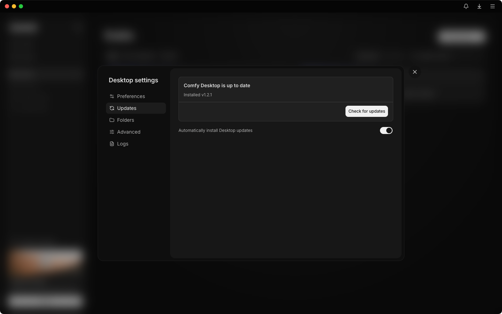
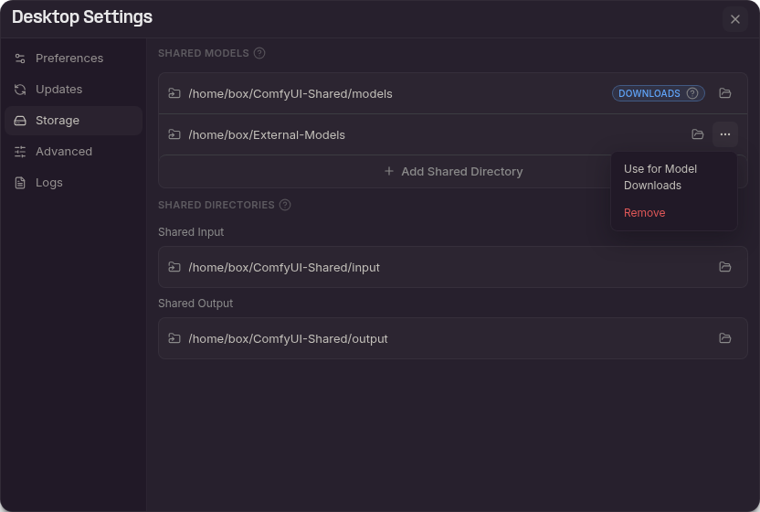

Нажмите меню ☰ (1) в верхнем левом углу и выберите **Настройки рабочего стола** (2), чтобы открыть панель глобальных настроек.


Панель настроек разделена на пять вкладок. Нажмите на вкладку в боковой панели, чтобы переключить вид.

## Предпочтения


Вкладка «Предпочтения» открывается выбором **Language**, а остальные элементы управления сгруппированы в трёх разделах.

- **Language**: выбор языка интерфейса. Доступны **English** и **简体中文**.

### Поведение приложения

- **Auto-launch on startup**: выберите, какой экземпляр запускать при открытии Comfy Desktop. По умолчанию используется **None (show dashboard)**. Также можно выбрать **Last used instance** или конкретную установку.
- **Confirm before closing a window**: запрашивать подтверждение перед закрытием окна, в котором работает локальная установка.
- **Warn before running multiple instances**: показывать предупреждение перед запуском ещё одного локального экземпляра ComfyUI, если один уже работает или запускается.
- **Hide Cloud from the Instance Picker**: скрыть строку Cloud на панели управления. Cloud продолжит работать, если позже включить эту настройку снова.

### Конфиденциальность

- **Share anonymous usage telemetry**: отправлять анонимные данные об использовании, чтобы помочь улучшить Comfy Desktop.
- **Opt-in to beta features**: разрешить Comfy Desktop включать для ваших экземпляров ранние функции Core. Переключатель остаётся недоступным, пока вы не подтвердите обмен данными с помощью **Share anonymous usage telemetry**, даже если телеметрия уже включена.

Бета-функции добавляются как дополнительные аргументы запуска и вставляются перед теми, что вы задали сами. Ваши собственные аргументы сохраняют свой порядок и никогда не переписываются, а Desktop убирает только флаг `--`, который установленный ComfyUI не указывает в своём списке. Если прочитать этот список не удаётся, приложение запускается ровно с вашими аргументами и не добавляет бета-аргументы. Когда для экземпляра включается бета-функция, в заголовке окна появляется карточка **A beta feature is on**. Кнопка **Got it** закрывает её, а **Settings** открывает эту панель на переключателе согласия. Какие аргументы добавила бета-функция, видно на вкладке Startup Args экземпляра, за плашкой **+N beta** рядом с **Startup Arguments**.

### Сообщество

- **Comfy Desktop**: карточка со ссылкой на [репозиторий Comfy Desktop на GitHub](https://github.com/Comfy-Org/Comfy-Desktop).

## Обновления



- **Строка состояния**: Первая строка вкладки сообщает, актуальна ли версия Comfy Desktop, либо что доступно обновление, оно готово к установке или загружается. Установленная версия отображается ниже, вместе со временем последней проверки после её выполнения.
- **Проверить обновления**: Проверьте наличие новой версии вручную. Если обновление доступно, кнопка меняется на **Скачать**, а после завершения загрузки — на **Перезапустить и обновить**.
- **Автоматически устанавливать обновления Desktop**: Автоматически скачивать и устанавливать обновления в фоне.

## Хранилище

Вкладка Storage позволяет настроить, где Comfy Desktop ищет и хранит файлы. Ключевое понятие здесь — **совместное использование**: вместо того чтобы каждый экземпляр имел собственные изолированные модели, входы и выходы, вы настраиваете общие каталоги, доступные всем экземплярам.


- **Shared Models**: каждый перечисленный здесь каталог сканируется всеми экземплярами в поисках моделей. Новые модели скачиваются в каталог, отмеченный значком **DOWNLOADS**.

  

  - Нажмите на путь каталога, чтобы открыть его в файловом менеджере.
  - Меню **⋯** (1) отображается у каждого общего каталога, кроме того, который уже принимает загрузки. Выберите **Use for Model Downloads** (2), чтобы сделать этот каталог целью загрузок, или **Remove**, чтобы убрать его из списка. При удалении каталога его файлы сохраняются.
  - Нажмите **+ Add Shared Directory**, чтобы добавить новые каталоги моделей.
- **Shared Input**: общий путь, по которому все экземпляры ищут входные файлы (изображения, видео и т. д.).
- **Shared Output**: общий путь, по которому все экземпляры сохраняют сгенерированные выходы. Настроив его, вы сможете хранить все результаты в одном месте.
- Нажмите на иконку папки, чтобы просмотреть и выбрать новый путь. Подсказки **?** содержат дополнительные сведения.

Переопределения для отдельного экземпляра (включение общих каталогов, разделение входов и выходов, дополнительные папки моделей) настраиваются на вкладке Storage страницы [Управлять](/ru/installation/desktop/usage/manage#storage-tab).

## Расширенные


- **Default Install Location**: место, где создаются новые отдельные экземпляры. Нажмите на иконку папки, чтобы изменить его.
- **PyPI Mirror URL**: пользовательское зеркало pip (например, `https://mirrors.aliyun.com/pypi/simple/`).
- **Use Chinese Mirrors (Git & PyPI)**: использовать китайские зеркала для Git и PyPI. Полезно в материковом Китае. Если язык приложения китайский, этот переключатель находится на вкладке **Preferences** в разделе **App Behavior**.
- **Use hardware acceleration**: использовать GPU для отрисовки Comfy Desktop. Перезапустите Comfy Desktop, чтобы изменения вступили в силу.
- **Cache Directory**: папка, в которой Comfy Desktop хранит временные и кэшированные данные. Нажмите на иконку папки, чтобы изменить её.

### Кэш загрузок

При автономной установке набор файлов ComfyUI скачивается в **Cache Directory** (путь по умолчанию оканчивается на `download-cache`). При последующей установке того же набора загрузка пропускается и отображается **Using cached download**, поэтому установка завершается гораздо быстрее.

Используйте **Cache Directory** только для этого кэша: когда загрузка завершается, старые вложенные папки внутри неё удаляются, поэтому всё остальное, что вы там сохраните, может быть удалено. Удаление отдельной папки кэша лишь вызовет повторную загрузку при следующей установке; модели, входы, выходы и установки хранятся в других местах.

## Логи

- **Диагностика**: **Открыть папку журналов** открывает каталог логов приложения Comfy Desktop (`app.log`). См. [Как проверить логи запуска Comfy Desktop?](/ru/installation/desktop/faq#как-проверить-журналы-запуска-comfy-desktop).

## Расположение данных

Comfy Desktop хранит данные в каталогах, зависящих от платформы.

<Tabs>
  <Tab title="Windows">
```
App data:     %APPDATA%\Comfy Desktop
Logs:         %APPDATA%\Comfy Desktop\logs
Installs:     %LOCALAPPDATA%\Comfy-Desktop\ComfyUI-Installs
Shared data:  %LOCALAPPDATA%\Comfy-Desktop\ComfyUI-Shared
```

Новые установки размещают большие объёмы данных (установки, общие модели, кэш) в `%LOCALAPPDATA%\Comfy-Desktop`. Если до обновления в вашем профиле пользователя уже были папки `ComfyUI-Installs` или `ComfyUI-Shared`, эти папки в корне домашнего каталога сохраняются. Если вы установили приложение на другой диск, большие данные будут храниться в `<drive>\Comfy-Desktop\`.
  </Tab>
  <Tab title="macOS">
```
App data:     ~/Library/Application Support/Comfy Desktop
Logs:         ~/Library/Logs/Comfy Desktop
Installs:     ~/ComfyUI-Installs
Shared data:  ~/ComfyUI-Shared
```
  </Tab>
  <Tab title="Linux">
```
Config:       ~/.config/comfyui-desktop-2
Data:         ~/.local/share/comfyui-desktop-2
Cache:        ~/.cache/comfyui-desktop-2
State:        ~/.local/state/comfyui-desktop-2
Logs:         ~/.config/Comfy Desktop/logs
Installs:     ~/ComfyUI-Installs
Shared data:  ~/ComfyUI-Shared
```

В Linux Comfy Desktop хранит свои настройки, кэш, данные и состояние в `comfyui-desktop-2`, а Electron хранит профиль приложения и его логи под отображаемым именем `Comfy Desktop`. При работе из исходного кода `comfyui-desktop-2` используется для обоих. Это расположения по умолчанию: `XDG_CONFIG_HOME`, `XDG_CACHE_HOME`, `XDG_DATA_HOME` и `XDG_STATE_HOME` перемещают их, а логи следуют за `XDG_CONFIG_HOME`.
  </Tab>
</Tabs>

## Горячие клавиши

| Сочетание клавиш | Действие |
|----------|--------|
| `Ctrl+R` / `Cmd+R` | Перезагрузить текущее представление ComfyUI |
| `Ctrl`/`Cmd` + `+` / `-` / `0` | Увеличить или уменьшить масштаб представления ComfyUI либо вернуть его к 100% |
| `Escape` | Закрыть диалоговое окно или всплывающее окно |

Comfy Desktop не назначает `Ctrl+W` / `Cmd+W`, поэтому случайное нажатие не может закрыть окно с работающим экземпляром. Чтобы закрыть окно, используйте пункт **Close Window** в меню ☰.

## Обратная связь и проблемы

Вы нашли ошибку или у вас есть предложение? Comfy Desktop имеет открытый исходный код. Здесь вы можете сообщить о проблемах и посмотреть запланированные функции:

- **Проблемы Comfy Desktop**: [github.com/Comfy-Org/Comfy-Desktop/issues](https://github.com/Comfy-Org/Comfy-Desktop/issues)
- **Проблемы с документацией**: [github.com/Comfy-Org/docs/issues](https://github.com/Comfy-Org/docs/issues)

По общим вопросам о ComfyUI посетите [ComfyUI GitHub Discussions](https://github.com/Comfy-Org/ComfyUI/discussions) или присоединяйтесь к [ComfyUI Discord](https://www.comfy.org/discord).
