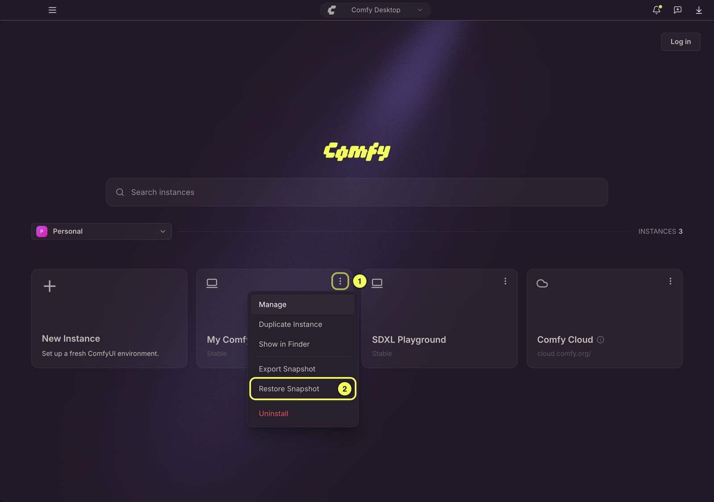
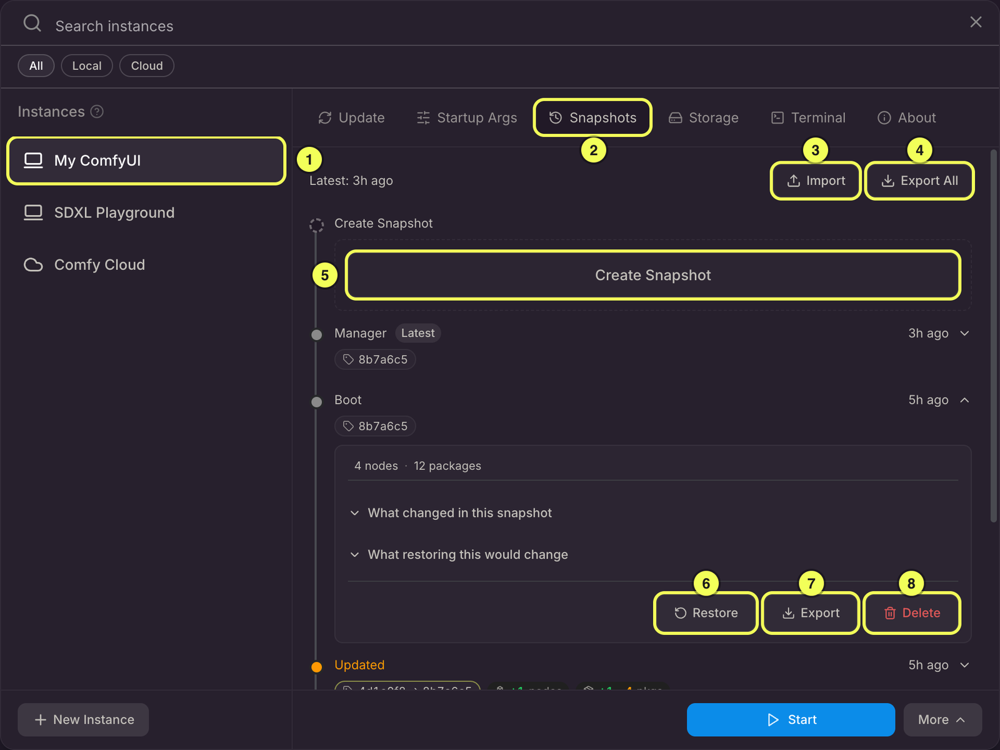
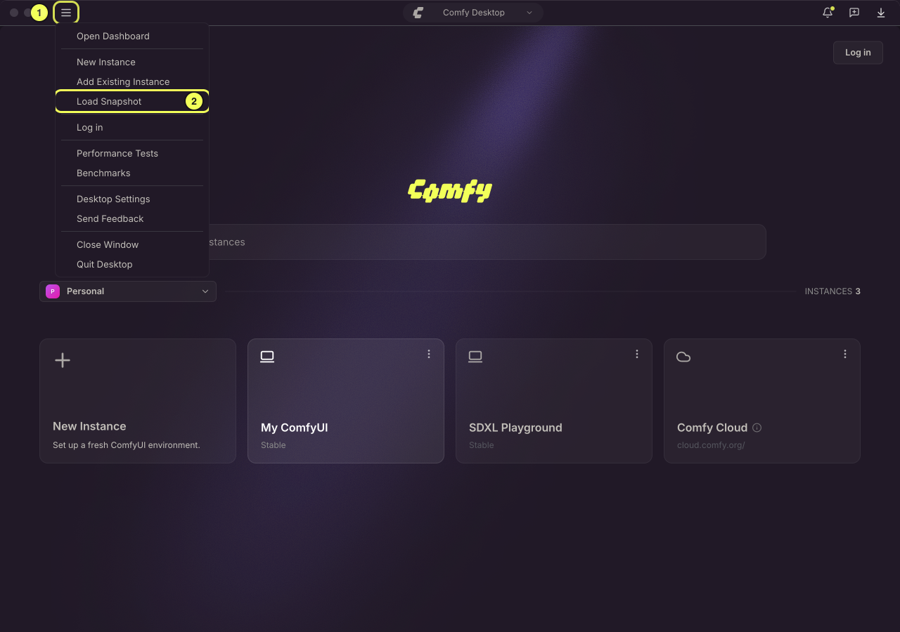
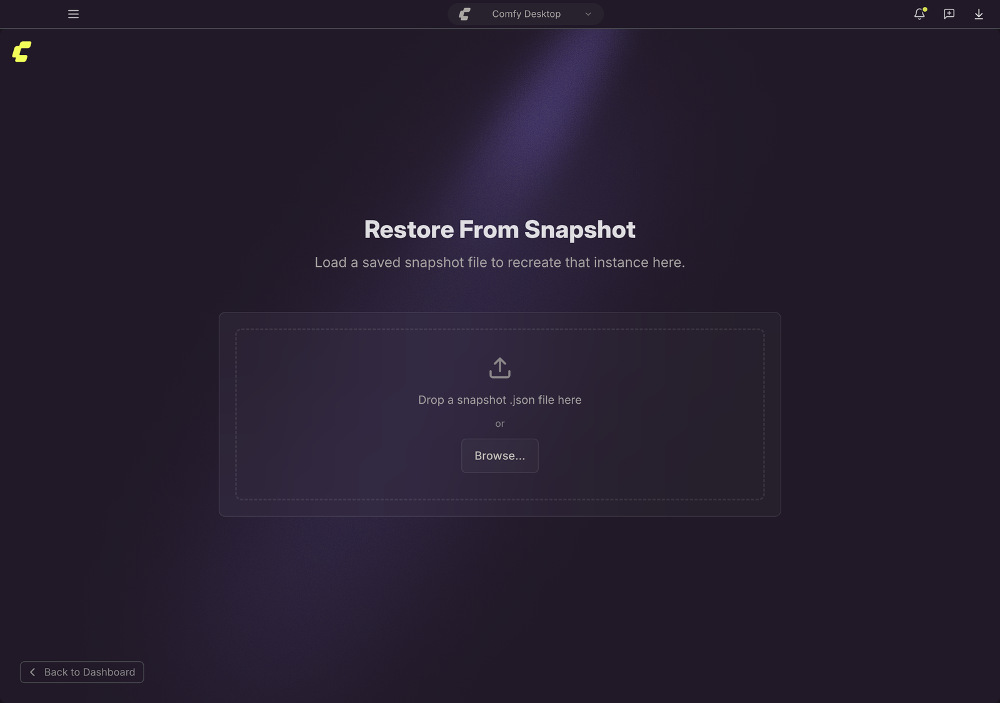
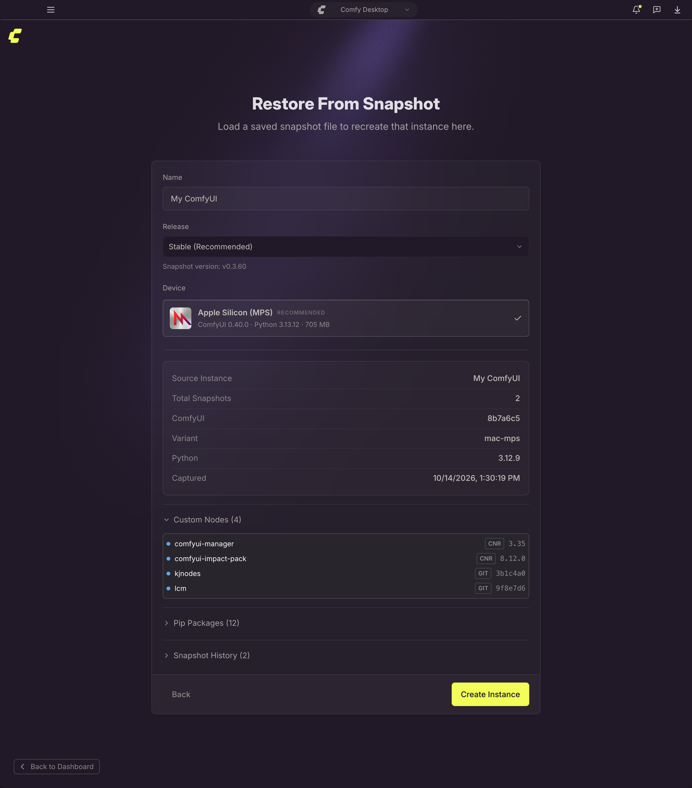

Снимок фиксирует программную конфигурацию экземпляра, а не его файлы:

- **Версия ComfyUI**: какая сборка ComfyUI установлена
- **Пользовательские узлы**: каждый пользовательский узел с его версией или хешем коммита
- **Пакеты pip**: каждый пакет Python в окружении, согласно `pip freeze`
- **Python и PyTorch**: версия Python и, если Comfy Desktop может это определить, стек PyTorch

Снимки служат точками восстановления: откатитесь после неудачного обновления, клонируйте установку или поделитесь рабочей конфигурацией с коллегой.

Comfy Desktop автоматически создаёт снимки для экземпляра Standalone: при каждой загрузке и каждом перезапуске, до и после обновления, а также после восстановления. Вы также можете создать снимок вручную в любое время.

## Что не включает снимок

Снимок не является резервной копией ваших файлов. Модели, рабочие процессы, сгенерированные результаты, входные файлы и настройки ComfyUI не записываются, и восстановление не возвращает их на место.

Вместо этого восстановление пересобирает программный стек: переключается на записанную версию ComfyUI, возвращает пользовательские узлы к записанному набору, синхронизирует пакеты Python и PyTorch и запускает скрипты установки тех узлов, которые оно меняет. Эти скрипты могут записывать собственные настройки ComfyUI.

Стоит знать две вещи:

- **Удалённая модель остаётся удалённой.** Восстановление более старого снимка не вернёт модель, которую вы удалили. ComfyUI сообщит о ней как об отсутствующей модели при следующем открытии рабочего процесса, который её использует. Если диалог отсутствующих моделей предлагает **Download** для этой модели, Comfy Desktop загрузит её за вас (см. [Загрузки](/ru/installation/desktop/usage/downloads)); если нет, верните файл в соответствующую папку моделей самостоятельно.
- **Снимки хранятся внутри папки экземпляра.** Удаление экземпляра стирает вместе с ним и историю его снимков. **Forget** только убирает экземпляр из списка и сохраняет папку, включая снимки. В любом случае сначала экспортируйте то, что хотите сохранить, с помощью **Export All** на вкладке Snapshots; см. [Поделиться снимком](#поделиться-снимком).

## Доступ к Snapshots

На карточке любого экземпляра нажмите **меню (⋮)** (1) и выберите **Restore Snapshot** (2), чтобы сразу открыть вкладку **Snapshots**.

Либо откройте панель **Manage** на карточке любого экземпляра и перейдите на вкладку **Snapshots**.

## Обзор вкладки Snapshots

Вкладка Snapshots: центр управления всеми действиями со снимками. На временной шкале показаны снимки экземпляра, сначала новые, и каждая запись помечена тегом, указывающим, как она была создана: **Boot**, **Manager**, **Update**, **Updated**, **Restored** или **Manual**. Если экземпляр копировали в другой экземпляр или из него, на шкале также отображается это копирование. Доступные основные действия:

1. **Selected instance**: экземпляр, снимки которого показаны на временной шкале.
2. **Snapshots tab**: активная вкладка на панели Manage.
3. **Import**: импорт файла снимка, экспортированного другим пользователем или экземпляром.
4. **Export All**: экспорт всех снимков этого экземпляра в один файл `.json`.
5. **Create Snapshot**: создание ручного снимка текущего состояния экземпляра.
6. **Restore**: восстановление экземпляра до состояния конкретного снимка.
7. **Export**: экспорт одного снимка с временной шкалы.
8. **Delete**: удаление одного снимка с временной шкалы.

### Создать ручной снимок

Нажмите **Create Snapshot** (5) в верхней части временной шкалы. При желании можно добавить метку (например, «Before adding LCM LoRA»), чтобы потом опознать снимок. Снимок зафиксирует:

- Текущий Git-коммит ComfyUI
- Каждый пользовательский узел с URL git-клонирования и коммитом либо с его CNR ID и версией, а также папки, отключённые в `custom_nodes/.disabled`. У узла, скопированного вручную, нет источника, который можно использовать при восстановлении, поэтому восстановление его пропускает, а отдельный узел `.py`, оставленный в `.disabled`, не записывается вообще
- Все пакеты pip из `pip freeze`

Ручные снимки не учитываются в лимите автоснимков, и их можно удалять по отдельности.

### Просмотреть детали снимка

Нажмите на любую строку, чтобы развернуть её. В свёрнутой строке уже видно, как был создан снимок, когда он сделан, версия ComfyUI и плашки с количеством узлов и пакетов, добавленных, удалённых или изменённых по сравнению с предыдущим снимком. У самого нового снимка есть значок **Latest**.

В развёрнутом виде показаны общее число узлов и пакетов в снимке, его метка (если она есть) и два раскрывающихся списка различий:

- **What changed in this snapshot**: сравнение этого снимка с непосредственно предыдущим. Скрыто для самого старого снимка на шкале.
- **What restoring this would change**: сравнение этого снимка с текущим состоянием экземпляра. Скрыто для самого нового снимка на шкале.

Кнопки **Restore**, **Export** и **Delete** для этого снимка также находятся в развёрнутом виде. У самого нового снимка на временной шкале кнопки **Restore** нет.

### Восстановить из снимка

1. На вкладке Snapshots найдите снимок, который нужно восстановить.
2. Нажмите **Restore**: откроется предпросмотр с различиями (что изменится).
3. Проверьте изменения и нажмите **Restore** в диалоге подтверждения, чтобы начать.

Для восстановления экземпляр должен быть остановлен. Если при запуске восстановления ComfyUI работает, в диалоге будет сказано, что сначала экземпляр остановят. Comfy Desktop останавливает его, ждёт завершения, выполняет восстановление и снова запускает, если восстановление прошло успешно.

Во время восстановления Comfy Desktop:

1. **Переключит записанную версию ComfyUI** (Git-коммит)
2. **Установит отсутствующие пользовательские узлы**, переключит версии и включит или отключит узлы по необходимости
3. **Запустит скрипты установки** установленных или переключённых узлов: сначала `requirements.txt`, затем `install.py`. Для узла, который только включается или отключается, и для узла, восстановленного отключённым, они не запускаются
4. **Восстановит пакеты pip**: установит отсутствующие пакеты, обновит или откатит до записанной версии и удалит лишние

Comfy Desktop сначала восстанавливает пользовательские узлы, потому что установка узла может подтянуть пакеты Python, а затем синхронизирует пакеты Python. Перед синхронизацией он создаёт резервную копию пакетов, которые собирается перезаписать или удалить. Отмена или сбой установки пакета после этого момента возвращает эти пакеты на место и откатывает ComfyUI к коммиту, на котором он был до восстановления. Если какой-то пакет вернуть не удалось, восстановление сообщает об этом, а не заявляет о чистом откате. Отмена на шаге работы с узлами откатывает коммит, но оставляет на месте уже установленные папки узлов и добавленные ими пакеты. Если окружение уже совпадает со снимком, восстановление сообщает **No changes needed** и оставляет окружение как есть.

Пользовательские узлы восстанавливаются по мере возможности. Если узел не удалось установить или переключить, это не останавливает остальное восстановление: оно завершается со списком ошибок, а запись на временной шкале получает метку **Restore did not complete** рядом с тегом **Restored**. Исправьте или удалите узел, затем восстановите снова.

Карточка в верхней части временной шкалы сообщает, чем закончилось последнее восстановление: **Snapshot restored** или **Restore failed**. Отмена восстановления закрывает карточку без результата. Успешное восстановление также добавляет новую запись с тегом **Restored**, в которой зафиксировано состояние, полученное в результате восстановления.

### Импортировать снимок в экземпляр

Используйте **Import** на вкладке Snapshots, чтобы добавить файл снимка в историю самого экземпляра. Применяется только самый новый снимок из файла. Если окружение можно воспроизвести точно, этот снимок добавляется на временную шкалу; в противном случае Comfy Desktop вместо этого сохраняет снимок получившегося состояния, а более старые снимки из файла игнорируются. Если сборку PyTorch из снимка нельзя применить на этой машине, Comfy Desktop предупредит вас перед применением.

### Удалить снимок

Разверните любой снимок и нажмите **Delete**, чтобы удалить его. Comfy Desktop хранит 200 самых новых снимков Boot и Manager без метки на каждую установку и автоматически удаляет более старые по мере записи новых, так что вручную их чистить не нужно. Снимки, сделанные вручную, до или после обновления либо после восстановления, никогда не удаляются автоматически, поэтому удаляйте их сами, когда они больше не нужны.

## Поделиться снимком

Файлы снимков переносимы: один файл `.json` содержит всю конфигурацию, поэтому его можно передать коллеге или переместить на другой компьютер.

Есть два быстрых способа экспортировать **новейший** снимок экземпляра, не открывая вкладку Snapshots:

- На карточке экземпляра в Панели управления откройте меню **⋮** и выберите **Export Snapshot**.
- В окне выбора экземпляра откройте меню **More** в нижней части и выберите **Share**.

Оба способа открывают диалоговое окно сохранения и записывают один файл `.json`. Если у экземпляра ещё нет снимков, Comfy Desktop сообщает, что делиться нечем. Чтобы экспортировать один конкретный снимок или все снимки сразу, используйте **Export** и **Export All** на вкладке Snapshots.

Получатель может либо создать новый экземпляр из файла, либо импортировать его в уже существующий экземпляр.

## Создать экземпляр из файла снимка

Если кто-то поделится с вами файлом снимка, вы можете использовать его, чтобы развернуть новый экземпляр ComfyUI с точно такой же конфигурацией.

1. Нажмите **меню ☰** (1) в левом верхнем углу представления Chooser и выберите **Load Snapshot** (2).

2. Просмотрите файловую систему и выберите файл снимка `.json`.

3. В окне предпросмотра отображается содержимое снимка: имя исходного экземпляра, версия ComfyUI, пользовательские узлы и пакеты pip. Проверьте детали, затем нажмите **Create Instance**, чтобы создать новый экземпляр из снимка.

Так создаётся совершенно новый отдельный экземпляр, а оригинальный экземпляр остаётся неизменным. Вы увидите, как он появится в представлении Chooser рядом с другими вашими экземплярами.
