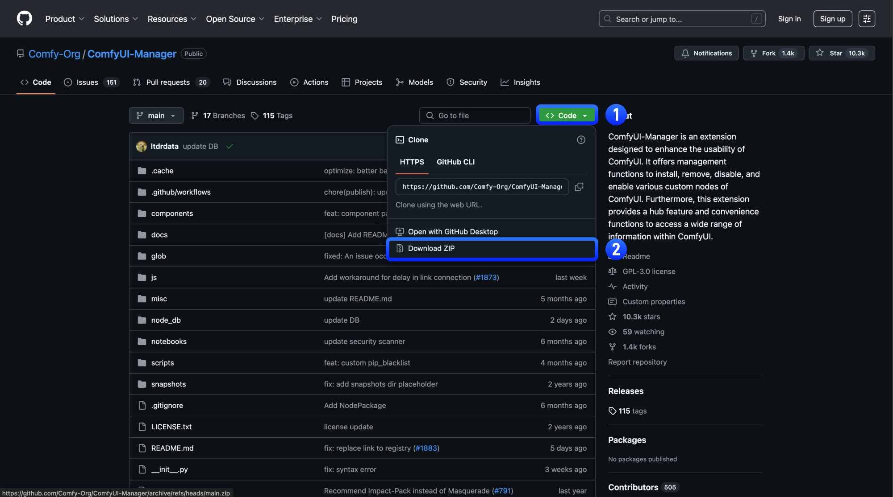

## Что такое пользовательские узлы?

Пользовательские узлы это расширения для ComfyUI, которые добавляют новые возможности: расширенную обработку изображений, дообучение моделей машинного обучения, корректировки цвета и многое другое. Эти узлы, разработанные сообществом, могут значительно расширить базовые возможности ComfyUI.

<Warning>
Перед установкой пользовательских узлов важно внимательно их изучить. Поскольку ComfyUI это проект с открытым исходным кодом, вредоносные плагины могут использовать пользовательские узлы в своих целях:
1. Устанавливайте пользовательские узлы только от проверенных авторов и тех, что широко используются сообществом
2. Понимайте функциональность плагина перед установкой и избегайте неизвестных источников, чтобы обеспечить безопасность системы
3. Избегайте установки малоизвестных или подозрительных плагинов: непроверенные плагины могут создавать угрозы безопасности, способные привести к компрометации системы
</Warning>

Для любой установки пользовательских узлов необходимо выполнить два шага:

1. Клонировать код узла в каталог `ComfyUI/custom_nodes`
2. Установить необходимые зависимости Python

В этом руководстве сравниваются три подхода к установке. **ComfyUI Manager** встроен в текущие версии ComfyUI для большинства конфигураций: начните с [обзора ComfyUI Manager](/ru/manager/overview), чтобы узнать, что он делает и как его включить. Используйте **Git clone** или **ZIP**, если узла нет в реестре или вам нужна определённая ревизия.

| Метод                        | Преимущества                                                    | Недостатки                                                |
| ---------------------------- | ------------------------------------------------------------- | ----------------------------------------------------------- |
| **ComfyUI Manager** (РЕКОМЕНДУЕТСЯ) | 1. Автоматическая установка<br/>2. Обработка зависимостей<br/>3. Графический интерфейс | Нельзя напрямую искать узлы, не зарегистрированные в реестре |
| **Git Clone**                | Можно устанавливать узлы, не зарегистрированные в реестре               | 1. Требуются знания Git<br/>2. Ручная обработка зависимостей<br/>3. Риски при установке |
| **Скачать ZIP-архив репозитория**   | 1. Git не требуется<br/>2. Ручной контроль                      | 1. Ручная обработка зависимостей<br/>2. Нет контроля версий<br/>3. Риски при установке |

Совет: перед установкой пользовательских узлов проверьте файл README плагина, чтобы узнать методы установки, использование и требования, такие как конкретные модели, версии зависимостей и решения распространённых проблем.

## Метод 1: ComfyUI Manager (рекомендуется) {#method-1-comfyui-manager-recommended}

<Note>
Перед использованием этого метода ComfyUI Manager должен быть доступен в вашей среде. Если он отсутствует или отключён, см. [Обзор ComfyUI Manager](/ru/manager/overview) и [руководство по установке](/ru/manager/install).
</Note>

ComfyUI Manager предоставляет две версии интерфейса для управления пользовательскими узлами. Выберите руководство, соответствующее вашему интерфейсу:

<Columns cols={2}>
  <Card title="Новый интерфейс (по умолчанию для Desktop)" icon="sparkles" href="/ru/manager/pack-management">
    Новый интерфейс управления узлами, включённый по умолчанию для пользователей Desktop.
  </Card>
  <Card title="Классический интерфейс" icon="rectangle-history" href="/ru/manager/legacy-ui">
    Классический интерфейс менеджера для установки пользовательских узлов.
  </Card>
</Columns>

## Метод 2: Ручная установка с помощью Git

Подходит для новых узлов, которых нет в Менеджере, или когда нужны конкретные версии. Требуется установленный в системе [Git](https://git-scm.com/).

<Steps>
  <Step title="Получить URL репозитория">
    Нажмите кнопку «Code» на GitHub и скопируйте ссылку HTTPS.
  </Step>
  <Step title="Перейти в каталог custom_nodes">
 ```bash
 cd /path/to/ComfyUI/custom_nodes
 ```
  </Step>
  <Step title="Клонировать репозиторий">
 ```bash
 git clone [repository URL]
 ```
  </Step>
  <Step title="Установить зависимости">
  Зависимости нужно устанавливать в окружение ComfyUI: не смешивайте его с системным окружением, чтобы избежать загрязнения.
   <Tabs>
    <Tab title="Windows Portable">
    Для портативной версии Windows устанавливайте зависимости во встроенную среду Python.
      ```bash
      ..\..\python_embeded\python.exe -m pip install -r [node directory]\requirements.txt
      ```
    </Tab>
    <Tab title="Ручная установка">
    Установите зависимости в вашем окружении ComfyUI.
      ```bash
      cd [node directory]
      pip install -r requirements.txt
      ```
    </Tab>
  </Tabs>
  </Step>
  <Step title="Перезапустить ComfyUI и обновить браузер">
    Перезапустите ComfyUI и обновите страницу браузера. Проверьте логи запуска на наличие ошибок `import failed`.
  </Step>
</Steps>

## Способ 3: установка из ZIP-архива

Подходит пользователям, которые не могут использовать Git или Manager.

<Warning>
Мы не рекомендуем этот способ установки, так как он лишает вас возможности контролировать версии.
</Warning>

<Steps>
  <Step title="Нажмите `Code` → `Download ZIP` на GitHub">
    Нажмите `Code` → `Download ZIP` на странице GitHub
    
  </Step>
  <Step title="Распакуйте ZIP-архив">
    Распакуйте скачанный ZIP-архив
  </Step>
  <Step title="Скопируйте извлечённую папку в каталог `ComfyUI/custom_nodes/`">
    Скопируйте извлечённую папку в каталог `ComfyUI/custom_nodes/`
  </Step>
  <Step title="Установите зависимости вручную (как в шаге 4 способа с Git)">
    Перезапустите ComfyUI и обновите страницу в браузере
  </Step>
  <Step title="Проверьте, что установка прошла успешно">
    После перезапуска проверьте ComfyUI Manager, чтобы подтвердить, что плагин установлен успешно и нет ошибок `import failed`
  </Step>
</Steps>

## Ресурсы пользовательских узлов

В ComfyUI помимо базовых возможностей расширения узлов пользовательские узлы могут также включать следующие дополнительные ресурсы:
- [Документация узлов](/ru/custom-nodes/help_page): эта возможность поддерживается для всех пользовательских и базовых узлов. С её помощью можно просматривать документацию узлов, понимать назначение и использование узлов, а также отправлять документацию автору через PR.
- [Шаблоны рабочих процессов пользовательских узлов](/ru/custom-nodes/workflow_templates): шаблоны рабочих процессов, которые авторы узлов предоставляют в качестве примеров; их можно просматривать и загружать из шаблонов ComfyUI.
- [Поддержка нескольких языков](/ru/custom-nodes/i18n)

Если вы разработчик пользовательских узлов, вы можете добавить эти ресурсы, чтобы ваш пользовательский узел стал удобнее для пользователей.
