Режим приложения упрощает работу с рабочим процессом: вы можете определить пользовательские интерфейсы ввода и вывода, поэтому рабочими процессами проще делиться и использовать их без редактирования узлов.

<iframe
  className="w-full aspect-video rounded-xl"
  src="https://www.youtube.com/embed/MR6CmStFoWA"
  title="Руководство по режиму приложения ComfyUI"
  allow="accelerometer; clipboard-write; encrypted-media; gyroscope; picture-in-picture"
  allowFullScreen
></iframe>

<Note>
Режим приложения официально поддерживается начиная с версии 1.41.13 внешнего интерфейса ComfyUI. В более ранних версиях он находится на стадии раннего тестирования.
</Note>

## Войти в режим приложения

Есть два способа войти в режим приложения: нажмите иконку в левом верхнем углу (**1**) и выберите **Enter app mode** в выпадающем меню либо воспользуйтесь выпадающим меню навигационной цепочки (**2**) в верхней части интерфейса.

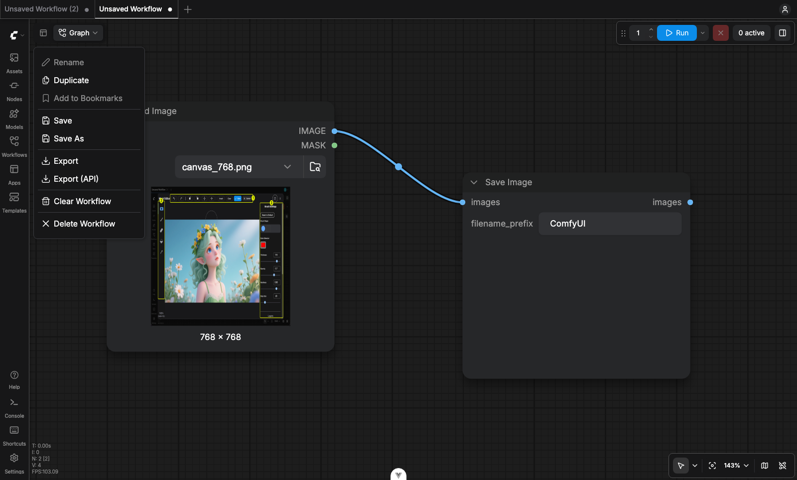

1. Нажмите иконку в левом верхнем углу (отмечена **1**), чтобы открыть выпадающее меню, и выберите **Enter app mode**.
2. Либо воспользуйтесь выпадающим меню навигационной цепочки (отмечено **2**) в верхней части интерфейса, чтобы войти в режим приложения.

## Создать рабочий процесс в режиме приложения

<iframe
  className="w-full aspect-video rounded-xl"
  src="https://www.youtube.com/embed/tqLY-vjY-3I"
  title="How to Create APP Mode Workflows"
  allow="accelerometer; clipboard-write; encrypted-media; gyroscope; picture-in-picture"
  allowFullScreen
></iframe>

Если рабочий процесс ещё не настроен для режима приложения, при входе в этот режим автоматически откроется конструктор приложений.

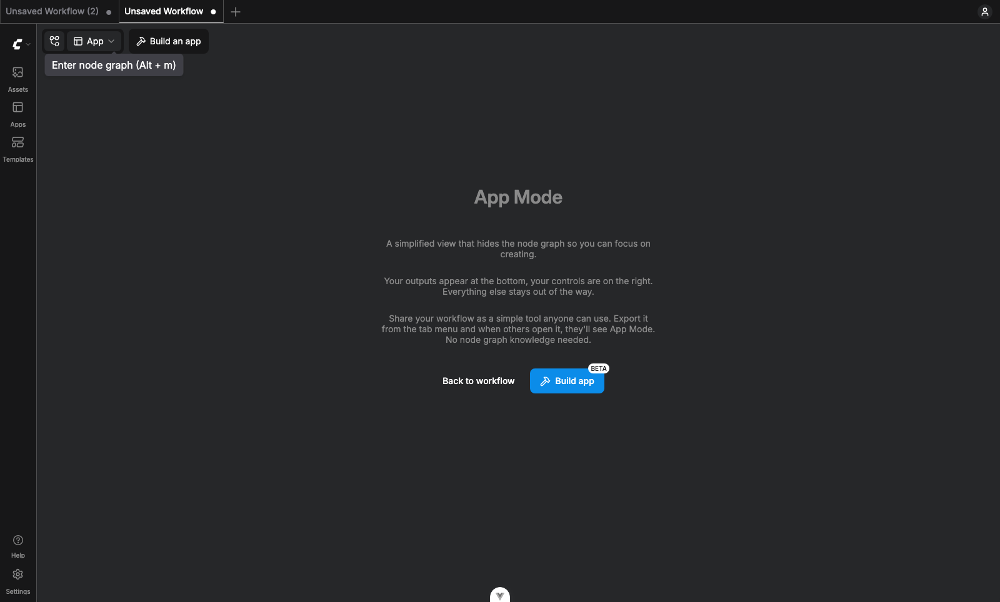

1. Если у рабочего процесса ещё нет конфигурации режима приложения, конструктор приложений открывается по умолчанию.
2. Нажмите **Build app**, чтобы открыть конструктор приложений и начать настройку.

### Шаг 1: Выбрать входы

Интерфейс конструктора отображает четыре этапа с подсказками (отмечены **1**, **2**, **3**, **4**) в верхней части. Нижняя панель позволяет выйти из конструктора или переключаться между шагами.

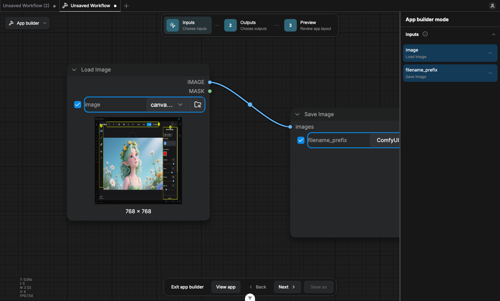

1. Числа **1 2 3 4** вверху соответствуют четырём этапам создания: выбор входов, выбор выходов, предпросмотр и настройка вида по умолчанию.
2. Кнопки внизу позволяют выйти из конструктора или переходить между шагами.
3. Области, отмеченные на холсте, представляют собой выбираемые параметры входов и выходов.
4. Правая панель показывает живой предпросмотр текущей конфигурации.

Нажмите этап **Inputs** в верхней части. На холсте подсветятся выбираемые узлы входов. Нажмите на узел, чтобы выбрать его в качестве параметра входа. Доступные варианты включают загрузку изображений, ввод текстового промпта и выбор модели. Выбранные параметры отображаются в правой боковой панели.

### Шаг 2: Выбрать выходы

Нажмите этап **Outputs**. Выберите, какие узлы выходов отображать в приложении, например узел Preview или узел Save Image.

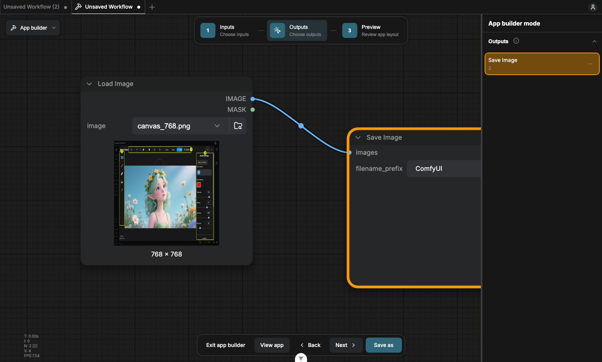

1. Выберите узлы выходов для отображения в приложении.
2. Как и для входов, правая боковая панель показывает живой предпросмотр выбранных узлов выходов.

### Шаг 3: Предпросмотр

Нажмите этап **Preview**, чтобы просмотреть итоговый макет приложения. Выбранные входы отображаются на правой панели, а область выходов показана на холсте.

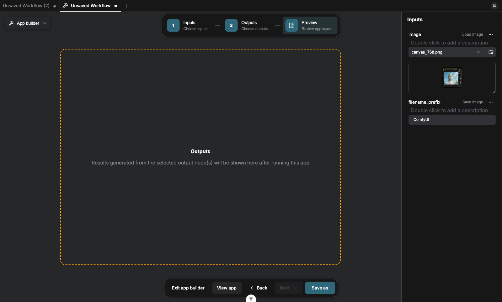

1. Это режим предпросмотра: проверьте, что все настройки входов и выходов отображаются как ожидалось.
2. Если требуются корректировки, нажмите **Back**, чтобы вернуться к предыдущему шагу.

### Шаг 4: Задать вид по умолчанию

Нажмите этап **Set a default view**. Выберите, должен ли рабочий процесс по умолчанию открываться в режиме **App** или в режиме **Node Graph**. Нажмите **Apply** для подтверждения.

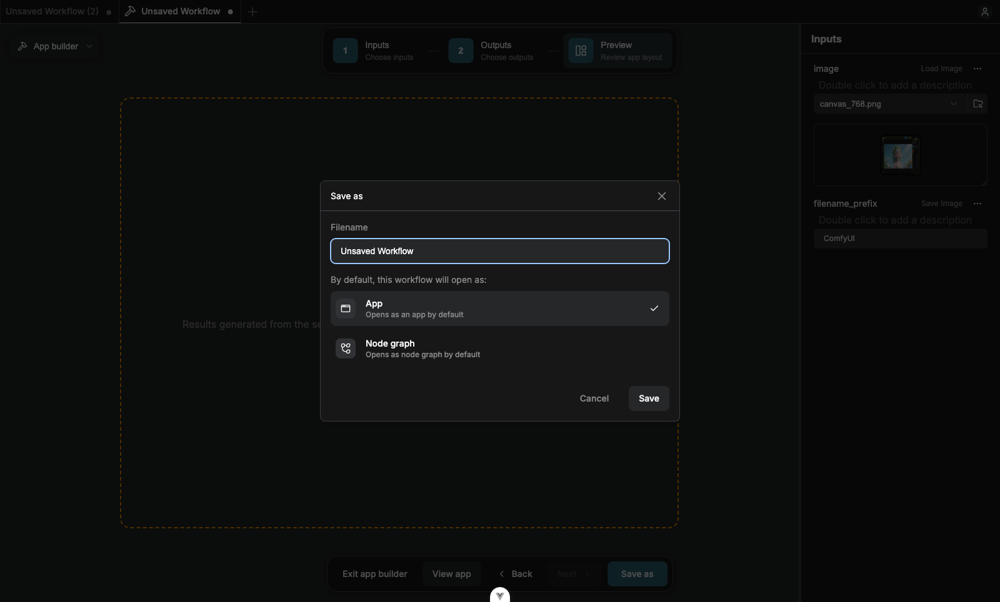

1. Выберите режим, в котором рабочий процесс открывается по умолчанию: **App** или **Node Graph**.
2. Выберите **App** и нажмите **Apply** для подтверждения. После этого рабочий процесс будет по умолчанию открываться в режиме приложения.

После применения появится запрос подтверждения.

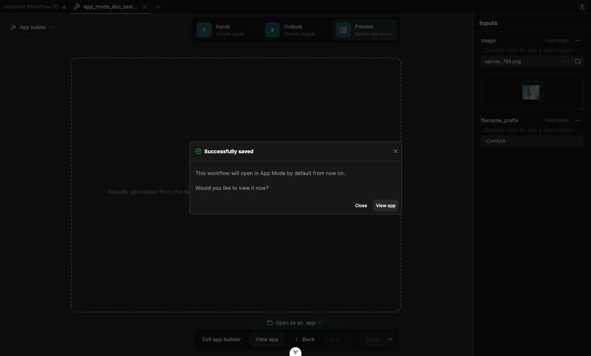

Нажмите **View app**, чтобы войти в режим приложения и начать использовать рабочий процесс.

## Использовать режим приложения

В режиме приложения правая панель показывает все настроенные параметры входов. Настройте входы по мере необходимости, затем нажмите **Run**, чтобы выполнить рабочий процесс.

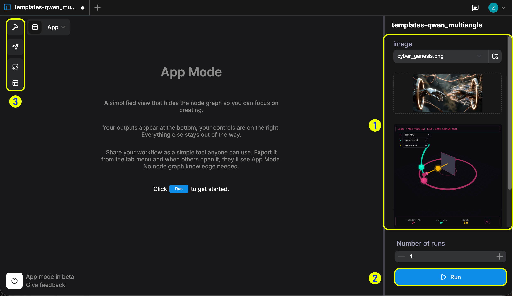

1. Правая панель **Input** позволяет настраивать входные параметры перед запуском.
2. Нажмите **Run**, чтобы выполнить рабочий процесс.
3. Левая боковая панель содержит дополнительные элементы управления, например пересборку приложения, просмотр ассетов и открытие панели рабочего процесса.

Режим приложения также оптимизирован для мобильных устройств и макетов с узким экраном. Интерфейс преобразуется в представление с вкладками, позволяя переключаться между панелью входов, видом результата и панелью медиафайлов.

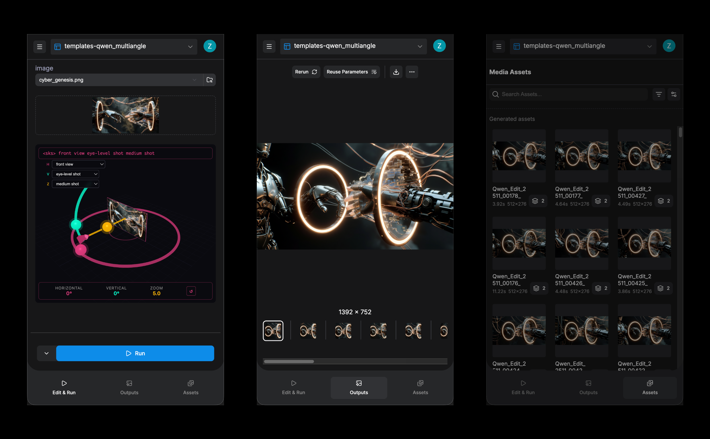

Во время выполнения вверху появляется кнопка **Cancel this run**, чтобы остановить текущее выполнение.

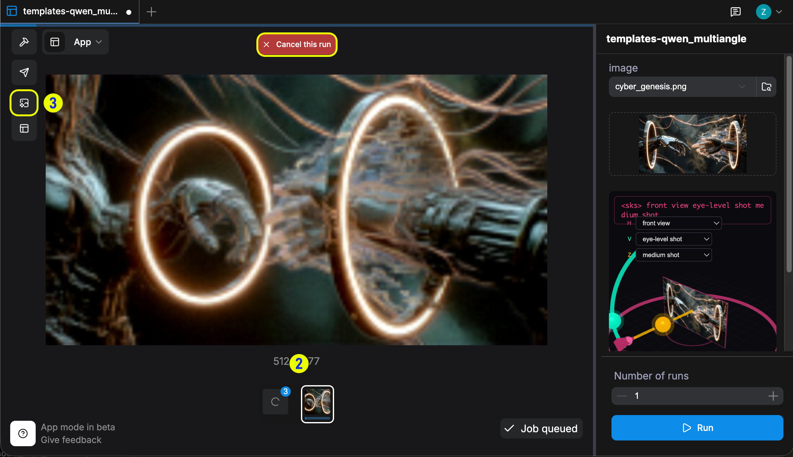

1. Нажмите **Cancel this run** вверху, чтобы остановить текущий запуск.
2. Переключайтесь между видом очереди и видом результатов на нижней панели.
3. Нажмите на соответствующую область, чтобы открыть панель ассетов.

## Сохранить рабочий процесс и поделиться им

### Сохранить рабочий процесс

Нажмите `Ctrl + S` (или `Cmd + S` на Mac), чтобы сохранить рабочий процесс для дальнейшего использования.

Нажмите кнопку на левой боковой панели, чтобы открыть панель сохранённых рабочих процессов.

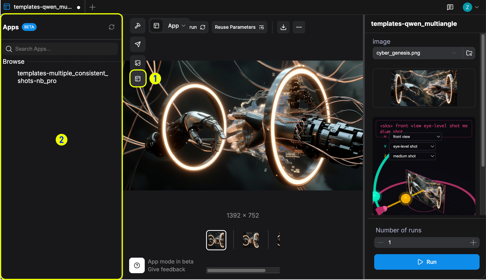

1. Нажмите кнопку на левой боковой панели, чтобы открыть панель, на которой отображаются все сохранённые рабочие процессы режима приложения.
2. Переключайтесь между сохранёнными рабочими процессами режима приложения на этой панели.

### Поделиться рабочим процессом

<iframe
  className="w-full aspect-video rounded-xl"
  src="https://www.youtube.com/embed/-JEDHJktsr0"
  title="Как делиться рабочими процессами"
  allow="accelerometer; clipboard-write; encrypted-media; gyroscope; picture-in-picture"
  allowFullScreen
></iframe>

В режиме приложения нажмите кнопку **Поделиться** на левой боковой панели. Если рабочий процесс ещё не сохранён, появится диалог с предложением сначала сохранить его, прежде чем можно будет создать ссылку.

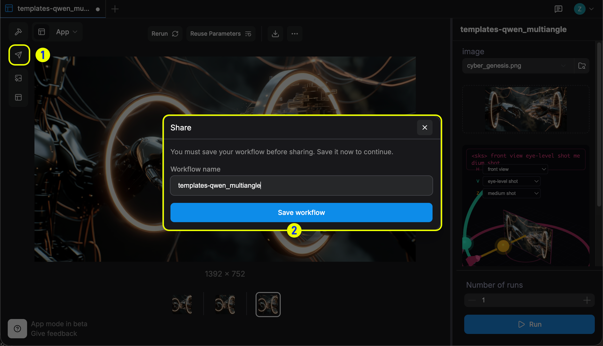

1. Нажмите кнопку «Поделиться» на левой боковой панели, чтобы открыть диалог.
2. Если рабочий процесс не сохранён, введите название рабочего процесса и нажмите **Сохранить рабочий процесс**, чтобы продолжить.

После сохранения в диалоге появится возможность сгенерировать ссылку.

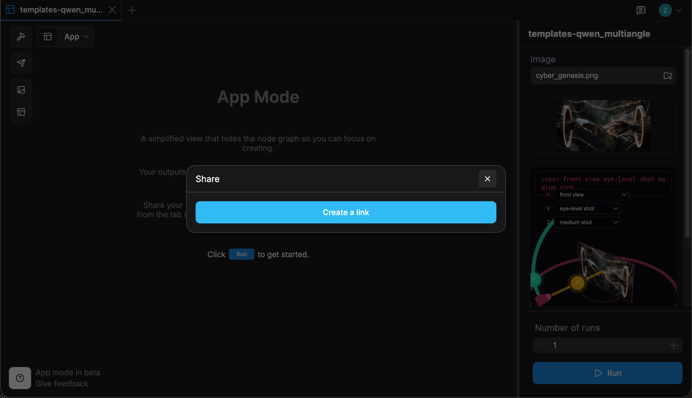

Нажмите **Создать ссылку**, чтобы сгенерировать URL для отправки рабочего процесса.

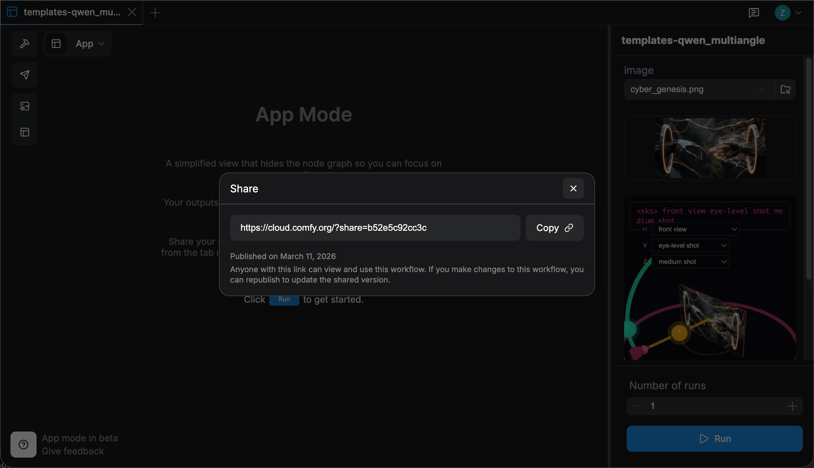

Нажмите **Копировать**, чтобы скопировать ссылку. Получатели смогут открыть её и сразу запустить рабочий процесс: полная конфигурация рабочего процесса включена в ссылку.

<Note>
Ссылки для отправки поддерживаются только в Comfy Cloud.
</Note>
