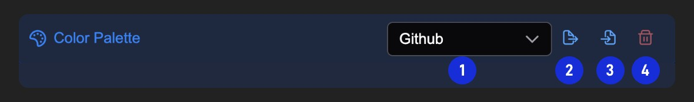
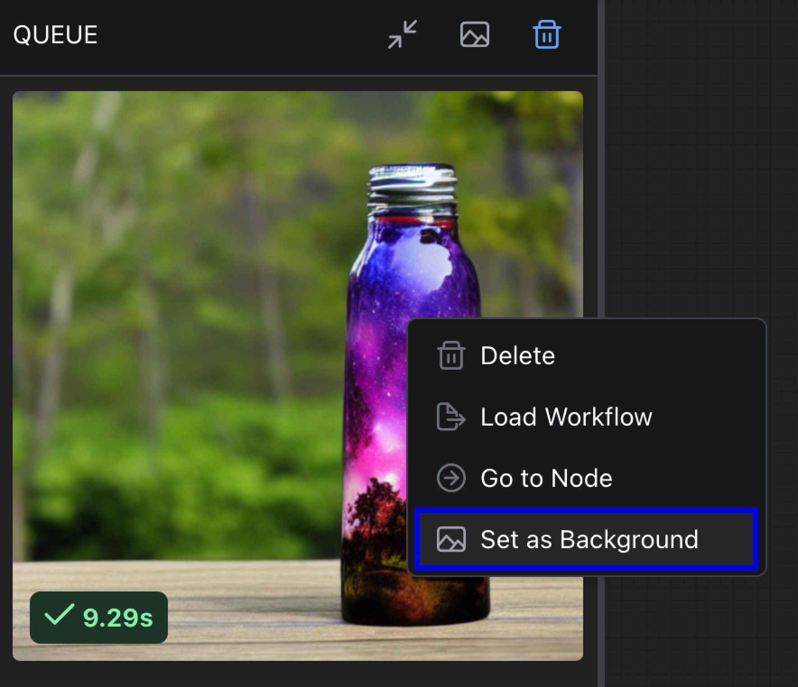
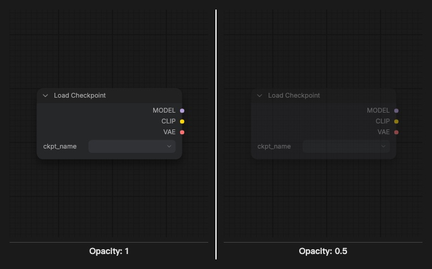
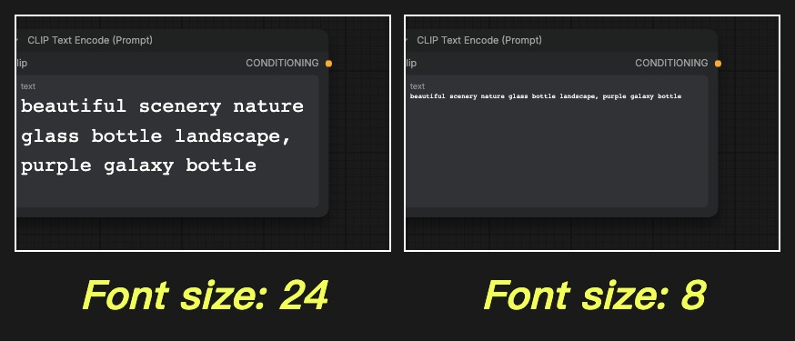
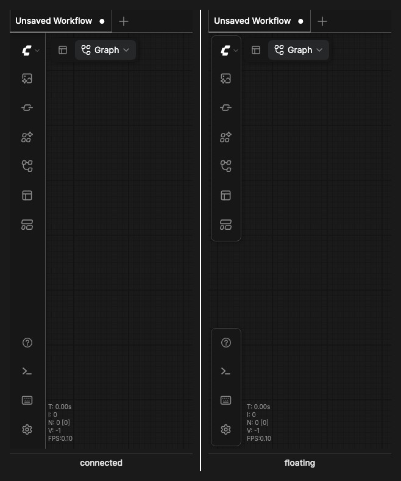
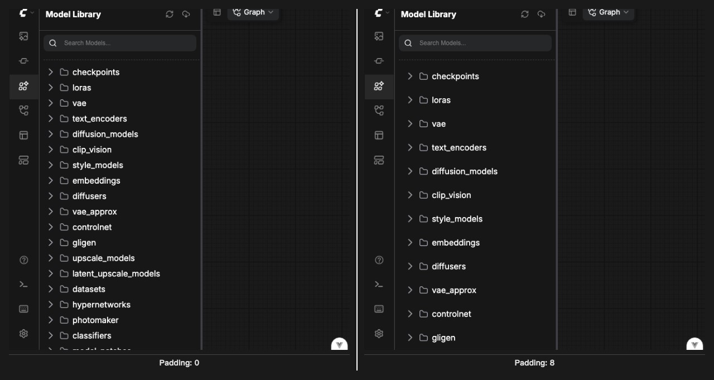

import UserDirectory from "/snippets/ru/install/user-directory.mdx"
import SettingsMenuContext from "/snippets/ru/interface/settings-menu-context.mdx"

<SettingsMenuContext />

ComfyUI предлагает гибкие параметры настройки внешнего вида, которые позволяют персонализировать интерфейс под ваши предпочтения.

## Система цветовой палитры

Основным способом настройки внешнего вида ComfyUI является встроенная система цветовых палитр.



Это позволяет вам:

1. Переключение тем ComfyUI
2. Экспорт текущей выбранной темы в формате JSON
3. Загрузка конфигурации пользовательской темы из файла JSON
4. Удаление конфигурации пользовательской темы

<Note>
  Если возможностей цветовой палитры не хватает, воспользуйтесь расширенной настройкой внешнего вида через файл [user.css](#расширенная-настройка-с-помощью-user-css).
</Note>

### Встроенные темы

Селектор тем показывает все установленные темы. В ComfyUI встроено девять:

- **Dark**: тема по умолчанию
- **Light**
- **Classic**
- **Solarized**
- **Arc**
- **Nord**
- **Github**
- **Fennec Girl**
- **Morning Class**: ореховый интерфейс, узлы цвета зелёной классной доски и связи цвета мела

Любую встроенную тему можно экспортировать в JSON и использовать как основу для пользовательской темы.

### Как настроить цветовые темы

Палитра цветов позволяет изменять множество конкретных свойств. Вот некоторые из наиболее часто настраиваемых элементов, цвета которых представлены в шестнадцатеричном формате:

<Tip>
  1. Комментарии в JSON ниже приведены только для иллюстрации. Не копируйте содержимое ниже для изменения: это приведёт к сбою темы.
  2. Поскольку мы всё ещё часто вносим изменения, содержимое ниже может меняться вместе с обновлениями фронтенда ComfyUI. Если вам нужно внести изменения, экспортируйте конфигурацию темы из настроек, а затем изменяйте её.
</Tip>

```json
{
  "id": "dark",                     // Must be unique, cannot be the same as other theme IDs
  "name": "Dark (Default)",         // Theme name, displayed in theme selector
  "colors": {
    "node_slot": {                  // Node connection slot color configuration
      "CLIP": "#FFD500",            // CLIP model connection slot color
      "CLIP_VISION": "#A8DADC",     // CLIP Vision model connection slot color
      "CLIP_VISION_OUTPUT": "#ad7452", // CLIP Vision output connection slot color
      "CONDITIONING": "#FFA931",     // Conditioning control connection slot color
      "CONTROL_NET": "#6EE7B7",     // ControlNet model connection slot color
      "IMAGE": "#64B5F6",           // Image data connection slot color
      "LATENT": "#FF9CF9",          // Latent space connection slot color
      "MASK": "#81C784",            // Mask data connection slot color
      "MODEL": "#B39DDB",           // Model connection slot color
      "STYLE_MODEL": "#C2FFAE",     // Style model connection slot color
      "VAE": "#FF6E6E",             // VAE model connection slot color
      "NOISE": "#B0B0B0",           // Noise data connection slot color
      "GUIDER": "#66FFFF",          // Guider connection slot color
      "SAMPLER": "#ECB4B4",         // Sampler connection slot color
      "SIGMAS": "#CDFFCD",          // Sigmas data connection slot color
      "TAESD": "#DCC274"            // TAESD model connection slot color
    },
    "litegraph_base": {             // LiteGraph base interface configuration
      "BACKGROUND_IMAGE": "",        // Background image, default is empty
      "CLEAR_BACKGROUND_COLOR": "#222", // Main canvas background color
      "NODE_TITLE_COLOR": "#999",    // Node title text color
      "NODE_SELECTED_TITLE_COLOR": "#FFF", // Selected node title color
      "NODE_TEXT_SIZE": 14,          // Node text size
      "NODE_TEXT_COLOR": "#AAA",     // Node text color
      "NODE_TEXT_HIGHLIGHT_COLOR": "#FFF", // Node text highlight color
      "NODE_SUBTEXT_SIZE": 12,       // Node subtext size
      "NODE_DEFAULT_COLOR": "#333",   // Node default color
      "NODE_DEFAULT_BGCOLOR": "#353535", // Node default background color
      "NODE_DEFAULT_BOXCOLOR": "#666", // Node default border color
      "NODE_DEFAULT_SHAPE": 2,        // Node default shape
      "NODE_BOX_OUTLINE_COLOR": "#FFF", // Node border outline color
      "NODE_BYPASS_BGCOLOR": "#FF00FF", // Node bypass background color
      "NODE_ERROR_COLOUR": "#E00",    // Node error state color
      "DEFAULT_SHADOW_COLOR": "rgba(0,0,0,0.5)", // Default shadow color
      "DEFAULT_GROUP_FONT": 24,       // Group default font size
      "WIDGET_BGCOLOR": "#222",       // Widget background color
      "WIDGET_OUTLINE_COLOR": "#666", // Widget outline color
      "WIDGET_TEXT_COLOR": "#DDD",    // Widget text color
      "WIDGET_SECONDARY_TEXT_COLOR": "#999", // Widget secondary text color
      "WIDGET_DISABLED_TEXT_COLOR": "#666", // Widget disabled state text color
      "LINK_COLOR": "#9A9",          // Connection line color
      "EVENT_LINK_COLOR": "#A86",    // Event connection line color
      "CONNECTING_LINK_COLOR": "#AFA", // Connecting line color
      "BADGE_FG_COLOR": "#FFF",      // Badge foreground color
      "BADGE_BG_COLOR": "#0F1F0F"    // Badge background color
    },
    "comfy_base": {                  // ComfyUI base interface configuration
      "fg-color": "#fff",            // Foreground color
      "bg-color": "#202020",         // Background color
      "comfy-menu-bg": "#353535",    // Menu background color
      "comfy-menu-secondary-bg": "#303030", // Secondary menu background color
      "comfy-input-bg": "#222",      // Input field background color
      "input-text": "#ddd",          // Input text color
      "descrip-text": "#999",        // Description text color
      "drag-text": "#ccc",           // Drag text color
      "error-text": "#ff4444",       // Error text color
      "border-color": "#4e4e4e",     // Border color
      "tr-even-bg-color": "#222",    // Table even row background color
      "tr-odd-bg-color": "#353535",  // Table odd row background color
      "content-bg": "#4e4e4e",       // Content area background color
      "content-fg": "#fff",          // Content area foreground color
      "content-hover-bg": "#222",    // Content area hover background color
      "content-hover-fg": "#fff",    // Content area hover foreground color
      "bar-shadow": "rgba(16, 16, 16, 0.5) 0 0 0.5rem" // Bar shadow effect
    }
  }
}
```

## Холст

### Фоновое изображение

- **Требования**: версия фронтенда ComfyUI 1.20.5 или новее.
- **Функция**: позволяет задать пользовательское фоновое изображение для холста, чтобы сделать рабочее пространство более персонализированным. Вы можете загрузить изображения или использовать изображения из интернета, чтобы установить фон холста.



## Общие

### Макет панели вкладок

- **Значение по умолчанию**: По умолчанию
- **Варианты**: По умолчанию, Классический
- **Назначение**: Определяет, какие элементы содержит встроенная панель вкладок. Классический вариант показывает старый набор элементов панели вкладок.

### Отключить анимации

- **Значение по умолчанию**: Зависит от настройки уменьшения движения в вашей операционной системе
- **Назначение**: Отключает большинство CSS-анимаций и переходов в интерфейсе. Это также может ускорить вывод, если GPU, отвечающий за вывод изображения, используется и для генерации.

## Узел

### Непрозрачность ноды

- **Функция**: Устанавливает непрозрачность узлов, где 0 означает полную прозрачность, а 1 означает полную непрозрачность.



## Виджет ноды

### Размер шрифта виджета текстовой области

- **Значение по умолчанию**: 10
- **Диапазон**: 8 - 24
- **Функция**: Задаёт размер шрифта в виджетах текстовой области. Регулирует размер отображаемого текста в полях ввода для улучшения читаемости.



## Боковая панель

### Унифицированная ширина боковой панели

- **Значение по умолчанию**: Включено
- **Функция**: Если включено, ширина боковой панели будет приведена к единому значению при переключении между разными боковыми панелями. Если отключено, разные боковые панели сохраняют свою заданную ширину при переключении.

### Размер боковой панели

- **Функция**: Управляет размером боковой панели. Можно задать обычный или маленький размер.

### Расположение боковой панели

- **Функция**: Определяет, отображается ли боковая панель слева или справа от интерфейса, что позволяет пользователям расположить её в соответствии со своими привычками.

### Стиль боковой панели

- **Функция**: Управляет визуальным стилем боковой панели. Доступны варианты:
  - **Прикреплённая**: боковая панель выглядит прикреплённой к краю интерфейса.
  - **Плавающая**: боковая панель выглядит как плавающая панель, визуально отделённая от края интерфейса.



## Дерево проводника

### Отступ элемента в проводнике дерева

- **Значение по умолчанию**: 8
- **Функция**: Задаёт отступ элементов в дереве проводника (боковая панель), регулируя расстояние между элементами в структуре дерева.



## Расширенная настройка с помощью user.css

В случаях, когда цветовая палитра не обеспечивает достаточного контроля, вы можете использовать пользовательский CSS через файл user.css. Этот метод рекомендуется опытным пользователям, которым нужно настраивать элементы, недоступные в системе цветовой палитры.

### Требования

- Версия фронтенда ComfyUI 1.20.5 или новее

### Настройка user.css

1. Создайте файл с именем `user.css` в пользовательской директории ComfyUI (там же, где находятся ваши рабочие процессы и настройки: подробности о расположении ниже)
2. Добавьте свои правила CSS в этот файл
3. Перезапустите ComfyUI или обновите страницу, чтобы применить изменения

### Расположение пользовательской директории

<UserDirectory/>

После того как вы найдёте расположение указанной выше папки, скопируйте соответствующий CSS-файл в соответствующий пользовательский каталог, например, папка пользователя по умолчанию: `ComfyUI/user/default`, затем перезапустите ComfyUI или обновите страницу, чтобы применить изменения.

### Примеры user.css и связанные инструкции

Файл `user.css` загружается на раннем этапе запуска приложения. Поэтому вам может потребоваться использовать `!important` в ваших правилах CSS, чтобы гарантировать, что они переопределяют стили по умолчанию.

**Примеры настройки user.css**

```css
/* Increase font size in inputs and menus for better readability */
.comfy-multiline-input, .litecontextmenu .litemenu-entry {
    font-size: 20px !important;
}

/* Make context menu entries larger for easier selection */
.litegraph .litemenu-entry,
.litemenu-title {
  font-size: 24px !important; 
}

/* Custom styling for specific elements not available in the color palette */
.comfy-menu {
    border: 1px solid rgb(126, 179, 189) !important;
    border-radius: 0px 0px 0px 10px !important;
    backdrop-filter: blur(2px);
}
```

**Best Practices**

1. **Начните с цветовой палитры** для большинства изменений оформления
2. Используйте **user.css только при необходимости** для элементов, не охваченных цветовой палитрой
3. **Экспортируйте свою тему** перед внесением значительных изменений, чтобы при необходимости можно было откатиться
4. **Делитесь своими темами** с сообществом, чтобы вдохновлять других

**Troubleshooting**

- Если изменения цветовой палитры не отображаются, попробуйте обновить страницу
- Если CSS-настройки не работают, проверьте, что вы используете frontend версии 1.20.5+
- Попробуйте добавить `!important` к правилам в user.css, которые не применяются
- Сохраняйте резервные копии ваших настроек, чтобы легко их восстанавливать
