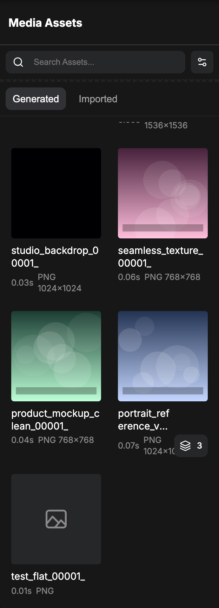
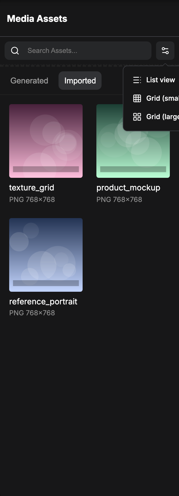
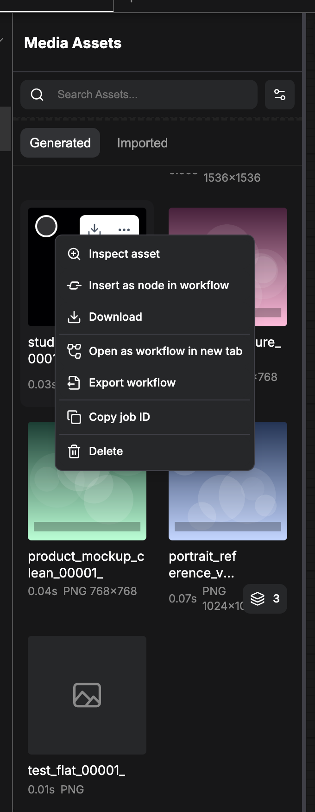
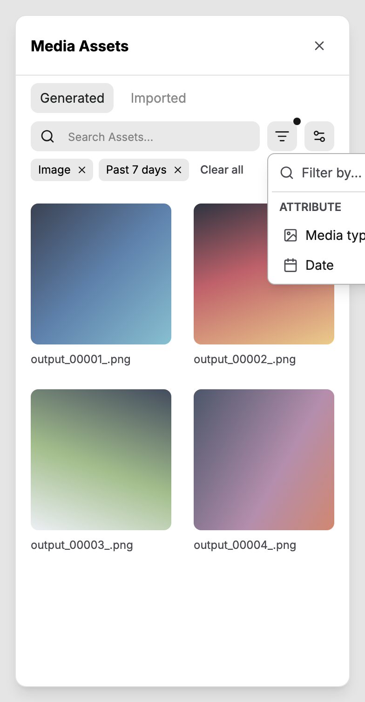
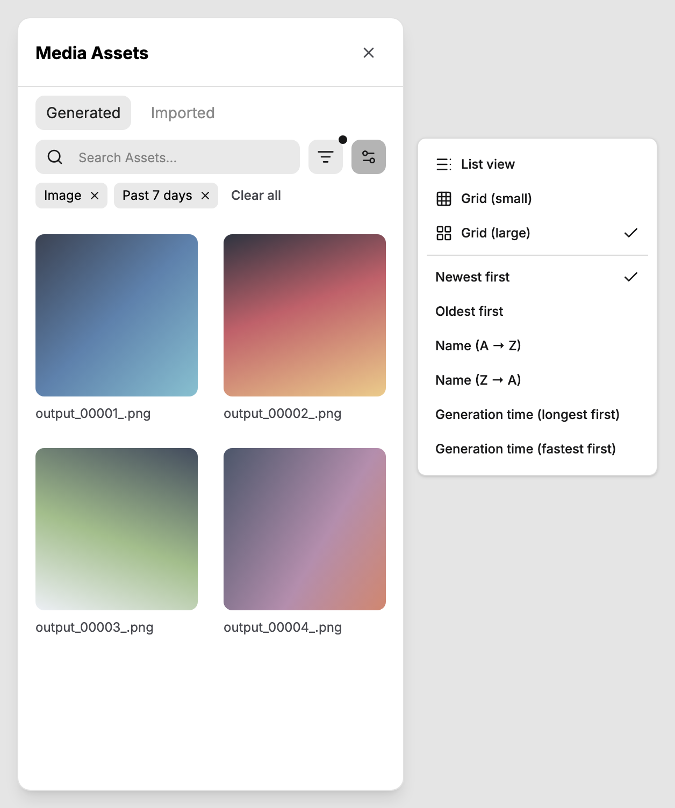

Панель **Ассеты** представляет собой библиотеку ComfyUI для медиафайлов, которые создают и используют ваши рабочие процессы. Она собирает каждый файл, сохранённый при запуске, и каждый импортированный вами файл, чтобы вы могли искать их, просматривать, повторно использовать в другом рабочем процессе, скачивать или удалять, не покидая граф.

Панель открывается из пункта **Ассеты** в левой боковой панели и носит заголовок **Медиафайлы**. В Comfy Desktop пункт **Ассеты** в собственной боковой панели приложения открывает отдельную страницу, которая просматривает выходы по всем вашим сборкам и Comfy Cloud: см. [Ассеты Comfy Desktop](/ru/installation/desktop/usage/assets).

Доступность зависит от версии:

- **Comfy Cloud**: панель «Ассеты» включена по умолчанию.
- **Self-hosted ComfyUI**: запустите сервер с [`--enable-assets`](/ru/development/comfyui-server/startup-flags), чтобы включить систему ассетов. Флаг требует рабочего подключения к базе данных, поэтому оставьте расположение базы данных по умолчанию или передайте `--database-url`. Без флага панель всё равно открывается, но показывает файлы из локальной истории и папок вывода вместо библиотеки ассетов.

В Cloud добавлены меню фильтров, параметры сортировки, скачивание ZIP-архивов и безвозвратное удаление файлов. Остальная часть панели работает одинаково в обеих версиях.

## Открыть панель «Ассеты»

Нажмите на иконку **Ассеты** в левой боковой панели, чтобы открыть панель.

## Сгенерированные и импортированные ассеты

Панель разделяет ваши файлы на две вкладки:

- **Сгенерированные**: каждый файл, сохранённый при выполнении рабочего процесса. Если один запуск создаёт несколько выходов, панель группирует их в одну карточку, где указано число файлов, а бейдж на этой карточке открывает группу.
- **Импортированные**: файлы, которые вы загрузили в рабочие процессы, например референсные изображения для графа «изображение в изображение», или ассеты, импортированные в ваше рабочее пространство Comfy Cloud.

Модели не входят в эту панель. Локальные файлы моделей находятся в панели **Models**, а загрузка собственных моделей в Comfy Cloud описана в разделе [Импорт моделей](/ru/cloud/import-models).

## Найти ассет

В заголовке панели расположены поисковая строка и элементы управления отображением.

- **Поиск**: фильтрует текущую вкладку по имени файла по мере ввода.
- **Фильтровать по** (Cloud): сузить список по типу медиа (`Image`, `Video`, `Audio`, `3D`, `Text`) или по дате (`All time`, `Today`, `Past 7 days`, `Past 30 days`, `This year`). Активные фильтры отображаются в виде чипов, которые можно удалять по одному или очистить все сразу.
- **Настройки отображения**: переключение между `List view`, `Grid (small)` и `Grid (large)`.
- **Сортировать** (Cloud): сначала новые, сначала старые, имя (A to Z), имя (Z to A), а на вкладке **Сгенерированные** время генерации: сначала самые долгие или самые быстрые.

## Предпросмотр ресурса

Нажмите на карточку, чтобы выбрать её, или дважды щёлкните по изображению, чтобы открыть его в увеличенном предпросмотре. Видео воспроизводятся прямо на месте, а поверх отображается перекрытие воспроизведения; аудио- и 3D-файлы открываются в отдельных средствах просмотра. Щёлкните по карточке правой кнопкой мыши и выберите **Просмотреть ресурс**, чтобы открыть тот же предпросмотр.

## Просмотр HDR и EXR изображений

Файл с расширением `.exr` или `.hdr` не открывается в стандартном окне просмотра изображений. ComfyUI открывает его в **HDR Просмотрщике**: это диалоговое окно отображает изображение в полном разрешении и сохраняет значения ярких участков выше 1.0 нетронутыми, пока вы сами не примените к ним tone mapping. Заголовок окна содержит имя файла.

<video controls>
  <source src="/images/interface/assets/hdr_viewer_demo.mp4" type="video/mp4"/>
  Ваш браузер не поддерживает тег video.
</video>

HDR Просмотрщик открывается из трёх мест:

- **Просмотр изображения узла**: для HDR-выхода вместо изображения показывается заглушка с кнопкой **Открыть в HDR просмотрщике**. Это же действие доступно на кнопке солнца в панели действий предпросмотра.
- **Панель ассетов**: дважды щёлкните по карточке ассета `.exr` или `.hdr` либо выберите **Просмотреть ресурс** в его контекстном меню.
- **История задач**: дважды щёлкните по завершённой задаче, выходом которой является HDR файл.

На боковой панели расположены элементы управления tone mapping:

- **Экспозиция**: регулируется от -10 до +10 ступеней с шагом 0.1 ступени. **Автоэкспозиция** подбирает значение для текущего изображения.
- **Канал**: отображает `RGB`, отдельный канал (`R`, `G`, `B`, `Alpha`) или `Luminance`. Гистограмма следует за выбранным каналом.
- **Исходный цветовой охват**: `sRGB` или `Rec.2020`. Просмотрщик считывает координаты цветности, записанные в заголовке EXR, и заранее выбирает охват, которому они соответствуют, поэтому задайте его вручную для файла, в котором записан другой охват или не записано ничего. Файлы Radiance HDR не содержат координат цветности, поэтому для них используется `sRGB`.
- **Дизеринг**: включён по умолчанию и сглаживает полосы на градиентах.
- **Предупреждения о клиппинге**: отмечают пиксели вне отображаемого диапазона.
- **Гистограмма и статистика изображения**: разрешение, минимум, максимум, среднее, стандартное отклонение, а также количество пикселей NaN и Inf, если они присутствуют в файле.
- **Fit** возвращает изображение к вписанному виду, а **Скачать изображение** сохраняет оригинальный файл.

Прокрутите колесо, чтобы уменьшить масштаб до 0.05x или увеличить до 64x. Индикатор в левом верхнем углу следует за указателем и показывает координаты пикселя, а под ними исходные значения RGBA. Если просмотрщик не может декодировать файл, выводится сообщение `Не удалось загрузить HDR изображение`.

## Повторное использование ассета в рабочем процессе

- **Вставить как узел в рабочий процесс**: щёлкните карточку правой кнопкой мыши и выберите этот пункт, чтобы добавить соответствующий узел загрузки (например, `Load Image`, `Load Video` или `Load Audio`) в центр холста с уже выбранным в узле ассетом. Этот пункт отображается только для типов файлов, для которых существует узел загрузки.
- **Перетащить на холст**: перетащите карточку на холст, чтобы загрузить её тем же способом. Удерживайте `Ctrl` или `Cmd` при нажатии, чтобы выбирать ассеты, а не начинать перетаскивание.
- **Перетащить в композер Comfy Agent**: ассет, перетащенный на композер агента, прикрепляется к сообщению, которое вы пишете.
- **Открыть как рабочий процесс в новой вкладке** и **Экспорт рабочего процесса**: доступно для сгенерированных файлов, а также для импортированных файлов, содержащих метаданные рабочего процесса, например изображений PNG и WebP, записанных ComfyUI. Экспортированные рабочие процессы сохраняются в формате JSON.

## Загрузка ассетов

Откройте меню по правому клику на одной или нескольких карточках и выберите **Download**, либо воспользуйтесь кнопкой скачивания, которая появляется на карточке при наведении.

- Один файл скачивается отдельно.
- В Comfy Cloud при выборе нескольких ассетов или карточки, запуск которой создал несколько выходов, вместо последовательного скачивания файлов подготавливается ZIP-архив.
- На сервере с самостоятельным размещением сгруппированные выходы раскрываются в отдельные файлы.

## Работа с несколькими ассетами одновременно

Протяните рамку выделения по сетке, чтобы выделить блок ассетов, затем воспользуйтесь нижней панелью выделения. На ней показано, сколько ассетов выбрано, и доступны **Deselect all**, **Download** и **Delete**. Щелчок правой кнопкой мыши по выбранной карточке открывает меню массовых действий с пунктами **Insert all assets as nodes**, **Open all workflows**, **Export all workflows**, **Download all** и **Delete all**.

## Сгруппированные выходы

Когда запуск создал несколько файлов, на карточке отображается значок с количеством выходов. Нажатие на этот значок открывает представление папки для этой задачи вместо плоской сетки. В заголовке папки показаны ID задачи с кнопкой копирования и время выполнения запуска, а **Назад ко всем ассетам** возвращает к полному списку.

## Удаление ассетов

Выберите **Delete** в контекстном меню или **Delete all** для выбранных элементов. Диалоговое окно подтверждения сначала перечисляет затронутые файлы. Дальнейшие действия зависят от сервера:

- Comfy Cloud также удаляет сохранённый файл, поэтому ассет исчезает.
- Для сгенерированных ассетов сервер, не поддерживающий удаление файлов, удаляет ассет только из библиотеки. Файл остаётся на диске.
- Импортированные ассеты можно удалить только на Comfy Cloud. На самостоятельно размещённом сервере для них нет пункта **Delete**.
- Удаление записи очереди без сохранённого ассета затрагивает только историю, а файлы остаются на диске.

Удаление ассета также убирает его из узлов загрузки, которые на него ссылались; после этого такие узлы показывают, что медиафайл отсутствует.

## Связанные страницы

- [Обзор интерфейса](/ru/interface/overview): место панели «Ассеты» среди других разделов боковой панели.
- [Импорт моделей](/ru/cloud/import-models): загрузка собственных моделей в Comfy Cloud.
- [Флаги запуска](/ru/development/comfyui-server/startup-flags): `--enable-assets` и `--enable-asset-hashing`.
