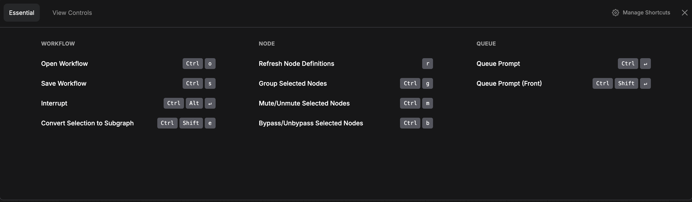
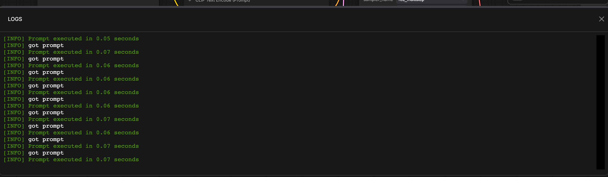
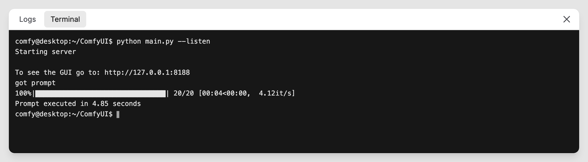

Нижняя панель представляет собой закреплённую полосу рабочего пространства под холстом. В ней на любой сборке доступны вкладки со справочником горячих клавиш, в локальных сборках и сборках Desktop есть поток **Логи**, а **Терминал** присутствует только в приложении Desktop. Comfy Cloud не регистрирует вкладки терминала, но вкладки горячих клавиш по-прежнему работают.

## Как открыть панель

Открыть нижнюю панель можно несколькими способами:

- **Горячие клавиши**: нажмите иконку клавиатуры внизу левой боковой панели (`Workspace.ToggleBottomPanel.Shortcuts`, по умолчанию `Ctrl` + `Shift` + `K`). Это переключает именно панель горячих клавиш.
- **Консоль / панель терминала** (не Cloud): нажмите иконку терминала внизу левой боковой панели. Запускается команда **Переключить нижнюю панель**, которая выбирает панель терминала, если загружены вкладки логов или терминала, иначе открывает горячие клавиши.
- Меню **Вид**: **Нижняя панель** (`Workspace.ToggleBottomPanel`).
- **Горячая клавиша логов** (не Cloud): по умолчанию `Ctrl` + `` ` `` переключает вкладку логов (`Workspace.ToggleBottomPanelTab.logs-terminal`).

Панель скрыта, пока включён [Режим фокуса](/ru/interface/canvas-controls).

## Вкладки горячих клавиш

В панели **горячих клавиш** регистрируются две вкладки:

- **Основное**: распространённые сочетания клавиш для редактирования и очереди.
- **Управление видом**: сочетания клавиш для навигации и работы с видом.

Эти панели отражают те же данные о командах и привязках клавиш, которые можно настроить в разделе Настройки → Привязка клавиш. Полный список с возможностью редактирования приведён в разделе [Горячие клавиши](/ru/interface/shortcuts).

## Логи (локальный запуск и Desktop)

В сборках, отличных от Cloud, вкладка **Логи** транслирует вывод журнала процесса ComfyUI в реальном времени. Используйте её для отладки пользовательских узлов, ошибок сервера или сообщений бэкенда, не переключаясь на внешний терминал.

Сочетание клавиш по умолчанию: `Ctrl` + `` ` ``.

## Терминал (только Desktop)

В приложении **Desktop** рядом с логами регистрируется вкладка **Терминал** (командный терминал). Она даёт пользователям Desktop оболочку внутри приложения. Эта вкладка не регистрируется в чисто браузерных локальных сессиях и в Comfy Cloud.

В сборках Cloud регистрация логов и терминала полностью пропускается: остаются только горячие клавиши.

## Связанные страницы

- [Горячие клавиши](/ru/interface/shortcuts)
- [Управление холстом](/ru/interface/canvas-controls) (Режим фокуса скрывает эту панель)
- [Центр поддержки](/ru/interface/help-center)
- [Обзор интерфейса](/ru/interface/overview)