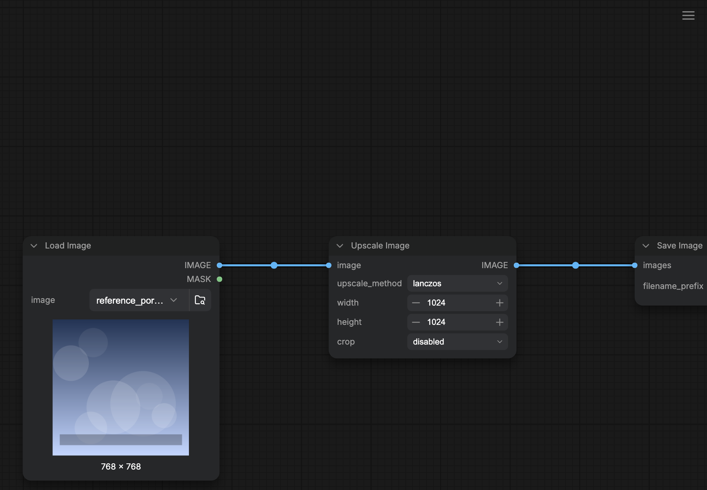
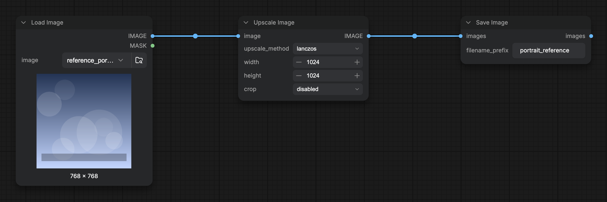
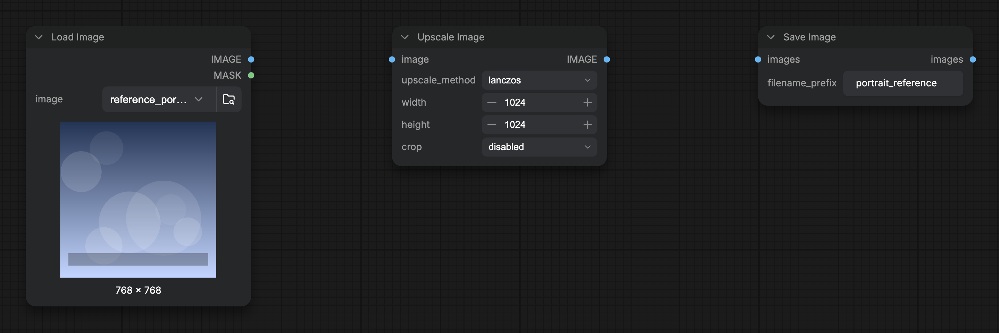

Нижняя панель инструментов холста в правом нижнем углу и меню **View** определяют, как вы перемещаетесь по графу. К основным командам меню View относятся: переключение нижней панели, просмотр шаблонов, **Режим фокуса**, информация о производительности холста, мини-карта, видимость соединений, приближение/отдаление и подгонка под выделенные.

## Панель инструментов холста

Когда параметр **Show graph canvas menu** (`Comfy.Graph.CanvasMenu`) включён (по умолчанию), в правом нижнем углу холста отображается плавающая панель инструментов:

<Frame caption="Панель инструментов холста в правом нижнем углу, над ней открыта панель мини-карты.">
  
</Frame>

| Элемент управления | Что делает |
| --- | --- |
| **Canvas mode** | Меню для переключения между **Select** (редактирование узлов) и **Hand** (только панорамирование, холст только для чтения). По умолчанию: `v` разблокирует Select, `h` блокирует Hand. |
| **Fit view** | Вписывает граф в область просмотра (`Comfy.Canvas.FitView`, по умолчанию `.`). |
| **Zoom** | Открывает всплывающее окно с командами «Увеличить», «Уменьшить», «Масштабировать по размеру» и полем процента (1-1000%). Стандартные сочетания клавиш включают `Alt` + `=` / `Alt` + `-` для приближения и отдаления. |
| **Minimap** | Переключает мини-карту (`Comfy.Canvas.ToggleMinimap`, по умолчанию `Alt` + `Shift` + `M`). Сохраняется как `Comfy.Minimap.Visible`. |
| **Link visibility** | Скрывает или показывает линии соединений, переключая режим рендеринга скрытых соединений (`Comfy.Canvas.ToggleLinkVisibility`). |

Скрыть всю панель инструментов можно с помощью **Show graph canvas menu** в настройках Lite Graph / Canvas.

## Меню View

Меню **View** регистрирует те же команды навигации, поэтому вы можете запускать их из строки меню или палитры команд:

- Нижняя панель
- Просмотреть шаблоны
- Режим фокуса
- Производительность холста (`Comfy.ToggleCanvasInfo`, переключает `Comfy.Graph.CanvasInfo`)
- Мини-карта
- Связи узлов (`Comfy.Canvas.ToggleLinkVisibility`)
- Увеличить / Уменьшить / Масштабировать по размеру

## Режим фокуса

**Режим фокуса** (`Workspace.ToggleFocusMode`) скрывает элементы интерфейса рабочего пространства, чтобы вы могли сосредоточиться на графе. Пока он включён:

- Верхняя секция меню скрыта (новое меню).
- Левая и правая боковые панели, а также нижняя панель не отображаются в макете со сплиттером.
- Появляется кнопка-гамбургер, позволяющая выйти из режима фокуса (**Показать меню**).

Снова переключите режим фокуса или воспользуйтесь кнопкой-гамбургером, чтобы восстановить полное рабочее пространство.

## Параметры мини-карты

Помимо показа и скрытия мини-карты, настройки в разделе «Мини-карта» определяют, что именно отрисовывается на ней: цвета узлов, связи, группы, состояние обхода и состояние ошибки. См. [Настройки Lite Graph](/ru/interface/settings/lite-graph) и связанные пункты «Внешний вид», если они есть.

## Связи и глобальные настройки холста

Форму связи и то, показывать ли прикреплённые связи, также можно быстро переключить в **Глобальных настройках** [правой боковой панели](/ru/interface/right-side-panel), когда ничего не выделено, а полностью настроить в настройках Lite Graph (`Comfy.LinkRenderMode` и связанные параметры). Шаг сетки и привязка к сетке находятся в тех же местах: в Глобальных настройках и настройках Lite Graph.

### Видимость связей

**Видимость связей** скрывает все провода на холсте сразу. Используйте кнопку перечёркнутой связи в правом конце [панели инструментов холста](#панель-инструментов-холста) или **View** > **Node Links**. Ни одна связь не удаляется, и граф продолжает работать: у сокетов остаются точки, перестают рисоваться только провода, что помогает на слишком плотном графе.

Команда (`Comfy.Canvas.ToggleLinkVisibility`) устанавливает для `Comfy.LinkRenderMode` значение **Скрытый** и возвращает предыдущий режим (Прямой, Линейная или Сплайн) при следующем использовании.

<Frame caption="Видимость связей включена (сверху) и выключена (снизу). Меняются только провода, у сокетов остаются точки.">
  
</Frame>

Остальная часть этого раздела посвящена скрытию отдельных связей. При этом на сокете остаётся значок, с помощью которого можно подписать соединение и вернуть его отдельно.

### Выделение связей

Требуется ComfyUI frontend 1.59.0 или новее. Выделение связей рамкой является стандартным поведением холста в режиме Select (это не переключатель в настройках).

Протяните рамку через провода соединений, с которыми хотите выполнить действие. Рамка, которая не захватывает ни узлы, ни группы, ни Reroute, выделяет каждую видимую связь, которую пересекает, а панель инструментов выделения заменяет свои кнопки для узлов двумя действиями для связей: **Скрыть**, которое сохраняет соединение и скрывает провод, и **Удалить**, которое удаляет связь из графа. Каждое действие выполняется за один шаг отмены, а `Delete` или `Backspace` также снимают выделение связей.

Рамки с `Shift` и `Alt` выделяют только узлы и группы, а режим холста Hand никогда не выделяет связи.

### Нажатие на вход или выход узла для действий с его связями

Требуется ComfyUI frontend 1.59.1 или новее. Нажмите на точку входа или выхода узла вместо перетаскивания от неё. Холст выделит все связи, прикреплённые к этой точке: одну связь на входе и все связи на выходе, а панель инструментов выделения предложит **Скрыть** и **Удалить**, те же действия, которые использует выделение рамкой.

- Если все выбранные связи уже скрыты, панель инструментов показывает **Показать** вместо **Скрыть**.
- **Скрыть** действует только на видимые связи, а **Показать** только на скрытые, поэтому ни одно из них не создаёт пустой шаг отмены.
- **Удалить** удаляет все связи в этой точке, включая скрытые.
- Удерживайте `Shift`, `Ctrl`, `Cmd` или `Alt` при нажатии, чтобы сохранить текущее выделение.
- Нажатие с `Ctrl` + `Alt` вместо этого разрывает связь, как и в других местах холста.
- Точка без связей игнорирует нажатие, как и холст с отключённой видимостью связей, поскольку там все провода скрыты. Перетаскивание от точки по-прежнему начинает новую связь.

### Скрытие связи и подпись её значка

Скрыть связь можно двумя способами:

- Сначала выделите связи, затем нажмите перечёркнутый глаз (**Скрыть**) на панели инструментов выделения.
- Нажмите правой кнопкой мыши на середину провода и выберите **Скрыть связь**.

В любом случае провод перестаёт рисоваться, а на каждом сокете появляется значок с типом данных связи или её меткой. Нажмите правой кнопкой мыши на значок, чтобы **Переименовать** его. В frontend 1.59.1 и новее метки с одного сокета собираются в один значок, например `IMAGE ×3`; более ранние версии рисуют отдельный значок для каждой связи. Чтобы снова нарисовать скрытый провод, нажмите правой кнопкой мыши на его значок и выберите **Показать связь**. Сгруппированный значок предлагает **Показать связи** и восстанавливает все связи, которые он обозначает.

В записи ниже скрываются три связи, которые питают узлы предпросмотра, их значки переименовываются, а затем связи снова показываются:

<video controls className="w-full">
  <source src="/images/interface/canvas-controls/hide-link.mp4" type="video/mp4" />
</video>

## Связанные страницы

- [Обзор интерфейса](/ru/interface/overview)
- [Горячие клавиши](/ru/interface/shortcuts)
- [Настройки Lite Graph](/ru/interface/settings/lite-graph)
- [Правая боковая панель](/ru/interface/right-side-panel) (быстрые переключатели глобальных настроек)
- [Нижняя панель](/ru/interface/bottom-panel)
