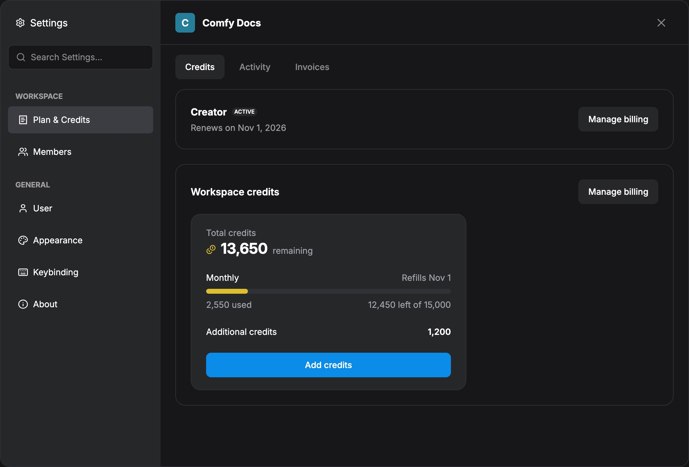
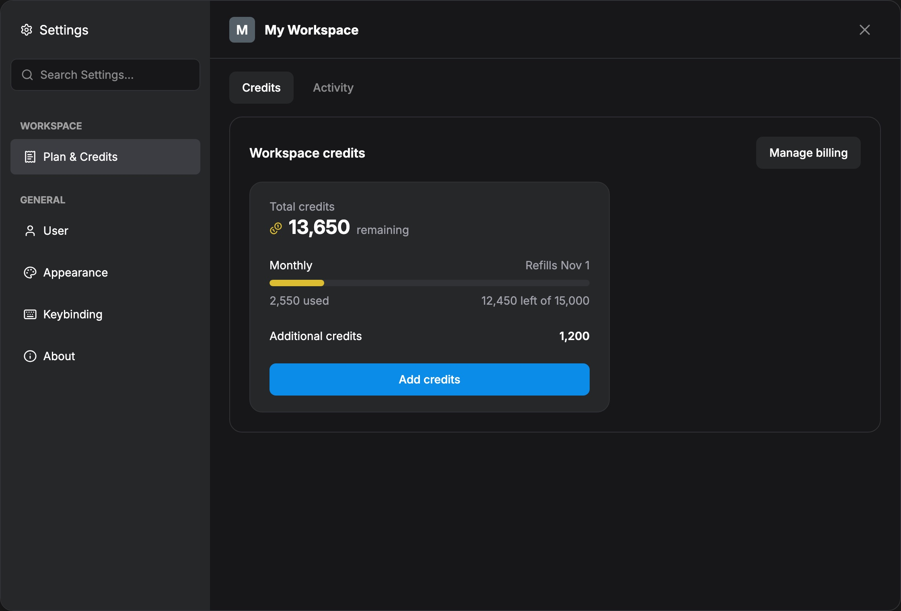
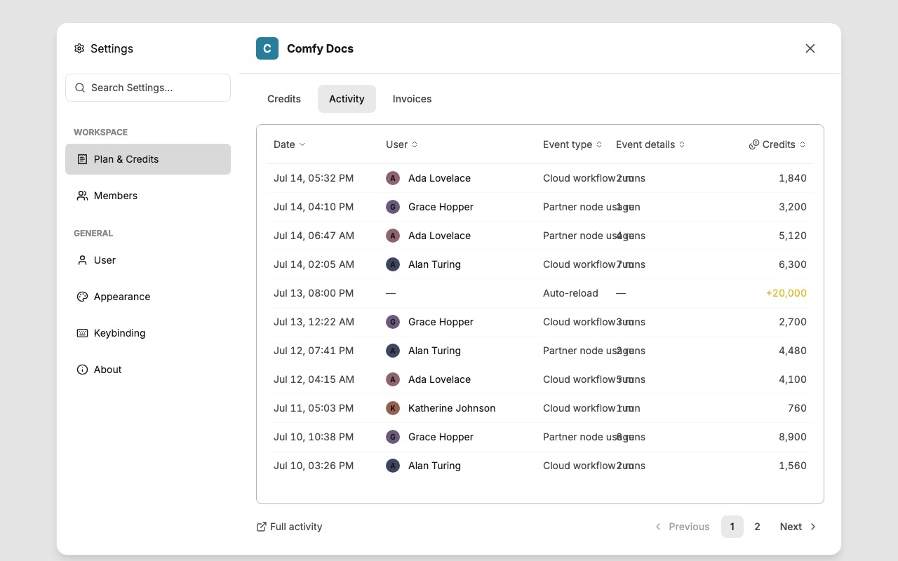
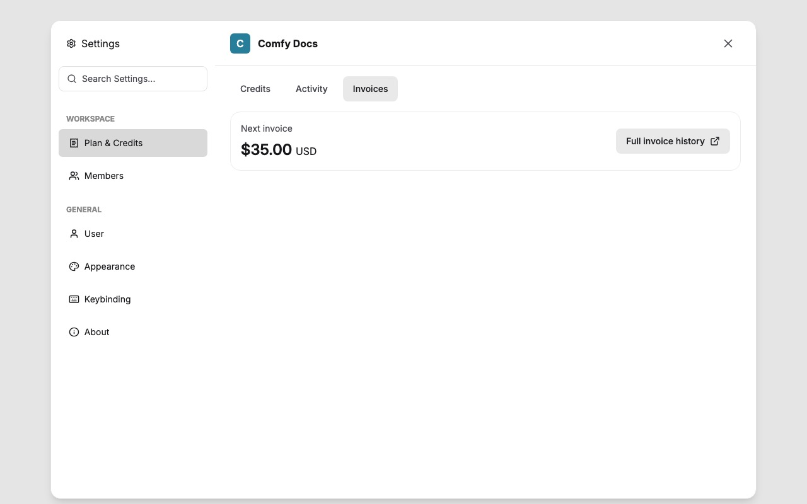
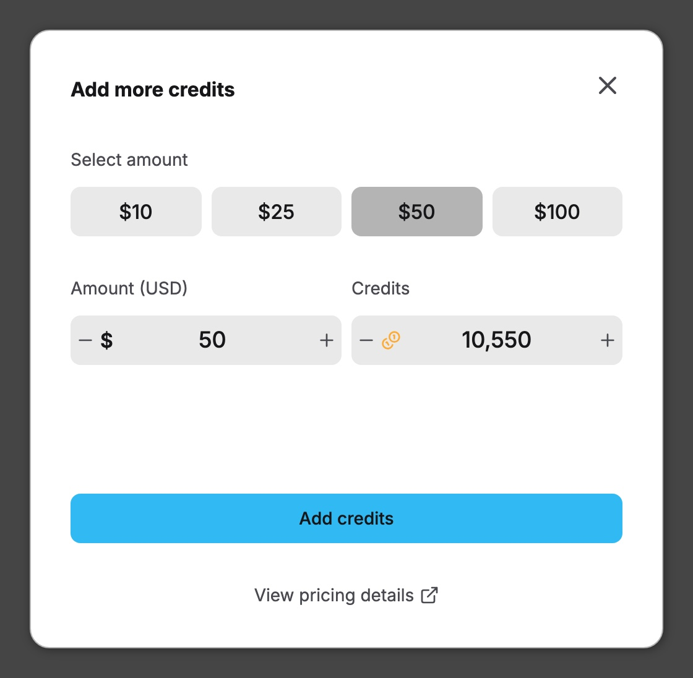
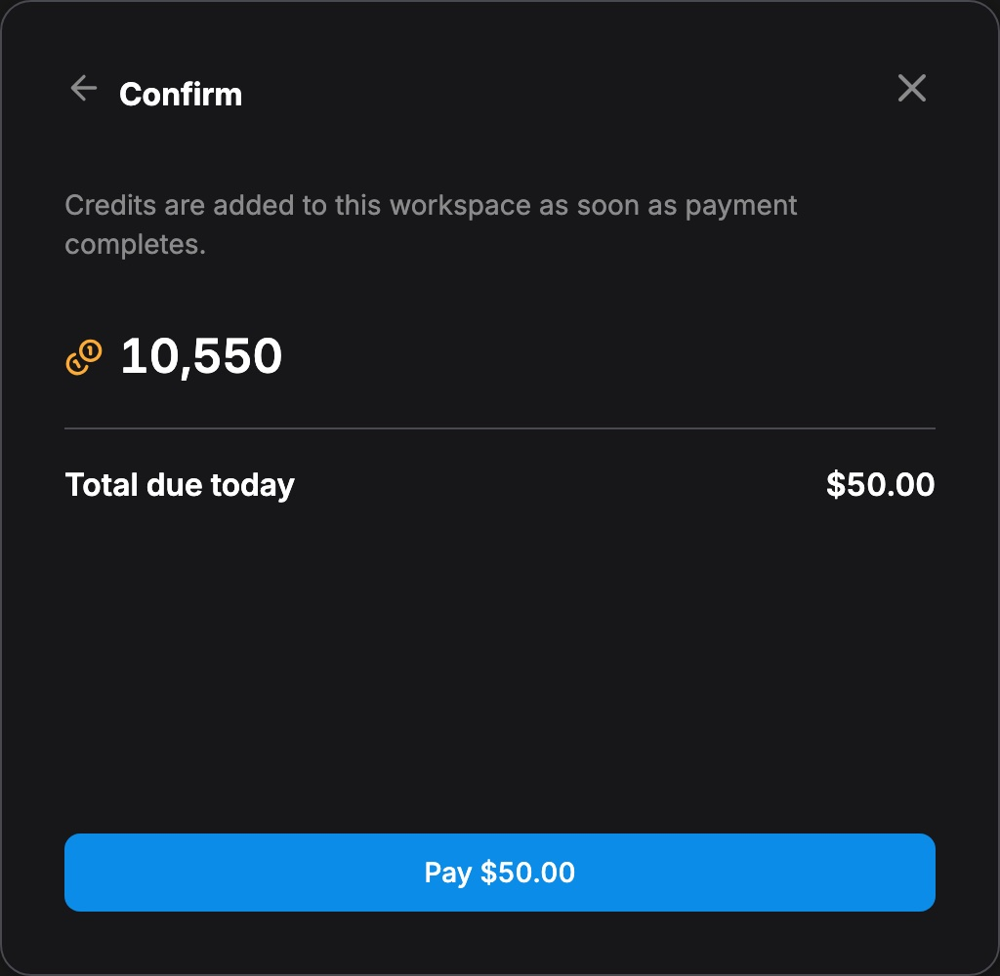
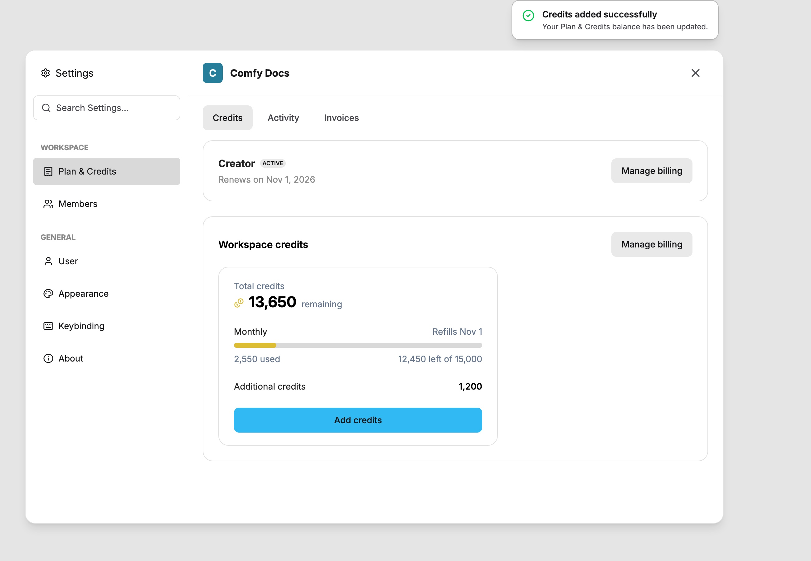

import SettingsMenuContext from "/snippets/ru/interface/settings-menu-context.mdx"

<SettingsMenuContext />

Кредиты оплачивают работу **партнёрских узлов** (API-вызовы к моделям с закрытым исходным кодом). ComfyUI остаётся полностью открытым и бесплатным для локального выполнения графа: кредиты нужны только при запуске партнёрских узлов или при использовании функций выставления счетов в Comfy Cloud.

После входа в разделе **Настройки → Пользователь** откройте **Настройки → Рабочее пространство → План и кредиты**. В Comfy Cloud ту же панель можно открыть из меню профиля с помощью **Управление планом**.

В некоторых рабочих пространствах Cloud те же данные о тарифе и кредитах отображаются в панели **Выставление счетов** вместо **План и кредиты**. Она находится в той же группе **Настройки → Рабочее пространство** и добавляет настройку автоматического пополнения. См. [Панель выставления счетов и автоматическое пополнение](#панель-выставления-счетов-и-автоматическое-пополнение).

<Note>
ComfyUI всегда будет полностью открытым и бесплатным для локальных пользователей. Балансы кредитов на скриншотах приведены для примера.
</Note>

## Что есть в разделе «План и кредиты»

Откройте **Настройки → Рабочее пространство → План и кредиты**. При локальной установке после входа боковая панель показывает «План и кредиты» в разделе «Рабочее пространство» (без пунктов «Участники» и «Счета»). В панели есть следующие вкладки:

| Вкладка | Что здесь есть |
| --- | --- |
| **Кредиты** | Баланс, пополнение и сводка по тарифу (локально встраивается панель кредитов; в Cloud отображается представление подписки рабочего пространства) |
| **Активность** | История использования и расход кредитов |
| **Счета** | Только Cloud, для пользователей, которые могут управлять подпиской рабочего пространства: следующий счёт и история в Stripe |

В командном рабочем пространстве в таблице «Активность» появляется столбец **Участник**, поэтому видно, какой участник выполнил каждую операцию. В строках, привязанных к участнику, покинувшему рабочее пространство, после имени отображается `(former member)`, а в строках без привязки отображается `-`.

Чтобы сменить тариф в Cloud, открыть портал выставления счетов или разобраться с ошибкой платежа, воспользуйтесь руководствами поддержки:

<CardGroup cols={2}>
  <Card title="Управлять подпиской Cloud" icon="receipt" href="/ru/support/subscription/managing">
    Сменить тариф, открыть «Оплата и счета», «Команда» или «Личное»
  </Card>
  <Card title="История платежей" icon="file-invoice" href="/ru/support/payment/payment-history">
    Счета и PDF-файлы в портале выставления счетов Stripe
  </Card>
</CardGroup>

## Как купить кредиты

<Steps>

<Step title="Войдите в свой аккаунт ComfyUI">
Откройте **Настройки → Пользователь** и войдите в систему.

</Step>

<Step title="Откройте План и кредиты">
После входа откройте **Настройки → Рабочее пространство → План и кредиты** (или профиль Cloud → **Управление планом**).

</Step>

<Step title="Укажите количество кредитов для покупки">

В открывшемся окне укажите количество кредитов и нажмите **Купить**.
</Step>

<Step title="Подтвердите и завершите оплату">

Проверьте сумму, затем перейдите к оформлению в Stripe, чтобы завершить оплату. Используйте ту же электронную почту, что и в аккаунте ComfyUI.
</Step>

<Step title="Проверьте баланс">

Вернитесь в **План и кредиты** и убедитесь, что баланс обновился. При необходимости обновите страницу или перезапустите приложение.
</Step>

</Steps>

В рабочих пространствах с панелью **Выставление счетов** начните с **Настройки → Рабочее пространство → Выставление счетов**, нажмите **Добавить кредиты** и проверьте новый баланс на карточке кредитов. Остальные шаги те же.

## Панель выставления счетов и автоматическое пополнение

В рабочих пространствах, где используется панель **Billing**, раздел **Settings → Workspace → Billing** объединяет тариф рабочего пространства, баланс кредитов и автоматическое пополнение в одной панели. Владельцы могут менять там тариф и добавлять кредиты. Участники видят тот же баланс и ссылку на свою статистику использования.

### Тариф и кредиты

Строка тарифа показывает текущий тариф, интервал выставления счетов и дату следующего счёта. Запланированное изменение тарифа показывает дату вступления в силу и кнопку **Остаться на**, чтобы отменить это изменение. Отменённая подписка показывает дату окончания и кнопку **Возобновить тариф** для продления.

Показатель **Доступно** в верхней части карточки кредитов отражает то, что рабочее пространство может потратить прямо сейчас. Если запуски превысили баланс, карточка указывает, на сколько кредитов был превышен баланс. Если у рабочего пространства есть активный тариф, карточка делит баланс на две части:

- **Тариф**: часть лимита тарифа, оставшаяся у рабочего пространства в этом расчётном периоде
- **Пополнение**: кредиты, которые вы добавили; они расходуются после исчерпания лимита тарифа. Показывается **In use now**, когда запуски уже расходуют пополненные кредиты.

**Добавить кредиты** открывает сценарий пополнения. Владельцы также получают кнопку перехода на внешнюю страницу выставления счетов, где доступны способы оплаты, счета и использование.

### Автоматическое пополнение

Автоматическое пополнение пополняет баланс, когда он опускается ниже порога, так что длительные задачи могут продолжаться без ручного пополнения. Средства списываются с основного способа оплаты рабочего пространства, поэтому способ оплаты должен быть сохранён заранее. Неудачное списание или достижение месячного лимита приостанавливает пополнение, пока вы не устраните проблему.

Пока автоматическое пополнение включено, карточка показывает правило: например, сумму и количество добавляемых кредитов и баланс, при котором срабатывает пополнение. Она также показывает, какую часть месячного лимита израсходовали автоматические списания. В этот лимит учитываются только автоматические списания, и счётчик сбрасывается в каждом расчётном периоде.

Каждая кнопка на карточке открывает страницу выставления счетов в новой вкладке, где вы меняете настройку. Владельцы видят кнопки действий. Участники видят ту же карточку без них, а также примечание с просьбой обратиться к владельцу рабочего пространства.

| Статус | Что означает |
| --- | --- |
| **Включено** | Автоматическое пополнение активно. **Управлять** открывает страницу выставления счетов, где можно изменить количество, порог или месячный лимит. |
| **Выключено** | Автоматическое пополнение не активно. **Включить** открывает страницу выставления счетов для его настройки. |
| **Приостановлено** | Нет основного способа оплаты, поэтому следующее пополнение нельзя списать. **Обновить оплату** открывает страницу выставления счетов, где можно добавить карту. |
| **Лимит достигнут** | Автоматические списания достигли месячного лимита. Пополнение возобновится в дату, указанную на карточке, или раньше, если вы повысите лимит на странице выставления счетов. |
| **Максимум достигнут** | Автоматические списания достигли месячного максимума. Дальнейшие автоматические списания не произойдут до даты, указанной на карточке. |
| **Ошибка** | Последнее автоматическое списание не прошло. **Обновить оплату** открывает страницу выставления счетов, или вы можете добавить кредиты вручную. |
| **Отключено** | Способ оплаты был отклонён три раза подряд, поэтому автоматическое пополнение отключилось само. Обновите способ оплаты и включите его снова. |

## Часто задаваемые вопросы

<AccordionGroup>
  <Accordion title="Могут ли кредиты уйти в минус?">
    Кредиты не задуманы как кредитная линия. Партнёрские узлы иногда сообщают стоимость после выполнения, поэтому один запуск может оставить временный отрицательный баланс. Пока баланс отрицательный, Партнёрские узлы остаются заблокированными, пока вы не пополните счёт.
  </Accordion>

  <Accordion title="Можно ли вернуть деньги за неиспользованные кредиты?">
  Сейчас мы не поддерживаем возврат средств за неиспользованные кредиты.
  </Accordion>

  <Accordion title="Как проверить текущий баланс и использование?">
  Откройте **Настройки → Рабочее пространство → План и кредиты**. На вкладке **Кредиты** показан баланс, а на вкладке **Активность** хранится история использования. В рабочих пространствах, где вместо этого отображается панель **Выставление счетов**, баланс находится на карточке кредитов, а **Посмотреть использование** открывает историю использования.
  </Accordion>

  <Accordion title="Можно ли поделиться кредитами с другими пользователями?">
  Вы можете войти в один и тот же аккаунт на нескольких устройствах. Совместное использование кредитов с другими аккаунтами пользователей не поддерживается. В командных рабочих пространствах Cloud участники делят один баланс рабочего пространства, и только владелец рабочего пространства может добавлять кредиты или менять тариф.
  </Accordion>

  <Accordion title="Как узнать, сколько будет стоить узел?">
  Перед запуском проверьте значок цены на API / Партнёрском узле. Фактическая стоимость может меняться в зависимости от размера изображения, количества генераций и других параметров.
  </Accordion>

  <Accordion title="Почему я не вижу вариантов оплаты WeChat или Alipay?">
  Выберите оплату в Comfy Credits. WeChat и Alipay доступны только для этого варианта валюты.
  </Accordion>

  <Accordion title="Идут ли кредиты вместе с тарифом Cloud?">
  Нет. Покупка кредитов не запускает подписку и не открывает рабочие процессы Cloud: для запуска рабочих процессов в Cloud нужен тариф. Партнёрские узлы в локальном ComfyUI и Desktop могут использовать кредиты без тарифа.
  </Accordion>

  <Accordion title="Сгорают ли кредиты?">
  Да, срок действия зависит от типа:
  - **Кредиты в месяц**: сгорают в конце расчётного периода
  - **Пополнить кредиты**: сгорают через 1 год с даты покупки
  </Accordion>
</AccordionGroup>
