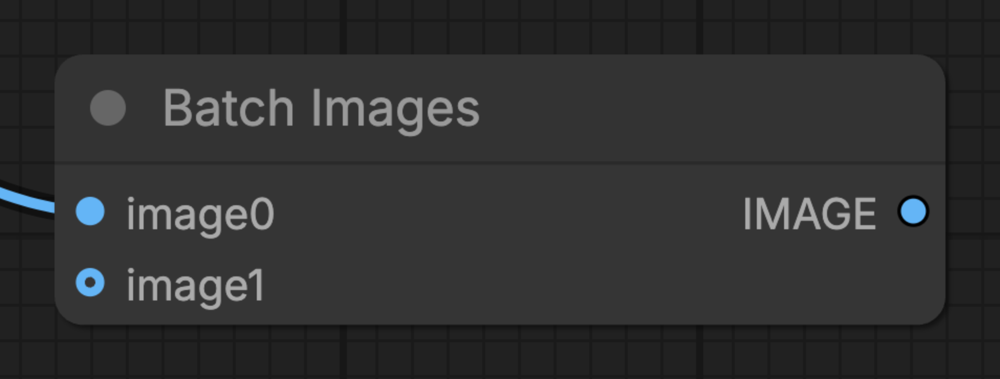
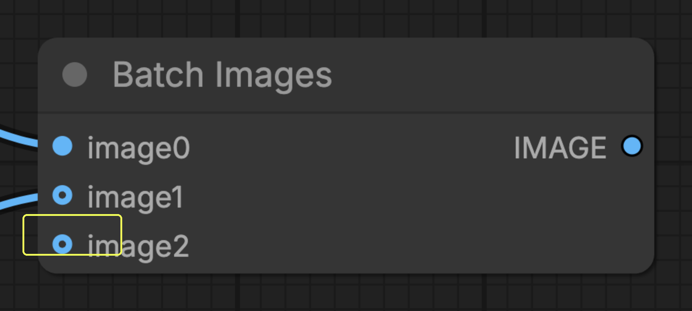

Некоторые узлы в ComfyUI имеют **авторасширяемые входы**, их также называют **динамическими входами**. Такие узлы не показывают фиксированный список слотов. Они добавляют ещё один вход, как только вы подключаете последний свободный, поэтому один узел может объединить в пакет два изображения или двадцать без какой-либо дополнительной настройки.

## Как работают авторасширяемые входы

1. **Подключите последний свободный вход.** В примере на этой странице источник изображения связан с `image0` на узле **Batch Images**, а `image1` всё ещё свободен.
2. **Понаблюдайте, как растёт узел.** Как только вы заполняете последний свободный вход, узел добавляет под ним новый пустой вход. На рисунке ниже новый вход `image2` появляется после подключения `image1`.
3. **Повторяйте по необходимости.** Каждый раз, когда вы заполняете последний вход, узел снова растёт, пока не достигнет максимального числа входов, допустимого для этого узла.

Ещё две детали, о которых стоит знать:

- **Порядок важен.** Входы передаются узлу в том порядке, в котором они отображаются, поэтому `image0` идёт перед `image1` и так далее. Учитывайте это, когда результат зависит от последовательности, например когда вы объединяете в пакет изображения, которые проходят через модель видео.
- **Свободный вход служит заполнителем.** Он становится частью данных узла только после того, как вы что-то к нему подключите. Узел, допускающий ноль входов, всё равно выполняется, когда все слоты пусты.

## Узлы, использующие авторасширяемые входы

| Узел | Растущий вход | Максимум входов |
|---|---|---|
| **Batch Images** | `image` | 50 |
| **Batch Masks** | `mask` | 50 |
| **Batch Latents** | `latent` | 50 |
| **And** / **Or** | `value` | 10 |
| **Nano Banana 2** и другие партнёрские узлы, принимающие референсные изображения | `image_1`, `image_2` и так далее | до 14 изображений |

Каждый узел сам определяет свои ограничения. Наведите курсор на вход в ComfyUI, чтобы прочитать подсказку, если вы не уверены, сколько значений он принимает.

<Tip>
Авторасширение входит в схему узлов ComfyUI V3. Если вы пишете пользовательские узлы, см. раздел [Динамические входы)](/ru/custom-nodes/v3_migration#динамические-входы) о шаблонном API `Autogrow`.
</Tip>

<Card title="Узел Batch Images" icon="book-open" href="/built-in-nodes/BatchImagesNode">
  Объедините несколько изображений в один пакет с таким количеством входов, какое вам нужно.
</Card>