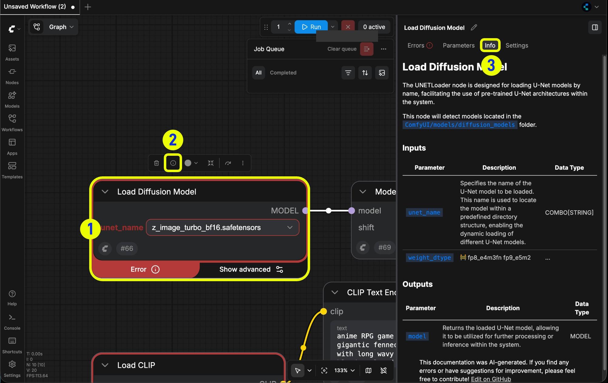
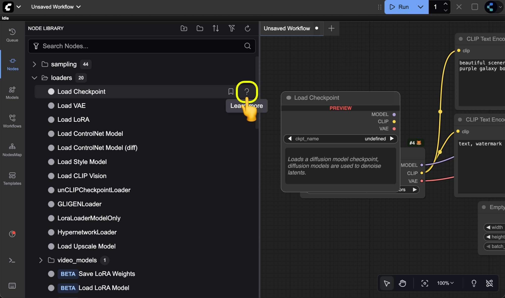

Документация узлов обеспечивает быстрый доступ к документации любого узла в вашем рабочем процессе. Вы можете просматривать подробную информацию о функциональности узла, его параметрах и примерах использования прямо в ComfyUI.

Ту же справку можно открыть с помощью иконки документации в панели инструментов выделения, кнопки справки в Nodes 2.0 или вкладки **Info** в [правой боковой панели](/ru/interface/right-side-panel), когда выбран один узел, не являющийся подграфом.

## Как открыть документацию узла

1. **Выберите узел:**  
   Нажмите на любой узел в рабочем процессе, чтобы выбрать его.

2. **Откройте документацию узла:**  
   Нажмите на иконку информации о ноде в панели инструментов выделения, чтобы открыть страницу документации узла.

3. **Выйдите из документации узла:**  
   Если вы хотите закрыть документацию узла, нажмите на иконку стрелки в левом верхнем углу.

{/* Точка входа «?» в библиотеке нод удалена в текущем фронтенде. Восстановить, когда её вернут.
Вы также можете открыть документацию узла через библиотеку нод: наведите курсор на узел, затем нажмите иконку «?», чтобы открыть документацию.

*/}

## Встроенная документация узлов

Документация встроенных узлов ComfyUI поддерживается в [репозитории embedded-docs](https://github.com/Comfy-Org/embedded-docs).

**Как внести вклад во встроенную документацию узлов:**
- Пользователи могут предлагать улучшения и дополнения к встроенной документации узлов
- Отправляйте pull request в [репозиторий embedded-docs](https://github.com/Comfy-Org/embedded-docs)
- Помогите повысить качество документации для всего сообщества ComfyUI

## Документация пользовательских узлов

Пользовательские узлы также могут содержать собственную документацию. Если авторы пользовательских узлов предоставляют документацию, она автоматически появится в панели документации узла при выборе их узлов.

<Card title="Руководство разработчика: добавление документации к узлам" icon="code" href="/ru/custom-nodes/help_page">
  Узнайте, как создать подробную документацию для своих пользовательских узлов
</Card>