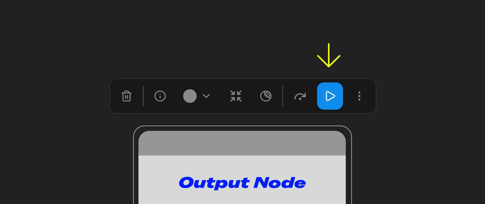
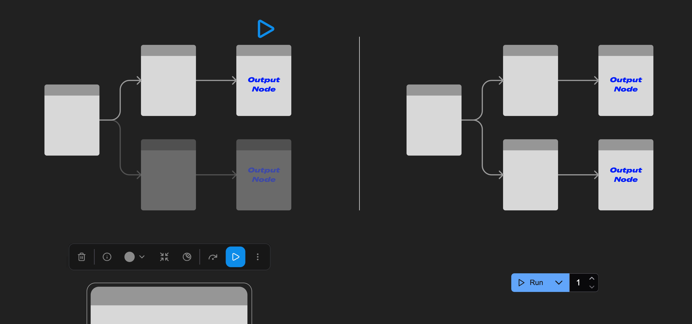
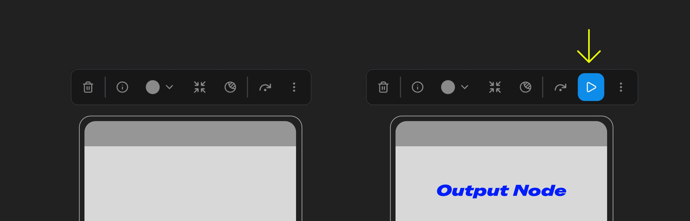

Функция частичного выполнения находится в панели выделения узлов ComfyUI. Она позволяет запускать только часть рабочего процесса вместо выполнения всех узлов. Функция доступна только когда выбранный узел является выходным, и в этом случае отображается в виде иконки синего треугольника.

## Что такое частичное выполнение?

Частичное выполнение, как следует из названия, позволяет запускать только часть рабочего процесса вместо выполнения всех узлов рабочего процесса.

На схеме выше сравниваются частичное выполнение и запуск всего рабочего процесса:

1. Частичное выполнение (слева): выполняет только ветвь рабочего процесса от начального узла до выходного узла.
2. Run Workflow (справа): выполняет все узлы рабочего процесса.

Эта функция позволяет гибко выполнять отдельные части рабочего процесса, а не запускать весь рабочий процесс каждый раз.

## Как использовать функцию частичного выполнения?

Чтобы использовать частичное выполнение, выбранный узел должен быть выходным, например узлом предпросмотра или сохранения. Если соответствующий узел соответствует требованиям, после выбора узла кнопка на панели отображается в виде иконки синего треугольника. Нажмите на эту иконку, чтобы выполнить часть рабочего процесса.

## Частые проблемы

Если кажется, что частичное выполнение запускает весь граф, сначала проверьте версию фронтенда:

<AccordionGroup>
  <Accordion title="Почему при использовании этой функции выполняются все узлы?">
    Убедитесь, что версия фронтенда ComfyUI выше v1.23.4, а возможно, требуется v1.24.x. Соответствующая ошибка была исправлена примерно в версии 1.24.x. Обновите ComfyUI до последней версии, чтобы фронтенд соответствовал требованиям.
  </Accordion>
</AccordionGroup>