<Note>
    Для работы подграфов требуется версия фронтенда ComfyUI 1.24.3 или более поздняя. Если вы не видите эту функцию, обратитесь к разделу: [Как обновить ComfyUI](/ru/installation/update_comfyui)
    - Изображения в этом документе сделаны с ночной версией фронтенда, ориентируйтесь на фактический интерфейс
</Note>

<Tip>
Документацию для разработчиков о программной работе с подграфами см. в [Руководстве разработчика подграфов](/ru/custom-nodes/js/subgraphs).
</Tip>

<iframe
  className="w-full aspect-video rounded-xl"
  src="https://www.youtube.com/embed/xgQoGT-VpxE?si=hD5196gcX0RW-0Ko"
  title="ComfyUI Selection Toolbox New Features"
  allow="accelerometer; clipboard-write; encrypted-media; gyroscope; picture-in-picture"
  allowFullScreen
></iframe>
Подграф это мощная функция ComfyUI, которая позволяет упаковать сложный рабочий процесс в один переиспользуемый узел подграфа, чтобы им было проще управлять и делиться.

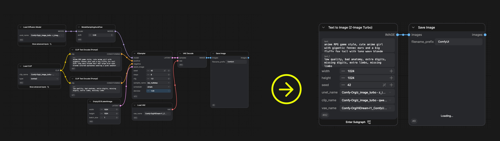

Представьте подграф как «папку» для вашего рабочего процесса: вы можете объединить связанные узлы в группу и использовать всю эту коллекцию как один узел подграфа.

**Подграфы позволяют:**
- Упрощать сложные рабочие процессы
- Переиспользовать типовые комбинации узлов
- Строить более эффективные рабочие процессы из модульных компонентов

## Создание подграфа

<Steps>
    <Step title="Выберите узлы">
    Выберите узлы, которые хотите объединить в группу в ComfyUI
    </Step>
    <Step title="Нажмите на иконку подграфа">
        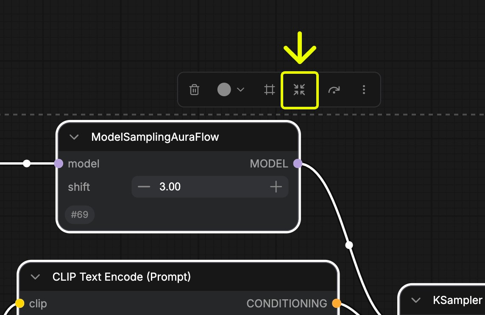
        Найдите иконку подграфа на панели инструментов
    </Step>
    <Step title="Подграф создан">
        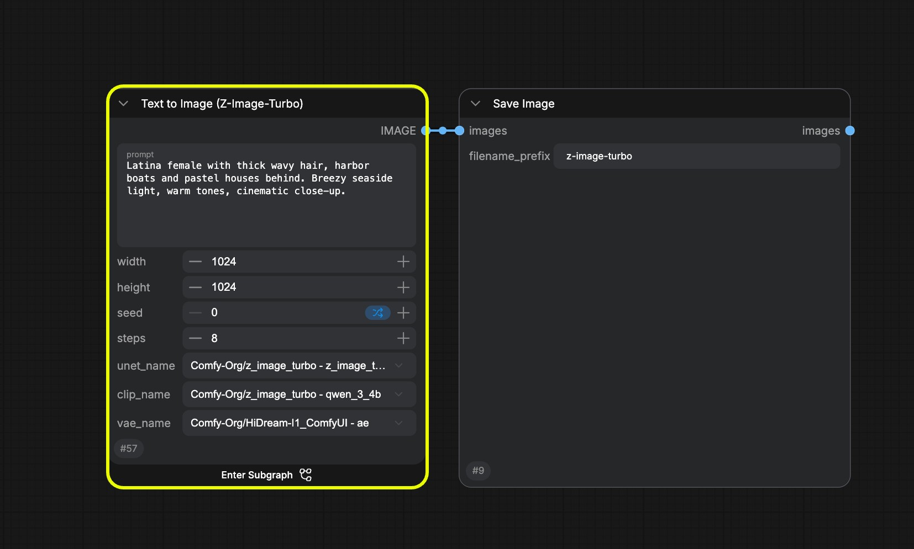
        ComfyUI автоматически создаёт подграф на основе входов и выходов выбранных узлов
    </Step>
    <Step title="Настройте подграф">
        Обратитесь к разделу [Редактирование подграфов](#редактирование-подграфов): вы можете редактировать и организовывать подграф, чтобы получить полностью функциональный узел
        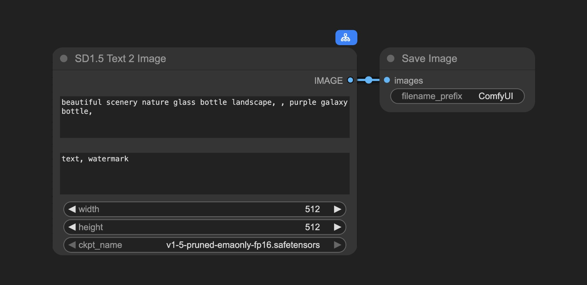
    </Step>
</Steps>

## Работа с подграфами

### Базовые операции

Подграфы работают так же, как обычные узлы. Вы можете:
- Изменять цвета и имена
- Использовать обход (bypass), чтобы отключить подграф
- Применять все стандартные операции с узлами

### Редактирование подграфов

**Чтобы войти в режим редактирования:**
- Дважды щёлкните по пустой области внутри подграфа (не по виджетам), или
- Нажмите кнопку редактирования подграфа

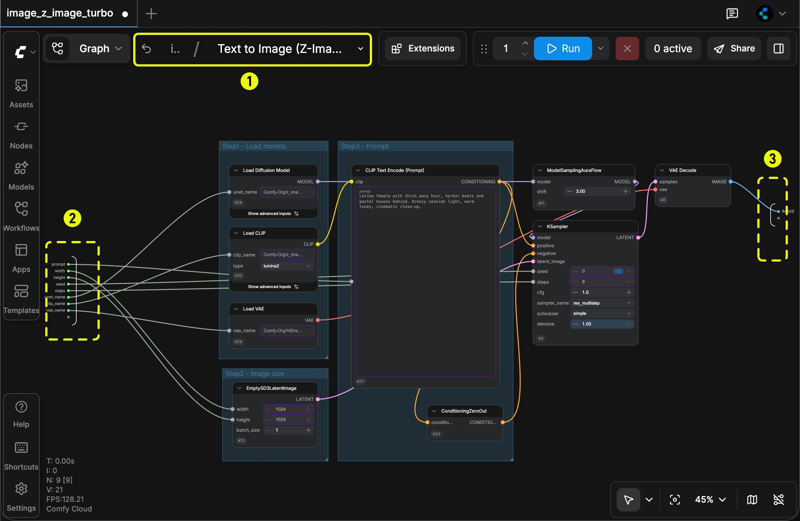

**В режиме редактирования вы увидите:**

1. **Панель навигации**: выход из текущего подграфа и возврат на родительский уровень
2. **Входные слоты**: внутренние входы узлов, выведенные наружу
    - Подключайте выходы к слотам так же, как у обычных узлов
    - **Щёлкните правой кнопкой** по точкам подключения, чтобы переименовать или удалить выведенные слоты
3. **Выходные слоты**: выходы, выведенные наружу (та же функциональность, что и у входных слотов)

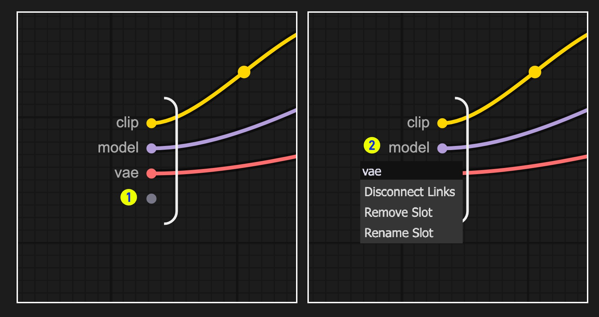

**Работа со слотами:**
1. **Слот по умолчанию** (обозначен 1): используйте его, чтобы добавить новые подключения входов и выходов
2. **Щёлкните правой кнопкой** по существующим слотам, чтобы переименовать, удалить или отключить их от исходных узлов

> Примечание. Подключения слотов подчиняются стандартным правилам валидации типов данных

### Панель параметров

Начиная с ComfyUI v0.3.66 вы можете редактировать параметры подграфа прямо из панели параметров, не входя в подграф.

Вы можете выбрать любой подграф и нажать кнопку «Редактировать виджеты подграфа», чтобы открыть панель параметров.
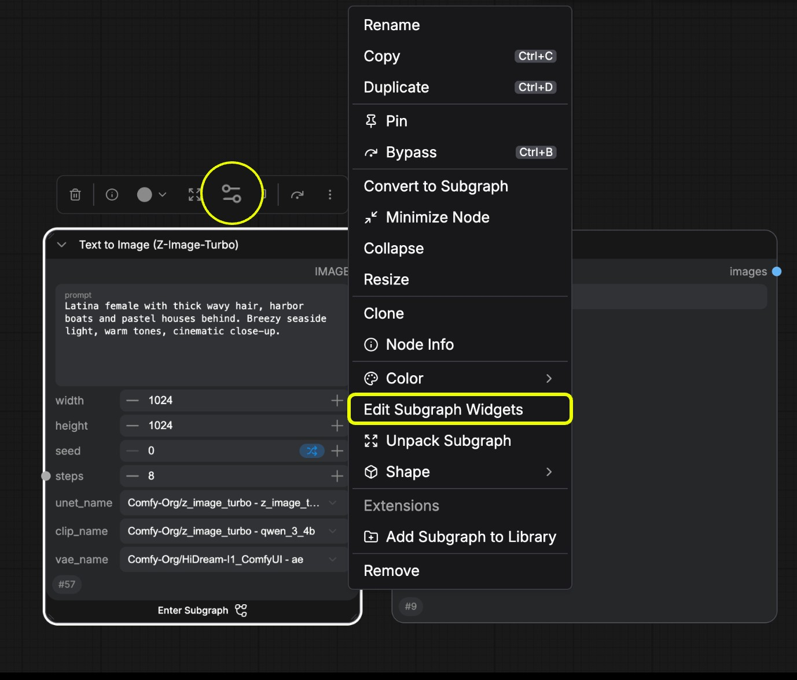

После открытия панели вы можете редактировать порядок и видимость виджетов подграфа прямо в панели параметров.

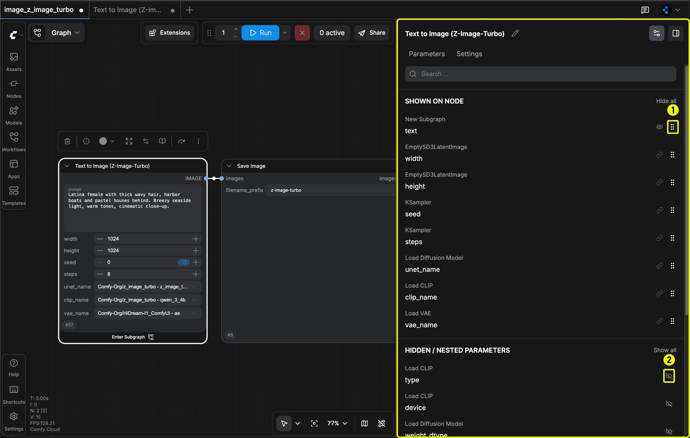
1. Изменение порядка: зажмите виджет правой кнопкой мыши и перетащите его в нужное положение
2. Видимость: проверить видимость виджета можно, нажав на иконку глаза

### Вложенные подграфы

Создавайте ещё более сложные рабочие процессы, вкладывая подграфы в подграфы.

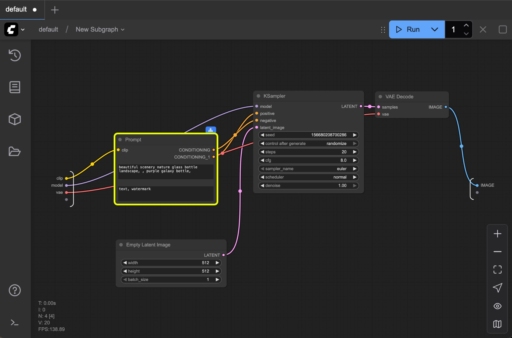

Панель навигации показывает текущий уровень и позволяет легко перемещаться между вложенными подграфами.

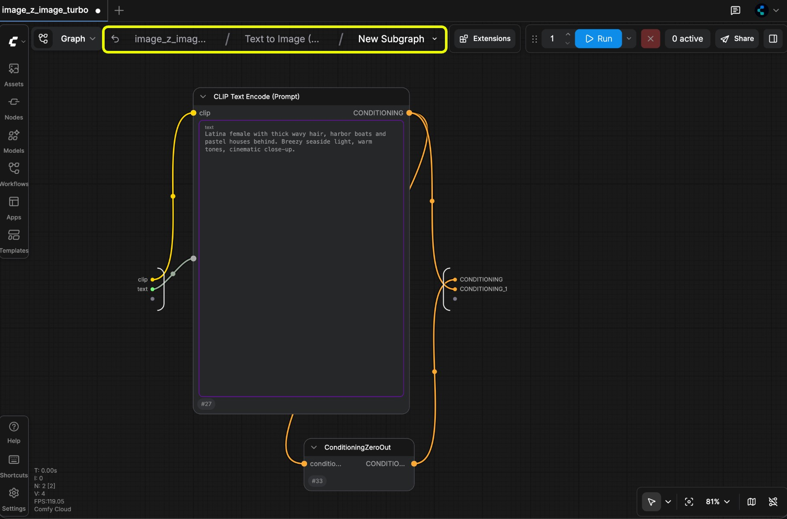

### Выйти из подграфа

Чтобы выйти из подграфа и вернуться на родительский уровень:
- Используйте **панель навигации** (обозначена 1 на изображении) в верхней части холста, или
- Нажмите клавишу **Esc**

Нажмите на панель навигации или клавишу Esc, чтобы выйти из текущего подграфа и вернуться к родительскому рабочему процессу.

## Распаковать подграфы в узлы

Когда вы закончите создание подграфа, вы можете преобразовать его обратно в узлы, если это необходимо.

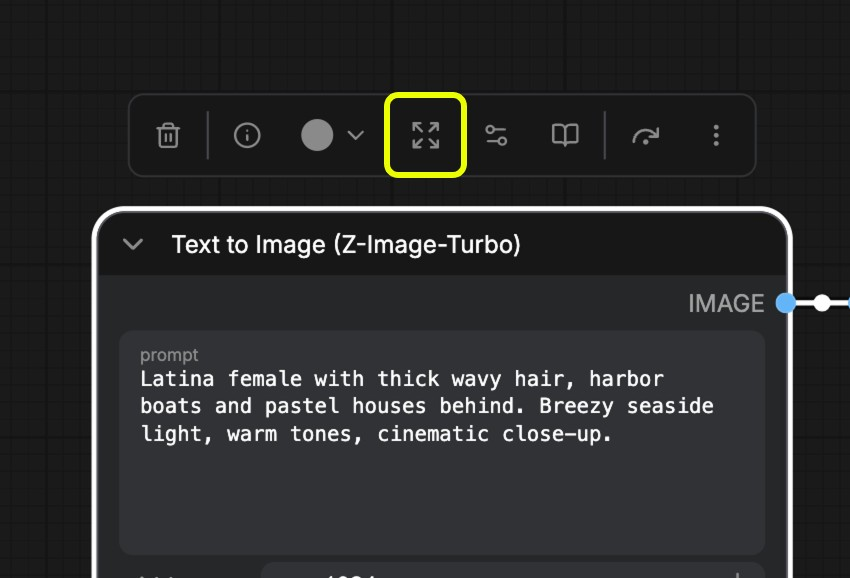

1. Вы можете выбрать узел подграфа, затем использовать контекстное меню «Unpack subgraph», чтобы преобразовать его обратно в узлы.
2. Нажмите кнопку «Unpack subgraph» на панели инструментов выбора, чтобы преобразовать его обратно в узлы.

## Чертёж подграфа

Начиная с версии фронтенда ComfyUI 1.27.7, вы можете публиковать подграф в библиотеку узлов.

Эта функция позволяет преобразовать подграф в узел `Subgraph Blueprints`, то есть в переиспользуемый узел подграфа.

### Опубликовать подграф в библиотеку узлов

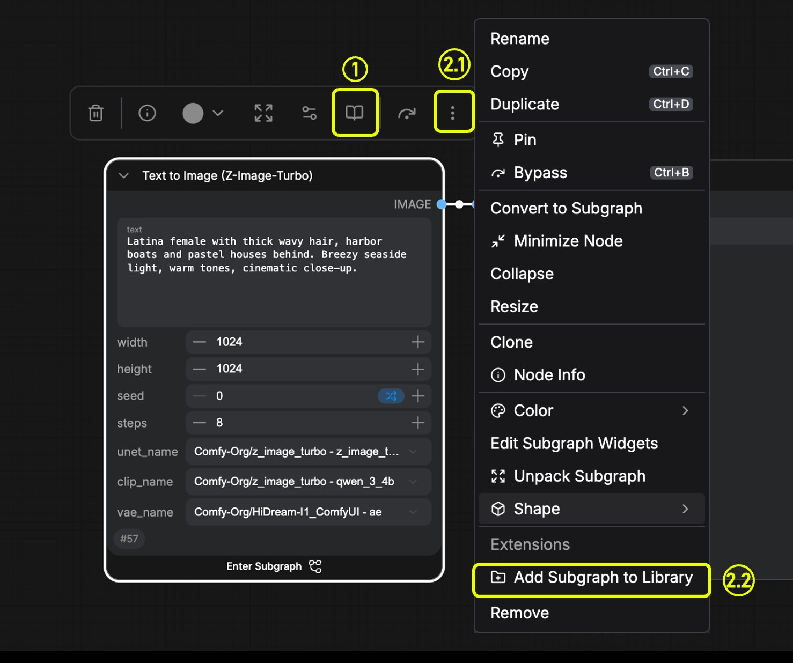

Сейчас опубликовать подграф в библиотеку узлов можно двумя способами, оба доступны на панели инструментов выделения:

1. Нажмите иконку `book(publish)` на панели инструментов выделения.
2. Откройте меню панели инструментов выделения и выберите пункт `Add Subgraph to Library`, чтобы опубликовать подграф.

После нажатия на иконку `book(publish)` или выбора пункта `Add Subgraph to Library` откроется следующее диалоговое окно:

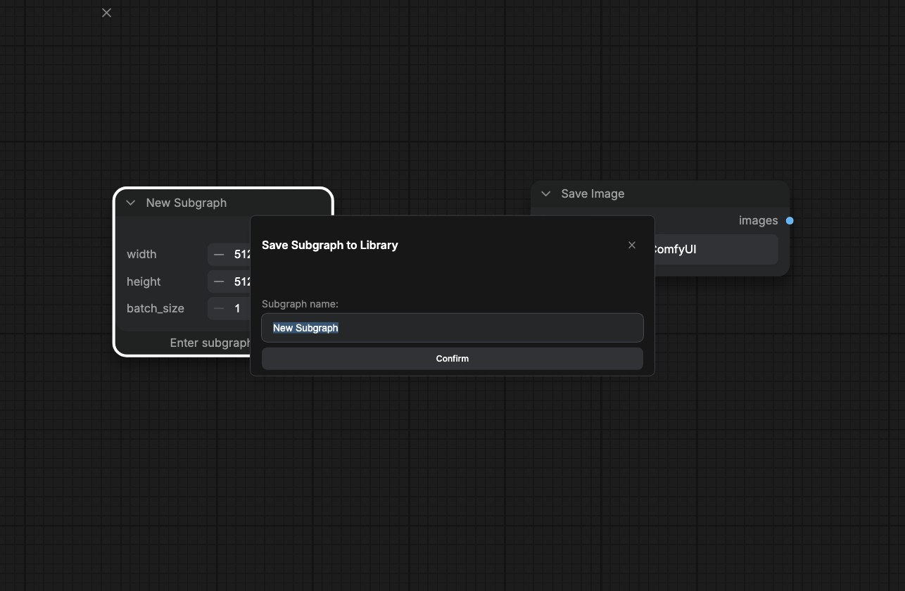

По умолчанию в качестве имени чертежа подграфа используется имя узла подграфа.

После публикации вы увидите узел чертежа подграфа в библиотеке узлов.

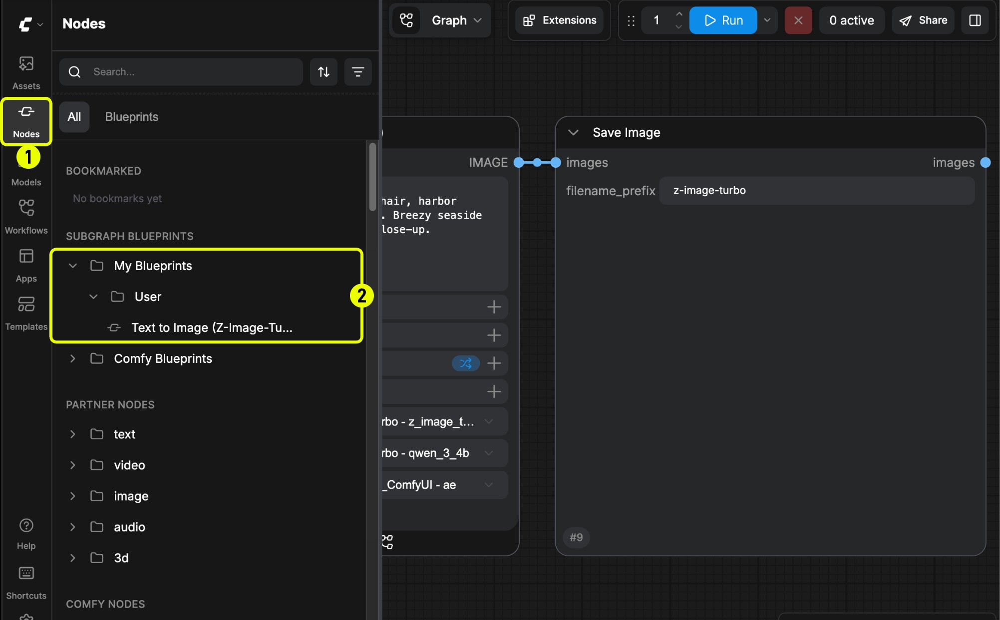

Теперь вы можете перетаскивать подграф или искать его так же, как обычный узел. Новый узел подграфа, добавленный из Subgraph Blueprints, по-прежнему изолирован: после добавления в рабочий процесс его можно редактировать независимо, такие узлы не влияют друг на друга.

### Редактировать чертёж подграфа

Чтобы отредактировать чертёж подграфа, нажмите кнопку редактирования, как показано на изображении ниже. Его также можно удалить.

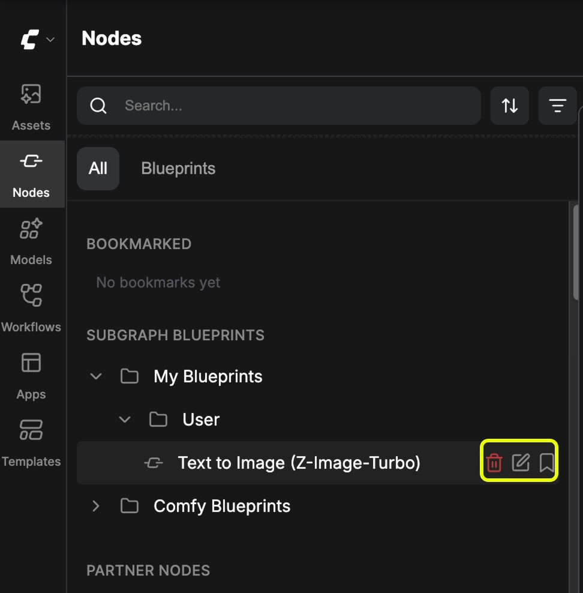

Откроется режим редактирования подграфа.

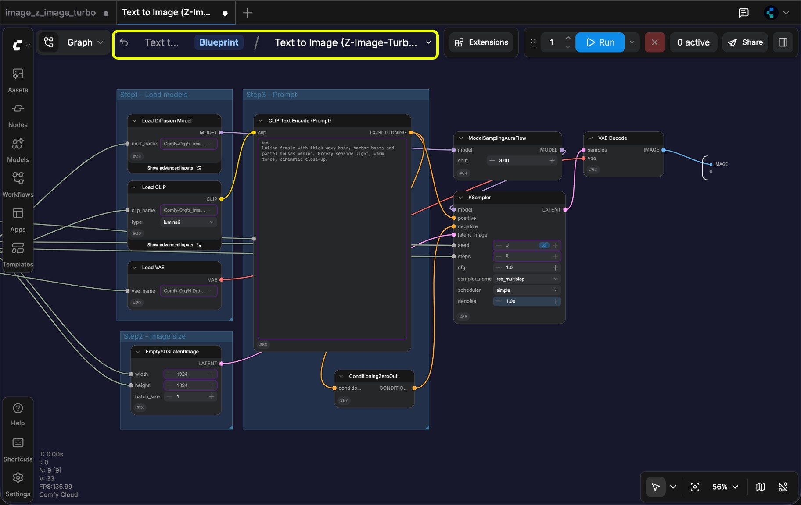

После редактирования чертежа подграфа можно перейти на родительский уровень, чтобы просмотреть подграф.

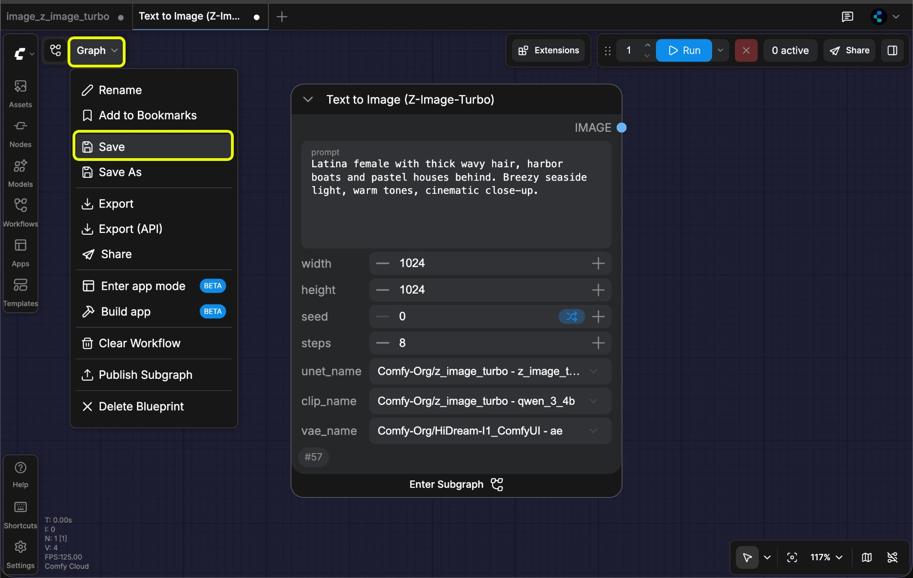

Чтобы сохранить обновлённый чертёж подграфа, нажмите кнопку сохранения или используйте сочетание клавиш Ctrl + S.
