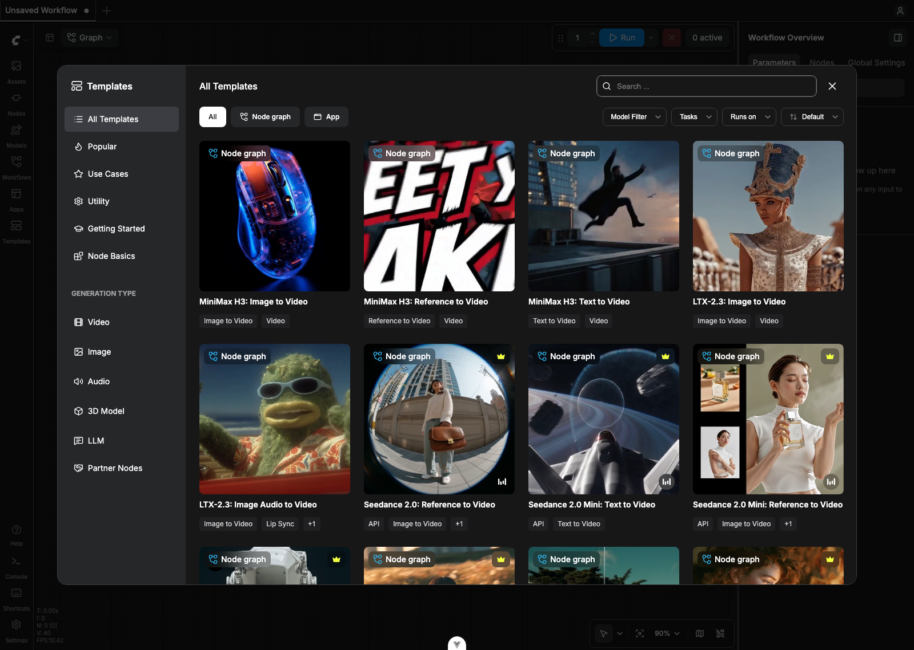
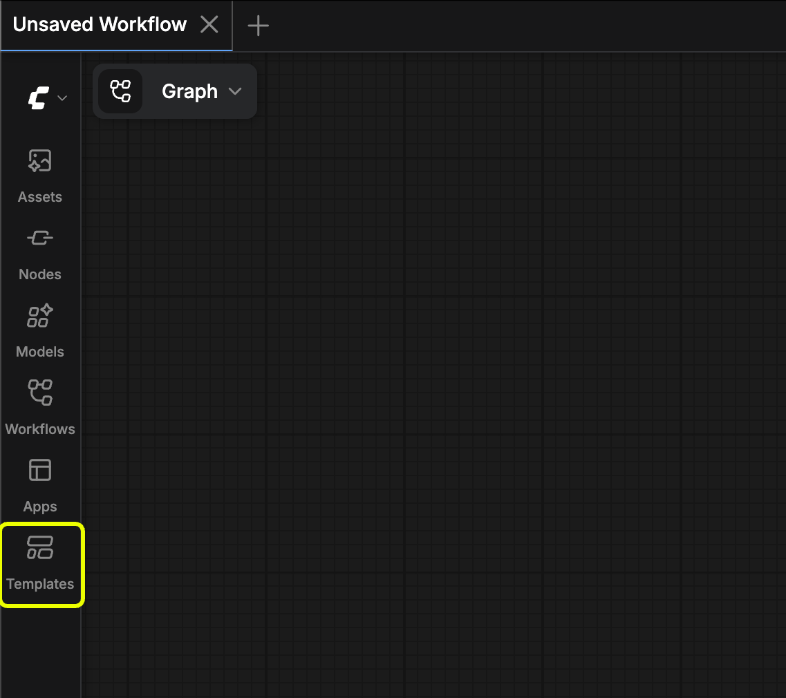
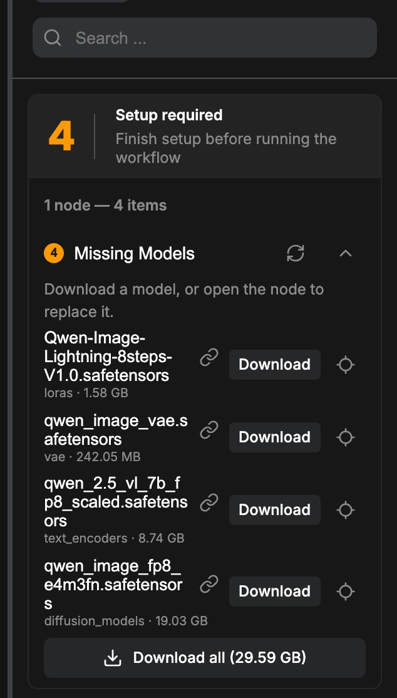

Шаблоны рабочих процессов представляют собой браузер для нативно поддерживаемых в ComfyUI рабочих процессов для моделей, а также некоторых примеров рабочих процессов от пользовательских узлов.

В разделе «Шаблоны рабочих процессов» ComfyUI вы можете найти:

- Рабочие процессы для нативно поддерживаемых моделей
- Примеры рабочих процессов от пользовательских узлов



## Как открыть шаблоны в ComfyUI

Нажмите на иконку **Templates** в боковой панели, чтобы открыть шаблоны рабочих процессов. Также их можно открыть из меню **Workflow** → **Browse Workflow Templates**.


## Как использовать шаблоны

1. Загрузить шаблон: нажмите на любой шаблон, чтобы загрузить его рабочий процесс.
2. Скачать модели: при загрузке шаблона ComfyUI автоматически проверяет, существуют ли все необходимые файлы моделей. Если чего-то не хватает, он предложит скачать модели.
3. Запустить рабочий процесс: когда всё необходимое (модели, входные изображения и промпты) готово, нажмите кнопку Run, чтобы начать работу с рабочим процессом.

### Где хранятся модели

Каждый шаблон рабочего процесса содержит ссылки на необходимые модели. При первом использовании, если этих файлов нет, ComfyUI не показывает отдельное модальное окно. Вместо этого он:

1. Подсвечивает затронутые узлы загрузки красным на холсте.
2. Показывает небольшой баннер, например **N errors found**, с кнопкой **View details**.
3. Открывает детали в [Right Side Panel](/ru/interface/right-side-panel) на вкладке **Errors** в разделе **Setup required** / **Missing Models**.



В этом списке можно нажать **Download** для одного файла, **Download all**, **Refresh** или воспользоваться элементом поиска, чтобы перейти к узлу, которому нужна модель. Группа **Missing models** остаётся доступной на вкладке Errors, пока вы работаете.

1. **Desktop**: **Download** / **Download all** сохраняет файлы в соответствующие папки `ComfyUI/models/…`.
2. **Self-hosted browser**: те же действия запускают скачивание через браузер, если доступен URL. Поместите каждый файл в соответствующую папку. Пример для шаблона Qwen Image на скриншоте:

```
📂 ComfyUI/
├── 📂 models/
│   ├── 📂 loras/
│   │   └── Qwen-Image-Lightning-8steps-V1.0.safetensors
│   ├── 📂 diffusion_models/
│   │   └── qwen_image_fp8_e4m3fn.safetensors
│   ├── 📂 vae/
│   │   └── qwen_image_vae.safetensors
│   └── 📂 text_encoders/
│       └── qwen_2.5_vl_7b_fp8_scaled.safetensors
```

Детекция отсутствующих файлов сейчас проверяет наличие файла с тем же именем в соответствующем каталоге верхнего уровня (например, непосредственно в `ComfyUI/models/diffusion_models`).
Если модель уже находится в подпапке, например `ComfyUI/models/diffusion_models/wan_video`, можно закрыть запрос и выбрать этот файл в узле загрузки.

Если вам интересно, как встраиваются ссылки на модели: мы добавляем поле `models` в `properties` узла. Ниже приведён полный фрагмент узла `DualCLIPLoader` со встроенной информацией о моделях:
```json
    {
      "id": 40,
      "type": "DualCLIPLoader",
      "pos": [
        -320,
        290
      ],
      "size": [
        270,
        130
      ],
      "flags": {},
      "order": 0,
      "mode": 0,
      "inputs": [],
      "outputs": [
        {
          "name": "CLIP",
          "type": "CLIP",
          "links": [
            64
          ]
        }
      ],
      "properties": {
        "Node name for S&R": "DualCLIPLoader",
        "cnr_id": "comfy-core",
        "ver": "0.3.40",
        "models": [
          {
            "name": "clip_l.safetensors",
            "url": "https://huggingface.co/comfyanonymous/flux_text_encoders/resolve/main/clip_l.safetensors",
            "directory": "text_encoders"
          },
          {
            "name": "t5xxl_fp16.safetensors",
            "url": "https://huggingface.co/comfyanonymous/flux_text_encoders/resolve/main/t5xxl_fp16.safetensors",
            "directory": "text_encoders"
          }
        ]
      },
      "widgets_values": [
        "clip_l.safetensors",
        "t5xxl_fp16.safetensors",
        "flux",
        "default"
      ]
    }
```

Поле `models` внутри `properties` содержит `name`, `url` и `directory`.

- `name`: имя файла модели
- `url`: прямая ссылка на скачивание файла (не страница репозитория)
- `directory`: в какую подпапку внутри `ComfyUI/models` сохранять файл, например `vae` означает `ComfyUI/models/vae`

Сейчас поддерживаются только ссылки с Hugging Face и Civitai. Формат модели должен быть безопасным, например `.safetensors` или `.sft`. Такие форматы, как `.gguf`, считаются небезопасными: при встраивании они будут отмечены как небезопасные, и ссылка не будет показана.

Вы можете использовать [этот инструмент](https://comfyui-wiki.github.io/ComfyUI-Workflow-JSON-Editor/), чтобы редактировать информацию о моделях в шаблонах рабочих процессов. На данный момент [@ComfyUI-Wiki](https://github.com/ComfyUI-Wiki) добавляет поддержку только для нативных узлов.

## Как обновить шаблоны?

Шаблоны управляются и обновляются как отдельная зависимость: [`comfyui-workflow-templates`](https://pypi.org/project/comfyui-workflow-templates/).

Если после обновления ComfyUI вы не видите документацию или новые анонсированные шаблоны, возможно, потребуется обновить соответствующую зависимость. Версии можно проверить в [`ComfyUI/requirements.txt`](https://github.com/Comfy-Org/ComfyUI/blob/master/requirements.txt).

Обычно при обновлении ComfyUI следующие три зависимости могут обновляться вместе:

```
comfyui-frontend-package==1.24.4
comfyui-workflow-templates==0.1.52
comfyui-embedded-docs==0.2.4
```

Если вы не уверены, как правильно обновить, см. раздел [Обновить ComfyUI](/ru/installation/update_comfyui), где описано, как обновить ComfyUI и его зависимости.

## Как добавить шаблоны в репозиторий ComfyUI?

Все шаблоны хранятся в репозитории [workflow_templates](https://github.com/Comfy-Org/workflow_templates/). Вы можете добавить шаблоны, отправив PR. Для официальных шаблонов мы требуем следующее:

1. Не используйте сторонние узлы (чтобы пользователям, у которых нет этих узлов, не пришлось устанавливать их дополнительно).
2. Шаблон не должен дублировать существующие и должен соответствовать поддерживаемым возможностям модели.
3. Вы можете открыть issue в репозитории, чтобы задать вопросы.

## Шаблоны пользовательских узлов

Если автор пользовательского узла предоставляет шаблоны и примеры рабочих процессов, их также можно найти в браузере шаблонов. Обычно все шаблоны можно найти, открыв категорию, названную по имени узла.

Если вы автор пользовательского узла, обратите внимание: сейчас поддерживается только один уровень каталогов внутри папки `templates` (без вложенных подкаталогов), и поддерживаются только шаблоны в формате JSON.

## Как добавить шаблоны для пользовательских узлов?

См. раздел [Шаблоны пользовательских узлов](/ru/custom-nodes/workflow_templates), чтобы узнать, как добавить шаблоны рабочих процессов для ваших пользовательских узлов.
