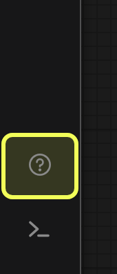
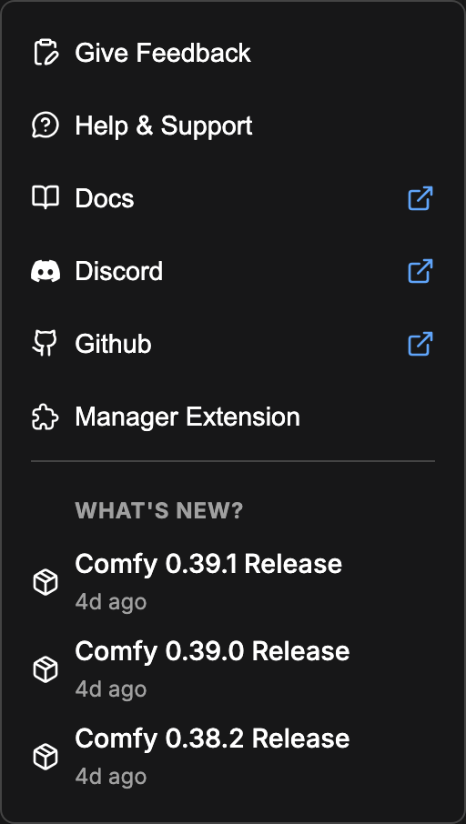
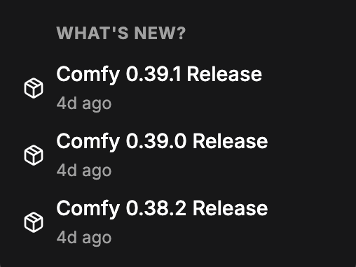
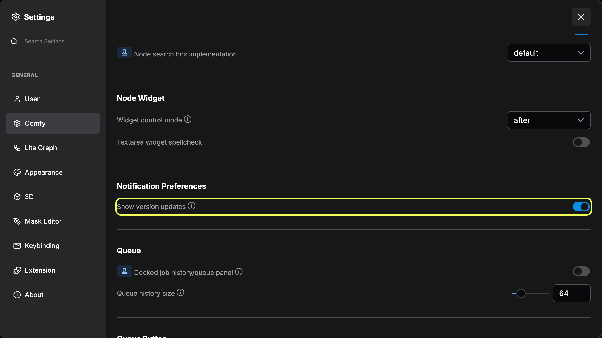

Центр поддержки — это панель, которая открывается по иконке вопросительного знака в нижней части боковой панели ComfyUI. В ней собраны ссылки и действия, которые иначе пришлось бы искать за пределами редактора: примечания к выпускам, документация, каналы сообщества и поддержки, статус системы, обратная связь и действие «Обновить» для ComfyUI.

## Открыть Центр поддержки

Нажмите на иконку вопросительного знака в нижней части левой боковой панели. В подсказке отображается **Help Center**, а красная точка на иконке означает, что появились новые материалы для чтения.

Нажмите на иконку ещё раз, чтобы закрыть панель. В **App mode** (линейный режим) та же иконка открывает форму обратной связи напрямую вместо меню.

## Пункты меню

Панель содержит перечисленные ниже пункты. Некоторые из них отображаются только в сборке Comfy Cloud, а некоторые только при локальной установке.

| Пункт | Что делает |
| --- | --- |
| **Оставить отзыв** | Открывает форму обратной связи в Comfy Cloud и ночных сборках. В остальных сборках запускает обращение в поддержку. |
| **Помощь и поддержка** | Открывает обращение в поддержку. |
| **Документация** | Открывает docs.comfy.org или страницу начала работы с Cloud, если вы работаете в Comfy Cloud. |
| **Discord** | Открывает сервер ComfyUI в Discord. |
| **Github** | Открывает репозиторий ComfyUI. |
| **Статус системы** | Открывает страницу статуса Comfy по адресу status.comfy.org. Только в Comfy Cloud. |
| **Расширение менеджера** | Открывает менеджер пользовательских узлов. Только при локальной установке. |
| **Обновить ComfyUI** | Ставит обновление ComfyUI в очередь. Для локальных установок с новым менеджером, кроме приложения для десктопа. |
| **More...** | Дополнительные пункты, отображаются только когда доступен хотя бы один из них. В приложении для десктопа: **Руководство пользователя для Desktop**, **Открыть инструменты разработчика** и **Переустановить**. При включённом режиме разработчика: **Повторить ознакомление**. |

## Что нового

Раздел **Что нового?** в меню содержит список самых новых релизов ComfyUI с номером версии и датой релиза. Нажмите на релиз, чтобы открыть его запись на странице [changelog](/changelog).

Раздел подчиняется настройке **Показывать обновления версий** в разделе **Comfy**, затем **Настройки уведомлений** в настройках; она включена по умолчанию. Если её выключить, раздел скрывается.

## Красная точка

Иконка боковой панели показывает красную точку, когда есть что прочитать или что устранить:

- **Непрочитанные примечания к выпуску**: доступна более новая версия, а вы ещё не открыли её примечания. Приложение показывает этот маркер и только пока включена настройка **Показывать обновления версий**.
- **Конфликты узлов**: менеджер пользовательских узлов обнаружил проблему с установленным пользовательским узлом, например несовпадение версии ComfyUI или фронтенда, узел, который не удалось импортировать, или пакет, не поддерживаемый вашей операционной системой или GPU.

Точка исчезает, когда вы открываете примечания к выпуску и подтверждаете конфликты узлов.
