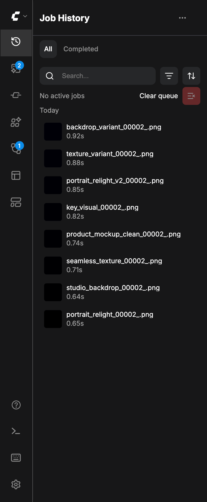
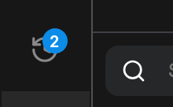

**Job History** — это вкладка в левой боковой панели, которая появляется, когда включена настройка **Использовать объединённую очередь заданий в боковой панели ресурсов** (`Comfy.Queue.QPOV2`). Фронтенд регистрирует её в **верхней части** боковой панели (`prepend`), чтобы вы могли следить за активными заданиями и просматривать прошлые запуски, не прибегая к плавающему перекрытию очереди.

Когда настройка выключена, вкладка удаляется, а вместо неё остаётся доступным плавающее перекрытие истории задач (`Comfy.Queue.ToggleOverlay`). Кнопки Run и queue в верхней панели в любом случае запускают задания. Эта страница посвящена варианту Job History в **боковой панели**.

## Включить историю задач

1. Откройте **Настройки**.
2. В разделе `Comfy` → `Queue` → `Layout` включите **Использовать объединённую очередь заданий в боковой панели ресурсов** (`Comfy.Queue.QPOV2`).
3. Иконка **История задач** появится в верхней части левой боковой панели.

Эта настройка экспериментальная. В ночных сборках она включена по умолчанию; в других сборках проверьте настройку, если вкладка не отображается.

## Открыть панель

Нажмите на иконку **История задач**. Пока задания выполняются или стоят в очереди, а эта вкладка **не** активна, на иконке отображается числовой значок с количеством активных задач. При открытии вкладки отображение значка для этого представления убирается.

## Вкладки: All, Completed, Failed

В заголовке панели расположены вкладки статуса:

- **All**: все задачи в истории, соответствующие текущим фильтрам.
- **Completed**: завершённые запуски.
- **Failed**: отображается, только если в списке есть хотя бы одна задача с ошибкой.

Ниже вкладок строка сводки показывает, сколько заданий выполняется и находится в очереди (или что активных заданий нет). Элемент **Clear queue** отменяет все задания в ожидании (поставленные в очередь, но ещё не запущенные).

## Поиск, фильтрация и сортировка

Используйте инструменты в верхней панели, чтобы сузить список:

- **Поиск**: фильтрация заданий по тексту.
- **Фильтр**: **Все рабочие процессы** или **Текущий рабочий процесс**.
- **Сортировка**: **Самые новые** или **Общее время генерации**.

## Список заданий и действия

Задания отображаются со статусом, прогрессом во время выполнения и миниатюрами предпросмотра, если есть выходы. В строке задания или в её контекстном меню доступны следующие действия:

**Выполняется или в очереди**

- Открыть как рабочий процесс в новой вкладке
- Копировать ID задачи
- Отменить задание

**Завершено**

- Просмотреть ресурс (если есть предпросмотр)
- Добавить выход в текущий рабочий процесс как узел загрузки
- Скачать ресурс предпросмотра
- Открыть как рабочий процесс в новой вкладке
- Экспорт рабочего процесса
- Копировать ID задачи

**Ошибка**

- Открыть рабочий процесс в новой вкладке
- Копировать ID задачи
- Скопировать сообщение об ошибке
- Сообщить об ошибке
- Удалить задачу из списка истории

Меню действий в заголовке содержит пункт **Очистить историю**, который открывает диалог подтверждения. Очистка истории удаляет записи из истории очереди; прочитайте примечание в диалоге о том, как это связано с сохранёнными ассетами в вашей установке.

## Как это связано с ассетами и ошибками

Выходы завершённых запусков также отображаются в разделе [Ассеты](/ru/interface/assets), если система ассетов включена. Сбои рабочего процесса и отсутствующие ресурсы перечислены на вкладке **Errors** [правой боковой панели](/ru/interface/right-side-panel), пока вы исправляете граф.

## Связанные страницы

- [Обзор интерфейса](/ru/interface/overview)
- [Ассеты](/ru/interface/assets)
- [Правая боковая панель](/ru/interface/right-side-panel)
- [Настройки Comfy](/ru/interface/settings/comfy)
