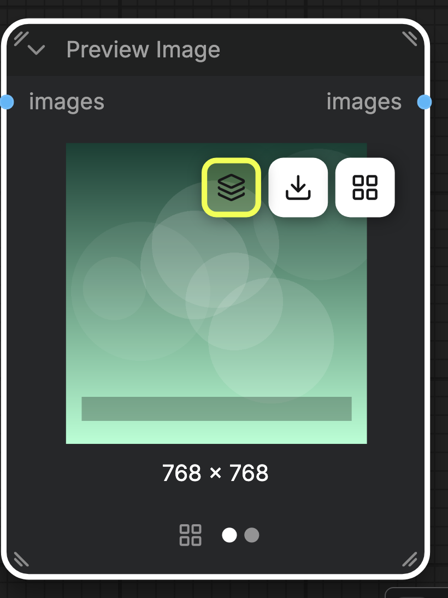
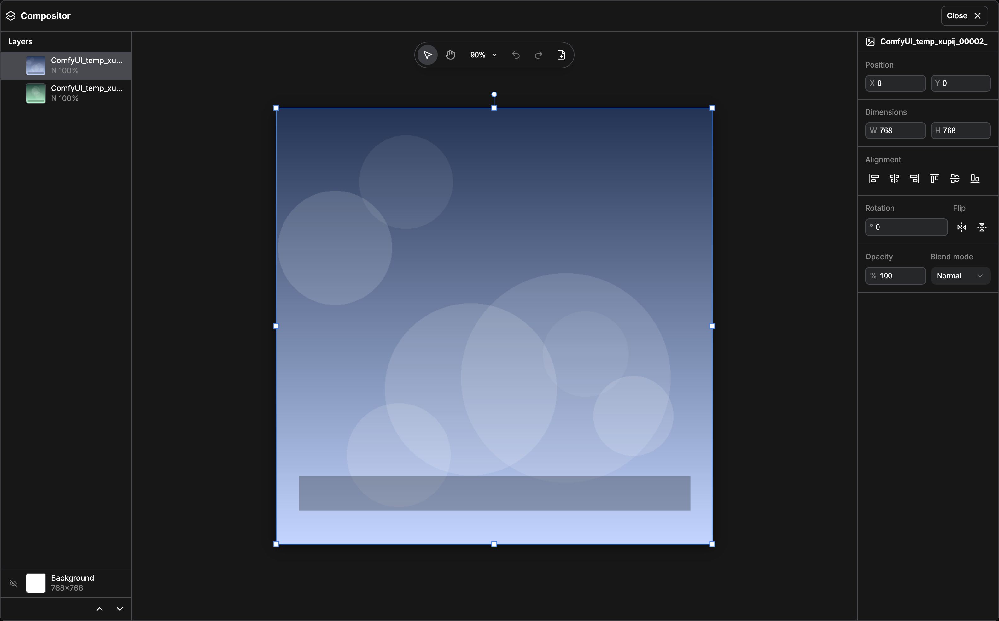

Редактор слоёв представляет собой встроенный редактор в стиле PSD для объединения изображений в один многослойный композит. Вы открываете его из выхода изображения на холсте, наслаиваете два или более изображения в виде слоёв и настраиваете положение, размер, поворот, непрозрачность и режим наложения каждого слоя.

С ним работают входы двух типов:

- **Выходы изображений из любого узла.** Редактор загружает выходные изображения узла как отдельные слои, а готовый композит вы экспортируете в виде файла PSD.
- **Create Layered Image.** [Create Layered Image](/built-in-nodes/ImageCompositor) сохраняет многослойную композицию в необязательный вход `compositor`, который предназначен только для этого узла. Редактор загружает сохранённую композицию и записывает ваши изменения обратно в неё, поэтому при следующем запуске рабочего процесса используется созданная вами композиция. Стек слоёв, который он объединяет, создаётся с помощью [Add Layer](/built-in-nodes/AddLayer) и [Layers From Bounding Boxes](/built-in-nodes/LayersFromBoundingBoxes): эти узлы создают слои, а не сохраняют композицию.

## Открыть редактор слоёв

Открыть редактор с холста можно двумя способами:

1. **Предпросмотр выходного изображения**: наведите курсор на предпросмотр выхода узла, создавшего более одного изображения, и нажмите кнопку слоёв (**Открыть редактор слоёв**) в правом верхнем углу предпросмотра.
2. **Палитра команд**: выберите один узел и выполните **Открыть редактор слоёв для выбранного узла**.

У узла должно быть как минимум два выходных изображения. Если их меньше двух, ComfyUI сообщает, что редактору слоёв нужно не менее двух выходных изображений.

Узел «Создать многослойное изображение» также содержит на самом узле кнопку **Открыть композитор**. Этот способ требует, чтобы рабочий процесс выполнялся хотя бы один раз: иначе входных изображений не будет, и ComfyUI попросит запустить рабочий процесс один раз, чтобы загрузить входные изображения.

## Компоновка редактора

Редактор открывается в диалоговом окне на весь экран и состоит из четырёх областей:

| Область | Расположение | Содержимое |
| --- | --- | --- |
| Заголовок | Верх | Название редактора, **Восстановить** (только в «Создать многослойное изображение») и кнопка закрытия |
| Панель слоёв | Слева | Список слоёв, порядок слоёв, видимость и запись фона |
| Холст | По центру | Предпросмотр композиции в реальном времени и плавающая панель инструментов |
| Панель свойств | Справа | Настройки выбранного слоя или фона, когда ничего не выбрано |

## Инструменты и элементы управления холстом

Панель инструментов расположена над холстом:

- **Выбор**: выбирайте и преобразуйте слои на холсте.
- **Рука**: панорамируйте холст, не изменяя слои.
- **Масштаб**: предустановки масштаба 25%, 50%, 100% и 200%, а также **Вписать**, чтобы поместить всю композицию в область просмотра.
- **Отменить** и **Повторить**: перемещайтесь по истории правок.
- **Экспортировать PSD**: скачайте итоговое изображение в виде файла PSD.

## Работа со слоями

Выберите слой на холсте или на панели «Слои», а затем настройте его на панели свойств:

| Свойство | Что можно изменить |
| --- | --- |
| Положение | Размещение слоя по X и Y на холсте |
| Размеры | Ширина и высота слоя |
| Выравнивание | Выровнять по левому краю, по центру по горизонтали, по правому краю, по верхнему краю, по центру по вертикали или по нижнему краю |
| Поворот | Поворот слоя |
| Отражение | Отразить слой по горизонтали или по вертикали |
| Непрозрачность | Непрозрачность слоя |
| Режим наложения | Как слой смешивается со слоями под ним |

Слои отрисовываются в порядке списка. Используйте действия перемещения вверх и вниз на панели «Слои», чтобы изменить, какой слой лежит сверху, и переключатель видимости, чтобы скрыть слой, не удаляя его.

Режимы наложения: Обычный, Умножение, Экран, Перекрытие, Затемнение, Осветление, Осветление основы, Затемнение основы, Жёсткий свет, Мягкий свет, Разница, Исключение, Линейное осветление, Линейное затемнение, Яркий свет, Точечный свет, Линейный свет, Жёсткое смешивание, Вычитание, Деление, Извлечение зерна, Слияние зерна, Цветовой тон, Насыщенность, Цветность и Яркость.

Выберите пункт **Background** на панели «Слои», чтобы редактировать саму композицию, а не слой: ширину и высоту холста (от 64 до 8192 пикселей) и цвет заливки фона (элемент управления называется **Fill**).

## Сохранить и экспортировать

Изменения, внесённые в Create Layered Image, являются частью рабочего процесса: состояние слоёв автоматически сохраняется в узле, поэтому композиция восстанавливается при повторном открытии рабочего процесса. Узел воспроизводит сохранённую композицию, когда записанные им входы всё ещё соответствуют текущему стеку слоёв; если они больше не соответствуют, он заново собирает композицию из свойств слоёв и помечает сохранённую композицию как устаревшую. Кнопка **Restore** в заголовке отменяет все изменения, сделанные за сеанс, и возвращает холст в состояние, загруженное из узла.

**Export PSD** скачивает композицию в виде PSD-файла со слоями, который можно открыть в графическом редакторе, например Photoshop. Для экспорта требуется WebGL в браузере; если WebGL недоступен, холст не может отрисоваться, и экспорт завершается ошибкой.

## Связанные страницы

<CardGroup cols={3}>
  <Card title="Создать многослойное изображение" icon="layer-group" href="/built-in-nodes/ImageCompositor">
    Объединить стек слоёв в одно изображение.
  </Card>
  <Card title="Добавить слой" icon="layer-group" href="/built-in-nodes/AddLayer">
    Добавить изображение в стек слоёв композитора.
  </Card>
  <Card title="Слои из ограничивающих рамок" icon="layer-group" href="/built-in-nodes/LayersFromBoundingBoxes">
    Построить слои композитора из ограничивающих рамок.
  </Card>
</CardGroup>
