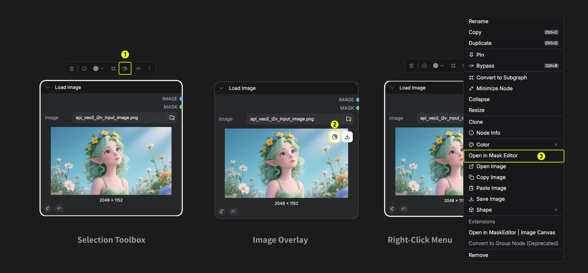
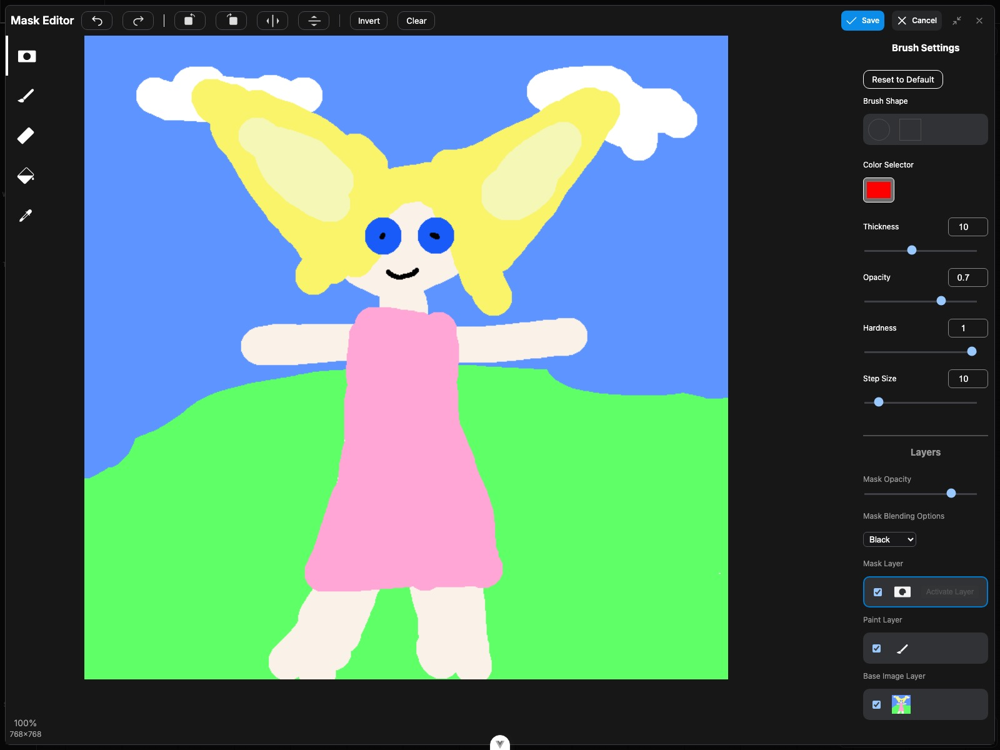
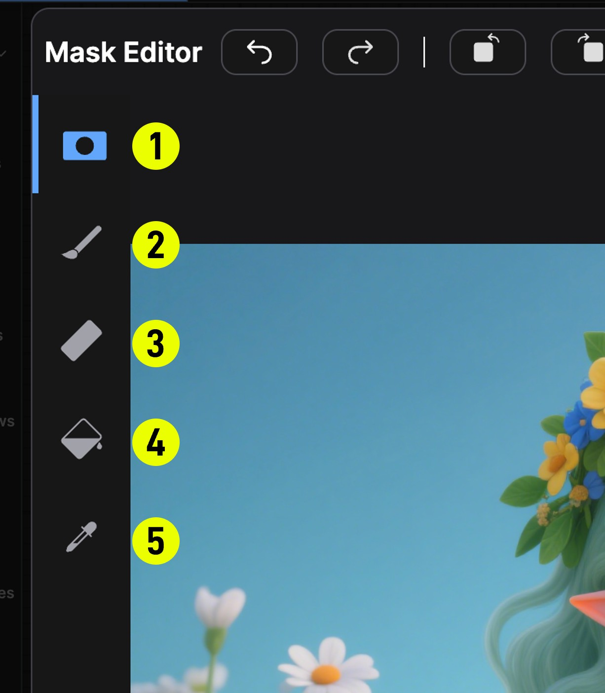
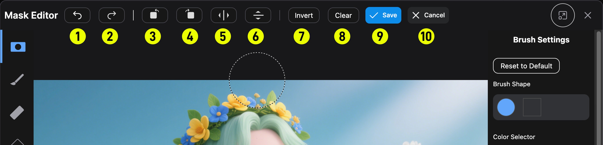

Редактор масок представляет собой встроенный инструмент ComfyUI, который позволяет создавать и редактировать маски прямо на ваших изображениях, без необходимости во внешнем редакторе изображений. Он поддерживает несколько инструментов рисования, управление слоями, отмену и повтор действий, преобразования холста и рендеринг кисти с ускорением на GPU.

---

## Как открыть

Открыть редактор масок можно тремя способами:

1. **Панель выделения**. Выделите узел `Load Image`, затем нажмите кнопку с иконкой маски на панели выделения над узлом.
2. **Перекрытие изображения**. Наведите курсор на просмотр изображения (режим галереи), затем нажмите кнопку **Edit or mask image** (иконка маски), которая появится в левом верхнем углу.
3. **Контекстное меню**. Нажмите правой кнопкой мыши на узел `Load Image` и выберите `Open in Mask Editor` в контекстном меню.

> Редактор масок доступен как в **графовом режиме**, так и в **режиме приложения**.

---

## Обзор интерфейса

Редактор масок открывается как модальное окно с четырьмя основными областями:

| # | Область | Расположение | Описание |
|---|---------|--------------|----------|
| 1 | **Верхняя панель** | Сверху | Заголовок с кнопками отмены/повтора, преобразования холста, инвертирования/очистки и сохранения/отмены |
| 2 | **Панель инструментов** | Слева | Выбор инструмента и информация о масштабе |
| - | **Зона указателя** | По центру | Основная область холста для рисования и редактирования |
| 3 | **Боковая панель** | Справа | Настройки инструмента и управление слоями |

---

## Инструменты

Панель инструментов слева предлагает пять инструментов. Выберите инструмент, чтобы активировать его, и правая панель покажет его настройки.

| # | Инструмент | Слой | Описание |
|---|------|-------|-------------|
| 1 | **Mask Pen** | Маска | Основной инструмент для рисования областей маски. Нажмите левой кнопкой мыши и перетащите, чтобы нарисовать маску на изображении. |
| 2 | **Paint Pen** | RGB (рисование) | Рисование непосредственно на слое RGB изображения. Полезно для инпейтинга или доработки базового изображения. |
| 3 | **Eraser** | Маска / RGB | Стирает части существующей маски или слоя рисования. |
| 4 | **Paint Bucket** | Маска | Инструмент заливки по схожести цвета. Нажмите на пиксель, чтобы залить связанную область маской; нажмите на уже замаскированную область, чтобы стереть её из маски. Параметр «Допуск» определяет, насколько широко распространяется заливка. |
| 5 | **Color Select** | Маска | Избирательно маскирует все пиксели, совпадающие с целевым цветом, с помощью расширенных алгоритмов сопоставления (Simple HSL / LAB).

---

## Действия на верхней панели

Верхняя панель предоставляет операции для всего холста:

| # | Действие | Описание |
|---|--------|-------------|
| 1 | **Отменить** (Ctrl+Z) | Отменить последнее действие |
| 2 | **Повторить** (Ctrl+Shift+Z / Ctrl+Y) | Повторить отменённое действие |
| 3 | **Повернуть влево** | Повернуть все слои на 90° против часовой стрелки |
| 4 | **Повернуть вправо** | Повернуть все слои на 90° по часовой стрелке |
| 5 | **Отразить по горизонтали** | Отразить все слои по горизонтали |
| 6 | **Отразить по вертикали** | Отразить все слои по вертикали |
| 7 | **Инвертировать** | Инвертировать маску (чёрный ↔ белый) |
| 8 | **Очистить** | Очистить всю маску |
| 9 | **Сохранить** | Сохранить маску и закрыть редактор |
| 10 | **Отмена** | Закрыть без сохранения |

> **Примечание**: операции поворота и отражения одновременно затрагивают все три слоя (маску, слой рисования и базовое изображение). Текстуры с ускорением GPU пересоздаются после преобразований.

---

## Слои

Правая панель содержит раздел **Layers**, где можно независимо переключать видимость каждого слоя:

- **Слой маски**: перекрытие маски. Можно настроить **непрозрачность** и **режим наложения**:
  - `Black`: маска отображается как чёрное перекрытие
  - `White`: маска отображается как белое перекрытие
  - `Negative`: инвертированное отображение маски
- **Слой рисования**: слой RGB-рисования (виден при использовании Paint Pen)
- **Базовый слой изображения**: исходное изображение

Нажмите **Activate Layer** на слое, чтобы переключить на него фокус рисования.

Обратитесь к скриншоту основного редактора выше: правая панель содержит настройки кисти и раздел Layers внизу.

---

## Настройки кисти

Когда активен инструмент на основе кисти (Mask Pen, Paint Pen или Eraser), на боковой панели отображаются настройки кисти:

| Параметр | Диапазон | Описание |
|---------|-------|-------------|
| **Форма** | Arc / Rect | Круглая или квадратная кисть |
| **Цвет** | Любой hex-цвет | Цвет краски (для Paint Pen) или цвет маски |
| **Толщина** | 1–250 | Диаметр кисти в пикселях |
| **Непрозрачность** | 0–1 | Прозрачность мазка кисти |
| **Жёсткость** | 0–1 | Мягкость краёв. 1 = жёсткий край, 0 = очень мягкий |
| **Размер шага** | 1–100 | Расстояние между отпечатками кисти. Меньшие значения дают более плавные штрихи |

Используйте **Reset to Default**, чтобы восстановить параметры кисти по умолчанию.

---

## Навигация по холсту и сочетания клавиш

| Сочетание клавиш | Действие |
|----------|--------|
| **Space + перетаскивание** | Перемещение по холсту |
| **Ctrl + прокрутка** | Приближение/отдаление |
| **Нажатие на % масштаба** | Сброс масштаба до 100% |
| **Ctrl + Z** | Отменить |
| **Ctrl + Shift + Z** или **Ctrl + Y** | Повторить |
| **Alt + правый клик + перетаскивание** | Настройка кисти: влево/вправо меняют **размер**, вверх/вниз меняют **жёсткость** |

---

## Настройки

В панели настроек ComfyUI можно задать следующие параметры редактора масок:

| Параметр | Категория | По умолчанию | Описание |
|---------|----------|---------|-------------|
| **Множитель скорости регулировки кисти** | Редактор масок → Настройка кисти → Чувствительность | 1.0 (0.1–2.0) | Насколько быстро изменяются размер и жёсткость кисти при перетаскивании с зажатой клавишей Alt и правой кнопкой мыши |
| **Привязать регулировку кисти к доминирующей оси** | Редактор масок → Настройка кисти → Использовать доминирующую ось | On | Если включено, регулировка изменяет только размер ИЛИ только жёсткость в зависимости от преобладающего направления движения |

## Видеоурок

<video controls>
  <source src="/images/interface/maskeditor/maskeditor.mp4" type="video/mp4"/>
  Ваш браузер не поддерживает тег video.
</video>

> **Примечание**: В этом видео показана более старая версия Редактора масок (Nodes 1.0 UI), в которой демонстрируются настройка размера кисти и создание предпросмотра маски. Общий рабочий процесс в текущей версии остаётся прежним.
