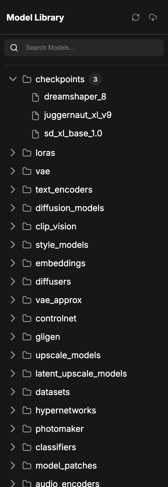

Пункт **Models** в левой боковой панели открывает Библиотеку моделей. После запуска ComfyUI она показывает папки и файлы моделей, обнаруженные в дереве `ComfyUI/models` (а также в дополнительных путях к моделям, которые вы настроили). С её помощью можно искать модели по имени, просматривать их по типу папки, смотреть метаданные и перетаскивать модель на холст, чтобы вставить соответствующий узел загрузки.

Доступность зависит от версии:

- **Локальная установка / Desktop**: в боковой панели отображается дерево папок с локальными файлами моделей. В Desktop текущие загрузки отображаются в верхней части панели, а иконка боковой панели может показывать значок с количеством загрузок.
- **Comfy Cloud**: если система ассетов доступна и включён параметр **Use the asset browser for the model library** (по умолчанию в Cloud), нажатие **Models** открывает браузер ассетов для моделей вместо дерева в боковой панели. Загрузка или импорт собственных весов описаны в разделе [Импорт моделей](/ru/cloud/import-models).

Медиафайлы (изображения, видео, аудио, 3D) здесь не отображаются. Они находятся в разделе [Ассеты](/ru/interface/assets).

## Открыть библиотеку моделей

Нажмите на иконку **Models** на левой боковой панели. Заголовок панели: **Model Library**.

## Просмотр по папкам

Без поискового запроса панель показывает корневые папки моделей (например, `checkpoints`, `loras`, `vae`, `controlnet`, `diffusion_models`, `upscale_models`, `text_encoders` и другие, возвращаемые сервером). Разверните папку, чтобы загрузить её файлы.

По умолчанию корневые папки загружают своё содержимое при открытии. Это можно изменить в настройках:

- **Автоматически загружать все папки моделей** (`Comfy.ModelLibrary.AutoLoadAll`): если включено, каждая папка загружается сразу при открытии библиотеки (на больших библиотеках это может быть медленно). Если выключено (по умолчанию при локальном размещении), папка загружается при её развёртывании. Эта настройка скрыта в Comfy Cloud.
- **Какое имя отображать в дереве библиотеки моделей** (`Comfy.ModelLibrary.NameFormat`): `title` (по умолчанию) использует заголовки из метаданных модели, если они доступны; `filename` показывает упрощённое имя файла без каталога и расширения `.safetensors`.

Если флаг функции «Ассеты» выключен, в заголовке панели рядом с «Обновить» появляется кнопка **Загрузить все папки**.

## Поиск

Поисковая строка в верхней части фильтрует модели по названию и связанным полям, доступным для поиска, по мере ввода. При поиске загружаются все папки, поэтому результаты получаются полными. Результаты автоматически разворачиваются в дереве. Если совпадений больше 500 моделей, панель показывает примечание об ограничении результатов. Уточните запрос, чтобы увидеть остальные.

## Предпросмотр и обновление

Наведите курсор на лист модели, чтобы открыть карточку предпросмотра, когда доступны метаданные. Карточка может показывать название, имя файла, архитектуру, автора, изображение предпросмотра, подсказку по использованию, триггерную фразу и описание.

Используйте кнопку «Обновить» в заголовке панели или нажмите `r` (`Comfy.RefreshNodeDefinitions`) после добавления или удаления файлов моделей, пока ComfyUI запущен. Это обновление также перезагружает списки комбо узлов, чтобы виджеты загрузчиков подхватывали новые файлы.

## Перетащить модель на холст

Листовые элементы моделей можно перетаскивать. Перетащите такой элемент на холст, чтобы создать узел загрузчика, сопоставленный с этой папкой (например, `CheckpointLoaderSimple` для `checkpoints`, `LoraLoader` для `loras`, `VAELoader` для `vae`, `UNETLoader` для `diffusion_models`, `CLIPLoader` для `text_encoders` и другие сопоставления, зарегистрированные во фронтенде). Соответствующий виджет заполняется именем файла модели.

Если для типа папки не зарегистрировано сопоставление загрузчика, при перетаскивании узел может не создаться. Отсутствующие модели, которые ожидает рабочий процесс, всё равно отображаются на вкладке **Errors** панели [Right Side Panel](/ru/interface/right-side-panel), с действиями скачивания или импорта, когда они доступны.

## Связанные настройки

| Настройка | Где | Что делает |
| --- | --- | --- |
| Автоматически загружать все папки моделей | `Comfy` → Библиотека моделей | Загружать все папки при открытии или при развёртывании |
| Формат имени | `Comfy` → Библиотека моделей | Показывать `title` или `filename` в дереве |
| Использовать браузер ассетов для библиотеки моделей | Экспериментальное / ориентировано на облако | Открывать браузер ассетов вместо дерева в боковой панели, когда ассеты включены |

## Связанные страницы

- [Обзор интерфейса](/ru/interface/overview)
- [Ассеты](/ru/interface/assets) (медиафайлы, а не веса моделей)
- [Импорт моделей](/ru/cloud/import-models) (Cloud)
- [Правая боковая панель](/ru/interface/right-side-panel) (ошибки отсутствующих моделей)
- [Настройки Comfy](/ru/interface/settings/comfy) (раздел «Библиотека моделей»)
