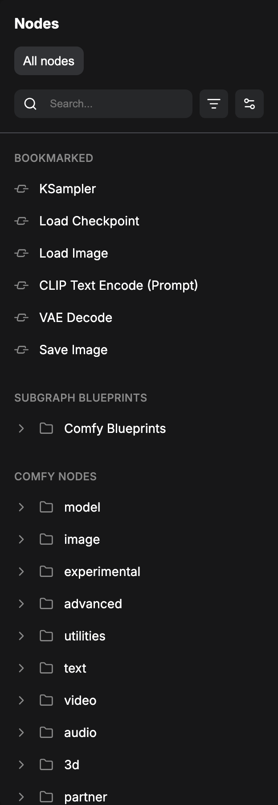
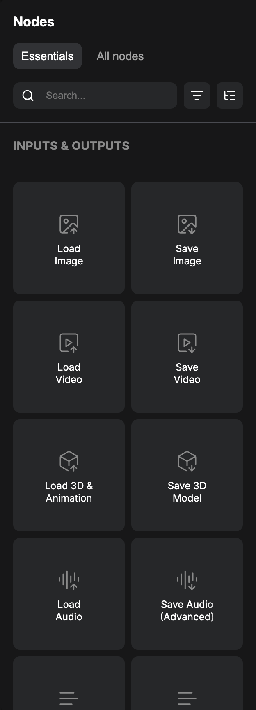
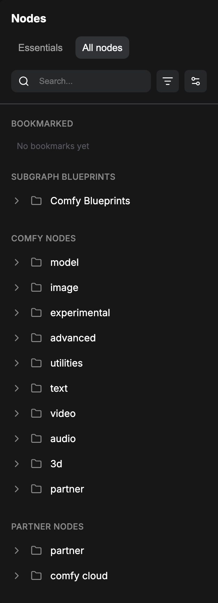

Пункт **Узлы** в левой боковой панели открывает библиотеку узлов. С её помощью можно найти любой узел, доступный в вашем экземпляре ComfyUI: Comfy Core, партнёрские узлы и установленные пользовательские узлы. Панель поддерживает поиск.

Если вкладка **Основное** доступна, панель содержит две вкладки:

- **Основное**: отобранная подборка узлов, которые нужны большинству рабочих процессов, сгруппированная по задачам. Разделы: Входы и выходы, Генерировать (изображение, видео, текст, аудио, 3D), Контроль и управление (изображение) и Редактирование и утилиты (Преобразование изображения, Утилиты для изображений, Фильтры и эффекты для изображений, Цвет изображения, Выделение и маскирование изображения, Преобразование видео, Композиция видео, Выделение и маскирование видео, Преобразование 3D). Наведите курсор на плитку, чтобы просмотреть узел перед добавлением. Перетащите плитку на холст, чтобы добавить узел в рабочий процесс. Кнопка фильтра позволяет показывать только те типы медиа, с которыми вы работаете, а кнопка списка позволяет сразу перейти к нужному разделу.
- **Все узлы**: полный список узлов. Фильтруйте его по Comfy-узлам, партнёрским узлам, расширениям или чертежам, а сортировку переключайте между оригинальным порядком по умолчанию и A-Z.

Нажмите значок закладки у узла на вкладке **Все узлы**, чтобы добавить его в раздел **В избранном** вверху списка.

Вкладка **Основное** появляется, когда её включает бэкенд ComfyUI, что происходит в Comfy Cloud и в nightly-сборках. Самостоятельная стабильная установка показывает только **Все узлы**. Вернуться к прежней панели можно в `Настройки` --> `Comfy` --> `Библиотека узлов`, отключив `Новый дизайн библиотеки узлов`.

## См. также

- [Обзор интерфейса](/ru/interface/overview)
- [Документация по узлам](/ru/interface/features/node-docs)
- [Правая боковая панель](/ru/interface/right-side-panel) (на вкладке Info отображается та же справка для выбранного узла)