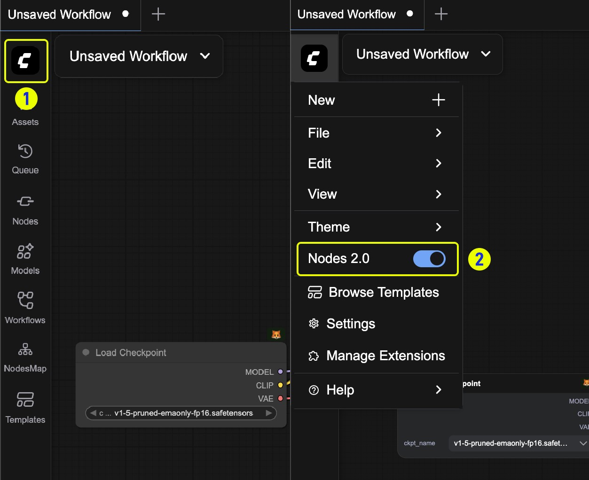

Nodes 2.0 теперь доступно в Comfy Desktop, портативной и стабильной версиях. Это обновление переводит систему узлов с отрисовки через LiteGraph.js Canvas на архитектуру на основе Vue, что открывает путь к более быстрой итерации и более богатым взаимодействиям.

## Почему это изменение?

Прежняя система отрисовки на Canvas стала узким местом разработки. Даже небольшие изменения интерфейса часто требовали глубоких доработок и могли занимать дни. Это замедляло реакцию на отзывы сообщества и усложняло кастомизацию узлов для разработчиков.

Новая система на основе Vue позволяет:

- **Быстрее разрабатывать функции**: изменения интерфейса можно реализовать быстрее
- **Более богатые взаимодействия**: динамические виджеты, раскрываемые узлы и улучшенные компоненты
- **Более гибкая основа**: лучшая поддержка будущих инструментов и кастомизации

## Текущий статус и известные проблемы

Мы активно работаем над улучшениями и хотим быть прозрачными в отношении текущих ограничений:

| Область | Статус |
|------|--------|
| **Производительность** | Продолжаем оптимизацию до уровня производительности Canvas. В некоторых сценариях поведение может отличаться. |
| **Совместимость** | Некоторым пользовательским узлам может потребоваться обновление для полной поддержки. |
| **Крайние случаи** | При экстремальных уровнях масштабирования или в очень больших рабочих процессах могут появляться незначительные визуальные проблемы. |

Мы собираем отзывы, чтобы расставить приоритеты улучшений. Система отрисовки LiteGraph.js по-прежнему доступна, и вы можете переключаться между системами в любой момент.

## Как попробовать

### Включить Nodes 2.0

1. Перейдите на [cloud.comfy.org](https://cloud.comfy.org) или обновитесь до последней версии Comfy Desktop, портативной или стабильной
2. Нажмите **Try it out** на верхнем баннере при запуске ComfyUI

### Что протестировать

Используйте Nodes 2.0 в своих повседневных рабочих процессах и делитесь с нами отзывами:

- **Базовые взаимодействия**: перетаскивание, изменение размера, выделение
- **Повседневные рабочие процессы**: выполнение, параметры, пользовательские узлы
- **Производительность**: особенно со сложными рабочими процессами

## Как оставить отзыв

Столкнулись с проблемами или есть предложения по улучшению взаимодействия?

- **Центр поддержки**: [ComfyUI Help Center](https://support.comfy.org)
- **Проблемы на GitHub**: [Создайте issue в ComfyUI_frontend](https://github.com/Comfy-Org/ComfyUI_frontend/issues)

<Tip>
При сообщении о проблемах крайне полезно приложить шаги воспроизведения, скриншоты и информацию о системе.
</Tip>

## Как вернуться к прежнему интерфейсу

Если вы столкнулись с проблемами:

1. Нажмите на **логотип ComfyUI**, чтобы открыть меню
2. Переключите **Nodes 2.0**, чтобы вернуться к прежнему интерфейсу

Ваша обратная связь помогает нам расставлять приоритеты улучшений. Включите Nodes 2.0 в настройках и начните знакомство с новым дизайном узлов!