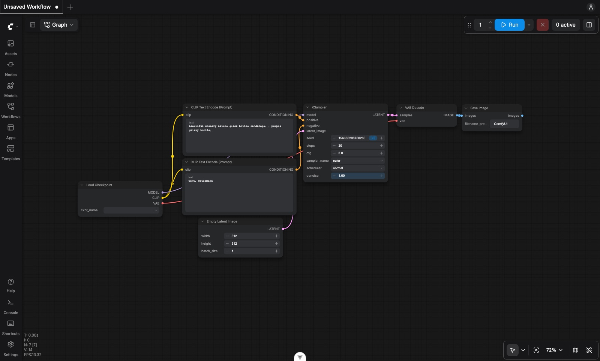
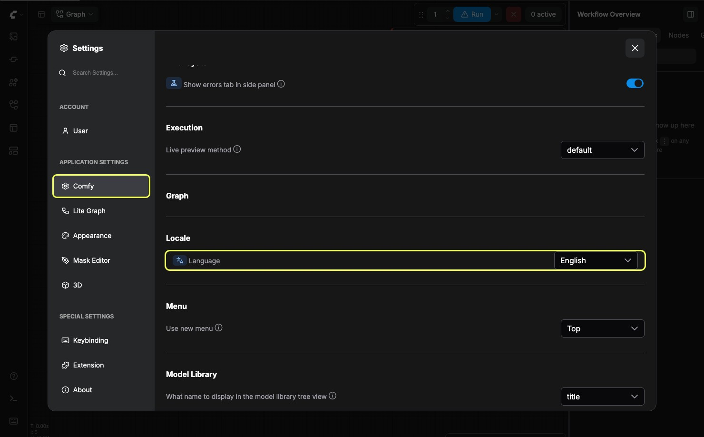
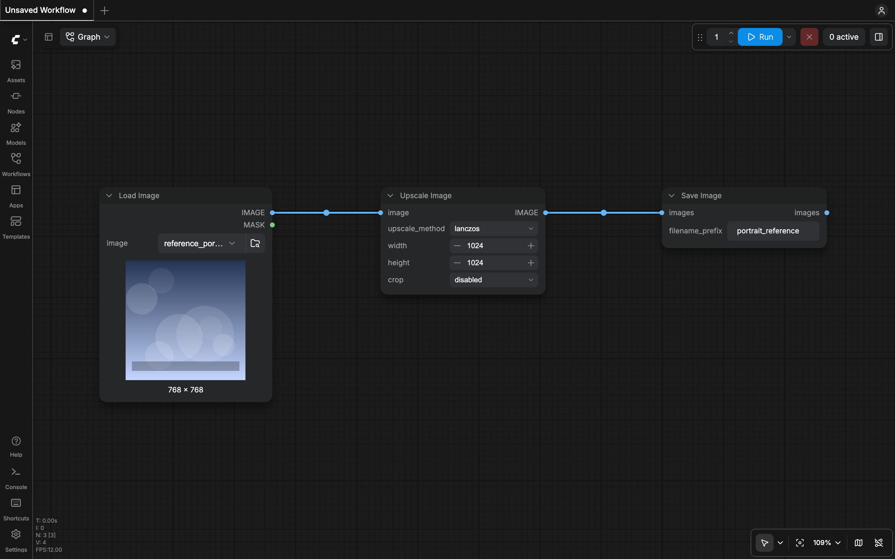
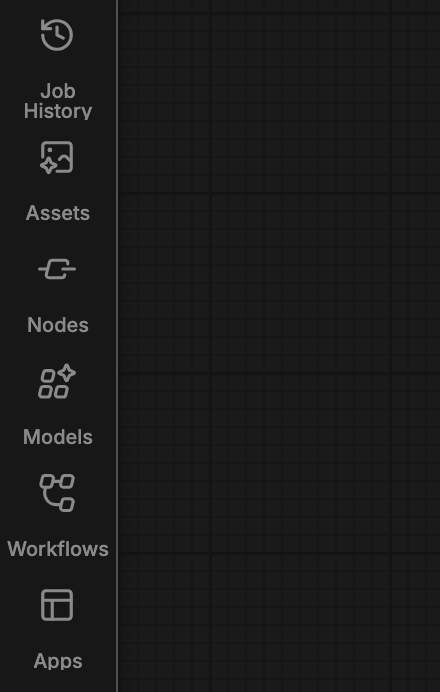
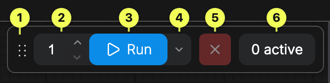

С помощью визуального интерфейса большинство людей управляет [сервером ComfyUI](/ru/development/comfyui-server/comms_overview). Используйте эту страницу как карту интерфейса, а затем открывайте связанные руководства по каждой области и компоненту.

[Фронтенд ComfyUI](https://github.com/Comfy-Org/ComfyUI_frontend) поддерживается как отдельный проект. Вклад следует вносить в этот репозиторий.

## Локализация

ComfyUI поддерживает английский, китайский, русский, французский, японский и корейский языки. Откройте **Настройки**, затем в разделе `Comfy` → `Locale` выберите нужный язык.

## Карта рабочего пространства

Номера на скриншоте соответствуют областям ниже:

| # | Область | Что это |
| --- | --- | --- |
| **1** | **Левая боковая панель** | Ассеты, Библиотека нод, Библиотека моделей, Рабочие процессы, Приложения и (если включено) История задач |
| **2** | **Холст** | Граф, в котором вы размещаете и соединяете узлы, а также элементы управления холстом |
| **3** | **Панель справа** | Параметры, информация о ноде, настройки и ошибки для текущего выделения (открывается переключателем свойств в верхней панели) |
| **4** | **Верхняя панель** | Открытие рабочих процессов, элементы управления Run и очередью, вход и переключатель панели свойств |
| **5** | **Слева внизу** | Центр поддержки, нижняя панель (логи и горячие клавиши) и Настройки |
| **6** | **Справа внизу** | Управление холстом: панорамирование, мини-карта, видимость связей, масштаб, вписать |

### Левая боковая панель

Значки на левой панели, сверху вниз. **История задач** появляется вверху только при включённом `Comfy.Queue.QPOV2`:

<Columns cols={2}>
  <Card title="Ассеты" icon="images" href="/ru/interface/assets">
    Сгенерированные и импортированные медиафайлы: просмотр, повторное использование, скачивание, удаление
  </Card>
  <Card title="Библиотека нод" icon="cubes" href="/ru/interface/node-library">
    Сетка Основное и полный список нод, избранное, поиск
  </Card>
  <Card title="Библиотека моделей" icon="box" href="/ru/interface/model-library">
    Модели, обнаруженные в вашей папке моделей
  </Card>
  <Card title="Рабочие процессы" icon="folder-tree" href="/ru/interface/workflows">
    Локально сохранённые рабочие процессы и недавние файлы
  </Card>
  <Card title="Приложения" icon="grid-2" href="/ru/interface/apps">
    Элемент боковой панели Apps; см. также режим приложения в разделе Компоненты функций
  </Card>
  <Card title="История задач" icon="clock-rotate-left" href="/ru/interface/job-history">
    Очередь и история заданий при включённом QPOV2
  </Card>
</Columns>

### Панель справа

<Columns cols={2}>
  <Card title="Панель справа" icon="panel-right" href="/ru/interface/right-side-panel">
    Параметры, Информация (документация по ноде), Настройки, Ошибки
  </Card>
</Columns>

### Холст

<Columns cols={2}>
  <Card title="Управление холстом" icon="arrows-up-down-left-right" href="/ru/interface/canvas-controls">
    Мини-карта, связи, информация о холсте, масштаб, вписать, Режим фокуса
  </Card>
  <Card title="Ноды 2.0" icon="sitemap" href="/ru/interface/nodes-2">
    Оформление нод, заголовки и поведение при выборе
  </Card>
</Columns>

### Панель запуска

Плавающая панель запуска расположена в верхней части холста и содержит всё необходимое для запуска и контроля выполнения: количество пакетов, Run, режим очереди, отмену и число активных заданий.

| # | Элемент управления | Что он делает |
| --- | --- | --- |
| **1** | **Ручка перетаскивания** | Перемещает панель в любое место холста. Во время перетаскивания появляется зона **Закрепить сверху**, позволяющая вернуть панель к верхнему краю. |
| **2** | **Количество пакетов** | Сколько раз рабочий процесс ставится в очередь за один запуск (по умолчанию `1`). Введите значение или используйте стрелки вверх и вниз. |
| **3** | **Run** | Ставит рабочий процесс в очередь. Удерживайте `Shift`, чтобы поставить его в начало очереди, а не в конец. |
| **4** | **Меню режима очереди** | Выберите, когда рабочий процесс ставится в очередь сам: **Run** (только по нажатию), **Run (On Change)** (снова ставится в очередь при любом изменении рабочего процесса) или **Run (Instant)** (снова ставится в очередь, как только завершится текущий запуск). |
| **5** | **Отмена** | Останавливает выполняющийся сейчас запуск. Недоступна, пока очередь простаивает. |
| **6** | **Активные задания** | Число заданий в очереди и выполняющихся. Нажмите, чтобы открыть очередь, щёлкните правой кнопкой, чтобы очистить её. |

### Нижняя панель и справка

<Columns cols={2}>
  <Card title="Нижняя панель" icon="terminal" href="/ru/interface/bottom-panel">
    Горячие клавиши, логи и (в десктопной версии) терминал команд
  </Card>
  <Card title="Центр поддержки" icon="circle-question" href="/ru/interface/help-center">
    Примечания к выпуску, документация, поддержка, обратная связь
  </Card>
</Columns>

## Компоненты функций

Переиспользуемые возможности интерфейса, не привязанные к конкретной области оформления рабочего пространства.

<Columns cols={2}>
  <Card title="Шаблоны" icon="copy" href="/ru/interface/features/template">
    Встроенные шаблоны рабочих процессов
  </Card>
  <Card title="Режим приложения" icon="mobile" href="/ru/interface/app-mode">
    Линейный интерфейс в стиле приложения для запуска рабочих процессов
  </Card>
  <Card title="Подграф" icon="diagram-nested" href="/ru/interface/features/subgraph">
    Свернуть графы в переиспользуемые узлы подграфов
  </Card>
  <Card title="Частичное выполнение" icon="play" href="/ru/interface/features/partial-execution">
    Выполнять только часть рабочего процесса
  </Card>
  <Card title="Документация по узлам" icon="book" href="/ru/interface/features/node-docs">
    Справка по узлам в приложении (также на вкладке RSP Info)
  </Card>
  <Card title="Динамические входы" icon="plus" href="/ru/interface/features/autogrow-inputs">
    Динамические входы, растущие по мере подключения
  </Card>
  <Card title="Редактор масок" icon="brush" href="/ru/interface/maskeditor">
    Рисуйте и редактируйте маски на холсте
  </Card>
</Columns>

## Настройки

<Columns cols={2}>
  <Card title="Настройки" icon="gear" href="/ru/interface/settings/overview">
    Полное диалоговое окно настроек по категориям
  </Card>
</Columns>

## Аккаунт и кредиты

<Columns cols={2}>
  <Card title="Пользователь" icon="user" href="/ru/interface/user">
    Настройки аккаунта и профиля
  </Card>
  <Card title="План и кредиты" icon="coins" href="/ru/interface/credits">
    Баланс, пополнение, активность использования и счета Cloud
  </Card>
</Columns>

## Только в Cloud

<Columns cols={3}>
  <Card title="Рабочие пространства" icon="users" href="/ru/cloud/workspace">
    Командные рабочие пространства в Comfy Cloud
  </Card>
  <Card title="Поделиться рабочим процессом" icon="share-nodes" href="/ru/cloud/share-workflow">
    Делитесь рабочими процессами из Cloud
  </Card>
  <Card title="Импорт моделей" icon="cloud-arrow-up" href="/ru/cloud/import-models">
    Загружайте собственные модели в Cloud
  </Card>
</Columns>
