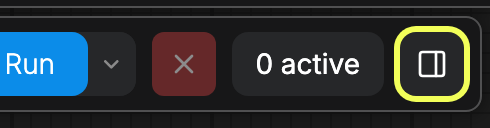
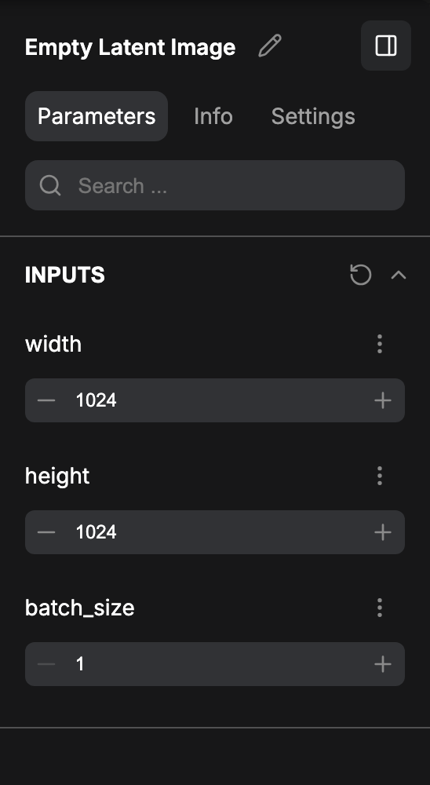
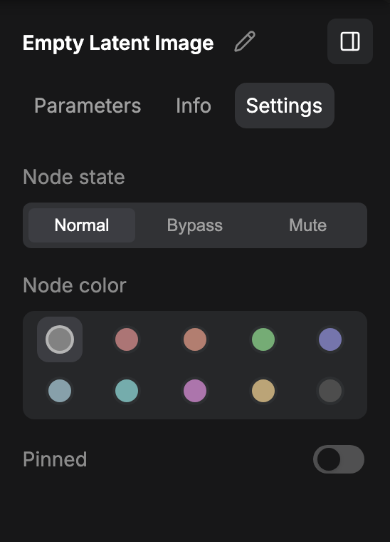
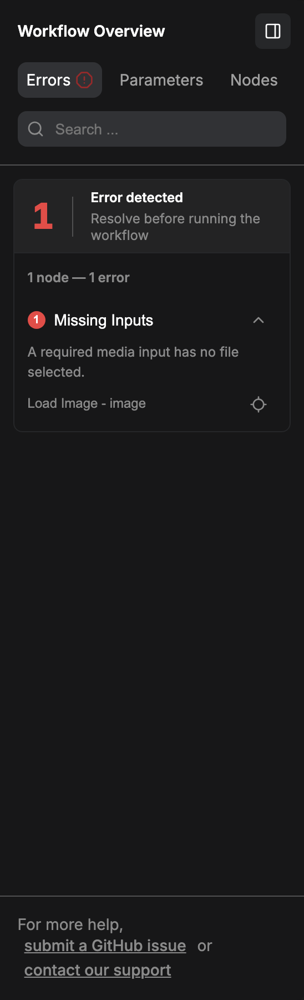
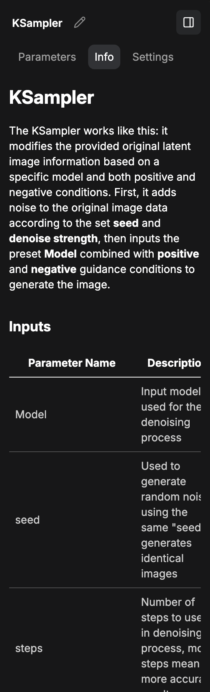
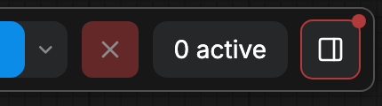

Панель справа представляет собой панель свойств у правого края рабочего пространства ComfyUI. Она отображает параметры, информацию и настройки того, что выбрано на холсте, делает наиболее часто используемые входы доступными в один щелчок и перечисляет ошибки рабочего процесса вместе со способами их исправления.

## Открыть и закрыть панель

Нажмите на иконку панели в правой верхней области управления, чтобы открыть панель. Во всплывающей подсказке кнопки указано: **Toggle properties panel**. Если в рабочем процессе есть ошибки, а панель закрыта, на кнопке появляется красная точка, поэтому панель можно открыть сразу со списком ошибок. Чтобы закрыть панель, нажмите на иконку в её заголовке.

ComfyUI запоминает состояние панели между сеансами.

## Панель следует за выбранным

Заголовок и доступные вкладки меняются в зависимости от того, что выбрано на холсте:

| Что выбрано | Заголовок панели | Вкладки |
| --- | --- | --- |
| Ничего | Обзор рабочего процесса | Параметры, Узлы, Настройки |
| Один узел | Имя узла | Параметры, Информация, Настройки, а также Ошибки, когда это уместно |
| Один узел подграфа | Имя узла | Параметры, Настройки, а также Ошибки, когда это уместно, и кнопка **Редактировать подграф** |
| Несколько элементов | Количество выбранных элементов | Узлы, Настройки, а также Ошибки, когда это уместно |

Нажмите кнопку с карандашом рядом с заголовком, чтобы переименовать выбранный узел или группу. Для узла подграфа в заголовке также отображается кнопка **Редактировать подграф**, которая открывает редактор подграфа внутри панели.

Вкладка «Ошибки» появляется, когда в выделении есть соответствующие ошибки, когда ничего не выбрано и рабочий процесс содержит ошибки, а также когда рабочий процесс использует устаревшие узлы, у которых есть замена. Вы можете полностью скрыть вкладку с помощью настройки **Показывать вкладку ошибок на боковой панели** в разделе `Comfy` → `Error System`.

### Параметры

Когда выбран один узел, вкладка **Параметры** перечисляет его входы в разделе **ВХОДНЫЕ ДАННЫЕ**. Когда выбрано несколько элементов, тот же вид называется **Узлы** и перечисляет входы каждого выбранного элемента. В обоих видах сверху есть поле поиска и сворачиваемый раздел для каждого узла. Входы, отмеченные как расширенные, собраны в отдельном разделе **РАСШИРЕННЫЕ ВХОДНЫЕ ДАННЫЕ**. У каждого входа есть меню действий с пунктами **Переименовать**, **В избранное** и **Сбросить по умолчанию**, а также **Скрыть вход** для входов, вынесенных из подграфа. Когда выбрано несколько узлов, в каждом разделе также есть кнопка, чтобы найти его узлы на холсте.

Когда ничего не выбрано, эта же вкладка вместо этого показывает ваши избранные входы, чтобы вы могли менять значения, которые изменяете чаще всего, не выбирая узел.

### Узлы

Вкладка **Узлы** отображается, когда ничего не выбрано. Она перечисляет все узлы рабочего процесса вместе с их входами, с поиском и сворачиванием, чтобы вы могли просмотреть или отредактировать любой узел из одного места. Это же название использует вид параметров, когда выбрано несколько элементов.

### Информация

Вкладка **Информация** появляется для одного выбранного узла, который не является подграфом. Она показывает то же справочное содержимое [документации по узлу](/ru/interface/features/node-docs), которое вы получаете по значку документации в панели инструментов выделения и по кнопке справки в Nodes 2.0.

### Настройки

При наличии выделения вкладка **Настройки** охватывает выбранные узлы и группы:

- **Состояние узла**: **Normal**, **Bypass** или **Mute**.
- **Цвет узла**: выберите цвет узла.
- **Закреплён**: закрепляет узел, чтобы он оставался на месте на холсте.

Изменения применяются к каждому элементу выделения, поэтому вы можете задать одинаковое состояние или цвет сразу для всей группы. Для групп доступны только элементы управления цветом и закреплением.

Когда ничего не выбрано, вкладка называется **Глобальные настройки** и собирает быстрые переключатели, повторяющие полный диалог настроек:

- **Узлы**: Показать расширенные параметры, Показывать панель инструментов при выборе, Nodes 2.0.
- **Холст**: Шаг сетки, Привязывать узлы к сетке.
- **СВЯЗИ**: Форма связи, Показывать соединённые связи.
- **Просмотреть все настройки**: открывает полный диалог настроек.

### Ошибки

Вкладка **Ошибки** объединяет проблемы, которые блокируют рабочий процесс, а также уведомления об узлах, у которых есть более новая замена, чтобы вы могли решить их перед запуском:

- **Ошибки узлов**: узел, в котором произошла ошибка, сообщение об ошибке, элементы **Развернуть** и **Свернуть**, а также **Найти узел на холсте**.
- **Отсутствующие пакеты узлов**: **Install All**, **Apply Changes** и **View in Manager**, если доступен ComfyUI Manager. В Comfy Cloud эта группа вместо этого называется **Unsupported Node Packs**, поскольку там нельзя устанавливать пакеты узлов.
- **Отсутствующие модели**: **Download** для одного файла или **Download all**, **Import** в Comfy Cloud для моделей, которые вы предоставляете сами, а также примечание, когда модель имеет ограниченный доступ на Hugging Face и требует аккаунта со входом и принятой лицензией.
- **Отсутствующие входные данные**: входные медиаданные, которые ожидает рабочий процесс, но не может найти.
- **Устаревшие узлы**: установленные узлы, которые всё ещё работают, но имеют более новую замену. Эта группа это уведомление, а не ошибка: она не открывает оверлей ошибок, не добавляет значки на холст и не учитывается в индикаторе ошибок. Используйте **Заменить** в строке или **Заменить все** для всей группы.
- **Журнал ошибок** и ссылки, чтобы отправить issue на GitHub или связаться с поддержкой.

Comfy Cloud сообщает о выходах, которые запуск пропускает. Когда ComfyUI принимает запуск, но пропускает некоторые выходы, поскольку их узлы не проходят валидацию, например из-за отсутствующего файла чекпойнта, выходы, которые всё же выполнились, по-прежнему отображаются, а пропущенные узлы становятся красными. Ошибки перечислены в разделе **Ошибки узлов**, и оверлей ошибок открывается для запуска на экране, когда включена настройка **Показывать вкладку ошибок на боковой панели**.

## Добавление входов в избранное

Избранные входы это ярлыки панели. Откройте вкладку Parameters, нажмите меню действий на любом входе и выберите **В избранное**. После этого избранные входы отображаются в панели, когда ничего не выбрано, где их можно искать и менять их порядок. Используйте **Убрать из избранного** в том же меню, чтобы удалить вход из списка.

## Связанные разделы

- [Обзор интерфейса](/ru/interface/overview): описание областей рабочего пространства.
- [Настройки ComfyUI](/ru/interface/settings/overview): полное описание диалога настроек.
- [Документация по узлам](/ru/interface/features/node-docs) (то же содержимое справки, что и на вкладке Info).
- [Библиотека нод](/ru/interface/node-library).
