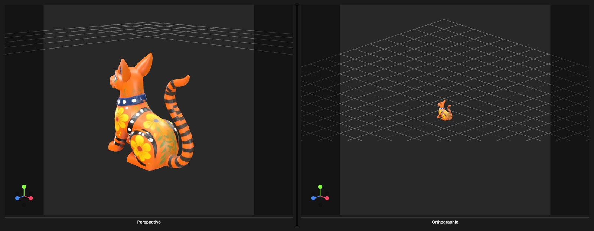
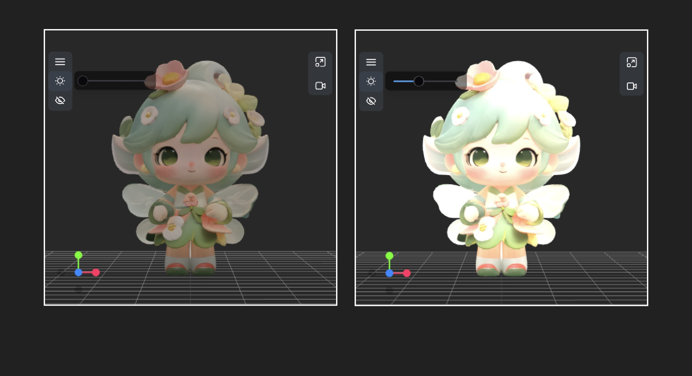
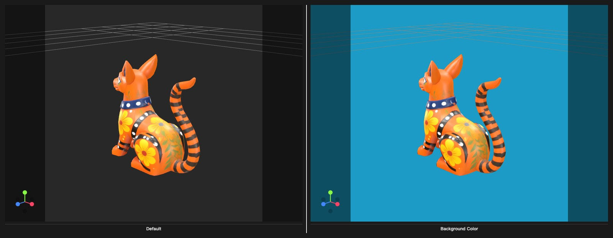
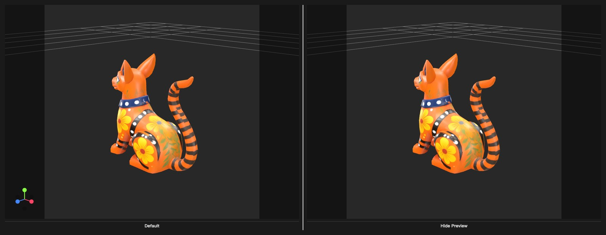
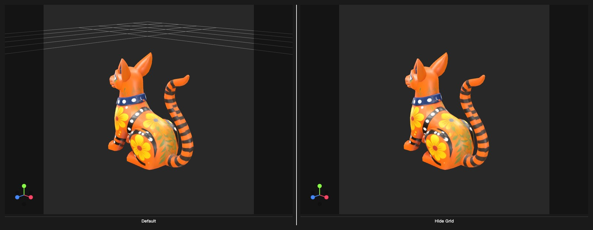

import SettingsMenuContext from "/snippets/ru/interface/settings-menu-context.mdx"

<SettingsMenuContext />

Этот раздел настроек в основном служит для управления параметрами инициализации компонентов, связанных с 3D, в ComfyUI, включая камеру, освещение, сцену и т.д. При создании новых 3D-компонентов они инициализируются в соответствии с этими настройками. После создания эти настройки по-прежнему можно изменять отдельно для каждого компонента.

## Камера

### Начальный тип камеры
- **Параметры**:
  - `perspective`
  - `orthographic`
- **Назначение**: определяет, будет ли камера по умолчанию перспективной или ортографической при создании новых 3D-компонентов. Этот параметр по умолчанию можно afterwards переключать отдельно для каждого компонента после его создания.

## Свет

Настройки освещения в этом разделе задают освещение по умолчанию для 3D-компонентов. Соответствующие параметры можно также изменить в настройках 3D в ComfyUI.

### Шаг регулировки освещения
- **Значение по умолчанию**: 0.5  
- **Назначение**: управляет размером шага при регулировке интенсивности света в 3D-сценах. Меньшие значения шага позволяют настраивать свет точнее, а большие делают каждую корректировку более заметной  

### Минимальная интенсивность освещения
- **Значение по умолчанию**: 1  
- **Назначение**: задаёт минимальное допустимое значение интенсивности света в 3D-сценах. Это определяет наименьшую яркость, которую можно установить при регулировке освещения любого 3D-элемента управления  

### Максимальная интенсивность освещения
- **Значение по умолчанию**: 10  
- **Назначение**: задаёт максимальное допустимое значение интенсивности света в 3D-сценах. Это определяет верхний предел яркости, который можно установить при регулировке освещения любого 3D-элемента управления  
  

### Начальная интенсивность освещения
- **Значение по умолчанию**: 3  
- **Назначение**: задаёт уровень яркости света по умолчанию в 3D-сценах. Это значение определяет, насколько интенсивно свет освещает объекты при создании новых 3D-элементов управления, но после создания каждый элемент можно настроить отдельно

## Сцена
  
### Начальный цвет фона    
- **Назначение**: управляет цветом фона по умолчанию для 3D-сцен. Этот параметр определяет внешний вид фона при создании новых 3D-компонентов, но после создания каждый компонент можно настроить отдельно  
- **Значение по умолчанию**: `282828` (тёмно-серый)  

Измените цвет фона, который также можно настроить на холсте.

### Начальная видимость предпросмотра
- **Назначение**: управляет тем, отображается ли экран предпросмотра по умолчанию при создании новых 3D-компонентов. Этот параметр по умолчанию можно затем переключать отдельно для каждого компонента после создания  
- **Значение по умолчанию**: true (включено)  

  
### Начальная видимость сетки
- **Назначение**: управляет тем, отображается ли сетка по умолчанию при создании новых 3D-компонентов. Этот параметр по умолчанию можно затем переключать отдельно для каждого компонента после создания  
- **Значение по умолчанию**: true (включено)

Скрыть или показать сетку при инициализации

## 3D Просмотрщик (Бета)

3D Просмотрщик (Бета) открывает 3D-модель в полноразмерном окне, отдельном от предпросмотра внутри узла. С его помощью можно осмотреть модель, настроить её размещение и экспортировать её.

Выберите один узел Load 3D на холсте, затем нажмите кнопку просмотрщика на панели инструментов выделения. Кнопка открывает окно **3D Просмотрщик (Бета)**, которое можно развернуть на весь экран.

### Включить 3D просмотрщик (Бета)

- **Параметры**:
  - enabled
  - disabled
- **Значение по умолчанию**: enabled
- **Функция**: определяет, появляется ли кнопка просмотрщика на панели инструментов выделения, когда выбран один узел Load 3D. Если параметр отключён, кнопка не появляется. В списке настроек у параметра есть отметка «Бета».

### Панели просмотрщика

У просмотрщика есть собственные панели для сцены, камеры, освещения, модели, гизмо, анимации и экспорта:

- **Сцена**: цвет фона, видимость сетки и фоновое изображение, отрисованное в плиточном режиме или в режиме панорамы
- **Камера**: тип камеры и угол обзора
- **Свет**: интенсивность света
- **Модель**: направление вверх и режим материала
- **Гизмо**: перемещение, поворот или масштабирование модели в окне просмотра
- **Анимация**: воспроизведение клипов анимации, хранящихся в файле, с управлением скоростью и перемоткой
- **Экспорт**: сохранение загруженной модели. Файлы сеток экспортируются в форматах GLB, OBJ, STL или FBX, а файлы облака точек и Gaussian splat сохраняют исходный формат

Изменения, внесённые в просмотрщике, записываются в узел при закрытии просмотрщика. Нажмите **Отмена**, чтобы закрыть просмотрщик без изменения узла.

## Облако точек

### Движок PLY

- **Варианты**:
  - `threejs`
  - `fastply`
- **Значение по умолчанию**: `threejs`
- **Назначение**: выбирает движок, который загружает PLY-файлы облаков точек. `threejs` использует встроенный Three.js PLYLoader, который читает двоичные и ASCII-файлы и может загружать меши. `fastply` использует оптимизированный парсер для ASCII-файлов PLY. Файлы 3D Gaussian Splat обнаруживаются автоматически и всегда используют рендерер Gaussian splat, какой бы движок здесь ни был выбран.
