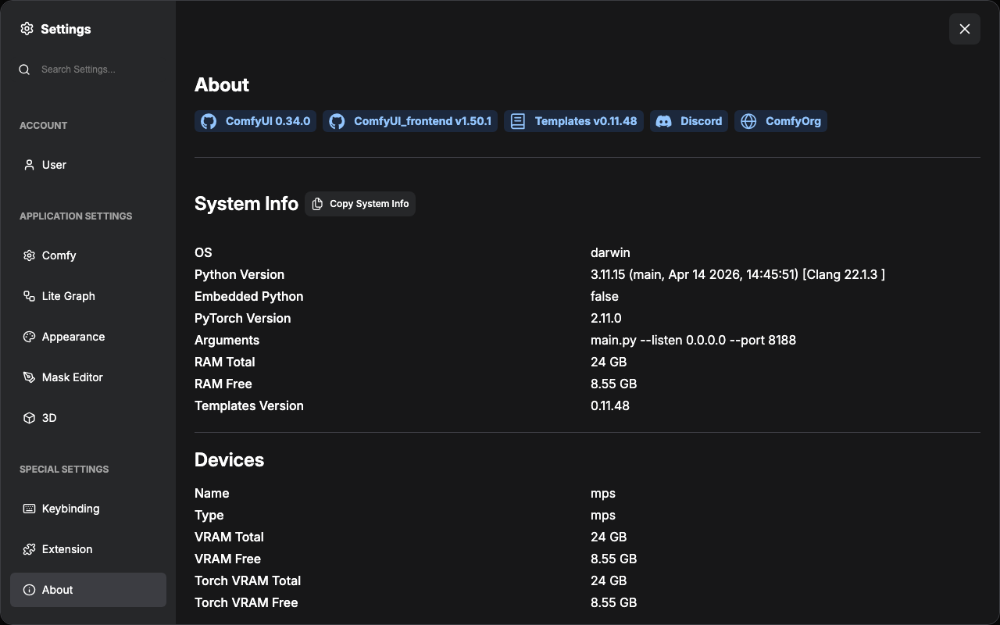

import SettingsMenuContext from "/snippets/ru/interface/settings-menu-context.mdx"

<SettingsMenuContext />

Страница About это информационная панель в системе настроек ComfyUI. Она показывает версию приложения, связанные ссылки и системную статистику. Эти данные дают важную информацию, когда вы отправляете отзыв или сообщаете о проблеме.



### Бейджи информации о версии

Страница About показывает следующие основные сведения о версии:

- **ComfyUI Version**: номер версии бэкенда ComfyUI со ссылкой на официальный репозиторий GitHub
- **ComfyUI_frontend Version**: номер версии интерфейса со ссылкой на репозиторий фронтенда на GitHub
- **Discord Community**: ссылка на сервер ComfyOrg в Discord
- **Official Website**: ссылка на официальный сайт ComfyOrg

<Tip>
Здесь показана в основном информация о стабильной версии, поэтому при использовании nightly-сборки соответствующий хеш коммита на этой странице не отображается. Если вы используете nightly-сборку, хеш коммита и другие сведения можно посмотреть командой `git log` в каталоге ComfyUI.
Ещё одна частая ситуация: при обновлении разные пакеты зависимостей могут не установиться и откатиться.
</Tip>

### Бейджи пользовательских узлов

Если установлены пользовательские узлы, страница About также показывает дополнительные бейджи от них. Каждый пользовательский узел регистрирует такие бейджи через свойство `aboutPageBadges`.

### Системная информация

В нижней части страницы отображается подробная системная статистика, в том числе:
- сведения о конфигурации оборудования
- сведения о программном окружении
- данные о производительности системы

## Руководство для разработчиков расширений

Разработчики расширений могут добавлять собственные бейджи на страницу About, указав свойство `aboutPageBadges` в конфигурации расширения:

```javascript
app.registerExtension({
  name: 'MyExtension',
  aboutPageBadges: [
    {
      label: 'My Extension v1.0.0',
      url: 'https://github.com/myuser/myextension',
      icon: 'pi pi-github'
    }
  ]
})
```
