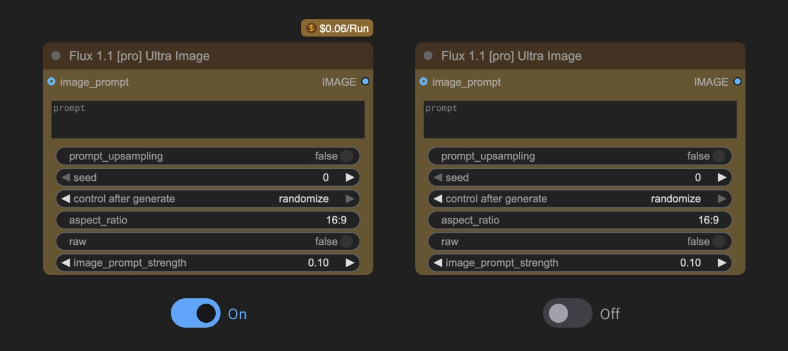
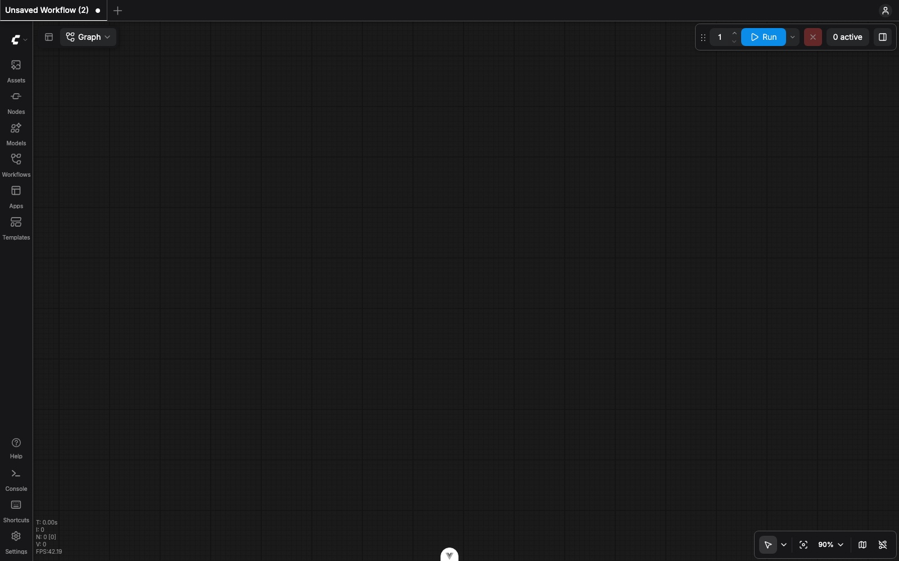
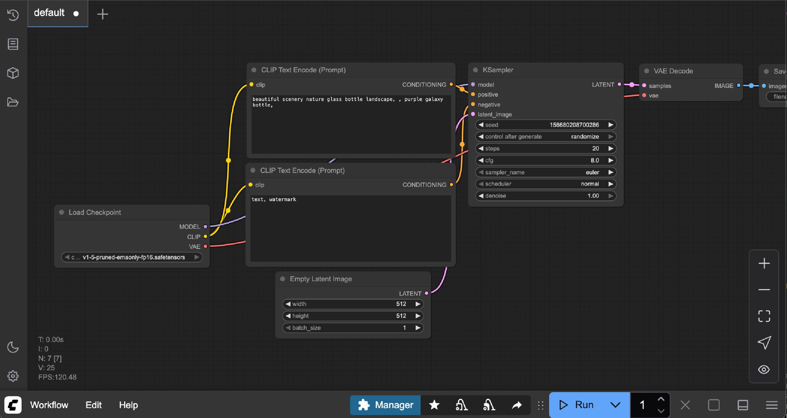
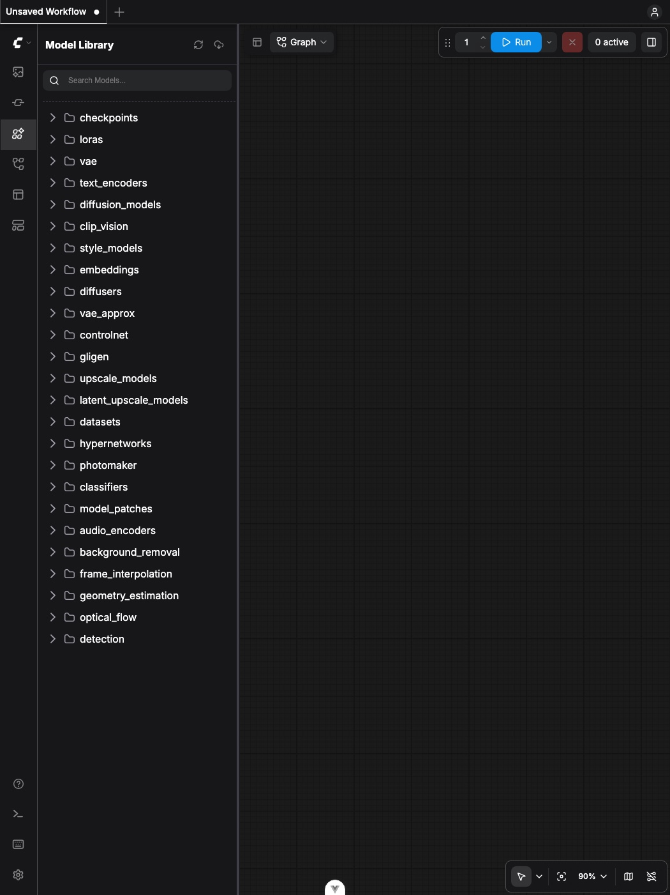
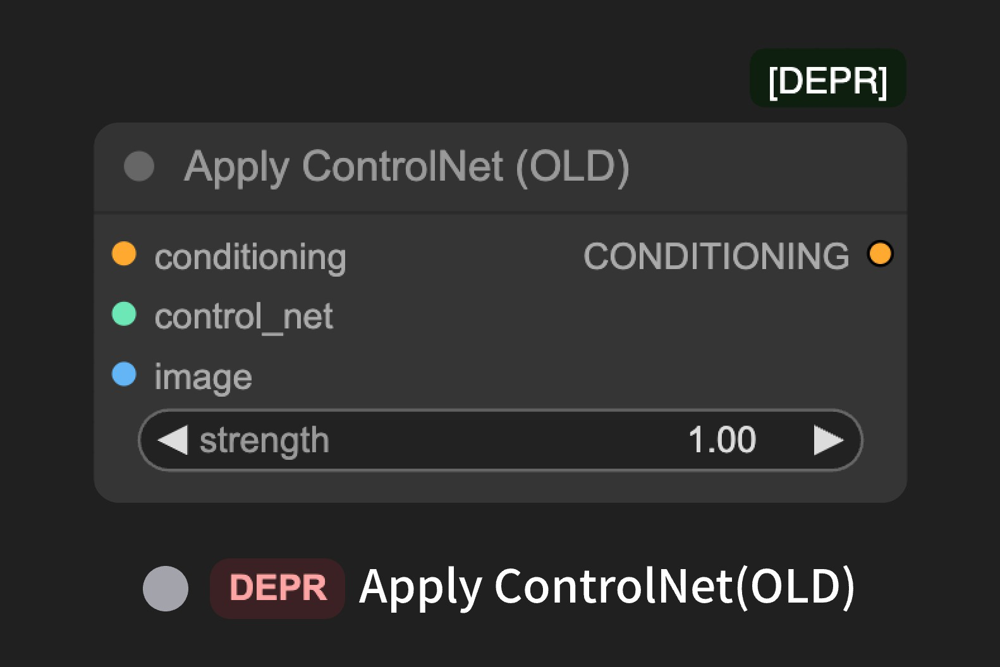
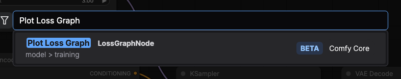
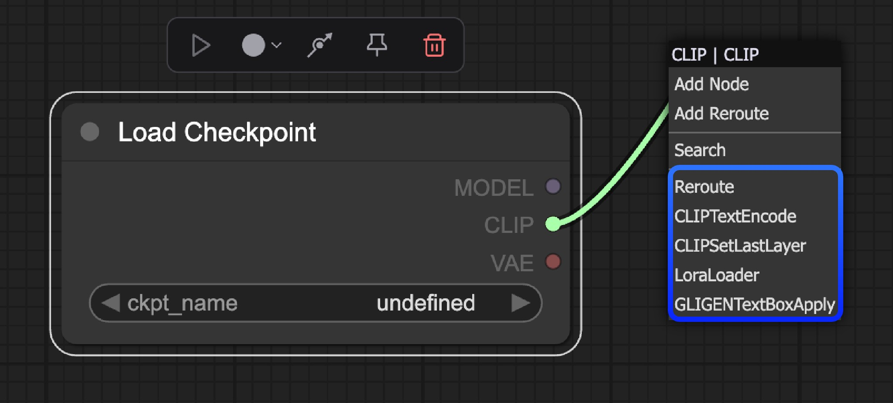
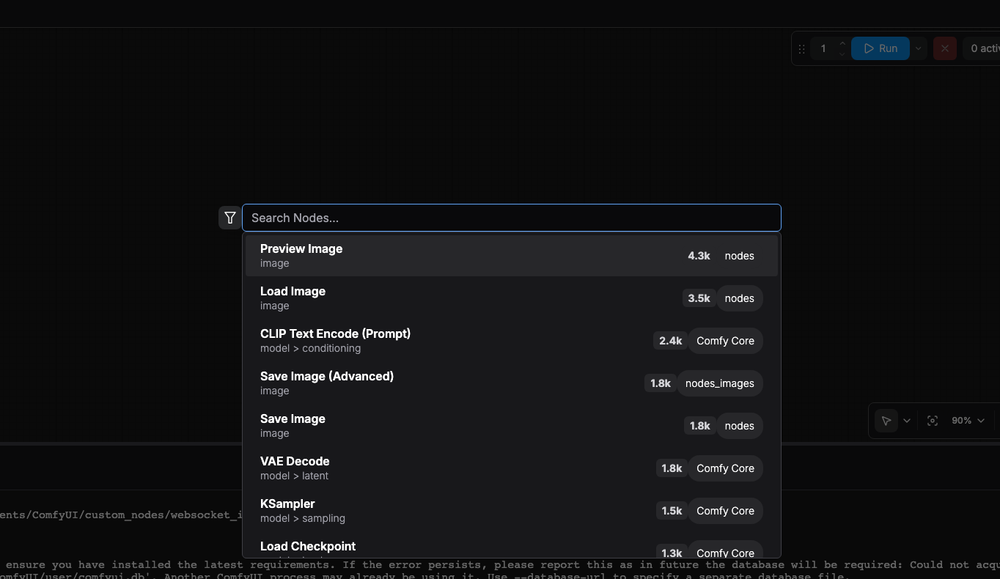
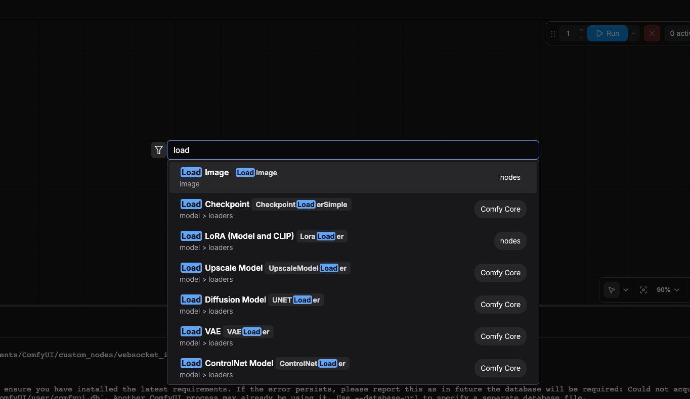

import SettingsMenuContext from "/snippets/ru/interface/settings-menu-context.mdx"

<SettingsMenuContext />

## Партнёрские узлы

### Show Partner Node pricing badge
- **Значение по умолчанию**: Enabled
- **Функция**: Определяет, отображать ли значки с ценой на Партнёрских узлах, помогая пользователям узнавать стоимость использования Партнёрских узлов.

> Подробнее о Партнёрских узлах см. в разделе [Партнёрские узлы](/ru/tutorials/partner-nodes/overview).

## Режим разработчика

### Включить параметры режима разработчика (сохранение через API и т. д.)
- **Значение по умолчанию**: Отключено
- **Функция**: Включает параметры режима разработчика (например, сохранение через API и т. д.)

## Редактировать вес токена

### Точность Ctrl+вверх/вниз
- **Значение по умолчанию**: 0.01
- **Назначение**: при работе с узлами типа CLIPTextEncode или виджетами узлов текстового ввода используйте Ctrl+вверх/вниз для быстрой настройки весов. Этот параметр задаёт величину изменения веса за одно нажатие.

<video controls>
  <source src="/images/interface/setting/comfy/token_weight.mp4" type="video/mp4" />
</video>

## Система ошибок

### Показывать вкладку ошибок в боковой панели
- **Значение по умолчанию**: Включено
- **Функция**: Отображает вкладку Issues в правой боковой панели, где перечислены блокирующие ошибки и отсутствующие ресурсы, требующие настройки, например отсутствующие пакеты узлов, файлы моделей и входные медиафайлы. Если параметр отключить, вкладка и перекрытие с ошибками скрываются; ошибки выполнения и выполнения промпта по-прежнему появляются в диалоговых окнах

### Показывать отсутствующие узлы на вкладке Issues
- **Значение по умолчанию**: Включено
- **Функция**: Определяет, будут ли отсутствующие пакеты узлов перечислены на вкладке Issues и выделены на холсте. Скрытие не делает рабочий процесс запускаемым: перед запуском узлы всё равно необходимо установить

### Показывать отсутствующие модели на вкладке Issues
- **Значение по умолчанию**: Включено
- **Функция**: Определяет, будут ли файлы моделей, которые не удаётся найти, перечислены на вкладке Issues и выделены на холсте

### Показывать отсутствующие медиафайлы на вкладке Issues
- **Значение по умолчанию**: Включено
- **Функция**: Определяет, будут ли входные изображения, видео и аудио, которые не удаётся найти, перечислены на вкладке Issues и выделены на холсте

## Выполнение

### Метод живого предпросмотра
- **Значение по умолчанию**: default
- **Параметры**: default, none, auto, latent2rgb, taesd
- **Назначение**: задаёт способ предпросмотра изображения в процессе выполнения промпта. `default` использует метод предпросмотра, настроенный на сервере ComfyUI, а `none` отключает живой предпросмотр.

## Локализация

### Язык
- **Варианты**: English, 中文 (Chinese), 日本語 (Japanese), 한국어 (Korean), Русский (Russian), Español (Spanish), Français (French)
- **Значение по умолчанию**: Авто (определяется язык браузера)
- **Назначение**: Изменяет язык интерфейса ComfyUI

## Меню

### Использовать новое меню
- **Значение по умолчанию**: Top
- **Функция**: выбор интерфейса меню и его положения; сейчас поддерживаются Top и Bottom

<Tabs>
    <Tab title="Top">
        Интерфейс меню будет отображаться в верхней части рабочего пространства
        
    </Tab>
    <Tab title="Bottom">
        Интерфейс панели меню будет отображаться в нижней части рабочего пространства
        
    </Tab>
</Tabs>

## Библиотека моделей

Библиотека моделей — это функция управления моделями в меню боковой панели ComfyUI. С её помощью можно просматривать модели в папке `ComfyUI/models` и в дополнительно настроенных папках моделей.

### Какое имя отображать в дереве библиотеки моделей
- **Значение по умолчанию**: title
- **Назначение**: выбор формата имени, отображаемого в дереве библиотеки моделей; сейчас поддерживаются только имя файла и заголовок

### Автоматически загружать все папки моделей
- **Значение по умолчанию**: Disabled
- **Назначение**: определяет, следует ли автоматически обнаруживать файлы моделей во всех папках при открытии библиотеки моделей. Включение может замедлить загрузку, так как требуется обход всех папок. Если параметр отключён, файлы из соответствующей папки загружаются только при нажатии на её название.

## Узлы

В процессе развития ComfyUI мы корректируем некоторые узлы и включаем некоторые узлы. Эти узлы могут претерпеть серьёзные изменения или быть удалены в будущих версиях. Однако для обеспечения совместимости устаревшие узлы не были удалены. С помощью настроек ниже вы можете включать или отключать отображение **экспериментальных узлов** и **устаревших узлов**.

### Показать устаревшие ноды в поиске
- **Значение по умолчанию**: Отключено
- **Функция**: управляет отображением устаревших узлов в поиске. Устаревшие узлы по умолчанию скрыты в интерфейсе, но продолжают работать в существующих рабочих процессах.

### Показать экспериментальные ноды в поиске
- **Значение по умолчанию**: Включено
- **Функция**: управляет отображением экспериментальных узлов в поиске. Экспериментальные узлы обеспечивают поддержку некоторых новых функций, но не полностью стабильны и могут быть изменены или удалены в будущих версиях.

## Библиотека узлов

### Новый дизайн библиотеки узлов
- **Значение по умолчанию**: Enabled
- **Функция**: Использует обновлённую боковую панель библиотеки узлов с вкладками Essential, All и Custom, улучшенным поиском и предпросмотром при наведении.

## Поисковая строка нод

### Количество предложенных нод
- **Значение по умолчанию**: 5
- **Функция**: Используется для изменения количества рекомендуемых узлов в контекстном меню связанных узлов. Чем больше значение, тем больше рекомендуемых узлов отображается.

### Показывать частоту использования узлов в результатах поиска
- **Значение по умолчанию**: Отключено
- **Функция**: Управляет отображением частоты использования узлов в результатах поиска

### Показывать имя id узла в результатах поиска
- **Значение по умолчанию**: Отключено
- **Функция**: Управляет отображением имён идентификаторов узлов в результатах поиска

### Показывать категорию узла в результатах поиска
- **Значение по умолчанию**: Включено
- **Функция**: Управляет отображением категорий узлов в результатах поиска, помогая пользователям понять информацию о классификации узлов

### Предварительный просмотр ноды
- **Значение по умолчанию**: Включено
- **Функция**: Управляет отображением предварительного просмотра узлов в результатах поиска, что позволяет вам быстро просматривать узлы

### Реализация поискового поля нод
- **Значение по умолчанию**: default
- **Функция**: Выберите метод реализации поисковой строки узлов (экспериментальная функция). Если выбрать `litegraph (legacy)`, произойдёт переключение на раннюю поисковую строку ComfyUI

### Добавленные узлы следуют за курсором
- **Значение по умолчанию**: Включено
- **Функция**: Если включено, узел, добавленный из поисковой строки, следует за указателем, пока вы не нажмёте, чтобы разместить его. Применяется только к реализации поисковой строки узлов по умолчанию

## Виджет ноды

### Режим управления виджетом
- **Варианты**: до, после
- **Значение по умолчанию**: после
- **Назначение**: Определяет, когда обновляются значения виджетов узлов: до или после выполнения рабочего процесса, например при обновлении значений seed.

### Проверка орфографии виджета текстовой области
- **Значение по умолчанию**: Отключено
- **Назначение**: Определяет, включается ли проверка орфографии в виджетах текстовой области, обеспечивая проверку орфографии при вводе текста. Эта функция реализуется через атрибут spellcheck браузера.

## Настройки уведомлений

### Показывать обновления версий
- **Значение по умолчанию**: Включено
- **Функция**: Показывает уведомления о новых моделях и важных новых функциях интерфейса

## Очередь

### Размер истории очереди
- **Значение по умолчанию**: 64
- **Диапазон**: 2 - 256
- **Функция**: Управляет размером истории очереди, которая записывается на панели истории очереди в боковой панели. Чем больше значение, тем больше записей истории очереди сохраняется. При большом значении загрузка страницы также потребляет больше памяти

### Использовать объединённую очередь заданий в боковой панели ресурсов
- **Значение по умолчанию**: Отключено в стабильных сборках, включено в ночных сборках
- **Функция**: Заменяет плавающую панель очереди заданий такой же очередью заданий, закреплённой в боковой панели истории задач. Отключите эту опцию, чтобы вернуться к макету с плавающей панелью

## Кнопка очереди

### Ограничение количества партий
- **Значение по умолчанию**: 100
- **Функция**: задаёт максимальное количество задач, добавляемых в очередь за один клик, чтобы случайно не добавить в очередь слишком много задач

## Валидация

### Проверка рабочих процессов
- **Значение по умолчанию**: Disabled
- **Функция**: обеспечивает структурную корректность рабочих процессов и правильность их связей. Если параметр включён, система вызывает `useWorkflowValidation().validateWorkflow()` для проверки данных рабочего процесса
- **Процесс валидации**: процесс валидации состоит из двух шагов:
    - Валидация схемы: структура рабочего процесса проверяется с помощью схем Zod
    - Восстановление связей: проверка и исправление проблем с соединениями между узлами
- **Обработка ошибок**: если валидация не проходит, отображаются сообщения об ошибках, но загрузка рабочего процесса не блокируется

## Окно

### Показать подтверждение при закрытии окна
- **Значение по умолчанию**: Включено
- **Функция**: Если есть изменённые, но несохранённые рабочие процессы, определяет, показывать ли подтверждение при закрытии окна или вкладки браузера, предотвращая случайное закрытие окна, ведущее к потере несохранённых рабочих процессов.

## Рабочий процесс

### Сохранять состояние рабочего процесса и восстанавливать при (пере)загрузке страницы
- **Значение по умолчанию**: Включено
- **Функция**: Управляет восстановлением состояния рабочего процесса при (пере)загрузке страницы, сохраняя содержимое рабочего процесса после обновления страницы

### Автосохранение
- **Значение по умолчанию**: Выкл.
- **Функция**: Управляет поведением автосохранения рабочих процессов: изменения сохраняются автоматически, чтобы избежать потери данных

### Задержка автосохранения (мс)
- **Значение по умолчанию**: 1000
- **Функция**: Задаёт задержку автосохранения; действует только когда для автосохранения выбрано «после задержки»

### Показать подтверждение при удалении рабочих процессов
- **Значение по умолчанию**: Включено
- **Функция**: Управляет отображением диалога подтверждения при удалении рабочих процессов в боковой панели, предотвращая случайное удаление важных рабочих процессов

### Сохранять и восстанавливать положение холста и уровень масштабирования в рабочих процессах
- **Значение по умолчанию**: Включено
- **Функция**: Управляет сохранением и восстановлением положения холста и уровня масштабирования в рабочих процессах, восстанавливая предыдущее состояние вида при повторном открытии рабочего процесса

### Положение открытых рабочих процессов
- **Параметры**: Боковая панель, Верхняя панель, Верхняя панель (второй ряд)
- **Значение по умолчанию**: Верхняя панель
- **Функция**: Управляет положением вкладок открытых рабочих процессов; сейчас поддерживаются только Боковая панель, Верхняя панель, Верхняя панель (второй ряд)

### Запрашивать имя файла при сохранении рабочего процесса
- **Значение по умолчанию**: Включено
- **Функция**: Управляет запросом имени файла при сохранении рабочего процесса, позволяя вам настраивать имена файлов рабочих процессов

### Сортировать ID узлов при сохранении рабочего процесса
- **Значение по умолчанию**: Отключено
- **Функция**: Определяет, сортировать ли ID узлов при сохранении рабочего процесса, что делает формат файла рабочего процесса более стандартизированным и удобным для контроля версий

### Требовать подтверждение при очистке рабочего процесса
- **Значение по умолчанию**: Включено
- **Функция**: Управляет отображением диалога подтверждения при очистке рабочего процесса, предотвращая случайную очистку его содержимого

### Включить автоматическую замену узлов
- **Значение по умолчанию**: Включено
- **Функция**: Отсутствующие узлы с известной заменой отмечаются в диалоге отсутствующих узлов как «Можно заменить», чтобы вы могли просмотреть и применить замену вместо установки оригинального пакета узлов

### Требовать подтверждение при перезаписи существующего чертежа подграфа
- **Значение по умолчанию**: Включено
- **Функция**: Запрашивает подтверждение перед перезаписью существующего чертежа подграфа, когда вы сохраняете подграф с тем же именем

### Восстановить значения виджетов по имени
- **Значение по умолчанию**: Отключено
- **Функция**: Загружает значения виджетов по имени виджета, а не по их положению в списке виджетов. Это переходная настройка, которую планируется сделать значением по умолчанию в будущем выпуске
