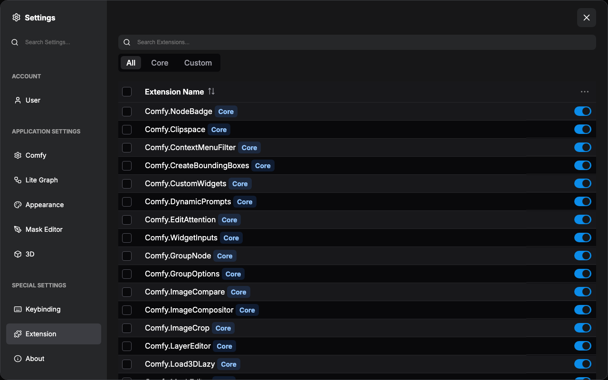

import SettingsMenuContext from "/snippets/ru/interface/settings-menu-context.mdx"

<SettingsMenuContext />

Панель настроек расширений это специальная панель управления в системе настроек фронтенда ComfyUI, предназначенная для управления статусом включения и отключения плагинов-расширений фронтенда. В отличие от пользовательских узлов, эта панель служит только для управления расширениями фронтенда, зарегистрированными пользовательскими узлами, а не для отключения самих пользовательских узлов.

Эти плагины-расширения фронтенда улучшают работу с ComfyUI: они предоставляют горячие клавиши, настройки, компоненты интерфейса, пункты меню и другие возможности.

Изменения статуса расширений вступают в силу после перезагрузки страницы:

## Возможности панели настроек расширений

### 1. Управление списком расширений
Отображает все зарегистрированные расширения в таблице, включая:
- Название расширения со значком `Core` или `Custom`
- Статус включения/отключения в виде переключателя в каждой строке
- Флажок для выбора расширений в пакетных операциях

Кнопки **All**, **Core** и **Custom** над таблицей фильтруют список, а заголовок столбца «Название расширения» сортирует его.

### 2. Функция поиска
Предоставляет поисковую строку для быстрого поиска конкретных расширений:

### 3. Управление включением/отключением
Каждое расширение имеет независимый переключатель:

### 4. Пакетные операции
Кнопка ⋮ (Больше опций) в заголовке столбца «Название расширения» открывает меню для пакетных операций:
- Включить выбранное, Отключить выбранное: применяются к расширениям, выбранным флажками
- Включить все расширения, Отключить все расширения, Отключить сторонние расширения (оставить основные расширения): применяются ко всем расширениям, выбранным или нет

Изменённые расширения перечисляются над таблицей вместе с кнопкой **Перезагрузите, чтобы применить изменения**.

## Примечания

- Изменения статуса расширений вступают в силу после перезагрузки страницы
- Некоторые основные расширения нельзя отключить
- Система автоматически отключает известные проблемные расширения
- Настройки расширений автоматически сохраняются в файл конфигурации пользователя

По сути эта панель настроек расширений является «менеджером плагинов фронтенда», который позволяет пользователям гибко управлять функциональными модулями ComfyUI.