import SettingsMenuContext from "/snippets/ru/interface/settings-menu-context.mdx"

<SettingsMenuContext />

LiteGraph представляет собой базовый движок графической отрисовки ComfyUI. Настройки этой категории в основном управляют поведением и внешним видом таких графических интерфейсов, как холст, узлы и связи между узлами.

## Холст

### Показать панель инструментов выбора
- **Значение по умолчанию**: Включено
- **Функция**: Панель инструментов выбора представляет собой плавающую панель быстрых действий, которая появляется на узлах после их выбора и предоставляет типовые быстрые операции: частичное выполнение, закрепление, удаление, изменение цвета и т. д.

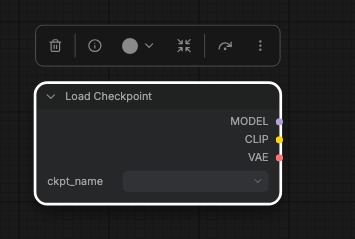

### Живое выделение
- **Значение по умолчанию**: Включено
- **Функция**: Если параметр включён, узлы выделяются и снимаются с выделения в реальном времени при перетаскивании рамки выделения, как в других инструментах проектирования.

### Уровень детализации узлов при зуме (порог размера шрифта)
- **Значение по умолчанию**: 8
- **Диапазон**: 0 - 24
- **Функция**: Задаёт момент, когда при уменьшении масштаба узлы переключаются на упрощённую отрисовку уровня детализации; измеряется как минимальный размер шрифта в пикселях. Большие значения переключают узлы на упрощённую отрисовку раньше, меньшие дольше сохраняют полное качество узлов, а 0 полностью отключает переключение уровня детализации. Различные режимы отрисовки показаны ниже.

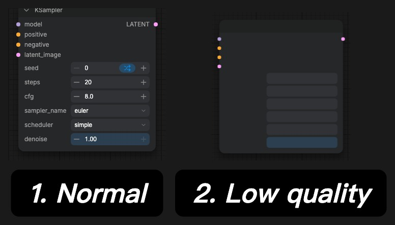

### Максимум FPS
- **Значение по умолчанию**: 0 (использовать частоту обновления экрана)
- **Диапазон**: 0 - 120
- **Функция**: Ограничивает частоту кадров отрисовки холста. 0 означает использование частоты обновления экрана. Более высокий FPS делает отрисовку холста плавнее, но потребляет больше ресурсов. Слишком низкие значения приведут к более заметным подтормаживаниям.

### Всегда привязываться к сетке
- **Значение по умолчанию**: Отключено
- **Функция**: Когда этот параметр не включён, можно удерживать клавишу `Shift`, чтобы выравнивать края узлов по сетке. Когда он включён, края узлов автоматически выравниваются по сетке без удержания клавиши `Shift`.

<video controls>
  <source src="/images/interface/setting/lite-graph/snap-to-grid.mp4" type="video/mp4" />
</video>

### Размер сетки привязки
- **Значение по умолчанию**: 10
- **Диапазон**: 1 - 500
- **Функция**: Когда включена автоматическая привязка или когда узлы перемещаются с удержанием клавиши `Shift`, этот параметр определяет размер сетки для привязки. Значение по умолчанию 10, его можно изменить по своему усмотрению.

### Включить сочетание быстрого зума (Ctrl + Shift + перетаскивание)
- **Значение по умолчанию**: Включено
- **Функция**: Включает функцию быстрого зума `Ctrl + Shift + Left Mouse Button Drag`, предоставляя более быстрый способ масштабирования.

<video controls>
  <source src="/images/interface/setting/lite-graph/fast-zoom.mp4" type="video/mp4" />
</video>

### Показать меню холста графа
- **Значение по умолчанию**: Включено
- **Функция**: Управляет отображением меню холста в правом нижнем углу.

Меню холста расположено в правом нижнем углу всего интерфейса ComfyUI и содержит такие операции, как масштабирование холста, временное скрытие всех соединений, быстрое масштабирование рабочего процесса по размеру холста и т. д., как показано на изображении ниже.

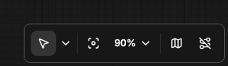

### Скорость зума холста
- **Значение по умолчанию**: 1.1
- **Диапазон**: 1.01 - 2.5
- **Функция**: Управляет скоростью масштабирования холста и регулирует чувствительность зума колесом мыши.

### Показывать информацию о холсте в левом нижнем углу (fps и т. д.)
- **Значение по умолчанию**: Включено
- **Функция**: Управляет отображением информации о холсте в левом нижнем углу, в том числе метрик производительности, таких как FPS.

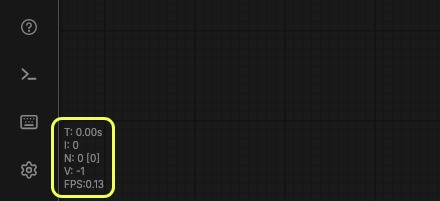

### Скорость автопрокрутки
- **Значение по умолчанию**: 15
- **Диапазон**: 0 - 30
- **Функция**: Задаёт максимальную скорость автоматического перемещения холста, когда вы перетаскиваете узел или соединение к краю холста. Установите 0, чтобы отключить автопрокрутку.

## Навигация по холсту

### Режим навигации по холсту
- **Значение по умолчанию**: Drag Navigation
- **Варианты**: Standard (New), Drag Navigation, Custom
- **Функция**: Выбирает предустановку для двух описанных ниже вариантов поведения при навигации по холсту. Standard (New) выделяет левой кнопкой мыши и перемещает холст колесиком мыши, Drag Navigation (по умолчанию) перемещает холст левой кнопкой мыши и приближает/отдаляет колесиком мыши, а Custom сохраняет индивидуальные настройки для каждого поведения. Изменение любого из этих поведений относительно его предустановки переключает эту настройку на Custom

### Поведение при клике левой кнопкой мыши
- **Значение по умолчанию**: Panning
- **Варианты**: Panning, Select
- **Функция**: Определяет действие при перетаскивании левой кнопкой мыши по пустой области холста: перемещение холста или рисование прямоугольника выделения

### Прокрутка колесиком мыши
- **Значение по умолчанию**: Zoom in/out
- **Варианты**: Panning, Zoom in/out
- **Функция**: Определяет действие колесика мыши на холсте: приближает и отдаляет либо перемещает по вертикали

## Контекстное меню

### Масштабировать меню (списки) виджета КОМБО узла при увеличении
- **Значение по умолчанию**: Disabled
- **Функция**: Управляет тем, масштабируются ли меню (списки) виджета КОМБО узла при увеличении, позволяя пользователям выбирать виджеты КОМБО узлов.

## Граф

### Режим рендеринга связей
- **Значение по умолчанию**: 2 (Сплайн)
- **Параметры**: Прямой, Линейный, Сплайн, Скрытый
- **Функция**: Задаёт стиль отрисовки соединений и определяет визуальный стиль связей между узлами

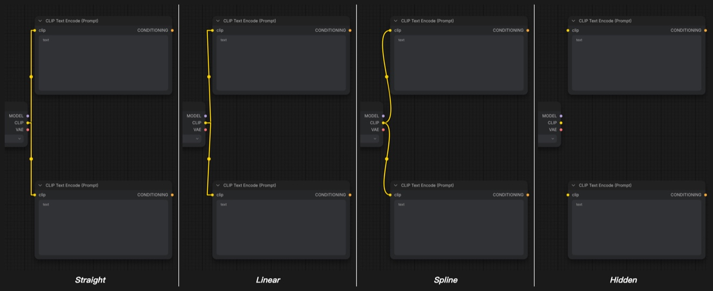

## Группа

Этот раздел настроек в основном связан с функциональностью групп узлов.

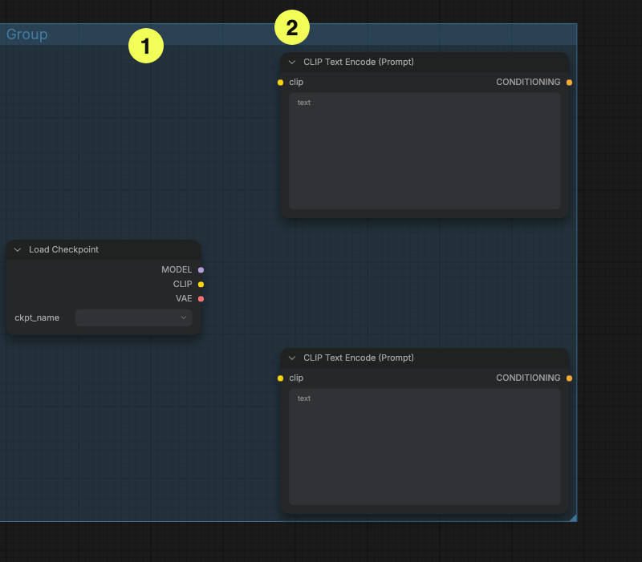

### Редактировать заголовок группы двойным щелчком
- **Значение по умолчанию**: Включено
- **Функция**: Управляет тем, можно ли редактировать заголовок узла двойным щелчком, что позволяет переименовывать узлы; на изображении отмечено цифрой `1`.

### Отступ для выбранных узлов группы
- **Значение по умолчанию**: 10
- **Диапазон**: 0 - 100
- **Функция**: Задаёт внутренний отступ при группировке выбранных узлов и контролирует расстояние между рамкой группы и узлами; на изображении отмечено стрелкой с цифрой `2`.

### Выделять дочерние элементы группы при клике
- **Значение по умолчанию**: Выключено
- **Функция**: Если включено, при клике на группу выделяются все узлы и элементы внутри неё.

## Соединение

### Маркеры середины соединений
- **Значение по умолчанию**: Circle
- **Варианты**: None, Circle, Arrow
- **Функция**: Задаёт стиль маркеров в серединах соединений, отображая указатели направления в серединах соединений.

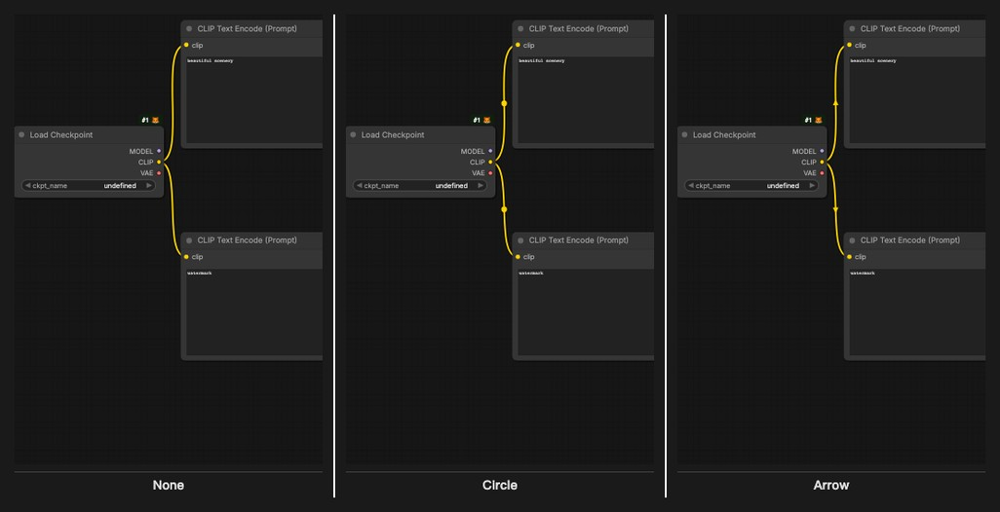

## Освобождение связи

В этом разделе меню в основном настраиваются операции, выполняемые при освобождении связей. Сейчас доступны две такие операции:

**После освобождения появится список рекомендаций узлов, связанных с текущим входом/выходом**
<video controls>
  <source src="/images/interface/setting/lite-graph/link-release-contenxt-menu.mp4" type="video/mp4" />
</video>

**После освобождения откроется поисковая строка**
<video controls>
  <source src="/images/interface/setting/lite-graph/link-release-search-box.mp4" type="video/mp4" />
</video>

### Действие при освобождении связи (Shift)
- **Значение по умолчанию**: поисковая строка
- **Параметры**: контекстное меню, поисковая строка, без действия
- **Функция**: задаёт действие при освобождении связей с зажатой клавишей Shift, то есть особое поведение при освобождении связей с зажатой Shift

### Действие при освобождении связи (без модификатора)
- **Значение по умолчанию**: контекстное меню
- **Параметры**: контекстное меню, поисковая строка, без действия
- **Функция**: задаёт действие по умолчанию при освобождении связей и определяет поведение после перетаскивания и освобождения связей

## Узел

### Всегда сжимать новые узлы
- **Значение по умолчанию**: Отключено
- **Функция**: Управляет автоматическим сжатием при создании новых узлов, благодаря чему узлы всегда отображаются в минимальном размере. Однако при добавлении часть текста может обрезаться, и размер узла придётся настраивать вручную

### Включить обрезку DOM-элементов (включение может снизить производительность)
- **Значение по умолчанию**: Включено
- **Функция**: Включает обрезку DOM-элементов (может влиять на производительность), оптимизирует отрисовку, но может снизить производительность

### Средний щелчок создаёт новый узел Reroute
- **Значение по умолчанию**: Включено
- **Функция**: Создаёт новый узел Reroute при среднем щелчке, что позволяет быстро создавать узлы перенаправления для организации соединений

### Сохранять все связи при удалении узлов
- **Значение по умолчанию**: Включено
- **Функция**: Автоматически обходит соединения при удалении промежуточных узлов, пытается восстановить входные и выходные связи при удалении узлов

### Подсветка узла при привязке
- **Значение по умолчанию**: Включено
- **Функция**: Подсвечивает узлы, когда вы перетаскиваете к ним связи, обеспечивает визуальную обратную связь и показывает узлы, к которым можно подключиться. При включении эффект выглядит так, как на изображении ниже: соответствующая сторона связи отображается в подсвеченном стиле

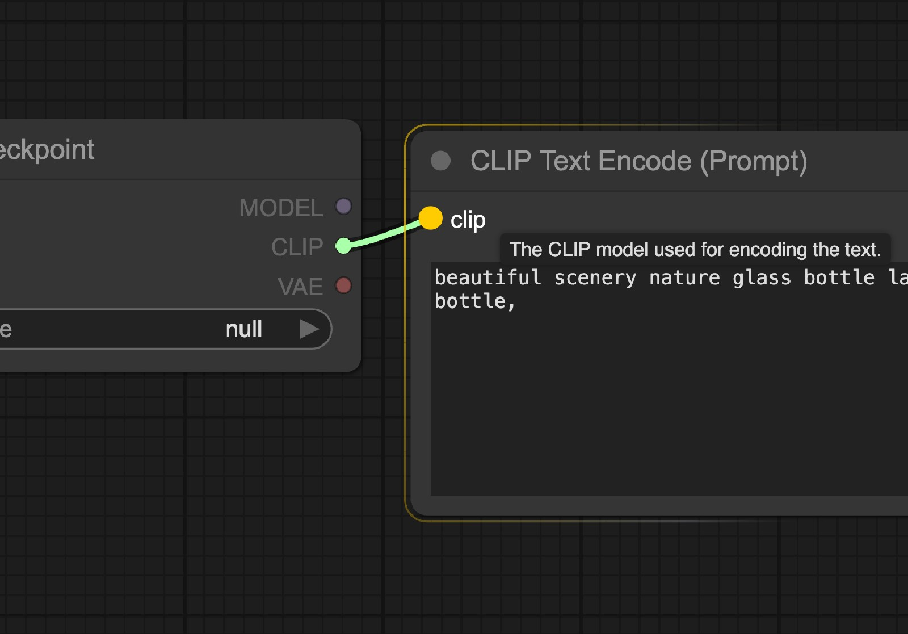

### Автоматически привязывать связь к слоту узла
- **Значение по умолчанию**: Включено
- **Функция**: Автоматически привязывается к доступным слотам при перетаскивании связей к узлам, упрощает подключение и автоматически находит подходящий входной слот

<video controls>
  <source src="/images/interface/setting/lite-graph/snap-link-to-node-slot.mp4" type="video/mp4" />
</video>

### Включить подсказки
- **Значение по умолчанию**: Включено
- **Функция**: Некоторые сведения об узлах содержат всплывающие подсказки, включая описания параметров и т. д. При включении эти подсказки отображаются при наведении мыши, как показано на изображении ниже

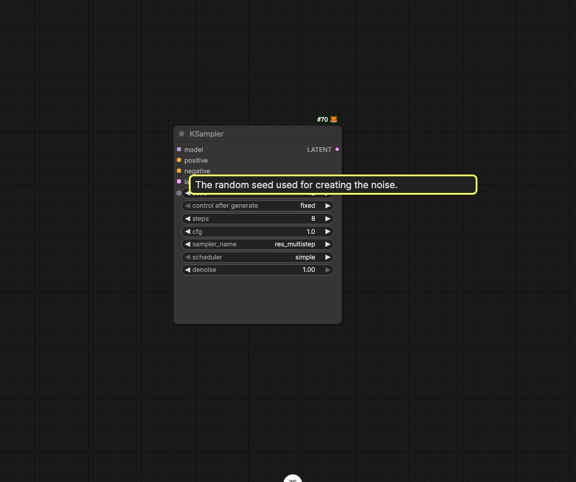

### Задержка всплывающей подсказки
- **Значение по умолчанию**: 500
- **Диапазон**: 100 - 3000
- **Функция**: Управляет задержкой перед появлением всплывающей подсказки в миллисекундах

### Режим значка жизненного цикла узла
- **Значение по умолчанию**: Показать все
- **Функция**: Управляет отображением маркеров жизненного цикла узла и показывает сведения о статусе узла

### Режим значка ID узла
- **Значение по умолчанию**: Нет
- **Функция**: Управляет отображением маркеров ID узла и показывает уникальные идентификаторы узлов

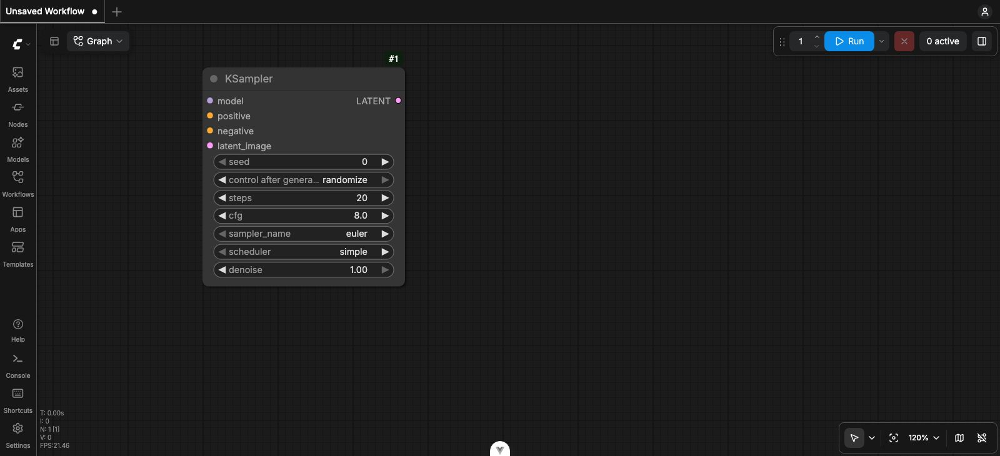

### Режим значка источника узла
- **Значение по умолчанию**: Скрыть встроенные
- **Параметры**:
  - Нет
  - Скрыть встроенные
  - Показать все
- **Функция**: Управляет режимом отображения маркеров источника узла и показывает сведения об источнике узла. Соответствующий эффект показан на изображении ниже. Если выбрано «Показать все», отображаются метки как для пользовательских, так и для встроенных узлов, что позволяет легко определить источник узла. Соответствующий логотип лисы обозначает встроенные узлы ComfyUI

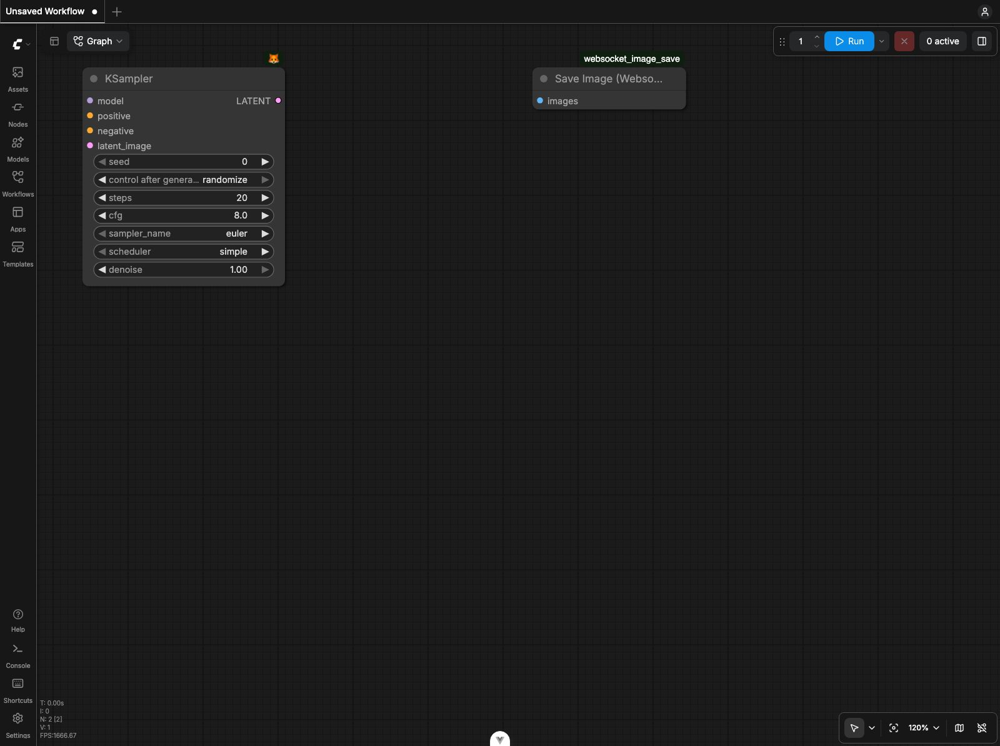

### Редактировать заголовок узла двойным щелчком
- **Значение по умолчанию**: Включено
- **Функция**: Управляет возможностью редактирования заголовка узла двойным щелчком, позволяя переименовывать узлы

## Виджет ноды

### Количество десятичных знаков для округления float-виджета [0 = авто]
- **Значение по умолчанию**: 0 (авто)
- **Диапазон**: 0 - 6
- **Функция**: Задаёт количество десятичных знаков для округления float-виджета; 0 означает авто; требуется перезагрузка страницы

### Отключить округление float-виджетов по умолчанию
- **Значение по умолчанию**: Отключено
- **Функция**: Управляет отключением округления float-виджетов по умолчанию; требуется перезагрузка страницы; нельзя отключить, если округление задано на стороне бэкенда узла

### Отключить ползунки виджетов нод
- **Значение по умолчанию**: Отключено
- **Функция**: Управляет отключением ползунков в виджетах нод: вместо ползунков используется текстовый ввод

### Всегда показывать расширенные виджеты на всех узлах
- **Значение по умолчанию**: Отключено
- **Функция**: Если включено, расширенные виджеты всегда видны на всех узлах, и разворачивать каждый узел отдельно не нужно

### Формат изображения предварительного просмотра
- **Значение по умолчанию**: Пустая строка (использовать исходный формат)
- **Функция**: Задаёт формат изображений предварительного просмотра в виджетах изображений; выполняется преобразование в лёгкие форматы, такие как webp, jpeg и т. д.

### Показывать ширину × высоту под просмотром изображения
- **Значение по умолчанию**: Включено
- **Функция**: Отображает информацию о ширине × высоте под просмотром изображения, показывая размеры изображения

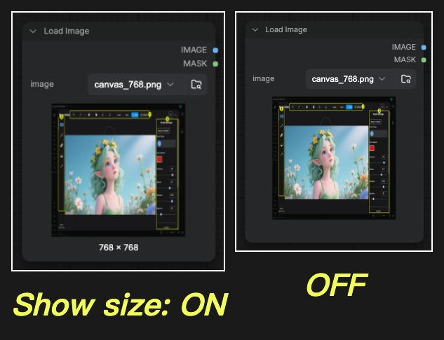

## Указатель

### Включить жесты трекпада
- **Значение по умолчанию**: Включено
- **Функция**: Этот параметр включает режим трекпада для холста, позволяя масштабировать щипком и перетаскивать двумя пальцами.

### Максимальный интервал двойного щелчка
- **Значение по умолчанию**: 300
- **Функция**: Максимальное время (в миллисекундах) между двумя щелчками, составляющими двойной щелчок. Увеличение этого значения помогает решить проблемы, когда двойные щелчки иногда не распознаются.

### Дрейф указателя при щелчке (максимальное расстояние)
- **Значение по умолчанию**: 6
- **Функция**: Если при удержании кнопки указатель перемещается больше чем на это расстояние, это считается перетаскиванием (а не щелчком). Помогает предотвратить случайное движение мыши при щелчке.

## Перенаправление

### Смещение сплайна перенаправления
- **Значение по умолчанию**: 20
- **Функция**: Определяет плавность кривых с обеих сторон узлов перенаправления. Чем больше значение, тем плавнее кривые; чем меньше, тем они резче.

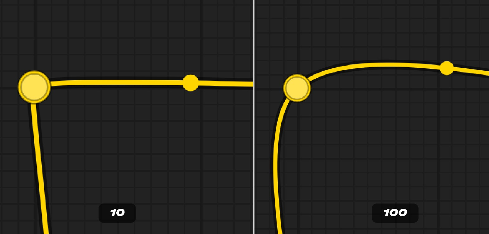
