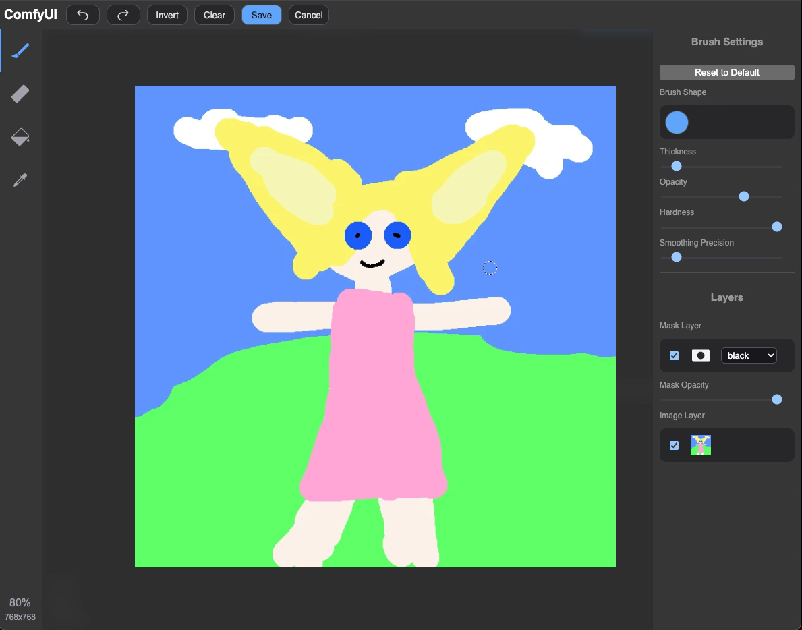
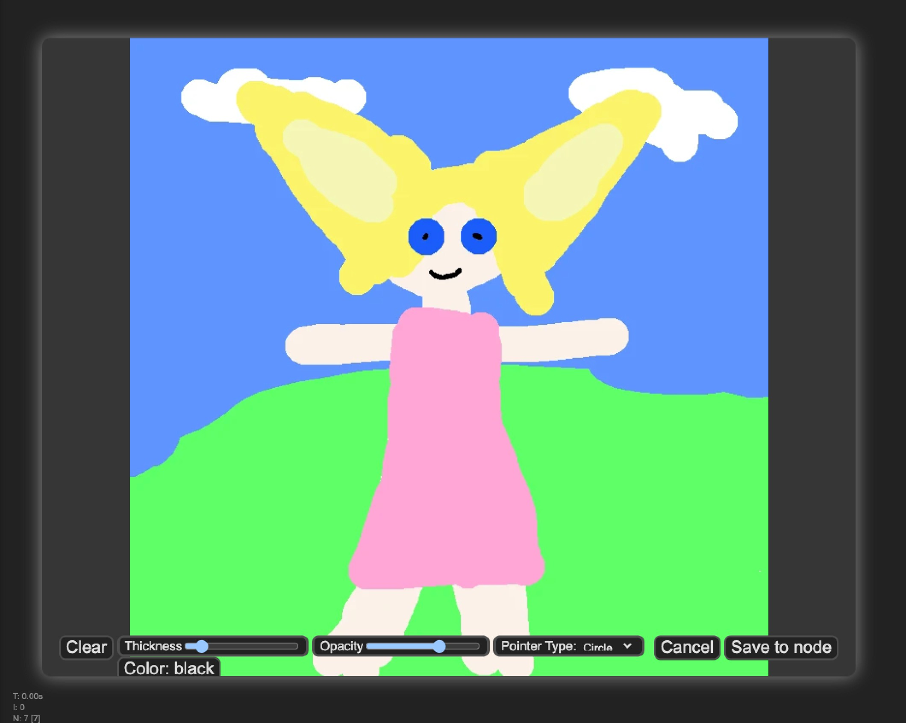

import SettingsMenuContext from "/snippets/ru/interface/settings-menu-context.mdx"

<SettingsMenuContext />

## Настройка кисти

### Множитель скорости регулировки кисти
- **Функция**: управляет скоростью изменения размера и жёсткости кисти при регулировке
- **Описание**: чем выше значение, тем быстрее происходят изменения

### Блокировка регулировки кисти по доминирующей оси
- **Функция**: если включено, регулировка кисти будет изменять только размер или жёсткость в зависимости от направления движения
- **Описание**: эта функция позволяет точнее контролировать изменение свойств кисти

## Новый редактор

### Использовать новый редактор масок

- **Функция**: переключение на новый интерфейс редактора кисти
- **Описание**: позволяет переключаться между новым и старым интерфейсами редактора

<Tabs>
    <Tab title="Новый редактор">
    Новая версия имеет улучшенный интерфейс и взаимодействие, а также более полный набор функций
        
    </Tab>
    <Tab title="Классический редактор">
    Классическая версия — это ранняя версия с относительно простыми функциями, но она покрывает базовые потребности. В дальнейшем она обновляться не будет.
        
    </Tab>
</Tabs>