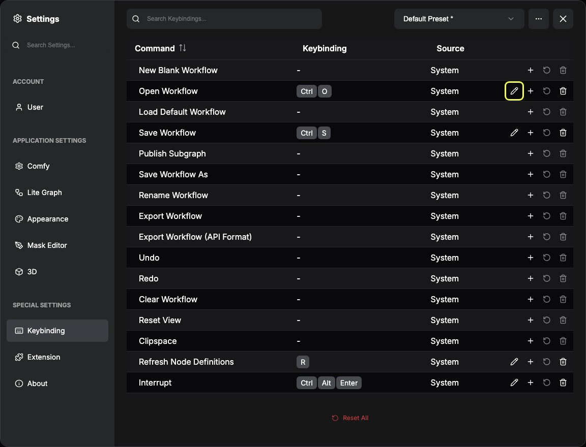

import SettingsMenuContext from "/snippets/ru/interface/settings-menu-context.mdx"

{/*
description: "Список сочетаний клавиш и мыши для ComfyUI"
*/}

{/* TODO(yoland): Add this back to comfyUI readme page */}

<SettingsMenuContext />

ComfyUI поставляется с набором горячих клавиш по умолчанию, и любую команду можно переназначить. Откройте **Настройки (иконка шестерёнки)** > **Привязка клавиш**, чтобы посмотреть и изменить их.

## Найти и изменить привязку клавиш

Панель перечисляет все команды с их текущими привязками клавиш. Поисковая строка в верхней части сужает список, а щелчок по заголовку **Command** сортирует его по алфавиту. В столбце **Source** указывается расширение или пакет пользовательских узлов, который предоставляет команду; для команд из самого ComfyUI он остаётся пустым.

Выберите иконку редактирования в строке, чтобы записать новую комбинацию клавиш. Меню строки позволяет сбросить эту команду к настройкам по умолчанию или удалить её привязки клавиш. Если у команды больше одной привязки клавиш, строка разворачивается, и для каждой привязки появляются отдельные кнопки редактирования и удаления. **Reset All** в нижней части панели сбрасывает все изменения после запроса подтверждения.

## Пресеты горячих клавиш

Ваши изменения относятся к именованному пресету, а селектор пресетов в верхней части панели переключает их. В **Стандартном пресете** хранятся встроенные сочетания клавиш. Его выбор восстанавливает эти сочетания и отбрасывает несохранённые изменения текущего сеанса. Ранее сохранённые пресеты остаются на диске.

- Рядом с именем пресета отображается `*`, пока есть несохранённые изменения. Для сохранённого пресета выберите **Сохранить изменения**, чтобы их записать. У стандартного пресета нет кнопки **Сохранить изменения**, поэтому его правки сохраняются через **Сохранить как новый пресет**.
- Кнопка ... (дополнительно) рядом с селектором пресетов содержит пункты **Сохранить как новый пресет** (скрыт, пока в стандартном пресете нет правок), **Сбросить по умолчанию**, **Удалить пресет** (недоступен для стандартного пресета), **Импортировать пресет** и **Экспортировать пресет**.
- **Импортировать пресет** читает файл пресета, экспортированный из ComfyUI, поэтому набор горячих клавиш можно перенести между установками или передать другому пользователю. **Экспортировать пресет** записывает текущий пресет в файл JSON.
- При переключении пресетов с несохранёнными изменениями появляется запрос: сохранить их сначала или отменить их и продолжить.

Пресеты хранятся в виде файлов JSON в пользовательском каталоге ComfyUI, в папке `keybindings/`.

Ниже приведён текущий список горячих клавиш по умолчанию.

<Tabs><Tab title="Windows/Linux">
| Сочетание клавиш                    | Команда                                                                                                            |
|------------------------------------|--------------------------------------------------------------------------------------------------------------------|
| Ctrl + Enter                       | Запрос в очереди                                                                                                   |
| Ctrl + Shift + Enter               | Запрос в очереди (в начало)                                                                                        |
| Ctrl + Alt + Enter                 | Прервать                                                                                                           |
| Ctrl + Z / Ctrl + Y                | Отменить/Повторить                                                                                                 |
| Ctrl + S                           | Сохранить рабочий процесс                                                                                          |
| Ctrl + O                           | Загрузить рабочий процесс                                                                                          |
| Ctrl + A                           | Выбрать все ноды                                                                                                   |
| Alt + C                            | Свернуть/развернуть выбранные ноды                                                                                 |
| Ctrl + M                           | Отключить/включить выбранные ноды                                                                                 |
| Ctrl + B                           | Обойти/восстановить выбранные ноды                                                                                 |
| Delete Backspace               | Удалить выбранные ноды                                                                                             |
| Backspace                          | Очистить рабочий процесс                                                                                           |
| Space                              | Перемещать холст при удержании и движении курсора                                                                  |
| Ctrl + Click Shift + Click     | Добавить узел, по которому выполнен щелчок, к выделению                                                            |
| Ctrl + C/Ctrl + V                  | Копировать и вставить выбранные ноды (без сохранения связей с выходами невыбранных нод)                            |
| Ctrl + C/Ctrl + Shift + V          | Копировать и вставить выбранные ноды (с сохранением связей от выходов невыбранных нод к входам вставленных нод)    |
| Shift + Drag                       | Перемещать несколько выбранных нод одновременно                                                                    |
| Ctrl + G                           | Добавить рамку к выбранным нодам                                                                                   |
| Ctrl + ,                           | Показать диалог настроек                                                                                           |
| Alt + =                            | Увеличить (холст)                                                                                                  |
| Alt + -                            | Уменьшить (холст)                                                                                                  |
| .                                  | Подогнать вид к выбранным нодам                                                                                    |
| P                                  | Закрепить/открепить выбранные элементы                                                                             |
| L                                  | Показать или скрыть связи выбранных нод                                                                            |
| Q                                  | Переключить боковую панель очереди                                                                                 |
| W                                  | Переключить боковую панель рабочего процесса                                                                       |
| N                                  | Переключить боковую панель библиотеки нод                                                                          |
| M                                  | Переключить боковую панель библиотеки моделей                                                                      |
| Ctrl + `                           | Переключить нижнюю панель журнала                                                                                  |
| F                                  | Переключить режим фокуса (на весь экран)                                                                           |
| R                                  | Обновить определения нод                                                                                           |
| Double-Click LMB                   | Быстрый поиск нод для добавления                                                                                   |
</Tab><Tab title="MacOS">
| Сочетание клавиш                       | Команда                                                                                                            |
|--------------------------------------|--------------------------------------------------------------------------------------------------------------------|
| Cmd ⌘ + Enter                        | Запрос в очереди                                                                                                   |
| Cmd ⌘ + Shift + Enter                | Запрос в очереди (Front)                                                                                           |
| Cmd ⌘ + Alt + Enter                  | Прервать                                                                                                           |
| Cmd ⌘ + Z/Cmd ⌘ + Y                  | Отменить/Повторить                                                                                                 |
| Cmd ⌘ + S                            | Сохранить рабочий процесс                                                                                          |
| Cmd ⌘ + O                            | Загрузить рабочий процесс                                                                                          |
| Cmd ⌘ + A                            | Выбрать все узлы                                                                                                   |
| Opt ⌥ + C                            | Свернуть/развернуть выбранные узлы                                                                                 |
| Cmd ⌘ + M                            | Отключить/включить выбранные узлы                                                                                  |
| Cmd ⌘ + B                            | Обойти/восстановить выбранные узлы                                                                                 |
| Delete Backspace                 | Удалить выбранные узлы                                                                                             |
| Backspace                            | Очистить рабочий процесс                                                                                           |
| Space                                | Перемещение холста при удержании и движении курсора                                                                |
| Cmd ⌘ + Click Shift + Click      | Добавить выбранный узел к выделению                                                                                |
| Cmd ⌘ + C / Cmd ⌘ + V                | Копировать и вставить выбранные узлы (без сохранения связей с выходами невыбранных узлов)                          |
| Cmd ⌘ + C / Cmd ⌘ + Shift + V        | Копировать и вставить выбранные узлы (с сохранением связей от выходов невыбранных узлов ко входам вставленных узлов) |
| Shift + Drag                         | Перемещать несколько выбранных узлов одновременно                                                                  |
| Cmd ⌘ + G                            | Добавить рамку к выбранным узлам                                                                                   |
| Cmd ⌘ + ,                            | Показать диалог настроек                                                                                           |
| Opt ⌥ + =                            | Увеличить (холст)                                                                                                  |
| Opt ⌥ + -                            | Уменьшить (холст)                                                                                                  |
| .                                    | Подогнать вид к выбранным узлам                                                                                    |
| P                                    | Закрепить/открепить выбранные элементы                                                                             |
| L                                    | Скрыть или показать связи на выбранных узлах                                                                       |
| Q                                    | Переключить боковую панель очереди                                                                                 |
| W                                    | Переключить боковую панель рабочего процесса                                                                       |
| N                                    | Переключить боковую панель библиотеки нод                                                                          |
| M                                    | Переключить боковую панель библиотеки моделей                                                                      |
| Cmd ⌘ + `                            | Переключить нижнюю панель логов                                                                                    |
| F                                    | Переключить режим фокуса (на весь экран)                                                                           |
| R                                    | Обновить определения нод                                                                                           |
| Double-Click LMB                     | Быстрый поиск узлов для добавления                                                                                 |

</Tab>
</Tabs>

## Отмена и повтор внутри узла

Некоторые виджеты ведут собственную историю изменений: Painter, ограничивающие рамки, кадрирование изображения, редактирование видео, кривая, диапазон, цвет и свет. Пока клавиатурный фокус находится внутри одного из таких узлов, `Ctrl + Z` и `Ctrl + Y` (`Cmd ⌘` в macOS) перемещаются по истории виджета этого узла на тот же шаг, который выполняют его кнопки «Отменить» и «Повторить». Если в узле несколько виджетов с историей, отмена затрагивает тот, который вы редактировали последним.

Во всех остальных случаях сочетание клавиш по-прежнему отменяет изменения в графе рабочего процесса: когда фокус находится на пустом холсте или на узле, чьи шаги в виджете исчерпаны. Текстовое поле в фокусе обрабатывается отдельно: там сочетание сохраняет обычное редактирование текста и никогда не доходит до графа или виджета. Режим приложения не рассматривается.
