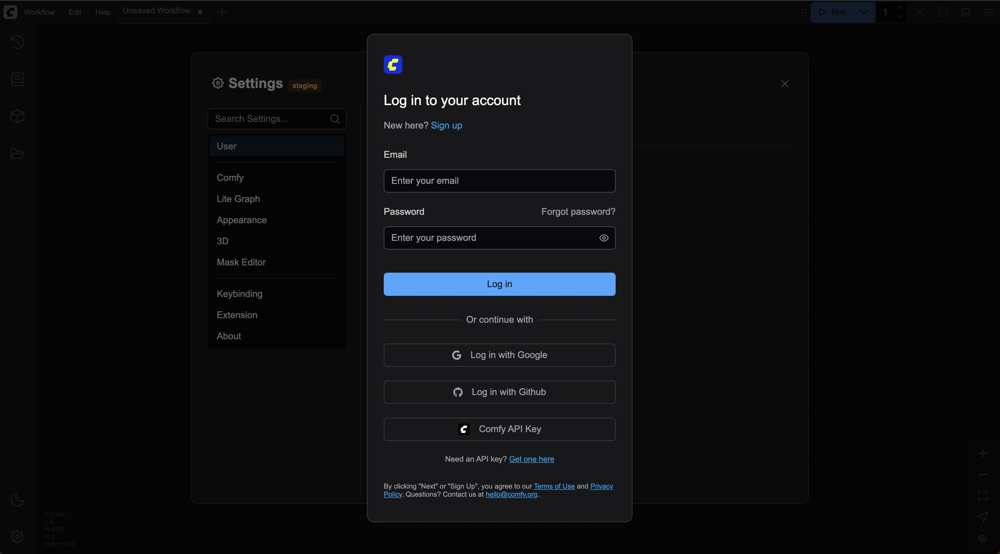
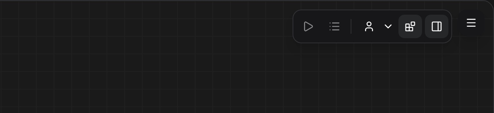
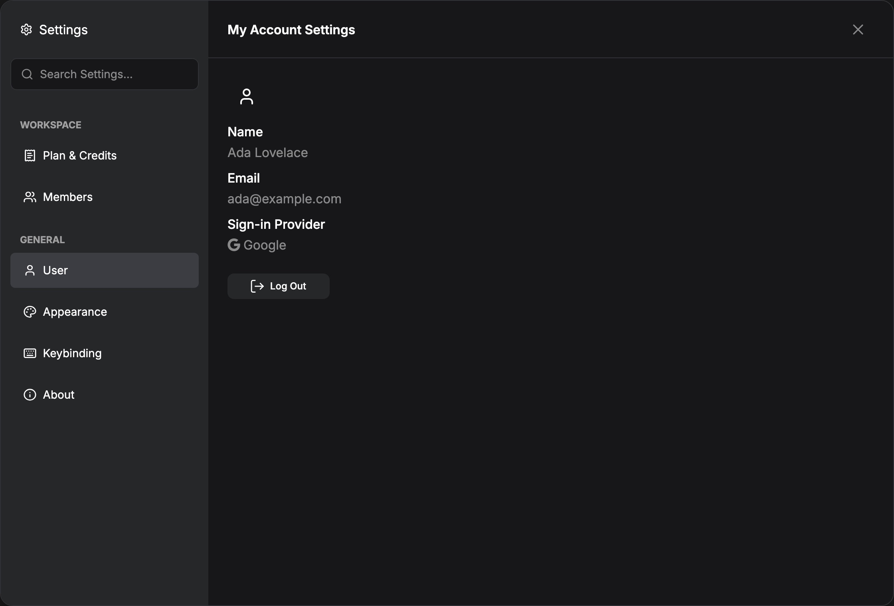

import SettingsMenuContext from "/snippets/ru/interface/settings-menu-context.mdx"

<SettingsMenuContext />

Для партнёрских узлов и выставления счетов Comfy Cloud нужен аккаунт ComfyUI с выполненным входом. Войдите через **Настройки → Пользователь** (в группе **Общие**). После входа появляется **Настройки → Рабочее пространство → План и кредиты** для проверки баланса и пополнения. См. [План и кредиты](/interface/credits).

Сейчас мы поддерживаем следующие способы входа:

- Вход по электронной почте
- Вход через Google
- Вход через Github
- Вход по API-ключу (для авторизации на сайтах, не включённых в белый список)

В этом документе мы приведём соответствующие требования ко входу и пояснения.

## Требования к версии ComfyUI

Возможно, для использования системы аккаунтов потребуется как минимум [ComfyUI v0.3.0](https://github.com/Comfy-Org/ComfyUI/releases/tag/v0.3.30). Убедитесь, что соответствующая версия фронтенда не ниже `1.17.11`. Иногда фронтенд может не установиться и откатиться до более старой версии, поэтому проверьте в разделе `Settings` -> `About`, что версия фронтенда больше `1.17.11`.

В некоторых регионах сетевые ограничения могут препятствовать обычному доступу к API входа, вызывая тайм-ауты или сбои. Перед входом **убедитесь, что ваша сетевая среда не ограничивает доступ к соответствующему API**, а также что у вас есть доступ к таким сайтам, как Google или Github.

<Tip>
Поскольку мы всё ещё находимся в процессе быстрых итеративных обновлений, связанные функции могут меняться. Если нет особых обстоятельств, постарайтесь обновиться до последней версии, чтобы получить поддержку соответствующих функций.
</Tip>

## Требования к сети

Чтобы войти в аккаунт ComfyUI, необходимо находиться в защищённой сетевой среде:

- Доступ разрешён только с `127.0.0.1` или `localhost`.
- Не поддерживается использование параметра `--listen` для доступа к Partner Node через локальную сеть.
- Если вы используете сертификат, не являющийся SSL, или сайт, адрес которого не начинается с `https`, вход может не выполниться.
- Войти на сайт, которого нет в нашем белом списке, может не получиться (но теперь можно войти с помощью API-ключа).
- Убедитесь, что подключение к нашему сервису работает нормально (в некоторых регионах может потребоваться прокси).

## Как войти

Войдите через **Настройки → Пользователь**:

## Способы входа

Если вы входите впервые, сначала создайте аккаунт.

<Card title="Вход с помощью API-ключа" icon="key" href="/account/login#logging-in-with-an-api-key">
  Для сайтов, не входящих в белый список, или локальных сетей (LAN) можно использовать вход по API-ключу. Подробное руководство см. в документации по входу в аккаунт.
</Card>

## Статус после входа

После входа в верхнем меню отображается управление аккаунтом. Оттуда можно снова открыть панель пользователя, выйти, а в Cloud открыть **Управление планом** (та же панель **План и кредиты**, что и в **Настройки → Рабочее пространство → План и кредиты**).

## Частые вопросы

<AccordionGroup>
  <Accordion title="Как изменить отображаемое имя или электронную почту?">
  Строки **Имя**, **Электронная почта** и **Провайдер** в разделе **Настройки → Пользователь** доступны только для чтения. Они показывают данные, которые возвращает аккаунт, в который вы вошли, и в панели нет поля для их изменения.

  - **Вход через Google или GitHub**: имя и электронная почта берутся из профиля этого провайдера. Измените их там, затем выйдите и войдите снова, чтобы панель отобразила новые значения.
  - **Регистрация по электронной почте**: в аккаунте не сохранено имя, поэтому в поле **Имя** отображается **Не задано**. Панель пока не позволяет добавить или изменить его.
  - **Адрес электронной почты**: это адрес, с которым вы зарегистрировались, или тот, который возвращает провайдер. Изменить его внутри приложения нельзя.
  </Accordion>

  <Accordion title="Есть ли ограничения на устройства для входа?">
   Мы не ограничиваем устройства для входа. Вы можете войти в свой аккаунт на любом устройстве, но учтите, что другие устройства могут получить доступ к информации вашего аккаунта, поэтому не входите в аккаунт на общедоступных устройствах.
  </Accordion>

  <Accordion title="Как войти в локальной сети?">
  Сейчас в локальной сети поддерживается только вход по API-ключу. Если вы обращаетесь к сервисам ComfyUI через локальную сеть, используйте для входа API-ключ.
  </Accordion>
   <Accordion title="Почему не удаётся войти на некоторых сайтах?">
  У нашей службы входа есть белый список, поэтому войти в ComfyUI, развёрнутый на некоторых серверах, может не получиться. В этом случае проблему можно решить входом по API-ключу.
  </Accordion>
</AccordionGroup>
